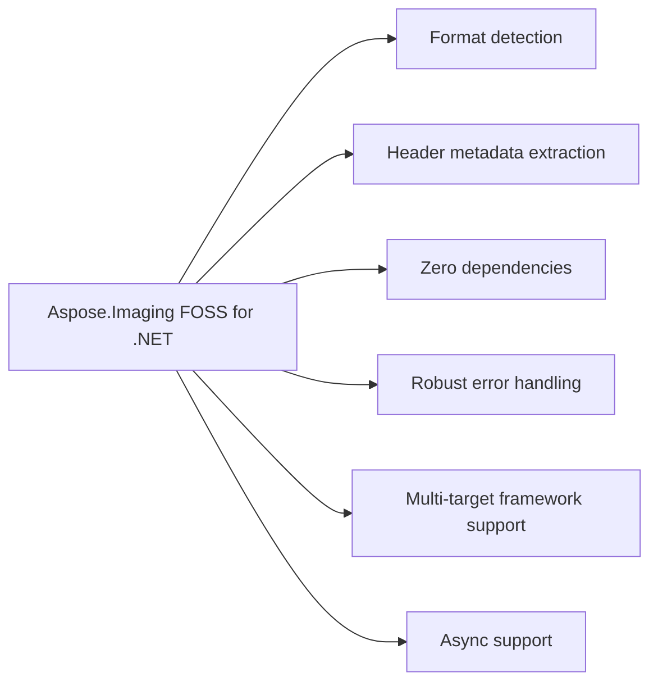

# Aspose.Imaging FOSS for .NET

It reads image file headers to detect format and extract dimensions, bit depth, and frame count without decoding pixels. It supports both synchronous and asynchronous probing from file paths, streams, or byte arrays.

Aspose.Imaging FOSS for .NET is a free, open-source .NET library — an Aspose.Imaging
alternative that does zero-dependency image format detection and header probing. `ImageProbe`
identifies a file's format and reads its basic properties — dimensions, bit depth, and frame
count — directly from the file header, so you know what a file is and how big it is, fast,
without pulling in a full imaging stack to decode a single pixel. It has no NuGet dependencies
and targets `netstandard2.0` and `net8.0`.

## Navigation

- [At a Glance](#at-a-glance)
- [Key Capabilities](#key-capabilities)
- [Installation](#installation)
- [Dependencies](#dependencies)
- [API Reference](#api-reference)
- [Scope and Limitations](#scope-and-limitations)

## At a Glance

## Key Capabilities

- **Format detection.** Detects 14 image formats by reading only signature bytes with `ImageProbe.DetectFormat()` and returning an `ImageFormat` value without loading a full imaging stack.
- **Header metadata extraction.** Extracts header metadata directly into an `ImageInfo` object containing width, height, bit depth, and frame count for PNG, JPEG, GIF, BMP, WEBP, ICO, TIFF, PSD, EMF, WMF, DICOM, DJVU, AVIF, and HEIC/HEIF formats.
- **Zero dependencies.** Implements all format parsing natively with zero required third-party package dependencies.
- **Robust error handling.** Returns an `ImageInfo` with only the Format field set for malformed or truncated input instead of throwing, enabling unattended pipelines over untrusted files.
- **Multi-target framework support.** Multi-targets netstandard2.0 and net8.0 to support both legacy and modern .NET runtimes.
- **Async support.** Provides both synchronous and asynchronous entry points for the same operations, including `ProbeFile()`/`ProbeFileAsync()` and `Probe()`/`ProbeAsync()`.

- DICOM parsing covers Implicit VR Little Endian and Explicit VR Little/Big Endian transfer
  syntaxes — including the common compressed ones, whose non-pixel elements are encoded
  Explicit VR Little Endian — and reads `Rows`/`Columns`/`BitsAllocated` directly from the data
  set, stopping rather than guessing if it reaches a sequence or encapsulated pixel data
  element with an undefined length first.

Most .NET image libraries make you fully decode an image just to answer "is this a JPEG, and
how big is it?". `ImageSharp.Image.Identify` covers common raster formats well, but nothing
else in the .NET FOSS ecosystem does the same for PSD, EMF/WMF, or DICOM — this library covers
that full range in one place.

The library multi-targets `netstandard2.0` and `net8.0` — see
[Dependencies](#dependencies) below for the full required, native, and development-only
breakdown.

The library builds from
`src/Aspose.Imaging.Foss/Aspose.Imaging.Foss.csproj`, which declares zero `<PackageReference>`
entries — every format's header parsing is implemented natively within the library.

## Installation

The package `Aspose.Imaging.Foss` is not yet published on NuGet (package registry: distribution not found on nuget).

## Dependencies

### Required Package Dependencies

No required third-party package dependencies; in `src/Aspose.Imaging.Foss/Aspose.Imaging.Foss.csproj`, no `PackageReference` a consumer would install is declared.

### Native and System Requirements

- Requires .NET `netstandard2.0;net8.0` (`TargetFrameworks` in `src/Aspose.Imaging.Foss/Aspose.Imaging.Foss.csproj`).

## API Reference

Aspose.Imaging FOSS for .NET exposes Aspose.Imaging FOSS for .NET as its sole public namespace, targeting netstandard2.0 and net8.0. The `ImageProbe` class serves as the single entry point, returning an `ImageFormat` value and an `ImageInfo` record for every supported format.

The verified public surface has 3 types.

View the Complete Public API Surface

### Core API

| Class | Description |
| --- | --- |
| `ImageInfo` | Aspose.Imaging.Foss.ImageInfo provides metadata for an image, including its format, dimensions, bit depth, and frame count. |
| `ImageProbe` | Aspose.Imaging.Foss.ImageProbe detects image formats and extracts image metadata from files, streams, or byte arrays. |

#### Enumerations

| Enumeration | Description |
| --- | --- |
| `ImageFormat` | Aspose.Imaging.Foss.ImageFormat represents a supported image file format. |

#### Detailed Member Reference

### Foss

`Aspose.Imaging.Foss.ImageProbe` provides static methods such as `DetectFormat`, Probe, `ProbeFile`, `ProbeAsync`, and `ProbeFileAsync` to inspect image data and return an `Aspose.Imaging.Foss.ImageFormat` enum and an `Aspose.Imaging.Foss.ImageInfo` record containing Format, Width, Height, `BitDepth`, and `FrameCount` where available.

## Scope and Limitations

Aspose.Imaging FOSS for .NET provides format detection and header metadata inspection via the `ImageProbe` class; it reads format signatures and header fields but never decodes pixel data, so it does not support rendering, editing, or format conversion.

- Detection and metadata only: `ImageProbe` identifies a format and reads its header fields but never decodes pixel data, so there is no rendering, editing, or format-conversion capability anywhere in the library.
- Frame count reflects only what the container itself records: it is a real, computed count for GIF, ICO, TIFF, and bundled multi-page DJVU (DJVM), while every other supported format reports a fixed 1 for a successfully parsed header, and an indirect or truncated DJVM reports `FrameCount` as null.
- Non-placeable WMF is detected but not dimensioned: the classic (non-placeable) WMF header carries no bounding rectangle, so Probe returns a format-only `ImageInfo` for it, and only placeable WMF yields Width and Height assuming a conventional 96 DPI target.
- DICOM parsing stops at the first undefined-length element: a sequence or encapsulated pixel-data element with an undefined length ends the walk rather than being parsed, since Rows, Columns, and `BitsAllocated` always precede such elements in a conformant file.
- CDR support is planned but not yet implemented: no `CdrFormatHandler` exists in the current source tree.

`Probe` never throws on malformed or truncated input — if a file matches a format's signature
but its header can't be fully parsed, you get back an `ImageInfo` with just the `Format` set
rather than an exception.
