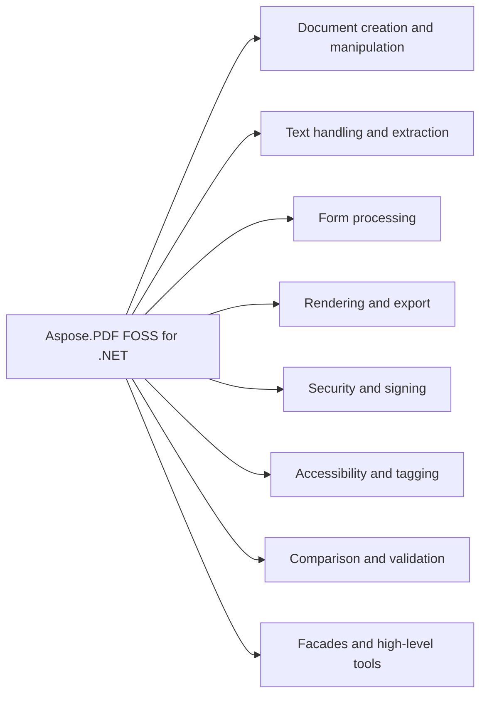

# Aspose.PDF FOSS for .NET

[](https://www.nuget.org/packages/Aspose.PDF.FOSS/) 

It reads PDF documents, creates new ones, modifies existing content, and converts between formats. It exposes classes such as `Aspose.Pdf.Document`, `Aspose.Pdf.Annotations`, `Aspose.Pdf.Text`, `Aspose.Pdf.Tagged`, `Aspose.Pdf.LogicalStructure`, `Aspose.Pdf.Comparison`, `Aspose.Pdf.PageCollection`, `Aspose.Pdf.OutlineCollection`, `Aspose.Pdf.PageLabelCollection`, `Aspose.Pdf.NamedDestinationCollection`, `Aspose.Pdf.XmpMetadata`, `Aspose.Pdf.OptionalContentGroup`, `Aspose.Pdf.TextStamp`, `Aspose.Pdf.Forms`, `Aspose.Pdf.AcroFormData`, `Aspose.Pdf.ExportFieldsToJsonOptions`, `Aspose.Pdf.Devices`, `Aspose.Pdf.SvgSaveOptions`, `Aspose.Pdf.RenderingOptions`, `Aspose.Pdf.Security`, `Aspose.Pdf.Signatures`, `Aspose.Pdf.CryptoAlgorithm`, `Aspose.Pdf.AutoTaggingSettings`, `Aspose.Pdf.SignaturesCompromiseDetector`, `Aspose.Pdf.Sanitization`, and `Aspose.Pdf.Facades` to handle these operations.

Aspose.PDF FOSS for .NET is a free, open-source PDF library for .NET Framework 4.8, .NET Standard 2.0 and .NET 8+ that reads, creates,
modifies, and converts PDF documents. A `Document` object model, task-oriented facades, and
converters cover the common PDF scenarios: text, forms, annotations, security and signatures,
rendering, accessibility, and comparison.

No optional third-party package dependencies.

No development-only third-party package dependencies beyond the standard .NET SDK/test tooling
used to build and run the test suite (see Development and Testing).

## Navigation

- [At a Glance](#at-a-glance)
- [Key Capabilities](#key-capabilities)
- [Installation](#installation)
- [Dependencies](#dependencies)
- [API Reference](#api-reference)
- [Scope and Limitations](#scope-and-limitations)

## At a Glance



## Key Capabilities

- **Document creation and manipulation.** It creates and manipulates PDF documents through the `Aspose.Pdf.Document` class, which provides access to page collections via `Aspose.Pdf.PageCollection`, outline collections via `Aspose.Pdf.OutlineCollection`, page label collections via `Aspose.Pdf.PageLabelCollection`, named destination collections via `Aspose.Pdf.NamedDestinationCollection`, XMP metadata via `Aspose.Pdf.XmpMetadata`, and optional content groups via `Aspose.Pdf.OptionalContentGroup`.
- **Text handling and extraction.** It handles text content and stamps using `Aspose.Pdf.Text` and `Aspose.Pdf.TextStamp`, enabling insertion, modification, and extraction of text elements within PDF pages.
- **Form processing.** It processes interactive forms through `Aspose.Pdf.Forms` and `Aspose.Pdf.AcroFormData`, supporting field access and export of form data to JSON using `Aspose.Pdf.ExportFieldsToJsonOptions`.
- **Rendering and export.** It renders pages and exports content to raster and vector formats using `Aspose.Pdf.Devices`, with rendering controlled by `Aspose.Pdf.RenderingOptions` and SVG export configured via `Aspose.Pdf.SvgSaveOptions`.
- **Security and signing.** It secures documents and applies digital signatures using `Aspose.Pdf.Security` and `Aspose.Pdf.Signatures`, with encryption algorithms specified via `Aspose.Pdf.CryptoAlgorithm`.
- **Accessibility and tagging.** It creates and manages tagged PDF structures for accessibility using `Aspose.Pdf.Tagged` and `Aspose.Pdf.LogicalStructure`, with tagging behavior configured via `Aspose.Pdf.AutoTaggingSettings`.
- **Comparison and validation.** It compares documents, sanitizes content, and detects compromised signatures using `Aspose.Pdf.Comparison`, `Aspose.Pdf.Sanitization`, and `Aspose.Pdf.SignaturesCompromiseDetector`.
- **Facades and high-level tools.** It provides high-level tools through `Aspose.Pdf.Facades` for common operations such as signing, flattening, and page manipulation without requiring direct interaction with low-level PDF structures.

## Installation

Install the published package from NuGet (`Aspose.PDF.FOSS`, version 26.10.0):

```bash
dotnet add package Aspose.PDF.FOSS
```

## Dependencies

### Required Package Dependencies

- `Microsoft.Bcl.HashCode 6.0.0`
- `System.Drawing.Common 8.0.0`
- `System.Memory 4.5.5`
- `System.Security.Cryptography.Pkcs 8.0.1`
- `System.Text.Encoding.CodePages 8.0.0`
- `System.Text.Json 8.0.5`

### Native and System Requirements

- Requires .NET `netstandard2.0;net8.0;net9.0;net10.0;net48` (`TargetFrameworks` in `src/Aspose.Pdf.Foss.csproj`).

### Development Dependencies

- `Polyfill 7.33.0`
- `PolySharp 1.16.0`
- `SonarAnalyzer.CSharp 10.33.0.1635`

## API Reference

Aspose.PDF FOSS for .NET provides the `Document` class as its primary entry point, which exposes page content through `PageCollection`, interactive forms through Forms, and security features through Security and Signatures. The library targets netstandard2.0;net8.0;net9.0;net10.0;net4.8 and is version 26.10.0.

The verified public surface has 969 types.

<details>
<summary>View the Complete Public API Surface</summary>

### Core API

| Class | Description |
| --- | --- |
| `AcroFormData` | Form-level AcroForm dictionary data surfaced by the form JSON export. |
| `ActionCollection` | Collection of actions associated with an annotation. |
| `Annotation` | Represents a PDF annotation. |
| `AnnotationActionCollection` | Per-event PDF action slots for a widget annotation (matches the public /AA-tree entry shape: 14 named events plus the direct /A activation action). |
| `AnnotationCollection` | Collection of annotations on a page. |
| `AnnotationSelector` | Visitor that filters annotations across one or more pages. |
| `AppearanceDictionary` | Appearance-stream dictionary on an annotation (/AP entry): maps appearance-state name -> XForm. |
| `BleedMarkAnnotation` | A bleed-mark printer's-mark annotation placed at one corner of the page for pre-press work. |
| `Border` | Represents the border of an annotation or field widget. |
| `CaretAnnotation` | A caret annotation: a mark that shows where text should be inserted. |
| `Characteristics` | Annotation characteristics (border, rotation, etc.). |
| `CircleAnnotation` | A circle annotation: an ellipse drawn inside the annotation rectangle. |
| `ColorBarAnnotation` | A colour-bar printer's-mark annotation: a strip of tint patches (0 to 100%) of one CMYK channel, placed in the margin outside the trim box. |
| `CommonFigureAnnotation` | Common base for square and circle annotations — a figure drawn inside a rectangle, optionally inset by /RD (PDF 32000 §12.5.6.8). |
| `Dash` | Represents a dash pattern for borders. |
| `DefaultAppearance` | Represents the default appearance of a free text annotation. |
| `DocumentActionCollection` | Document-level /AA additional-action dictionary (PDF 32000-1 §12.6.3 Table 195). |
| `ExplicitDestination` | Represents an explicit destination in a PDF document (e.g. |
| `FileAttachmentAnnotation` | Represents a file attachment annotation. |
| `FitBExplicitDestination` | Fit-bounding-box destination (/FitB). |
| `FitBHExplicitDestination` | FitBH destination (/FitBH) — fit bounding box horizontally at Top. |
| `FitBVExplicitDestination` | FitBV destination (/FitBV) — fit bounding box vertically at Left. |
| `FitExplicitDestination` | Fit-the-page destination (/Fit). |
| `FitHExplicitDestination` | Fit horizontally at /Top (/FitH). |
| `FitRExplicitDestination` | FitR rectangle destination (/FitR). |
| `FitVExplicitDestination` | Fit vertically at /Left (/FitV). |
| `FixedPrint` | FixedPrint defines the fixed print settings for an annotation, including horizontal and vertical translation and a transformation matrix. |
| `FreeTextAnnotation` | A free-text annotation: text shown directly on the page inside a box, styled by its default appearance. |
| `GenericAnnotation` | Fallback annotation class for annotation subtypes that have no dedicated model (e.g. |
| `GoToAction` | An action that jumps to a destination in the same document (/S /GoTo), such as a page or an explicit view of a page. |
| `GoToRemoteAction` | Go-to-remote action — jumps to a destination in a different PDF file . |
| `GoToURIAction` | Alias for UriAction, matching the public API name. |
| `HideAction` | Hide action (/S /Hide, PDF 32000 §12.6.4.10): sets the hidden flag of the named field(s) or annotation(s). |
| `HighlightAnnotation` | Highlight text markup annotation. |
| `IAppointment` | Marker interface for any object that can be stored in an outline item's Destination, a link annotation's Destination, Document.OpenAction, or a named-destination collection. |
| `ImportDataAction` | An import-data action (/S /ImportData): imports field data from the FDF/XFDF file identified by the action's /F file specification. |
| `InkAnnotation` | An ink annotation: one or more freehand paths, each given as a list of points. |
| `JavascriptAction` | An action that runs a JavaScript script (/S /JavaScript). |
| `FieldDateTimeFormatter` | Formats a date/time value string according to an Acrobat-style date format. |
| `FieldNumberCurrencyFormatter` | Formats a numeric string as a currency value. |
| `FieldNumberPercentFormatter` | Formats a numeric string as a percentage (multiplies by 100 first). |
| `LaunchAction` | An action that launches an application or opens a file (/S /Launch). |
| `LineAnnotation` | A line annotation: a single straight line between two points on the page, with optional line-ending shapes. |
| `LinkAnnotation` | A link annotation: a clickable area on the page that jumps to a destination or runs an action, such as opening a web address. |
| `MarkupAnnotation` | MarkupAnnotation is a base class for markup annotations that support properties such as appearance, author, color, contents, flags, and state. |
| `Measure` | Measure-units metadata attached to a LineAnnotation (PDF 32000 §12.5.6.13 measure dictionaries). |
| `MediaClip` | A media clip object (PDF §13.2.4) — the actual media data or section thereof. |
| `MediaClipData` | A media clip data object (PDF §13.2.4.2) — full media data via a file specification. |
| `MediaClipSection` | A media clip section object (PDF §13.2.4.3) — a temporal section of another clip. |
| `MediaRendition` | A media rendition (PDF §13.2.3.2) — pairs a media clip with playback parameters. |
| `MovieAnnotation` | A movie annotation: plays a movie file in a rectangle on the page. |
| `NamedAction` | An action that runs a predefined viewer command (/S /Named), such as going to the next page or printing. |
| `NumberFormat` | One number-format entry — describes how a measurement value is rendered (precision, separators, before/after text). |
| `NumberFormatList` | Nested number-format list (public-API shape: Measure+NumberFormatList). |
| `PDF3DAnnotation` | A 3D annotation that shows 3D artwork (U3D or PRC data) in a rectangle on the page. |
| `PDF3DArtwork` | A 3D artwork dictionary referenced by a PDF 3D annotation (public-API shape). |
| `PDF3DContent` | Embedded-stream content for a 3D artwork (U3D or PRC). |
| `PDF3DCrossSection` | Single cross-section through a PDF 3D model (public-API shape). |
| `PDF3DCrossSectionArray` | Ordered collection of PDF3DCrossSection entries applied to a PDF 3D view (public-API shape). |
| `PDF3DCuttingPlaneOrientation` | Orientation angles for the cutting plane of a 3D cross-section (public-API shape). |
| `PDF3DLightingScheme` | Lighting scheme applied to a PDF 3D artwork (public-API shape). |
| `PDF3DRenderMode` | Render mode applied to a 3D artwork view (public-API shape). |
| `PDF3DStream` | PDF /3DD stream wrapper — pairs a PDF3DArtwork with its document-owned content stream. |
| `PDF3DView` | Camera + render-state snapshot of a 3D artwork (public-API shape). |
| `PDF3DViewArray` | Indexed collection of PDF3DView snapshots (public-API shape). |
| `PageInformationAnnotation` | A page-information printer's-mark annotation that shows the file name and date in the page margin. |
| `PdfAction` | Base class for PDF actions. |
| `PdfActionCollection` | Collection of PdfAction entries attached to an annotation (or any other action-bearing PDF object). |
| `PolyAnnotation` | Common base for polygon and polyline annotations — a chain of connected vertices (PDF 32000 §12.5.6.9). |
| `PolygonAnnotation` | A polygon annotation: a closed shape through a list of vertices. |
| `PolylineAnnotation` | A polyline annotation: an open line through a list of vertices. |
| `PopupAnnotation` | A pop-up annotation: the window that shows the text of its parent markup annotation. |
| `PrinterMarkAnnotation` | Aggregate printer's-mark generator. |
| `RedactAnnotation` | Backward-compatible alias for RedactionAnnotation. |
| `RedactionAnnotation` | Represents a redaction annotation. |
| `RegistrationMarkAnnotation` | A registration-mark printer's-mark annotation placed at the middle of one page side for pre-press alignment. |
| `Rendition` | A rendition object (PDF §13.2.3) — describes a media object to be played by a rendition action. |
| `RenditionAction` | A rendition action (PDF §12.6.4.14) — controls the playing of multimedia content. |
| `RichMediaAnnotation` | A rich-media annotation: embeds video, audio or other media assets and settings for playing them on the page. |
| `RichTextToFlatStructureTransformer` | Transforms rich text annotation content (XHTML with arbitrarily nested spans) into a flat structure where every leaf text node becomes a single &lt;span style="."&gt; with the fully-merged CSS from all ancestor elements. |
| `ScreenAnnotation` | A screen annotation: a region of the page where media is played, started by a rendition action. |
| `SelectorRendition` | A selector rendition (PDF §13.2.3.3) — chooses among alternative renditions. |
| `SoundAnnotation` | A sound annotation: an icon on the page that plays embedded audio when activated. |
| `SoundData` | SoundData holds the audio data used by sound annotations. |
| `SoundSampleData` | Describes the format of embedded sound samples: sampling rate, number of channels, bits per channel and encoding. |
| `SquareAnnotation` | A square annotation: a rectangle drawn at the annotation rectangle. |
| `SquigglyAnnotation` | Squiggly text markup annotation. |
| `StampAnnotation` | A rubber-stamp annotation: a stamp such as "Approved" or "Draft", or a custom image, shown on the page. |
| `StrikeOutAnnotation` | StrikeOut text markup annotation. |
| `SubmitFormAction` | Submit-form action — sends form field data to a URL or remote file (PDF 32000-1:2008 §12.7.5.2). |
| `TextAnnotation` | A text annotation: a sticky note shown as an icon on the page, whose text opens in a pop-up. |
| `TextMarkupAnnotation` | Base class for the text-markup annotations (Highlight, Underline, StrikeOut, Squiggly) — those whose geometry is a set of QuadPoints over page text. |
| `Annotations.TextStyle` | Bundled font / colour / alignment style applied to a free-text annotation's rich text. |
| `TrimMarkAnnotation` | A trim-mark printer's-mark annotation placed at one corner of the page to show where the sheet is cut. |
| `UnderlineAnnotation` | Underline text markup annotation. |
| `UriAction` | UriAction represents an action that opens a Uniform Resource Identifier. |
| `WatermarkAnnotation` | Represents a watermark annotation that can be added to a PDF page: an annotation of subtype /Watermark, whose appearance is painted from the text it is given. |
| `WidgetAnnotation` | A widget annotation: the visible part of a form field on a page, such as a text box or a check box. |
| `XYZExplicitDestination` | XYZ explicit destination: display the page at position (left, top) with zoom factor. |
| `AppearanceEntry` | One state of a widget appearance variant (the body of an /AP/N, AP/D, or /AP/R entry). |
| `AppearanceImageData` | One image XObject of a widget appearance's /Resources, captured decoded (samples, not filtered bytes) for the JSON round-trip. |
| `Artifact` | Represents a PDF artifact — a marked content sequence tagged as /Artifact (PDF 32000 §14.8.2.2). |
| `ArtifactCollection` | Collection of artifacts on a page. |
| `AutoTaggingSettings` | Settings controlling automatic structure-tree generation during conversion. |
| `BackgroundArtifact` | Represents a background artifact (a coloured block or image painted behind page content). |
| `BackgroundPicture` | A picture painted as a block's background (CSS background-image), over its background colour and under its border and content. |
| `BaseOperatorCollection` | Standalone operator-list class — surface mirrors OperatorCollection but is detached from any page. |
| `BaseParagraph` | Base class for paragraph-level DOM content (text fragments, tables, images, header/footer fragments, floating boxes). |
| `BatesNArtifact` | A Bates-numbering pagination artifact: a zero-padded running number with optional prefix and suffix. |
| `BitmapInfo` | Raw pixel data with its size and pixel layout, used to add an uncompressed bitmap to a page's image resources. |
| `BorderInfo` | Represents border information for table cells and rows. |
| `BorderPartStyle` | BorderPartStyle describes the style of a border part for an annotation. |
| `BoundsCheckableList` | A list of T that optionally enforces container bounds on insertion: under ThrowExceptionIfDoesNotFit an item whose CheckBounds fails raises BoundsOutOfRangeException at add time. |
| `BoundsOutOfRangeException` | Thrown when an element is inserted into a parent container whose bounds check mode is ThrowExceptionIfDoesNotFit and the element does not fit the container rectangle. |
| `BoxBlock` | A box that holds other paragraphs: CSS's block container. |
| `BuildVersionInfo` | Build and version information for the library: its product name and version. |
| `Cell` | Represents a cell in a table row. |
| `Cells` | A collection of cells in a row. |
| `Collection` | PDF Portfolio collection. |
| `CollectionField` | One column in a PDF Portfolio's collection schema (PDF spec §7.11.5 Table 75). |
| `CollectionItem` | Per-file metadata entries declared by a portfolio /Collection's schema, exposed as a typed dictionary on CollectionItem. |
| `CollectionSchema` | Schema of a PDF Portfolio collection (PDF spec §7.11.5 Table 74). |
| `Pdf.Color` | Represents a color value used in PDF documents. |
| `ColumnInfo` | Describes a multi-column layout for a floating box, a table of contents or generated page content: how many columns, their widths and the gap between them. |
| `ComparisonOptions` | Options for a text comparison: which part of each page to read, what to leave out, and how to order the edits a difference produces. |
| `DiffOperation` | A single edit produced when diffing two texts: an Operation (Equal / Delete / Insert) together with the run of text it applies to. |
| `IDiffOptimizationOperation` | A post-processing pass that normalises a diff — a mutable list of DiffOperations — in place, preserving the source and destination texts while producing a cleaner or more canonical sequence of edits. |
| `MergingOptimizer` | Reduces a diff to its canonical form: coalesce adjacent runs of the same operation and factor the common prefix and suffix out of a mixed delete/insert run (OperationsMerger), then slide any single edit that is fenced by two equalities sideways to dissolve one of them (OperationsSlideMerger). |
| `OperationsMerger` | Merges a diff into its canonical minimal form: coalesces adjacent runs of the same operation, and for a mixed delete/insert run factors any common prefix into the preceding equality and any common suffix into the following equality. |
| `OperationsSlideMerger` | Shifts a single edit that is surrounded on both sides by equalities sideways to eliminate one of those equalities, canonicalising the diff. |
| `DiffUtils` | Text helpers used by the diff engine: common prefix/suffix extraction and re-assembly of the source / destination text from a list of DiffOperations. |
| `DocumentComparisonStatistics` | Counts over a whole document comparison: the document totals, plus the counts of each page in order. |
| `EditContainer` | A single change found by the side-by-side comparison, bound to the page rectangles it covers. |
| `GraphicalPdfComparer` | Compares two PDF pages/documents graphically by rendering them to rasters and highlighting the pixels that differ. |
| `HtmlDiffOutputGenerator` | Writes a comparison result as HTML in the reference shape: a style sheet with an inserted, a deleted, an equal and a strikethrough class, then one block per edit list whose unchanged text is written plain and whose edits are spans of those classes. |
| `IFileOutputGenerator` | Writes the result of a text comparison to a file. |
| `IStringOutputGenerator` | Renders the result of a text comparison to a string, for a caller that wants the markup itself rather than a file - the same content an IFileOutputGenerator would write. |
| `ImagesDifference` | The per-pixel difference between two rendered pages, as GetDifference computes it. |
| `JsonDiffOutputGenerator` | Writes a comparison result as JSON: an array of edits, each carrying the operation name and the run of text it applies to. |
| `MarkdownDiffOutputGenerator` | Writes a comparison result as Markdown: unchanged text as-is, inserted text in bold, deleted text in bold and struck through. |
| `OutputTextStyle` | The three styles a comparison output draws with - one per edit kind - plus whether deleted text is struck through as well as coloured. |
| `PdfOutputGenerator` | Writes a comparison result as a PDF. |
| `SideBySideComparisonOptions` | Options for SideBySidePdfComparer: whitespace handling, comparison/exclusion areas and the marker colours used in the output document. |
| `SideBySideDocsComparisonResult` | Result of a document-level side-by-side comparison: per-page change lists plus the full per-page edit sequences. |
| `SideBySidePagesComparisonResult` | Result of a page-level side-by-side comparison. |
| `SideBySidePdfComparer` | Compares the text of two pages or documents and produces a result PDF that shows both versions side by side with the changes highlighted (deletions on the left page, insertions on the right). |
| `TextItemComparisonStatistics` | Counts over one compared text: how many characters it held in all, and how many characters and edit runs were deleted from it or inserted into it. |
| `TextPdfComparer` | Compares the text of two documents. |
| `Comparison.TextStyle` | How one kind of edit is drawn in a comparison output: its text colour and the colour behind it. |
| `CompositingParameters` | Image-blending parameters consumed by AddImage. |
| `ContentStreamBuilder` | Builds PDF content stream bytes using the operator syntax from PDF32000 §8-9. |
| `ExtGState` | Represents an Extended Graphics State dictionary (PDF32000 §8.4.5). |
| `ExtractedPath` | Represents a complete path with its painting mode and color. |
| `GraphicsState` | Tracks the PDF graphics state during content stream parsing (PDF32000 §8.4). |
| `PathCommand` | A single path construction command with coordinates. |
| `PathExtractor` | Extracts vector paths from PDF page content streams. |
| `PathSegment` | Represents a segment of a path. |
| `RealSpelling` | How a real number is spelled in a content stream. |
| `ContentsAppender` | Buffers operators to prepend to / append to a page's content stream. |
| `MarkdownConverterOptions` | Options for PDF-to-Markdown conversion. |
| `PdfToHtmlConverter` | Converts PDF pages to HTML markup. |
| `PdfToMarkdownConverter` | Converts PDF pages to Markdown text. |
| `PdfToSvgConverter` | Converts PDF pages to SVG format. |
| `PdfToTextConverter` | Converts PDF pages to plain text. |
| `PsTintSpace` | A space whose colour is a tint that a procedure turns into a colour in the space underneath it: one tint for a separation, one per colourant for a DeviceN. |
| `CornerRadii` | The rounding of a box's four corners -- CSS border-radius. |
| `CornerRadius` | How far one corner of a box is rounded: the corner is a quarter of an ellipse Horizontal wide and Vertical tall. |
| `CrashReportOptions` | Configures crash-report emission for GenerateCrashReport. |
| `CssSavingInfo` | Context passed to a CssSavingStrategy callback. |
| `CssUrlRequestInfo` | Context passed to a CssUrlMakingStrategy callback. |
| `CosPdfBoolean` | A boolean value. |
| `CosPdfDictionary` | A dictionary value, editable in place: reads resolve references through the owning document, writes go straight into the dictionary. |
| `CosPdfName` | A name value, written with its leading slash. |
| `CosPdfNumber` | A numeric value. |
| `CosPdfPrimitive` | Base of the editor's values. |
| `CosPdfString` | A string value, literal or hexadecimal. |
| `DictionaryEditor` | Edits the dictionary behind a page, a document's catalog or a resources dictionary as a map of names to ICosPdfPrimitive values. |
| `ICosPdfPrimitive` | A value in a PDF dictionary as the data editor shows it: a name, a string, a number, a boolean or a nested dictionary. |
| `DefaultResourcesData` | Form-level default resources (/DR) surfaced by the form JSON export. |
| `DeprecatedFeatureException` | Thrown when an operation requests a feature that the document's PDF version has deprecated — e.g. |
| `DestinationArray` | Opaque wrapper around a PDF destination array, created by NamedDestination factory methods. |
| `DestinationCollection` | Named-destination collection exposed as IEnumerable&lt;KeyValuePair&lt;string, object&gt;&gt; for public-API compatibility. |
| `BmpDevice` | Renders PDF document pages into BMP image format. |
| `DocumentDevice` | Abstract base for whole-document rendering devices. |
| `GdiPlusPageRenderer` | PDF page renderer that rasterizes through GDI+ (Graphics). |
| `GifDevice` | Renders PDF document pages into GIF image format. |
| `IPageRenderer` | Renders a PDF page to an RGBA pixel buffer. |
| `ImageDevice` | Abstract base class for image rendering devices (PNG, JPEG, BMP, TIFF). |
| `ImagePageDevice` | Default PageDevice that delegates to any ImageDevice — PngDevice / JpegDevice / BmpDevice / TiffDevice. |
| `JpegDevice` | Renders PDF document pages into JPEG image format. |
| `Margins` | Page margins in points for TIFF rendering. |
| `PageDevice` | Abstract base for single-page rendering devices. |
| `Devices.PageSize` | Represents a physical page size in points. |
| `PdfDocumentDevice` | Default DocumentDevice implementation that saves the document as a PDF (Document.Save round-trip). |
| `PngDevice` | Renders PDF document pages into PNG image format. |
| `Resolution` | Represents the resolution (DPI) for device rendering and image placement. |
| `RgbaBuffer` | Raw RGBA pixel buffer returned by a IPageRenderer. |
| `SoftwarePageRenderer` | Built-in software PDF page renderer. |
| `SvgDevice` | Converts a PDF page to SVG markup. |
| `TextDevice` | Extracts text from PDF pages. |
| `ThumbnailDevice` | Renders PDF document pages into thumbnail PNG images. |
| `TiffDevice` | Renders PDF document pages into TIFF image format. |
| `TiffSettings` | Settings for TIFF image generation (color depth, compression). |
| `Document` | Represents a PDF document. |
| `DocumentCollection` | DocumentCollection manages a collection of documents within the Aspose.PDF FOSS for .NET library. |
| `DocumentInfo` | Represents the document information dictionary. |
| `Arc` | An arc shape (portion of an ellipse). |
| `Circle` | A circle shape. |
| `Drawing.Color` | Color for drawing shapes. |
| `CssBackground` | The CSS background geometry of one picture in one area: how large it is, where it sits, and how a rounded or spaced repeat reshapes and spreads it. |
| `CssBackgroundTile` | A picture placed in an area: x and y of its bottom-left corner, its width and height. |
| `Curve` | A Bézier curve shape. |
| `DrawingPath` | A path shape composed of move, line, and curve segments. |
| `DrawingRectangle` | A rectangle shape. |
| `Ellipse` | An ellipse shape. |
| `GradientAxialShading` | Defines a linear (axial) gradient between two colors for use as a fill pattern. |
| `GradientStopSpec` | One colour stop as given: its colour, its position and its hint. |
| `Graph` | A graph container that holds drawable shapes and renders them to a content stream. |
| `Line` | A line shape. |
| `LinearGradientLayout` | A linear gradient laid out as an axial shading, with CSS colour-stop rules: the axis to paint along (Coords), the part of the vector it covers (Domain, 0 at the vector's start, 1 at its end) and the colour pieces over it (Segments). |
| `LinearGradientSegment` | One piece of a laid-out gradient: from one colour to another over [Start, End] of the vector, along t to the power Exponent. |
| `Path` | A shape built out of OTHER shapes: the children's outlines go into one path and that path is painted once, with this shape's own GraphInfo. |
| `PatternColorSpace` | Pattern colour-space marker (public surface). |
| `Drawing.Point` | A 2D point (x, y). |
| `Polygon` | A polygon shape (closed path with arbitrary vertices). |
| `Drawing.Rectangle` | A rectangle shape in the Drawing namespace (distinct from Aspose.Pdf.Rectangle which is a page rectangle). |
| `Shape` | Base class for drawable shapes. |
| `EmbeddedFileCollection` | Collection of embedded files in a document. |
| `EmptyValueException` | Thrown when an operation requires a value the caller left empty (e.g. |
| `EncryptedPayload` | Wraps the /EP entry on an embedded-file file-spec — the encrypted-payload that signals a PDF 2.0 unencrypted-wrapper document. |
| `ExportFieldsToJsonOptions` | Options passed to Form.ExportToJson. |
| `ExtGStateValue` | One /ExtGState entry — name plus stroke/fill alpha factors. |
| `AlignmentType` | Horizontal-alignment selector for legacy facade APIs (e.g. |
| `AutoFiller` | Repeatedly stamps a template PDF with rows from a DataTable: for each row, fills the form fields whose names match column names, flattens (except those listed in UnFlattenFields), and appends the resulting pages to the output. |
| `BDCProperties` | Properties for a BDC / DP marked-content operator (/MCID and /Lang). |
| `Bookmark` | A single bookmark extracted from a document's outline tree by ExtractBookmarks. |
| `Bookmarks` | An ordered, indexable collection of Bookmark entries returned by ExtractBookmarks. |
| `ContentsResizeParameters` | Parameters for ResizeContents describing margins, content size, and whether the page media box should change to match. |
| `ContentsResizeValue` | Represents a content-resize value. |
| `CorruptedItem` | One file the Concatenate path could not parse — recorded only when CorruptedFileAction is set to skip-and-continue. |
| `DocumentPrivilege` | Represents document access permissions (P value in encryption dictionary). |
| `FontColor` | Represents a font color using RGB components. |
| `Facades.Form` | Facade for form field manipulation including XML import/export. |
| `FormDataConverter` | Bridges PDF form-data formats (FDF / XFDF / XML) with DataTable and direct stream-to-stream transforms. |
| `FormEditor` | Facade for form operations: fill fields, flatten forms, import/export data. |
| `FormFieldFacade` | Represents the visual appearance attributes of a form field. |
| `FormImportResult` | Per-field result of a form-data import operation. |
| `FormattedText` | Represents formatted text used in stamp and mend operations. |
| `FormattedTextFont` | Represents a font reference returned by FormattedText.getFont(). |
| `IFacade` | IFacade is an interface that defines the contract for facade classes in the facades namespace. |
| `ISaveableFacade` | ISaveableFacade is an interface that extends IFacade and adds the capability to save the facade's state. |
| `LineInfo` | Line drawing parameters for PdfContentEditor.DrawCurve. |
| `PageBreak` | Describes a single horizontal cut on a source page: PageNumber (1-based) identifies the page in the source document, Position the PDF y-coordinate where the page is split. |
| `PdfAnnotationEditor` | Facade for annotation manipulation: import/export XFDF, delete, flatten, redact. |
| `PdfBookmarkEditor` | Facade for bookmark (outline) manipulation: create, extract, delete bookmarks. |
| `PdfContentEditor` | Facade for content-level editing: text replacement, link creation, image operations. |
| `PdfConverter` | Facade for converting PDF pages to images. |
| `PdfExtractor` | Facade for extracting text and images from a PDF document. |
| `PdfFileEditor` | Facade for common PDF file editing operations: concatenate, split, extract, delete pages. |
| `PdfFileInfo` | Facade for accessing PDF document metadata and properties. |
| `PdfFileMend` | Facade for adding text and images to existing PDF documents. |
| `PdfFileSanitization` | Repairs damaged PDF files at the byte level so they open again: trims waste bytes before the %PDF- header and after the final %%EOF, and rebuilds a broken cross-reference table / trailer by re-scanning the file for its indirect objects. |
| `PdfFileSecurity` | Facade for encrypting, decrypting, and changing passwords on PDF files. |
| `PdfFileSignature` | Facade for signing and reading digital signatures in PDF documents. |
| `PdfFileStamp` | Facade for adding stamps, page numbers, headers, footers, and watermarks. |
| `PdfJavaScriptStripper` | Removes all JavaScript from a PDF document. |
| `PdfPageEditor` | Facade for page-level editing: rotation, resizing, margin adjustment, and page box manipulation (CropBox, TrimBox, BleedBox, ArtBox). |
| `PdfPrintPageInfo` | PdfPrintPageInfo provides information about a page for printing purposes. |
| `PdfViewer` | Façade for viewing and printing a PDF document. |
| `PdfXmpMetadata` | Dictionary-style facade over a PDF document's XMP metadata stream. |
| `Facades.RenderingOptions` | Rendering options used by PdfConverter and other facade classes. |
| `ReplaceTextStrategy` | Configures how ReplaceText matches and substitutes text. |
| `SignatureName` | Identifies a signature field by both its partial name (Name) and full hierarchical name (FullName), and reports whether the field currently carries a signature value via HasSignature. |
| `Facades.Stamp` | Represents a stamp to be applied via PdfFileStamp facade. |
| `StampInfo` | Contains information about a stamp on a page. |
| `TextProperties` | Text-display properties consumed by the *TextOperator family. |
| `VerticalAlignmentType` | Vertical-alignment selector for legacy facade APIs (e.g. |
| `ViewerPreference` | Bag of const int bit-flags describing viewer preferences (page mode, page layout, fullscreen behaviour, duplex, print scaling, reading direction). |
| `FieldExportingData` | Data-transfer object describing a single form field (or the form-level AcroForm dictionary) as produced by the form JSON export. |
| `FieldSerializationResult` | Per-field outcome of an Form.ExportToJson or Form.ImportFromJson call. |
| `FileHyperlink` | Hyperlink that launches an external file (e.g. |
| `FileParams` | Wraps the /Params dict on an embedded-file stream (PDF §7.11.3 Table 46). |
| `FileSpecification` | Represents an embedded file specification (PDF §7.11.3). |
| `FloatingBox` | Represents a floating box that can be positioned absolutely or flowed on a page. |
| `FontEmbeddingException` | Raised when a font marked for embedding may not be written into the document — the face's own licence permits printing and preview but not the editable copy a PDF amounts to. |
| `FontEmbeddingOptions` | Font-embedding behaviour during conversion. |
| `FontNotFoundException` | Thrown when a requested font cannot be located (no system font with that name, no matching custom-font source, etc.). |
| `FontUtilities` | Provides font management utilities for a document. |
| `BarcodeField` | A Tx form field whose widget carries a /PMD (PaperMetaData) dictionary — an Acrobat paper-barcode field. |
| `ButtonField` | Push-button form field (FT=Btn with Pushbutton flag set). |
| `CheckboxField` | A check-box form field, checked or unchecked, including grouped check boxes that share one name. |
| `ChoiceField` | ChoiceField represents a form field that allows users to select from a list of options. |
| `ComboBoxField` | Combo box (drop-down) form field — a ChoiceField with the Combo flag set. |
| `DateField` | A text field presenting a date with a popup JavaScript calendar. |
| `DocMDPSignature` | Pairs a Signature (which carries the signing certificate) with the DocMDPAccessPermissions level a certifying signature will impose. |
| `ExternalSignature` | A detached PKCS#7 signature configuration built around an already-loaded platform certificate — typically from the OS certificate store, a smartcard or an HSM — rather than a PFX file. |
| `Field` | Represents a form field. |
| `FileSelectBoxField` | A text field that holds a file path and offers a file-select dialog: a TextBoxField whose /Ff carries the FileSelect bit. |
| `FlattenSettings` | Settings for Flatten. |
| `Forms.Form` | Represents the interactive form (AcroForm) of a PDF document. |
| `FormFieldBuilder` | Creates new interactive form fields and adds them to a PDF document. |
| `IconFit` | PDF Annotation Handler "IF" entry — icon-fit dictionary for push-button widgets. |
| `ListBoxField` | List box form field — a ChoiceField without the Combo flag. |
| `Option` | Class represents option of choice field. |
| `OptionCollection` | Mutable collection of Option values backed by the owning ChoiceField's /Opt entry. |
| `PKCS1` | A PKCS#1 signature configuration. |
| `PKCS7` | A PKCS#7 signature configuration. |
| `PKCS7Detached` | A detached PKCS#7 (CMS) signature configuration. |
| `RadioButtonField` | A radio-button group field: a set of option widgets of which at most one is selected. |
| `RadioButtonGroup` | A logical radio-button group — a set of mutually exclusive options sharing the same field name in the AcroForm hierarchy. |
| `RadioButtonOption` | A single option within a radio button group. |
| `RadioButtonOptionField` | One option of a RadioButtonField. |
| `RichTextBoxField` | A Tx form field that carries the rich-text flag (bit 26 of /Ff). |
| `Signature` | Represents a digital signature in a PDF document. |
| `SignatureCustomAppearance` | Visual-layout knobs for a signature's appearance stream — font, size, padding and which signer metadata strings are rendered inside the widget annotation. |
| `SignatureField` | A signature form field. |
| `TextBoxField` | A text form field that holds a single-line or multi-line text value. |
| `XFA` | XmlNode-based accessor for the document's XFA packets (template / datasets / config / form / xdp). |
| `XfaAccessor` | Provides indexer access to XFA field values by path. |
| `XfaField` | Represents a single field of an XFA form addressed by its template SOM path (e.g. |
| `ExponentialFunction` | Exponential interpolation function (§7.10.3). |
| `PdfFunction` | Abstract base for all PDF function types. |
| `PostScriptEvaluator` | PostScript calculator evaluator for Type 4 PDF functions (PDF32000 §7.10.5). |
| `PostScriptFunction` | PostScript calculator function (§7.10.5). |
| `SampledFunction` | Sampled function (§7.10.2): lookup table with linear interpolation. |
| `StitchingFunction` | Stitching function (§7.10.4): combines sub-functions over sub-domains. |
| `GraphInfo` | Stroke / fill settings for drawable shapes and table-cell borders. |
| `Group` | Group / blending colour space dictionary (PDF 32000 §11.6.5). |
| `ObjectKey` | Identifies a PDF indirect object by its object number and generation number. |
| `HeaderArtifact` | Represents a header artifact — a page-level running head tagged Artifact /Subtype /Header (PDF 32000 §14.8.2.2). |
| `HeaderFooter` | Represents a header or footer that can be applied to PDF pages. |
| `Heading` | Represents a TOC heading entry that links to a destination page. |
| `HeadingLevels` | Heading-level recognition tuning for AutoTaggingSettings. |
| `HtmlFragment` | Represents an HTML content fragment that can be added to PDF pages via HeaderFooter.Paragraphs or Page.Paragraphs. |
| `HtmlImageSavingInfo` | Context passed to a per-image saving callback. |
| `HtmlLoadOptions` | Options for loading HTML content into PDF. |
| `HtmlPageMarkupSavingInfo` | Context passed to a HtmlPageMarkupSavingStrategy callback. |
| `HtmlSaveOptions` | Options for saving a PDF document as HTML. |
| `Hyperlink` | Base type for hyperlinks attached to text fragments or annotations. |
| `IDocumentFontUtilities` | Per-document font helper contract — implemented by FontUtilities. |
| `IIndexBitmapConverter` | A converter that reduces a bitmap to 1-, 4- or 8-bit indexed colour. |
| `IOperatorSelector` | Visitor interface for Accept. |
| `IWarningCallback` | IWarningCallback defines a callback interface for handling warnings during PDF processing. |
| `Id` | Pair of byte strings that make up the /ID array in the PDF trailer. |
| `Image` | An image paragraph: a picture loaded from a file, a URL or a stream and laid out in the page flow (or at a fixed rectangle) when the document is built. |
| `ImageCollection` | Collection of image XObjects on a page. |
| `ImagePlacement` | Represents an image placement found on a PDF page — the position, size, and resolution of an image XObject as it appears on the page (after CTM transformation). |
| `ImagePlacementAbsorber` | Absorbs image placement information from PDF pages. |
| `ImagePlacementCollection` | A collection of ImagePlacement items. |
| `ImageStamp` | Adds an image to a PDF page. |
| `ImageXObject` | Represents an image XObject found in a PDF page's resources. |
| `IncorrectFontUsageException` | Thrown during text extraction when the content stream issues a text-showing operator (Tj/TJ/'/") while no font is set in the current graphics state — i.e. |
| `InterruptMonitor` | A handle for asking a long-running operation to stop. |
| `InvalidFormTypeOperationException` | Thrown when an operation is attempted on the wrong form type (e.g. |
| `InvalidPasswordException` | Thrown when a password-protected operation is attempted without supplying a valid password (e.g. |
| `InvalidPdfFileFormatException` | Thrown when a stream cannot be opened as a PDF (bad header, truncated file, or otherwise unrecognisable as PDF). |
| `JavaScriptCollection` | Document-level JavaScript scripts (PDF spec §12.6.4.16). |
| `LaunchActionOperationConverter` | LaunchActionOperationConverter provides functionality to convert launch action operations. |
| `Layer` | A PDF layer (Optional Content Group) as exposed through Layers. |
| `LayerCollection` | Represents the collection of layers on a specific page. |
| `LayerEntry` | Represents a layer being built by OptionalContentBuilder. |
| `LevelFormat` | Per-heading-level TOC formatting descriptor (line-dash style, margins, indent, text state). |
| `ListBlock` | A list: items laid one under another, each item's paragraphs set in a column the list indents past its markers, and each item's marker set on the item's first line. |
| `ListBlockItem` | One item of a ListBlock: its marker and its paragraphs. |
| `LoadOptions` | Base class for options that control how a non-PDF source (HTML, SVG, Markdown and so on) is loaded and converted into a PDF document. |
| `LocalHyperlink` | Hyperlink that jumps to another paragraph or page in the same document. |
| `AnnotElement` | AnnotElement represents an annotation element in the logical structure of a PDF document. |
| `ArtElement` | ArtElement represents an art element in the logical structure of a PDF document. |
| `AttributeName` | A typed value for a standard attribute name (the /Name-valued entries in an attribute object, e.g. |
| `BibEntryElement` | BibEntryElement represents a bibliographic entry element in the logical structure of a PDF document. |
| `BlockQuoteElement` | BlockQuoteElement represents a block quote element in the logical structure of a PDF document. |
| `CaptionElement` | CaptionElement represents a caption element in the logical structure of a PDF document. |
| `CodeElement` | CodeElement represents a code element in the logical structure of a PDF document. |
| `DivElement` | DivElement represents a division element in the logical structure of a PDF document. |
| `DocumentElement` | The document root structure element (/S Document). |
| `LogicalStructure.Element` | Common base for nodes in the logical-structure tree. |
| `ElementList` | An ordered list of structure elements, as returned by ChildElements. |
| `LogicalStructure.FigureElement` | A figure structure element (tag /Figure) that marks an illustration such as an image or drawing. |
| `FormElement` | A form structure element (tag /Form) that marks a form field or other interactive widget. |
| `FormulaElement` | FormulaElement represents a formula element in the logical structure of a PDF document. |
| `HeaderElement` | A heading structure element: tag /H, or /H1, /H2 ... |
| `HeaderElementTextConflictException` | Thrown at save when a header element linked via LinkTocPageTitleToHeaderElement carries its own text that differs from the TOC page's TocInfo title — the two would render conflicting navigation titles. |
| `ITextElement` | A structure element that can carry inline text content (written to the element's /ActualText entry). |
| `IllustrationElement` | Abstract base for illustration-kind structure elements (Figure, Formula). |
| `IndexElement` | IndexElement represents an index element in the logical structure of a PDF document. |
| `LinkElement` | A link structure element (tag /Link) that marks a hyperlink. |
| `ListElement` | A list structure element (tag /L) that holds list items. |
| `ListLBodyElement` | ListLBodyElement represents the body of a list item in the logical structure of a PDF document. |
| `ListLIElement` | A list-item structure element (tag /LI), a child of a list element. |
| `ListLblElement` | ListLblElement represents the label of a list item in the logical structure of a PDF document. |
| `MCRElement` | A marked-content reference (/Type /MCR) in a structure element's /K: names the marked-content sequence (MCID) on a page (/Pg) that holds the element's content. |
| `MarkedContentItem` | A piece of page content a structure element marks: a run of text in one style on one line, or an image. |
| `NonStructElement` | NonStructElement represents a non-structural element in the logical structure of a PDF document. |
| `NoteElement` | A note structure element (tag /Note), such as a footnote or endnote. |
| `OBJRElement` | An object reference (role "OBJR") — links a structure element to a PDF object on a page (typically an annotation, e.g. |
| `ParagraphElement` | A paragraph structure element (tag /P). |
| `PartElement` | PartElement represents a part element in the logical structure of a PDF document. |
| `PrivateElement` | PrivateElement represents a private element in the logical structure of a PDF document. |
| `QuoteElement` | An inline quotation structure element (tag /Quote). |
| `ReferenceElement` | ReferenceElement represents a reference element in the logical structure of a PDF document. |
| `RubyChildElement` | Base for the ruby-annotation content elements (RB, RT, RP) that appear only inside a RubyElement. |
| `RubyElement` | RubyElement represents a ruby annotation element in the logical structure of a PDF document. |
| `RubyRBElement` | RubyRBElement represents the ruby base text element in the logical structure of a PDF document. |
| `RubyRPElement` | RubyRPElement represents the ruby parenthesis element in the logical structure of a PDF document. |
| `RubyRTElement` | RubyRTElement represents the ruby text element in the logical structure of a PDF document. |
| `SectElement` | A section structure element (tag /Sect) that groups related content. |
| `SpanElement` | A generic inline structure element (tag /Span). |
| `StructTreeRootElement` | The /StructTreeRoot wrapper at the top of the logical- structure tree. |
| `StructureAttribute` | A single tagged-PDF structure attribute (key plus one typed value). |
| `StructureAttributes` | An owner-scoped set of StructureAttribute objects attached to a structure element (one PDF attribute dictionary with a fixed /O owner). |
| `StructureElement` | Base class for tagged-PDF logical-structure elements. |
| `StructureElementAttributes` | The attribute manager exposed by Attributes. |
| `StructureTextState` | Text-state snapshot used to format inline structure-element runs. |
| `StructureType` | A structure-type role (the /S entry value), exposed via S. |
| `StructureTypeCategory` | Category of a standard structure type per ISO 32000-1 §14.8.4: grouping elements, block-level structure elements (BLSEs), inline-level structure elements (ILSEs) and illustration elements. |
| `StructureTypeStandard` | The PDF standard structure types (ISO 32000-1 Tables 333–337), exposed as singletons so StructureType reads compare by identity. |
| `TOCElement` | A table-of-contents structure element (tag /TOC) that holds TOC items. |
| `TOCIElement` | A table-of-contents item structure element (tag /TOCI), a child of a TOC element. |
| `TOCpageHasNoTitleException` | Thrown by LinkTocPageTitleToHeaderElement when the TOC page's TocInfo carries no title — the tagged-TOC navigation header must mirror an existing page title (PDF/UA-1 tagged TOC support). |
| `TableElement` | A table structure element (tag /Table) whose rows are /TR elements, directly or inside head, body and footer groups. |
| `TableTBodyElement` | A table-body structure element (tag /TBody) that groups body rows. |
| `TableTDElement` | A table data-cell structure element (tag /TD), a child of a table row. |
| `TableTFootElement` | A table-footer structure element (tag /TFoot) that groups footer rows. |
| `TableTHElement` | A table header-cell structure element (tag /TH), a child of a table row. |
| `TableTHeadElement` | A table-header structure element (tag /THead) that groups header rows. |
| `TableTRElement` | A table-row structure element (tag /TR) that holds /TD and /TH cells. |
| `WarichuChildElement` | Base for the warichu content elements (WT, WP) that appear only inside a WarichuElement. |
| `WarichuElement` | WarichuElement represents a warichu annotation element in the logical structure of a PDF document. |
| `WarichuWPElement` | WarichuWPElement represents a Japanese warichu paragraph element in the logical structure of a PDF document. |
| `WarichuWTElement` | WarichuWTElement represents a Japanese warichu text element in the logical structure of a PDF document. |
| `MarginInfo` | Represents margin information for page elements. |
| `MarginPartStyle` | One side of a MarginInfo: either a fixed PDF-point value or an auto-fit hint. |
| `Matrix` | Represents a 3x3 transformation matrix [a b 0; c d 0; e f 1]. |
| `Matrix3D` | 4×3 affine 3D matrix (public-API shape for PDF 3D camera positioning). |
| `MdLoadOptions` | Options for loading Markdown files as PDF documents. |
| `MergeOptions` | Merge tuning knobs honored by Merge and friends. |
| `Metadata` | XMP metadata accessor exposed by per-resource members such as Metadata. |
| `MissingOptionalDependencyException` | Thrown when a feature needs an optional dependency the consuming application has not referenced - a NuGet package the library deliberately does not force on every consumer, such as System.Drawing.Common for printing. |
| `NamedDestination` | Represents a named destination in the document (PDF32000 §12.3.2.3). |
| `NamedDestinationCollection` | Collection of named destinations in the document. |
| `Note` | A footnote or endnote attached to a TextFragment. |
| `OcspSettings` | OCSP (Online Certificate Status Protocol) settings for the signer's revocation-check / OCSP-stapling path. |
| `Pdf.Operator` | Top-level base for all PDF content-stream operators. |
| `OperatorCollection` | Collection of content stream operators for a page. |
| `OperatorSelector` | Visitor that filters content-stream operators by concrete type. |
| `BDC` | BDC — Begin marked content with properties. |
| `BI` | BI — Begin inline-image object. |
| `BMC` | BMC — Begin marked-content sequence (no properties). |
| `BT` | BT — Begin text object. |
| `BX` | BX — Begin compatibility section. |
| `BasicSetColorAndPatternOperator` | Common base for SCN/scn (basic color or pattern). |
| `BasicSetColorOperator` | Common base for the rg/RG/g/G/k/K family. |
| `BlockTextOperator` | Common base for the BT / ET delimiters. |
| `Clip` | W — Set clipping path (nonzero winding rule). |
| `ClosePath` | h — Close subpath. |
| `ClosePathEOFillStroke` | b* — Close, fill, and stroke path (even-odd rule). |
| `ClosePathFillStroke` | b — Close, fill, and stroke path (nonzero winding rule). |
| `ClosePathStroke` | s — Close and stroke path. |
| `ConcatenateMatrix` | cm — Concatenate matrix to CTM. |
| `CurveTo` | c — Append cubic Bézier curve with three control points. |
| `CurveTo1` | v — Append cubic Bézier curve; first control point is current point. |
| `CurveTo2` | y — Append cubic Bézier curve; second control point coincides with final point. |
| `DP` | DP — Designate marked-content point with property list. |
| `Do` | Do — Invoke named XObject. |
| `EI` | EI — End inline-image object. |
| `EMC` | EMC — End marked content. |
| `EOClip` | W* — Set clipping path (even-odd rule). |
| `EOFill` | f* — Fill path (even-odd rule). |
| `EOFillStroke` | B* — Fill and stroke path (even-odd rule). |
| `ET` | ET — End text object. |
| `EX` | EX — End compatibility section. |
| `EndPath` | n — End path without filling or stroking. |
| `Fill` | f — Fill path (nonzero winding rule). |
| `FillStroke` | B — Fill and stroke path (nonzero winding rule). |
| `GRestore` | Q — Restore graphics state. |
| `GS` | gs — Set parameters from named ExtGState resource. |
| `GSave` | q — Save graphics state. |
| `GlyphPosition` | One element of a TJ-style glyph-position array: a string with an optional preceding/following position adjustment (in 1/1000 text units). |
| `ID` | ID — Begin image data (after the inline-image dictionary). |
| `LineTo` | l — Append straight line segment to (X, Y). |
| `MP` | MP — Designate marked-content point (no properties). |
| `MoveTextPosition` | Td — Move text position: translate text origin by (X, Y). |
| `MoveTextPositionSetLeading` | TD — Move text position and set leading: translate by (X, Y) and set leading to -Y. |
| `MoveTo` | m — Begin new subpath at (X, Y). |
| `MoveToNextLine` | T* — Move to next line using current leading. |
| `MoveToNextLineShowText` | ' — Move to next line and show text. |
| `ObsoleteFill` | F — Fill path (deprecated; equivalent to f). |
| `Operators.Operator` | Back-compat alias for Operator kept so existing using Aspose.Pdf.Operators; code and the concrete operator subclasses (GSave, BT, ET, …) in this namespace continue to bind. |
| `Re` | re — Append rectangle (X, Y, Width, Height) as a complete subpath. |
| `SelectFont` | Tf — Select font and size. |
| `SetAdvancedColor` | scn — Set color (with optional pattern name) in current color space (non-stroking). |
| `SetAdvancedColorStroke` | SCN — Set color (with optional pattern name) in current color space (stroking). |
| `SetCMYKColor` | k — Set CMYK fill color. |
| `SetCMYKColorStroke` | K — Set CMYK stroke color. |
| `SetCharWidth` | d0 — Set glyph width in a Type 3 font. |
| `SetCharWidthBoundingBox` | d1 — Set glyph width and bounding box in a Type 3 font. |
| `SetCharacterSpacing` | Tc — Set character spacing. |
| `SetColor` | sc — Set color in current color space (non-stroking). |
| `SetColorOperator` | Common base for the SC/SCN/sc/scn family. |
| `SetColorRenderingIntent` | ri — Set color rendering intent. |
| `SetColorSpace` | cs — Set color space for non-stroking operations. |
| `SetColorSpaceStroke` | CS — Set color space for stroking operations. |
| `SetColorStroke` | SC — Set color in current color space (stroking). |
| `SetDash` | d — Set dash pattern. |
| `SetFlat` | i — Set flatness tolerance. |
| `SetGlyphsPositionShowText` | TJ — Show text with individual glyph positioning (array of strings and numeric adjustments). |
| `SetGray` | g — Set gray fill color. |
| `SetGrayStroke` | G — Set gray stroke color. |
| `SetHorizontalTextScaling` | Tz — Set horizontal text scaling. |
| `SetLineCap` | J — Set line cap style. |
| `SetLineJoin` | j — Set line join style. |
| `SetLineWidth` | w — Set line width. |
| `SetMiterLimit` | M — Set miter limit. |
| `SetRGBColor` | rg — Set RGB fill color. |
| `SetRGBColorStroke` | RG — Set RGB stroke color. |
| `SetSpacingMoveToNextLineShowText` | " — Set word/char spacing, move to next line, and show text. |
| `SetTextLeading` | TL — Set text leading. |
| `SetTextMatrix` | Tm — Set text matrix. |
| `SetTextRenderingMode` | Tr — Set text rendering mode. |
| `SetTextRise` | Ts — Set text rise. |
| `SetWordSpacing` | Tw — Set word spacing. |
| `ShFill` | sh — Paint shading specified by named resource. |
| `ShowText` | Tj — Show text string. |
| `Stroke` | S — Stroke path. |
| `TextOperator` | Common base for all text-related operators (BT/ET, Tx state, text-show, text-place). |
| `TextPlaceOperator` | Common base for text-positioning operators (Td, TD, T*, Tm). |
| `TextShowOperator` | Common base for text-showing operators (Tj, TJ, ', "). |
| `TextStateOperator` | Common base for text-state operators (Tc, Tw, Tz, TL, Tf, Tr, Ts). |
| `Opi` | Open Prepress Interface (OPI) metadata wrapper for an XForm. |
| `ImageCompressionOptions` | Image-compression sub-options for OptimizationOptions. |
| `Optimization.OptimizationOptions` | Class which describes document optimization algorithm. |
| `Pdf.OptimizationOptions` | Document-scoped alias for OptimizationOptions. |
| `OptimizedMemoryStream` | A growable in-memory stream that can exceed the 2 GB single-array limit of MemoryStream by storing data in fixed-size chunks. |
| `OptionalContentBuilder` | Creates optional content groups (layers) in a PDF document. |
| `OptionalContentGroup` | Represents an Optional Content Group (layer) in a PDF document. |
| `OptionalContentProperties` | Collection of Optional Content Groups (layers) in a document. |
| `OutlineBuilder` | Builder for creating bookmarks (outlines) programmatically. |
| `OutlineCollection` | The top-level bookmarks (outline items) of a document, backed by its /Outlines tree. |
| `OutlineItem` | Represents a bookmark (outline item) in the document outline hierarchy. |
| `OutlineItemBuilder` | Builder for a single outline item with fluent API. |
| `OutlineItemCollection` | A single outline (bookmark) item that may have child items. |
| `Outlines` | Base class for a bookmark (outline) collection. |
| `OutputIntent` | Represents a PDF OutputIntent entry (PDF32000 §14.11.5). |
| `OutputIntents` | Collection of OutputIntent entries on the document catalog's /OutputIntents array. |
| `Page` | Represents a page in a PDF document. |
| `PageActionCollection` | Per-page additional actions (PDF 32000 §12.6.3 /AA entries), backed by the page dictionary so assigned actions survive save → reload. |
| `PageCollection` | Collection of pages in a PDF document. |
| `PageCollectionExtensions` | Pagination stamping over a PageCollection (Bates numbering etc.). |
| `PageExtensions` | Extension methods over Page that manipulate the page content stream. |
| `PageInfo` | Container for page dimension and margin properties. |
| `PageLabel` | Represents a page label range. |
| `PageLabelBuilder` | Builder for creating page labels on a document. |
| `PageLabelCollection` | Collection of page label ranges from the /PageLabels number tree. |
| `PageNumberStamp` | A stamp that adds page numbers to PDF pages. |
| `PageResources` | Provides access to a page's resource collections (fonts, images). |
| `Pdf.PageSize` | Standard page size constants (dimensions in points, portrait orientation). |
| `PageSizeInfo` | Page size configuration for document loading. |
| `PageTransition` | Represents a page transition effect (PDF32000 §12.4.4). |
| `PaginationArtifact` | Base class for artifacts stamped across a page range by AddPagination — e.g. |
| `Paragraphs` | Container for paragraph-level content (text fragments, tables, images, header/footer fragments, etc.) attached to a Page, Cell, HeaderFooter or FloatingBox. |
| `PdfANonSpecificationFlags` | PDF/A non-spec compliance toggles. |
| `PdfASymbolicFontEncodingStrategy` | Strategy for re-encoding symbolic fonts during PDF/A conversion. |
| `PdfException` | Represents errors that occur during PDF application execution. |
| `PdfExceptionMessages` | Centralised message strings surfaced by the library's exceptions and security diagnostics. |
| `PdfFormatConversionOptions` | Options for converting a PDF document to a specific PDF/A conformance level. |
| `PdfPageStamp` | Stamps the content of one PDF page onto another page. |
| `PdfSaveOptions` | Options for saving a document as PDF. |
| `PdfTextDecodingException` | Thrown when text content cannot be decoded — e.g. |
| `MarkdownSaveOptions` | Save options for the PDF → Markdown converter (doc.Save(path, new MarkdownSaveOptions())). |
| `Pdf.Point` | Represents a point in 2D space. |
| `Point3D` | Represents a point in 3D space (used by 3D annotations). |
| `PolygonsHelper` | Polygon and rectangle geometry utilities — point/polygon containment, segment hit-testing and rectangle/polygon classification. |
| `CustomPrintEventArgs` | Event args raised by PdfViewer.CustomPrint: the printer surface the page has just been drawn on, so a handler can draw over it. |
| `PageSettings` | How one page of a print job is laid on paper: the sheet, its orientation, the margins printed inside it, the bin it is drawn from and the resolution it is rendered at. |
| `PageSettingsExtensions` | Converts between this library's PageSettings and the System.Drawing one. |
| `PaperSize` | The size of a sheet of paper, in hundredths of an inch - the unit PaperSize uses, so the two convert without scaling. |
| `PaperSizeExtensions` | Converts between this library's PaperSize and the System.Drawing one a printer driver speaks. |
| `PaperSizes` | The standard paper sizes, one per PaperKind. |
| `PaperSource` | The paper bin a print job draws from. |
| `PaperSourceExtensions` | Converts between this library's PaperSource and the System.Drawing one. |
| `PaperSources` | The standard paper sources, one per PaperSourceKind. |
| `PdfQueryPageSettingsEventArgs` | Event args supplied to PdfViewer.PdfQueryPageSettings: the settings the job is about to use for the page, which a handler may change. |
| `PrinterResolution` | A printer resolution: either one of the driver's named quality bands, or a Custom dpi pair. |
| `PrinterResolutionExtensions` | Converts between this library's PrinterResolution and the System.Drawing one. |
| `PrinterSettings` | Which printer a job goes to and how it is run there: the copies, the page range, the duplex mode, and whether the job is spooled to a file instead of to paper. |
| `PrinterSettingsExtensions` | Converts between this library's PrinterSettings and the System.Drawing one a print job is submitted with. |
| `PrintingOptionalDependencyGuard` | Guards the printing API's optional platform dependency: on modern .NET the printing pipeline needs System.Drawing.Common, which ships as a NuGet package the consuming application must reference itself. |
| `StartEndPageEventArgs` | Event args raised by PdfViewer.StartPage and PdfViewer.EndPage. |
| `ProgressEventHandlerInfo` | ProgressEventHandlerInfo provides information about the progress of a long-running operation. |
| `PsLoadOptions` | Options for loading PostScript (.ps) and Encapsulated PostScript (.eps) files as PDF documents. |
| `QueueItem` | One entry in the priority queue — names a single (platformID, platformSpecificID) cmap subtable. |
| `RawOperator` | An unparsed operator token from a content stream — used as a fallback for operators not covered by the typed Operators hierarchy. |
| `Pdf.Rectangle` | Represents a rectangle defined by lower-left and upper-right coordinates (PDF user-space convention: Y increases upward). |
| `Pdf.RenderingOptions` | Rendering options used by the page-to-image converters (PngDevice, JpegDevice, PdfConverter, …). |
| `RepairOptions` | Options describing what repair is needed. |
| `ReservedBlock` | A block of the flow whose content its caller lays out and paints itself: the flow reserves the room, the caller fills it. |
| `ReservedPart` | One part of a ReservedBlock: the height it takes from the top of its room, whether the block continues on the next page, and the caller's own state for painting it; the flow adds the page it landed on and its rectangle. |
| `ReservedRoom` | The room a ReservedBlock's part is offered: the region's left edge and width, and the cursor's height with the lowest the part may reach under it, all in the page's own points (y up). |
| `ResourceLoadingResult` | ResourceLoadingResult indicates the outcome of loading an external resource. |
| `ResourceSavingInfo` | ResourceSavingInfo contains information about saving a resource during export. |
| `Resources` | Type alias for PageResources, matching the Resources class name. |
| `RgbToDeviceGrayConversionStrategy` | Converts all RGB color operators and image color spaces on a page to DeviceGray. |
| `Row` | A row of a Table: holds the row's Cells and the height, border, background, padding and text defaults that apply to them. |
| `Rows` | A collection of rows in a table. |
| `SanitizationException` | Thrown when a document structure is recognised as a signature-forgery attack (e.g. |
| `SaveOptions` | Base class for the options passed to Document.Save. |
| `BitString` | A variable-length bit string supporting bitwise operations, concatenation, substring extraction, and conversion to/from bytes and hex. |
| `CertificateEncryptionOptions` | Bundles the public certificate used to encrypt a document and the private-key store needed to decrypt it. |
| `EncryptionInfo` | Information about a document's encryption. |
| `EncryptionParameters` | Parameters parsed from the document's /Encrypt dictionary and passed to Initialize when a custom security handler takes over for an alternative /Filter. |
| `HashAlgorithmFactory` | Creates a HashAlgorithm for a DigestHashAlgorithm. |
| `HiddenDataSanitizationOptions` | Options controlling which categories of hidden or sensitive data HiddenDataSanitizer strips from a document. |
| `HiddenDataSanitizer` | Strips hidden or sensitive data (annotations, JavaScript/actions, attachments, optional-content layers, form fields, metadata) from a document per the supplied HiddenDataSanitizationOptions. |
| `ICustomSecurityHandler` | Pluggable custom security handler — implement this to handle non-Standard /Filter entries (e.g. |
| `MathExtensions` | Small integer math helpers shared by the security primitives. |
| `PdfCertificate` | Represents a certificate + private key for PDF signing. |
| `PdfSigner` | Signs PDF documents with X.509 certificates using PKCS#7/CMS detached signatures. |
| `Result` | The outcome of TryGetContent. |
| `Sha3_256` | SHA3-256 (FIPS 202) — own Keccak implementation. |
| `Sha3_384` | SHA3-384 (FIPS 202) — own Keccak implementation. |
| `Sha3_512` | SHA3-512 (FIPS 202) — own Keccak implementation. |
| `SignatureAlgorithmInfo` | Algorithm + digest + envelope-standard triple extracted from a PDF signature value. |
| `SignatureAppearance` | Defines the visual appearance for a digital signature annotation. |
| `SignatureLengthMismatchException` | Thrown when a produced signature does not fit the space reserved for the Contents hex string because length estimation was skipped (AvoidEstimatingSignatureLength) and the actual signature exceeded the fixed reservation. |
| `SignatureOptions` | Options for signing a PDF document. |
| `TimestampAlgorithmInfo` | Algorithm info for an RFC 3161 document-timestamp signature (/SubFilter ETSI.RFC3161). |
| `UnsignedContent` | The objects that lie past the last signature's covered range. |
| `UnsignedContentAbsorber` | Finds the content a signed document acquired AFTER its last signature. |
| `ValidationOptions` | Tunes the verification policy used by Verify(SignatureName, ValidationOptions, out ValidationResult). |
| `ValidationResult` | Verification outcome produced by Verify(SignatureName, ValidationOptions, out ValidationResult). |
| `VerificationResult` | Result of a non-throwing signature verification (TryVerifySignature). |
| `AxialShading` | Axial (linear) shading (Type 2, §8.7.4.3). |
| `CoonsPatchShading` | Coons patch mesh (Type 6, §8.7.4.5.7). |
| `FreeFormGouraudShading` | Free-form Gouraud-shaded triangle mesh (Type 4, §8.7.4.5.5). |
| `FunctionBasedShading` | Function-based shading (Type 1, §8.7.4.2). |
| `LatticeFormGouraudShading` | Lattice-form Gouraud-shaded triangle mesh (Type 5, §8.7.4.5.6). |
| `Pattern` | Abstract base for all PDF pattern types. |
| `RadialShading` | Radial (circular) shading (Type 3, §8.7.4.4). |
| `ShadingBase` | Abstract base for all PDF shading types (§8.7.4.1). |
| `ShadingPattern` | Shading pattern (PatternType 2, §8.7.3.2): smooth gradient. |
| `TensorPatchShading` | Tensor-product patch mesh (Type 7, §8.7.4.5.8). |
| `TilingPattern` | Tiling pattern (PatternType 1, §8.7.3.1): repeating tile. |
| `CompromiseCheckResult` | What a SignaturesCompromiseDetector found: the signatures whose structure is a recognised forgery, and how much of the document the sound signatures cover. |
| `SignaturesCompromiseDetector` | Checks the signatures of a document for the known structural attacks - a universal signature forgery (an empty, hollow or fabricated /Contents or /ByteRange), a signature wrapping attack (unsigned bytes hidden in the /Contents gap) - and measures whether the sound signatures cover the whole file or content was appended after them (an incremental saving attack). |
| `Pdf.Stamp` | Base class for the stamps a Page takes through AddStamp. |
| `Structure.Element` | A node in a PDF's logical-structure tree (the /StructTreeRoot /K subtree, plus their /K descendants). |
| `ElementCollection` | A live, mutable collection of structure elements held under a parent's /K array. |
| `Structure.FigureElement` | A figure structure element (/S = "Figure") that wraps a raster or vector picture. |
| `RootElement` | Top-level wrapper for the PDF /StructTreeRoot dictionary. |
| `StructElement` | A generic structure element (anything other than the recognised typed subclasses). |
| `TextElement` | A text-bearing structure element (Span / P / Quote / Note / Reference / BibEntry). |
| `SvgImageSavingInfo` | SvgImageSavingInfo provides information about saving an SVG image during export. |
| `SvgLoadOptions` | Options for loading SVG files as PDF documents. |
| `SvgSaveOptions` | Options for saving a document as SVG. |
| `Table` | Represents a table that can be added to a PDF page. |
| `ITaggedContent` | The author-facing surface for a tagged PDF document. |
| `MarkedContentInfo` | Information about a marked content sequence, used to wrap content in BDC/EMC operators. |
| `PositionSettings` | Layout/position settings for a tagged structure element, passed to AdjustPosition. |
| `Rule` | A straight axis-aligned stroke on the page as it is shown: a horizontal one at At = y from From to To in x, a vertical one at x the other way. |
| `StructTreeElement` | Read-only view of a single structure element in a tagged document's structure tree: its role, accessibility text, attributes, marked-content references, and child elements. |
| `StructTreeRoot` | Read-only view of a tagged document's structure-tree root (/StructTreeRoot). |
| `StructureElementBuilder` | Builder for creating a structure element with children and marked content. |
| `StructureTreeBuilder` | Builds a logical structure tree for a tagged PDF document. |
| `TaggedContent` | Provides access to tagged PDF metadata (title, language) and the logical structure tree. |
| `TaggedException` | Exception thrown when a tagged PDF structure operation violates PDF spec constraints. |
| `AbsorbedCell` | Represents a cell in an absorbed table. |
| `AbsorbedRow` | Represents a row in an absorbed table. |
| `AbsorbedTable` | Represents a table detected on a PDF page. |
| `CharInfo` | Per-character layout information (glyph rectangle + page position): the box spans the glyph's own advance, from the descent to the ascent. |
| `CharInfoCollection` | The characters of a TextSegment: each one's position and glyph rectangle, filled by the text fragment absorber for the segments it finds. |
| `CustomFontSubstitutionBase` | Base class for a user-defined font substitution: override TrySubstitute to supply a replacement font for an original font name. |
| `ExternalFontCache` | Manages the set of folders searched for external (non-embedded) TrueType/OpenType faces during rendering and conversion. |
| `FileFontSource` | A font source backed by a single font file on disk. |
| `FolderFontSource` | A font source that searches fonts in a specific directory. |
| `Font` | Type alias for FontInfo, matching the Font class name. |
| `FontAbsorber` | Collects all fonts used in a PDF document or a single page. |
| `FontCollection` | Collection of fonts referenced by a page. |
| `FontData` | Represents a font with its name and type. |
| `FontEmbedder` | Embeds TrueType fonts into PDF documents for custom text rendering. |
| `FontInfo` | Information about a font used in a PDF. |
| `FontRepository` | Provides access to fonts available for use in PDF documents. |
| `FontSource` | Base class for font sources. |
| `FontSourceCollection` | A collection of font sources used by FontRepository. |
| `FontSubstitution` | Base type for font substitutions held in FontSubstitutionCollection. |
| `FontSubstitutionCollection` | The list of font substitutions registered in FontRepository.Substitutions. |
| `IFontOptions` | Per-font runtime options (currently only the font-embedding error toggle). |
| `MarkupParagraph` | A paragraph within a markup section. |
| `MarkupSection` | A section of text on a page — a spatially coherent group of lines. |
| `MemoryFontSource` | A font source backed by an in-memory font byte buffer. |
| `OpenTypeFeatures` | The OpenType features a font carries, and what a run of text becomes once they are applied: liga turns "fi" into the single glyph a good face draws it with, onum draws digits that sit on the old-style line, ss01 picks a face's first stylistic set. |
| `OriginalFontSpecification` | OriginalFontSpecification describes the original font used for text in a PDF document. |
| `PageMarkup` | Represents the text markup of a single page, organized into sections. |
| `ParagraphAbsorber` | Absorbs text from PDF pages and organizes it into sections and paragraphs. |
| `ParagraphAbsorberOptions` | Options for ParagraphAbsorber controlling section detection thresholds. |
| `PdfFontView` | Thin engine-font view exposed for public-API compatibility (Font.iPdfFont). |
| `PhysicalTextSegment` | Physical (page-space) projection of an absorbed TextSegment. |
| `Position` | A point on a page given as horizontal and vertical offsets in page coordinates, in points (1/72 inch), with y growing upward. |
| `RegexManager` | Global configuration for regular-expression text search (for example via TextFragmentAbsorber). |
| `SimpleFontSubstitution` | A font substitution that replaces one font name with another: when the original name matches exactly (case-sensitive), the substitute font is looked up in FontRepository. |
| `SystemFontSource` | A font source that searches the system's installed fonts. |
| `TabStop` | Represents a single tab stop position. |
| `TabStops` | A collection of tab stop positions for text layout. |
| `TableAbsorber` | Detects and extracts tables from PDF pages by analyzing text positions and line drawing operations. |
| `TextAbsorber` | Extracts text from PDF pages by parsing content streams. |
| `TextBuilder` | Appends text fragments to a PDF page by registering fonts in the page resources and writing content stream operators. |
| `TextDecorationStyle` | The geometry of an underline or strike-through rule the flow draws under a run: a filled rectangle as wide as the text, Thickness + ThicknessEm × size tall, centred Offset + OffsetEm × size from the baseline (negative = below), in Color or, when that is null, the text's own fill colour. |
| `TextEditOptions` | Options that control how text is edited (replaced, font-substituted, language-transformed). |
| `TextExtractionError` | Diagnostic produced by TextFragmentAbsorber when a page-level extraction fails or partially succeeds. |
| `TextExtractionErrorLocation` | Structured location of a TextExtractionError within a page's content stream. |
| `TextExtractionOptions` | Options for text extraction operations. |
| `TextFormattingOptions` | Represents text formatting options for a TextParagraph. |
| `TextFragment` | Represents a fragment of text on a page with position and style information. |
| `TextFragmentAbsorber` | Searches for text fragments on PDF pages, optionally matching a search phrase. |
| `TextFragmentCollection` | A 1-indexed collection of TextFragment objects, matching the public API. |
| `TextFragmentState` | Fragment-level text formatting state. |
| `TextOptions` | Base class for text-processing options. |
| `TextParagraph` | Represents a text paragraph that can be placed on a page via AppendParagraph. |
| `TextReplaceOptions` | Options for text replacement operations. |
| `TextReplacer` | Finds and replaces text in PDF content streams. |
| `TextSearchOptions` | Options for text search operations in PDF documents. |
| `TextSegment` | A single segment within a TextFragment. |
| `TextSegmentCollection` | A 1-indexed collection of TextSegment objects belonging to a TextFragment. |
| `TextState` | Text formatting state. |
| `TextStamp` | A text stamp that can be applied to PDF pages. |
| `TimestampSettings` | RFC 3161 Time-Stamp Authority (TSA) settings consumed by the signer when embedding a timestamp token into the PKCS#7 envelope. |
| `ToUnicodeProcessingRules` | Rules applied when generating ToUnicode CMaps during conversion. |
| `TocInfo` | Table of contents information for a page. |
| `TxtLoadOptions` | Options for loading a plain-text (.txt) file as a PDF document. |
| `UnifiedSaveOptions` | Common base class for save options of conversions to other formats, such as HTML and SVG. |
| `UnsupportedFontTypeException` | Thrown when a file cannot be opened as a font because its format is not a supported font program (e.g. |
| `ValidationIssue` | Represents a validation issue found in a PDF document. |
| `Value` | One typed value pulled out of a CollectionItem dict by TryGet*Value. |
| `GraphicElement` | Single vector-graphics element (path segment, image, text run) extracted from a PDF content stream. |
| `GraphicElementCollection` | Mutable collection of GraphicElement entries. |
| `GraphicsAbsorber` | Extracts the painted vector sub-paths of a page as SubPath elements, each carrying its page-space bounding Rectangle, and Form XObject invocations as XFormPlacement elements whose children are extracted in form space. |
| `SubPath` | A single painted sub-path extracted from a content stream: its construction operators (in their original user-space coordinates), the CTM in effect when it was drawn, and the painting operator that closed it. |
| `SvgExtractionOptions` | What SvgExtractor takes from a page and how it groups it. |
| `SvgExtractor` | Writes the vector graphics of a page, or a chosen part of them, as SVG documents. |
| `XFormPlacement` | A Form XObject invocation (Do) found in a content stream. |
| `ViewerPreferences` | Represents the document's viewer preferences (PDF32000 §12.2). |
| `WarningInfo` | WarningInfo contains details about a warning generated during PDF processing. |
| `Watermark` | Watermark applied to a page. |
| `WatermarkArtifact` | Represents a watermark artifact that can be added to a PDF page. |
| `WatermarkStamp` | A watermark stamp that draws diagonal text across the page. |
| `WebHyperlink` | Hyperlink that opens an external URL. |
| `XForm` | Represents a Form XObject (reusable content stream with its own resources). |
| `XFormCollection` | Collection of XForm (Form XObject) resources on a page. |
| `XFormResources` | Resources (fonts, xobjects) on an XForm's stream dict. |
| `XImage` | Image XObject wrapper exposing the public XImage surface. |
| `XImageCollection` | Collection of image XObjects on a page, with XImage-typed accessors and editing helpers. |
| `XmpField` | One named XMP field — a (prefix, local-name) pair plus a typed value. |
| `XmpMetadata` | Provides access to XMP metadata embedded in the PDF. |
| `XmpPacketContainer` | The XMP packet exposed by getData; its WorkingPacket yields the live RDF/XML. |
| `XmpPdfAExtensionField` | One field of a PDF/A XMP-extension structured value type. |
| `XmpPdfAExtensionObject` | One PDF/A XMP-extension property/value pair. |
| `XmpPdfAExtensionProperty` | One PDF/A XMP-extension property declaration (name, value, value type, category, description). |
| `XmpPdfAExtensionSchema` | One PDF/A XMP-extension schema, holding a description and its associated XmpPdfAExtensionObjects. |
| `XmpPdfAExtensionSchemaDescription` | Human-readable description of a PDF/A XMP extension schema. |
| `XmpPdfAExtensionValueType` | One PDF/A XMP-extension structured value type, holding its fields. |
| `XmpValue` | Represents a typed XMP metadata value. |
| `XmpWorkingPacket` | A working XMP packet; GetXml returns the packet's RDF/XML with rdf:RDF as the document element so callers can XPath into it. |
| `ZDeflaterOutputStream` | zlib (RFC 1950) deflating output stream — a public helper on the public API surface. |
| `ZInflaterInputStream` | zlib (RFC 1950) inflating input stream — a public helper on the public API surface. |

#### Enumerations

| Enumeration | Description |
| --- | --- |
| `AFRelationship` | Relationship between an embedded file and the document content that references it (/AFRelationship, PDF 2.0 §7.11.3). |
| `ActionType` | The type of a PDF action. |
| `ActivationEvent` | ActivationEvent represents the event that triggers the activation of an annotation. |
| `AnnotationFlags` | Annotation flags as defined in PDF spec Table 165. |
| `AnnotationState` | Review or marked-state of a markup annotation, as defined by PDF 32000 §12.5.6.3 (text annotations, /StateModel + /State entries). |
| `AnnotationStateModel` | Which state model a AnnotationState belongs to. |
| `AnnotationType` | Annotation subtype as defined in PDF spec Table 169. |
| `BorderEffect` | Border effect applied to annotations. |
| `BorderStyle` | Border style for annotations and fields. |
| `CapStyle` | Cap style used by ink strokes (free-hand drawings). |
| `CaptionPosition` | Caption-position within a LineAnnotation. |
| `CaretSymbol` | Caret-symbol style for CaretAnnotation. |
| `ColorsOfCMYK` | CMYK channel selector used by ColorBarAnnotation. |
| `ContentType` | ContentType specifies the MIME type of the content associated with an annotation. |
| `ExplicitDestinationType` | Explicit destination type, mirroring PDF 32000 §12.3.2.2 names. |
| `FileIcon` | Named-icon style for FileAttachmentAnnotation (/Name entry). |
| `FractionStyle` | How fractional values are rendered (decimal / fraction / round / truncate). |
| `FreeTextIntent` | Intent (sub-purpose) of a free-text annotation. |
| `HighlightingMode` | Highlighting mode for link annotations. |
| `Justification` | Justification of a free-text annotation's content. |
| `LightingSchemeType` | Lighting-scheme nominal type (PDF 32000-1 §13.6.4). |
| `LineEnding` | Line annotation ending styles (/LE entry elements). |
| `LineIntent` | Line annotation intents (/IT entry). |
| `PDF3DActivation` | How the embedded 3D model becomes active (PDF 32000-1 §13.6.2, AAS entry of the 3D activation dictionary). |
| `PolyIntent` | Intent of a polygon or polyline annotation (/IT entry). |
| `PredefinedAction` | Named viewer commands targeted by a NamedAction (PDF 32000 §12.6.4.11). |
| `PrinterMarkCornerPosition` | Corner a printer-mark annotation sits in (used by bleed-/trim-marks). |
| `PrinterMarkSidePosition` | Side a printer-mark annotation sits on. |
| `PrinterMarksKind` | The set of printer's-mark families PrinterMarkAnnotation.AddPrinterMarks generates on a page (PDF 32000 pre-press marks). |
| `RenderModeType` | Render-mode nominal type (PDF 32000-1 §13.6.5). |
| `RenditionType` | The kind of a rendition (PDF §13.2.3): the /S entry of its dictionary. |
| `ReplyType` | Reply-relationship between a markup annotation and its MarkupAnnotation.InReplyTo target. |
| `RichTextFontStyles` | Rich-text run styles applied via SetTextStyle. |
| `SoundEncoding` | SoundEncoding indicates the encoding format of the sound data in a sound annotation. |
| `SoundIcon` | SoundIcon specifies the icon displayed for a sound annotation. |
| `SoundSampleDataEncodingFormat` | SoundSampleDataEncodingFormat defines the encoding format for sound sample data. |
| `StampIcon` | Named stamp-icon style for StampAnnotation (/Name entry, PDF 32000 §12.5.6.14). |
| `TextAlignment` | Horizontal text alignment for annotation text boxes. |
| `TextIcon` | Named-icon style for TextAnnotation (PDF 32000 §12.5.6.4 /Name entries). |
| `AntialiasingProcessingType` | Antialiasing pass applied to the resulting HTML. |
| `ArtifactSubtype` | Enumerates artifact subtypes. |
| `ArtifactType` | Enumerates artifact types as defined by PDF 32000 §14.8.2.2. |
| `BackgroundBoxArea` | One of the boxes a block is drawn in, from the outside in (CSS background-origin and background-clip). |
| `BlendMode` | PDF blend modes (Table 136 of PDF 32000-1:2008). |
| `BorderCornerStyle` | Corner-rounding style for a Table's border box. |
| `BorderSide` | Specifies which sides of a border to draw. |
| `BoundsCheckMode` | How a BoundsCheckableList reacts when an item lies outside its container. |
| `CMapEncodingTableType` | OpenType cmap subtable selector. |
| `CollectionFieldSubtype` | Predefined collection field subtypes (PDF spec §7.11.5 Table 75). |
| `ColorSpace` | Top-level device colour-space selector (public surface). |
| `ColorType` | Represents the color type of a page. |
| `ColumnAdjustment` | How a Table sizes its columns (API compatibility). |
| `ComparisonMode` | How the side-by-side comparer treats whitespace when extracting the texts to diff. |
| `EditOperationsOrder` | When a delete and an insert are emitted for the same position, which one an optimizer places first in the resulting operation sequence. |
| `Operation` | Lives in Aspose.Pdf.Comparison (not ...Comparison.Diff) to match the reference surface: a caller with both namespaces in scope would otherwise see an ambiguous Operation. |
| `PathOp` | Path construction operator type. |
| `PathOperationType` | Represents a type of path operation. |
| `PathPaintMode` | Represents a single path painting operation. |
| `ConversionEngines` | Available conversion engines. |
| `ConvertErrorAction` | Action to take when a conversion error is found. |
| `ConvertSoftMaskAction` | Soft-mask handling strategy during PDF/A conversion. |
| `ConvertTransparencyAction` | Action to take when transparency is encountered during PDF/A conversion. |
| `CryptoAlgorithm` | PDF encryption algorithm. |
| `DefaultState` | Default visibility state of an Optional Content Group (layer). |
| `ColorDepth` | Color depth options for TIFF encoding. |
| `CompressionType` | TIFF compression algorithm options. |
| `FormPresentationMode` | How form fields are rendered (canonical Production / Editor split). |
| `ShapeType` | Shape type for TIFF rendering. |
| `DigestHashAlgorithm` | Digest hash algorithm used by a PDF signature (PKCS#7 messageDigest attribute). |
| `Direction` | Predominant text-flow direction recorded in the viewer-preferences dictionary. |
| `CssBackgroundEdge` | Where a background picture sits along one axis (CSS background-position). |
| `CssBackgroundRepeat` | How a background picture repeats along one axis (CSS background-repeat). |
| `CssBackgroundSizing` | How a background picture is sized in its area (CSS background-size). |
| `GradientHintKind` | How the point where a stop's colour is half-way to the next one is given. |
| `GradientOffsetKind` | How a colour stop's position is given. |
| `GradientSpread` | How a gradient continues past the ends of its colour stops. |
| `ImageFormat` | Specifies the encoding format of an image. |
| `ExtendedBoolean` | A tri-state Boolean — True/False plus an Undefined sentinel used at deserialization time when a value isn't carried on the PDF dictionary entry. |
| `ExtractImageMode` | Image extraction mode — matches the public ExtractImageMode surface. |
| `ExtractTextMode` | Text extraction mode — matches docs.aspose.com "Pure" (0) / "Raw" (1). |
| `Algorithm` | Encryption algorithm family used by PdfFileSecurity. |
| `AutoRotateMode` | Auto-rotation behaviour for the PDF viewer. |
| `BlendingColorSpace` | Blend-mode colour-space hint passed to a Stamp. |
| `ConcatenateCorruptedFileAction` | How the facade reacts to corrupted input during Concatenate. |
| `DataType` | Form-data source / destination kind consumed by FormDataConverter. |
| `DefaultMetadataProperties` | Well-known XMP-basic-schema property keys exposed by PdfXmpMetadata as a typed alternative to raw "xmp:&lt;name&gt;" strings. |
| `EncodingType` | Encoding type enumeration for FormattedText. |
| `Facades.FieldType` | The type of an AcroForm field, as used by FormEditor.AddField and related facade operations. |
| `FontStyle` | Font style enumeration for FormattedText. |
| `ImageMergeMode` | Layout strategy used by MergeImages when combining multiple input images into a single output image. |
| `ImportStatus` | Outcome of importing a single field's value. |
| `KeySize` | Key strength selector paired with Algorithm to pick the concrete RC4/AES variant used by PdfFileSecurity. |
| `Facades.NoCharacterAction` | What to do when the replacement font lacks a glyph for a character. |
| `PdfConverterImageFormat` | Image format for PdfConverter output. |
| `PositioningMode` | Text positioning mode for PdfFileMend. |
| `PropertyFlag` | Attribute flags applied to a form field via SetFieldAttribute. |
| `Facades.Scope` | How many matches to replace per call. |
| `StampType` | Stamp kind exposed by StampInfo. |
| `SubmitFormFlag` | Format of the data posted by a Submit form action — set per field via SetSubmitFlag. |
| `Facades.WordWrapMode` | Word wrap mode for PdfFileMend text operations. |
| `FieldSerializationStatus` | Outcome of serializing a single form field through Form.ExportToJson or Form.ImportFromJson. |
| `FieldValueType` | Logical value type carried by a CollectionField. |
| `FileEncoding` | Compression / encoding used for the embedded file stream's data (consumed by Encoding). |
| `Fixup` | Pre-defined PDF fixup operations accepted by Convert. |
| `FontEncodingRules` | Backing-byte enum: the public reflection signature is byte-typed. |
| `FontSavingModes` | How fonts are emitted into the output HTML. |
| `FontSubsetStrategy` | Strategy for font subsetting when saving a document. |
| `BoxShape` | Outer shape of a checkbox / radio-button widget border. |
| `BoxStyle` | Visual style of the checkbox glyph (/MK /CA mapping). |
| `DocMDPAccessPermissions` | /DocMDP /TransformParams /P access-permission levels per PDF 32000-1 §12.8.2.2. |
| `Forms.FieldType` | The type of a form field. |
| `FormType` | Represents the type of a PDF form. |
| `IconCaptionPosition` | PDF Annotation Handler "TP" entry — caption / icon layout for push-button widgets. |
| `ScalingMode` | How a button icon is scaled to fit its rectangle (/MK /IF /SW). |
| `ScalingReason` | When to scale the icon to fit its rectangle (/MK /IF /S). |
| `SignDependentElementsRenderingModes` | How widgets dependent on signature appearance are rendered when the form is converted. |
| `SubjectNameElements` | X.500 distinguished-name components rendered inside the visible signature appearance when UseDigitalSubjectFormat is set. |
| `Symbology` | Barcode symbology carried by a barcode form field's /PMD (PaperMetaData) dictionary. |
| `HeadingRecognitionStrategy` | Algorithm used to detect headings during auto-tagging. |
| `HorizontalAlignment` | Describes horizontal alignment. |
| `HtmlBorderLineType` | HtmlBorderLineType specifies the line type used for borders in HTML content. |
| `HtmlDocumentType` | HTML document flavour produced by HtmlSaveOptions. |
| `HtmlImageType` | Image type produced for embedded raster content. |
| `HtmlMarkupGenerationModes` | Granularity of HTML markup produced. |
| `HtmlMediaType` | Specifies the media type for HTML rendering. |
| `HtmlPageLayoutOption` | How the generated PDF page layout reacts to wide HTML content. |
| `ImageDeleteAction` | Action taken by Delete when the image being removed is still referenced from the page content. |
| `ImageFileType` | Recognised image-source file types reported by Image.FileType. |
| `ImageFilterType` | ImageFilterType indicates the filter used for image processing. |
| `ImageParentTypes` | Container element that hosts an image. |
| `LaunchActionOperation` | LaunchActionOperation specifies the operation to perform when launching an external application. |
| `LettersPositioningMethods` | How letter positions are encoded in the output CSS. |
| `LoadFormat` | Source format selector used by LoadOptions. |
| `AttributeKey` | Standard tagged-PDF attribute keys (ISO 32000-1 §14.8.5). |
| `AttributeOwnerStandard` | Standard owners of a tagged-PDF attribute set (the /O entry of an attribute object, ISO 32000-1 Table 348). |
| `MarkedContentKind` | What a MarkedContentItem paints. |
| `Pdf.NoCharacterAction` | Action taken when the configured font has no glyph for a character of the stamp text. |
| `NodeLevelResourceType` | NodeLevelResourceType specifies the type of resource associated with a node in the logical structure tree. |
| `NumberingStyle` | Numbering style for page labels and auto-sequenced headings. |
| `LineCap` | Line cap style. |
| `LineJoin` | Line join style. |
| `ImageCompressionVersion` | Strategy version for image compression. |
| `ImageEncoding` | How image streams are re-encoded during optimization. |
| `PageCoordinateType` | Which page-box the rendered image extents come from. |
| `PageLayout` | Page-layout entry written to the catalog (PDF32000 Table 28). |
| `PageLayoutMode` | Page layout mode for the document (PDF32000 §12.2, Table 28). |
| `PageMode` | Page-mode entry written to the catalog (PDF32000 Table 28). |
| `PageModeValue` | Page mode specifying how the document should be displayed on opening (PDF32000 §12.2, Table 28). |
| `ParagraphPositioningMode` | How Left / Top are interpreted. |
| `PartsEmbeddingModes` | Whether and how secondary parts (CSS / images / fonts) are embedded. |
| `PasswordType` | Identifies which password (if any) is in effect on an encrypted PDF. |
| `PdfAStandardVersion` | PdfAStandardVersion indicates the PDF/A standard version used for a document. |
| `PdfFormat` | PDF format/conformance level for validation and conversion. |
| `PdfVersion` | PDF specification version targeted by the document header. |
| `Permissions` | Permissions defines the set of operations allowed on a PDF document. |
| `PixelFormat` | PixelFormat describes the pixel format used for image processing operations. |
| `PrintDuplex` | Print-duplex value recorded in viewer preferences (PDF32000 Table 150). |
| `PrintScaling` | PrintScaling specifies how page scaling is handled during printing. |
| `Duplex` | How a printer prints on both sides of a sheet. |
| `PaperKind` | A standard paper size. |
| `PaperSourceKind` | The bin a printer draws paper from. |
| `PrintRange` | Which pages of a document a print job covers. |
| `PrinterResolutionKind` | A printer resolution expressed as a quality band rather than a dpi pair. |
| `ProgressEventType` | Conversion-progress milestones reported via EventType. |
| `PuaProcessingStrategy` | Strategy for processing Private-Use-Area Unicode characters. |
| `RasterImagesSavingModes` | How raster images are saved alongside the HTML. |
| `RectanglePosition` | Position of a rectangle relative to a polygon, as returned by GetRectanglePositionRelativePolygon. |
| `RemoveFontsStrategy` | Strategy for removing or excluding fonts during conversion. |
| `ReturnAction` | ReturnAction defines the action performed when returning from a destination in a PDF document. |
| `Rotation` | Rotation specifies the rotation angle applied to a page or content. |
| `RuleStyle` | How a rule -- a side of a border -- is built across its width: the CSS border-style structures. |
| `SaveFormat` | Save format enumeration. |
| `CryptographicStandard` | Cryptographic envelope standard reported by a PDF signature SubFilter entry. |
| `SignatureAlgorithmType` | Signing-algorithm family extracted from a signature's PKCS#7 signatureAlgorithm OID. |
| `ValidationMethod` | Revocation-check protocol selector used by ValidationMethod. |
| `ValidationMode` | How aggressively VerifySignature reports problems. |
| `ValidationStatus` | Outcome categories reported by Status. |
| `VerificationState` | Outcome of a signature verification. |
| `SegmentAlignStrategy` | Strategy for collapsing adjacent text segments during PDF/A conversion. |
| `ShadingType` | Shading type — /ShadingType entry. |
| `SignaturesCoverage` | How much of a document the signatures it carries actually cover. |
| `Subset` | Which pages of a document a pagination artifact applies to. |
| `SvgExternalImageType` | Image format used by the SVG embedded-image saver. |
| `TabOrder` | Tab order applied to widget annotations on a page (PDF 32000 /Tabs entry). |
| `TableBroken` | TableBroken indicates whether a table is broken across pages. |
| `ClippingPathsProcessingMode` | How clipping paths are processed when text edits affect clipped regions. |
| `CoordinateOrigin` | How the lowest Y coordinate of a text fragment is interpreted in positioning APIs (CoordinateOrigin and per-segment SetPosition overloads). |
| `FontReplace` | Font-replacement strategy when the original font cannot encode replacement text. |
| `FontSizeAdjustment` | Font size adjustment strategy when replaced text has a different size. |
| `FontStyles` | Represents a position on a page. |
| `FontType` | Font type classification. |
| `FontTypes` | Stream-loadable font formats accepted by OpenFont. |
| `LanguageTransformation` | Language transformation behavior (RTL, ligatures, etc). |
| `LineSpacingMode` | How line spacing is interpreted (font-derived vs full glyph extent). |
| `Text.NoCharacterAction` | Action to perform if font does not contain required character. |
| `ReplaceAdjustment` | Specifies how text replacement adjustments are handled. |
| `Text.Scope` | Replace-scope selector (canonical screaming-snake naming). |
| `TabAlignmentType` | Tab alignment type for tab stops. |
| `TabLeaderType` | Tab leader character type. |
| `TextFormattingMode` | Specifies how extracted text is formatted. |
| `TextRenderingMode` | PDF text rendering mode (Tr operator). |
| `Text.WordWrapMode` | Word wrap mode that controls how text wraps within a paragraph rectangle. |
| `VerticalAlignment` | Describes vertical alignment. |
| `WarningType` | Categories of warnings emitted during save/load. |
| `XmpFieldType` | XMP field categories (matches the public reflection signature exactly — the underlying integer values are not load-bearing because callers compare against the named members). |
| `XmpPdfAExtensionCategoryType` | Whether a PDF/A XMP-extension property is for external (publicly visible) or internal (private) use. |

#### Detailed Member Reference

### Document

The `Document` class represents a PDF document and provides access to its pages via `PageCollection`, interactive outlines via `OutlineCollection`, page labels via `PageLabelCollection`, named destinations via `NamedDestinationCollection`, optional content groups via `OptionalContentGroup`, and XMP metadata via `XmpMetadata`.

- `Actions`: Catalog /AA additional-action dictionary.
- `AddNamedDestination`: Add a named destination to the document using the /Names → /Dests name tree.
- `AllowReusePageContent`: Whether the saver may reuse identical page-content streams.
- `AssociateEmbeddedFiles`: Add an embedded file to the document.
- `Background`: Document-wide background colour painted on every page before content during Save.
- `BindXml`: Bind an Aspose.Pdf XML template to this document.
- `CenterWindow`: /CenterWindow viewer preference: position document window in the centre of the screen.
- `ChangePasswords`: Change the password on the bound document.
- `Check`: Validate / repair the document.
- `ChecksumEmbeddedFiles`: Whether an embedded file's /Params carries a /CheckSum of the bytes it embeds.
- `Collection`: PDF Portfolio (collection) wrapper — returns the catalog's Collection dictionary as a Collection, or null if the document is not a portfolio.
- `Convert`: Render each page to an image, hand it to the OCR callback, then overlay the returned hOCR text on the page as an invisible text layer (text rendering mode 3, /Tr 3) so the PDF becomes searchable / copy-pasteable.
- `ConvertPageToPNGMemoryStream`: Convert one page to a PNG memory stream.
- `Create`: Create a new empty PDF document.
- `CryptoAlgorithm`: The encryption algorithm in use, or null when the document is not encrypted.
- `CustomSecurityHandler`: Stored custom security handler when set via the ICustomSecurityHandler Encrypt overloads.
- `Decrypt`: Remove encryption from the document.
- `DefaultNodesNumInSubtrees`: Default page-tree branching factor (PDF table 30 /Count vs /Kids ratio).
- `Destinations`: Provides destination lookup methods (e.g., GetPageNumber by destination name).
- `Direction`: The /Direction viewer preference (text-flow direction).
- `DisableFontLicenseVerifications`: Whether the face licence gate is lifted for this document: with it set, a face whose OS/2 fsType forbids embedding is embedded anyway and no FontEmbeddingException is raised.
- `DisplayDocTitle`: /DisplayDocTitle viewer preference: show the document title in the window's title bar instead of the file name.
- `Document`: Create a new empty PDF document (parameterless constructor, matches public API).
- `Duplex`: The /Duplex viewer preference (default Simplex when unset).
- `EmbedStandardFonts`: When true, the standard 14 PostScript fonts (Helvetica / Times / Courier × 4 styles + Symbol + ZapfDingbats) are embedded into the saved document so the output renders identically without relying on viewer-side font fallbacks.
- `EmbeddedFiles`: Embedded files collection.
- `EnableNotificationLogging`: Whether the document emits notification log entries.
- `EnableObjectUnload`: Whether to unload large objects after use to reduce memory pressure.
- `EnableSignatureSanitization`: When true (default), the writer scrubs invalid signature references during save.
- `Encrypt`: Encrypt the document with the specified algorithm, passwords, and permissions.
- `EncryptMetadata`: Whether the next encryption carries the document's METADATA with everything else, or leaves the packet in the clear for a reader that indexes it without the password.
- `EncryptionInfo`: Encryption details, or null if not encrypted.
- `ExportAnnotationsToXfdf`: Export every annotation in the document to an XFDF stream.
- `FileName`: The file name/path this document was loaded from, or null if loaded from a stream.
- `FileSizeLimitToMemoryLoading`: Maximum file size (bytes) loaded entirely into memory.
- `FitWindow`: /FitWindow viewer preference: resize the window to fit the first displayed page.
- `Flatten`: Flatten all form fields — renders their visual appearance into page content and removes the interactive form.
- `FlattenTransparency`: Flatten transparency to opaque graphics.
- `FontUtilities`: Font utilities for subsetting and font management.
- `Form`: The interactive form (AcroForm).
- `FreeMemory`: Clears memory.
- `GetCatalogValue`: Reads a value from the document's /Catalog by name.
- `GetObjectById`: Resolve a PDF object by string id.
- `GetOrCreateMetadata`: Get or create XMP metadata for this document.
- `GetOrCreateViewerPreferences`: Get or create viewer preferences for this document.
- `GetPdfACompliance`: Returns the PDF/A compliance level detected from XMP metadata, or null if not a PDF/A document.
- `GetXmpMetadata`: Write the document's XMP /Metadata packet to stream.
- `HandleSignatureChange`: Whether signature fields fire change-handlers when their dict mutates.
- `HasCollection`: Whether the document is a PDF Portfolio (has a /Collection dictionary in the catalog).
- `HasDestinations`: Whether the document has named destinations.
- `HasEmbeddedFiles`: Whether the document has embedded files.
- `HasForm`: Whether the document has an interactive form.
- `HasIncrementalUpdate`: Returns true if this PDF uses incremental updates (has multiple %%EOF markers).
- `HasLayers`: Whether the document has optional content (layers).
- `HasMetadata`: Whether the document has XMP metadata.
- `HasOutlines`: Whether the document has bookmarks.
- `HasPageLabels`: Whether the document has page labels.
- `HasStructTree`: Whether the document has a structure tree.
- `HideMenubar`: Viewer preference: hide the menu bar (/ViewerPreferences /HideMenubar).
- `HideToolBar`: Viewer preference: hide the toolbar (/ViewerPreferences /HideToolbar).
- `HideWindowUI`: Viewer preference: hide window UI chrome (/ViewerPreferences /HideWindowUI).
- `Id`: The /ID array from the trailer, or null when no /ID entry is present.
- `IgnoreCorruptedObjects`: When true, the parser tolerates corrupted indirect-object declarations (extra/garbled bytes between objects) instead of throwing.
- `ImportAnnotationsFromXfdf`: Import annotations from an XFDF stream into the document.
- `ImportPage`: Import a single page from another document into this document.
- `ImportPages`: Import specified pages from another document into this document.
- `Info`: The document information dictionary (title, author, etc.).
- `IsDecrypted`: Whether the document has been successfully decrypted (i.e., the decryptor was initialised).
- `IsEncrypted`: Whether the document is encrypted.
- `IsLicensed`: Whether a license is currently applied.
- `IsPdfUaCompliant`: True when the document's XMP metadata carries a pdfuaid:part entry (PDF/UA-1 identifier).
- `IsPdfaCompliant`: True if the document declares itself PDF/A compliant.
- `IsRepairNeeded`: Check whether the document needs repair.
- `IsTagged`: Whether the document is tagged PDF.
- `IsXrefGapsAllowed`: Allow gaps in the xref table during parse.
- `JavaScript`: Document-level JavaScript (PDF spec §12.6.4.16 — /Names/JavaScript name tree in the catalog).
- `Language`: The natural language of the document (BCP 47).
- `LinearizeDocument`: Linearize the document for fast web viewing.
- `LoadFrom`: Async file load wrapper (currently synchronous).
- `LogicalStructure`: The root of the document's logical-structure tree.
- `Merge`: Merge every page of each documents entry into this document, preserving source order.
- `Metadata`: XMP metadata for the document.
- `NamedDestinations`: Named destinations in the document.
- `NonFullScreenPageMode`: The /NonFullScreenPageMode viewer preference (which page mode to revert to when leaving full-screen).
- `Open`: Open a PDF document from a byte array.
- `OpenAction`: The document open action (action or destination executed when opening the PDF), or null.
- `Optimize`: Optimize document resources by removing unused objects and deduplicating streams, and linearize the document for fast web view.
- `OptimizeResources`: Shrinks the document using the default settings: unused resources and objects are dropped, duplicate streams are linked and duplicate images are removed.
- `OptimizeSize`: Gets or sets a flag indicating whether the document should be optimized for size on save.
- `OptionalContent`: Optional content properties (layers), or null if none.
- `Outlines`: The document outline (bookmarks), or null if none exists.
- `OutputIntents`: Output intents declared in the document catalog.
- `PageCount`: Shortcut for Pages.Count.
- `PageInfo`: Default page dimensions/margins applied to pages added after this is set.
- `PageLabels`: Page labels, or null.
- `PageLayout`: The /PageLayout entry as a typed enum.
- `PageLayoutName`: Raw /PageLayout name read from the catalog (e.g., "SinglePage", "TwoColumnLeft").
- `PageMode`: The /PageMode entry as a typed enum.
- `PageModeName`: Raw /PageMode name read from the catalog (e.g., "UseNone", "UseOutlines").
- `PageNodesToBalancedTree`: Rebuild the page tree so each subtree has nodesNumInSubtrees children.
- `Pages`: The collection of pages in this document.
- `PdfFormat`: Returns the PDF format declared by this document.
- `PdfVersion`: The PDF version from the file header (e.g., "1.4", "1.7", "2.0").
- `Permissions`: Raw /P permissions bitmask from the encryption dictionary (PDF 32000-1:2008 Table 22).
- `PickTrayByPdfSize`: Viewer preference: pick the paper tray by PDF page size (/ViewerPreferences /PickTrayByPDFSize).
- `PlaceOnFinalPage`: Place an explicitly positioned fragment on the page that will bear pageNumber ONCE THE DOCUMENT HAS PAGINATED, rather than on whatever page holds that number right now.
- `PrintScaling`: The /PrintScaling viewer preference.
- `ProcessParagraphs`: Process paragraphs in the document (layout step before save).
- `RemoveFormField`: Remove a form field by name from all pages and the AcroForm.
- `RemoveMetadata`: Remove all metadata: the document information and every XMP packet - the document's, and those of its pages, images, fonts and forms.
- `RemoveNamedDestination`: Remove a named destination from the document's /Names → /Dests name tree.
- `RemovePdfUaCompliance`: Withdraw the document's claim to PDF/UA-1 conformance: the pdfuaid entries in the XMP packet and the extension schema that declares them.
- `RemovePdfaCompliance`: Remove PDF/A compliance identification from XMP metadata.
- `Repair`: Repair the document by re-serializing it.
- `Save`: Save the document in-place: writes back to the file the document was opened from (FileName), or performs an incremental save to the original source stream when the document was opened from a writable FileStream.
- `SaveAsync`: Async wrapper around Save.
- `SaveXml`: Write the document's generator DOM as Aspose.Pdf template XML — the counterpart of BindXml, so a document can be saved and read back.
- `SendTo`: Render this document through device into output — delegates to Process.
- `SetDefaultFileSizeLimitToMemoryLoading`: Reset FileSizeLimitToMemoryLoading to its built-in default.
- `SetTitle`: Update the /Info /Title entry.
- `SetVersion`: Set the PDF version for the output header (e.g., "1.7", "2.0").
- `SetXmpMetadata`: Replace the document's XMP /Metadata packet from stream.
- `SplitSharedImages`: Give each of the passed pages a private copy of the image XObjects they share, so an in-place edit reached through one page (e.g.
- `StructTreeRoot`: The structure-tree root (/StructTreeRoot) for reading a tagged document's logical structure, or null when the document is not tagged.
- `TaggedContent`: Tagged-content surface for accessibility metadata and the logical-structure tree.
- `ToArray`: Serialize the document into a fresh byte array.
- `Validate`: Validate the document structure and return any issues found.
- `Version`: Alias for PdfVersion.
- `ViewerPreferences`: Viewer preferences that control how the document is displayed.

### Text

The Text class supports text manipulation operations, and `TextStamp` enables adding text watermarks or stamps to PDF pages.

### Forms

The Forms class provides access to interactive form fields, `AcroFormData` exposes form field data, and `ExportFieldsToJsonOptions` controls how form data is exported to JSON.

### Devices

The Devices namespace provides rendering capabilities through classes like `SvgSaveOptions` and `RenderingOptions` for converting PDF pages to SVG and other formats.

### Security

The Security class handles document encryption, Signatures supports digital signing operations, and `CryptoAlgorithm` defines encryption algorithms such as AESx256.

### Tagged

The Tagged namespace supports tagged PDF features, `LogicalStructure` provides access to the document's logical structure tree, and `AutoTaggingSettings` controls automatic tagging behavior.

### Comparison

The Comparison namespace enables PDF comparison operations, `SignaturesCompromiseDetector` identifies compromised signatures, and Sanitization removes sensitive content from documents.

### Facades

The Facades namespace provides high-level facade classes for common PDF operations such as signing, flattening, and page manipulation.

The primary entry point is `Document`, which exposes its pages through `Document.Pages` (a
`PageCollection` of `Page` objects), its interactive form through `Document.Form`, and its
security surface through `PdfFileSecurity` and `PdfFileSignature`. The public API surface includes
983 public types across 36 modules, summarized in the module-grouped tables below.

| Class | Description |
|---|---|
| `BaseOperatorCollection` | Standalone operator-list class — surface mirrors OperatorCollection but is detached from any page. |
| `BeforePageGenerate` | Callback fired once per page just before the document writer serialises that page. |
| `BuildVersionInfo` | Build and version information for the library. |
| `CallBackGetHocr` | External OCR callback. |
| `CallBackGetHocrWithPage` | External OCR callback variant that also passes the source `Page` so the implementation can inspect existing content (e.g. /Rotate) before producing hOCR. |
| `CollectionItem` | Per-file metadata entries declared by a portfolio /Collection's schema, exposed as a typed dictionary on CollectionItem. |
| `ContentsAppender` | Buffers operators to prepend to / append to a page's content stream. |
| `CosPdfBoolean` | A boolean value. |
| `CosPdfDictionary` | A dictionary value, editable in place: reads resolve references through the owning document, writes go straight into the dictionary. |
| `CosPdfName` | A name value, written with its leading slash. |
| `CosPdfNumber` | A numeric value. |
| `CosPdfPrimitive` | Base of the editor's values. |
| `CosPdfString` | A string value, literal or hexadecimal. |
| `DictionaryEditor` | Edits the dictionary behind a page, a document's catalog or a resources dictionary as a map of names to `ICosPdfPrimitive` values. |
| `Document` | Represents a PDF document. |
| `DocumentCollection` | Enumerable collection of `Document` instances; `GetEnumerator()` throws `NotImplementedException` in this edition (see Scope and Limitations). |
| `DocumentInfo` | Represents the document information dictionary. |
| `EmbeddedFileCollection` | Collection of embedded files in a document. |
| `EncryptedPayload` | Wraps the /EP entry on an embedded-file file-spec — the encrypted-payload that signals a PDF 2.0 unencrypted-wrapper document. |
| `ExtGStateValue` | One /ExtGState entry — name plus stroke/fill alpha factors. |
| `FileParams` | Wraps the /Params dict on an embedded-file stream (PDF §7.11.3 Table 46). |
| `FileSpecification` | Represents an embedded file specification (PDF §7.11.3). |
| `FontSubstitutionHandler` | Delegate fired when the renderer fails to resolve a font referenced by a content stream. |
| `Group` | Group / blending colour space dictionary (PDF 32000 §11.6.5). |
| `Image` | Image compositing can be customized using the BlendMode enumeration, which includes common blend operations such as Multiply and Screen. |
| `ImagePlacement` | Represents an image placement found on a PDF page — the position, size, and resolution of an image XObject as it appears on the page (after CTM transformation). |
| `ImagePlacementAbsorber` | Absorbs image placement information from PDF pages. |
| `ImagePlacementCollection` | A collection of ImagePlacement items. |
| `ImageStamp` | Adds an image to a PDF page. |
| `InterruptMonitor` | A handle for asking a long-running operation to stop. |
| `JavaScriptCollection` | Document-level JavaScript scripts (PDF spec §12.6.4.16). |
| `LaunchActionOperationConverter` | LaunchActionOperationConverter converts a LaunchActionOperation value to its string representation via ToString, exposing the strings strOpen and strPrint. |
| `Layer` | A PDF layer (Optional Content Group) as exposed through Layers. |
| `MergeOptions` | Merge tuning knobs honored by Merge(MergeOptions, Document[]) and friends. |
| `OcspSettings` | OCSP (Online Certificate Status Protocol) settings for the signer's revocation-check / OCSP-stapling path. |
| `Operator-Pdf` | Top-level base for all PDF content-stream operators. |
| `OperatorCollection` | Collection of content stream operators for a page. |
| `Opi` | Open Prepress Interface (OPI) metadata wrapper for an XForm. |
| `OptimizationOptions-Pdf` | Document-scoped alias for OptimizationOptions. |
| `Page` | Represents a page in a PDF document. |
| `PageActionCollection` | Per-page additional actions (PDF 32000 §12.6.3 /AA entries). |
| `PageExtensions` | Extension methods over Page that manipulate the page content stream. |
| `PageInfo` | Container for page dimension and margin properties. |
| `PageResources` | Provides access to a page's resource collections (fonts, images). |
| `PageTransition` | Represents a page transition effect (PDF32000 §12.4.4). |
| `RawOperator` | An unparsed operator token from a content stream — used as a fallback for operators not covered by the typed Operators hierarchy. |
| `RepairOptions` | Options describing what repair is needed. |
| `Resolution` | Represents the resolution (DPI) for device rendering and image placement. |
| `Resources` | Type alias for PageResources, matching the Resources class name. |
| `TimestampSettings` | RFC 3161 Time-Stamp Authority (TSA) settings consumed by the signer when embedding a timestamp token into the PKCS#7 envelope. |
| `Value` | One typed value pulled out of a CollectionItem dict by TryGet*Value. |
| `WarningInfo` | A warning raised while a document is loaded or processed: its `WarningMessage` and `WarningType`. |
| `Watermark` | Watermark applied to a page. |
| `XForm` | Represents a Form XObject (reusable content stream with its own resources). |
| `XFormCollection` | Collection of XForm (Form XObject) resources on a page. |
| `XFormResources` | Resources (fonts, xobjects) on an XForm's stream dict. |

</details>

## Scope and Limitations

Aspose.PDF FOSS for .NET reads and writes PDF, converts to HTML, SVG, Markdown, plain text, XML, and `PostScript`, and supports text extraction, form filling, signing, encryption, and page-to-image rendering with `PngDevice`, `JpegDevice`, `BmpDevice`, and `TiffDevice` through the managed `SoftwarePageRenderer` on Windows, Linux, and macOS.

- AI-assisted workflows (LLM summarisation, OCR-aided extraction) and one-call low-code façades are out of scope by design.
- There are no dedicated multithreading APIs; this edition is single-threaded for a single `Document` instance.
- Format converters are limited to PDF, HTML, SVG, Markdown, plain text, XML, and `PostScript` — DOCX, EPUB, MHT, XPS, PCL, `LaTeX`, DJVU, OFD, and CGM conversion are not included.
- Members that take or return `System.Drawing` images — `ImageDevice.GetBitmap`, `StampInfo.Image`, `XImage.Grayscaled`, `FigureElement.Image`, `TextBoxField.AddImage`, the `ImagesDifference` bitmaps, and the hOCR `Document.Convert` callbacks — are Windows-only and throw `PlatformNotSupportedException` on Linux/macOS.
- Signing (PKCS#1, PKCS#7, `DocMDP` certifying, external `SignHash` signing, RFC 3161 document timestamps) and verification work, and `ValidationOptions.CheckCertificateChain` is honoured (chain trust from the machine and per-user stores).
- `DocumentCollection.GetEnumerator()` is not yet implemented and throws `NotImplementedException`.

- `PdfFileEditor.MakeNUp` and `MakeBooklet` impose pages as a plain scaled grid or as folded
  two-up sheets, controlled only by the sheet size, the grid and the page order.
- Dynamic XFA forms are read, laid out from their own content — field heights, per-edge border
  chrome, captions, rich text — and can be flattened to real AcroForm pages; XFA datasets
  round-trip through the AcroForm `/XFA` entry, sync with AcroForm fields, and export / import via
  FDF, XFDF, and XML. Fine-grained authoring of individual XFA dataset fields is still limited.
- `PDF3DAnnotation` content (artwork, views, cross-sections, lighting) is read and round-trips,
  but the 3D content stream is not regenerated on save and the page renderer does not display the
  3D model.
- Side-by-side and text comparison are text-based: they compare extracted text runs, so a change
  that leaves the text identical — a recoloured heading, a moved image — does not register. Use
  `GraphicalPdfComparer` for those.
- Auto-tagging infers the structure — paragraphs, headings, lists, tables, figures — from the page
  layout, so the tree it builds for an unusual layout may need correcting by hand.
- PDF/A conversion applies the part-specific fix-ups (transparency flattened or removed for
  PDF/A-1, embedded files converted for PDF/A-2, an sRGB output intent added), but content it
  cannot repair — such as text showing glyphs its font lacks — is reported in the conversion log
  rather than fixed.
- Colour management is approximate: an ICC-based colour space renders as the device space with
  the same number of components (the profile itself is not applied), and `DeviceN` / `Separation`
  colours render through their tint transform to the alternate space.
- Rendering is not pixel-identical across platforms: the managed renderer used off Windows and the
  GDI+ one on Windows can differ slightly in sub-pixel glyph positioning, image dithering and
  anti-aliasing weight.

This project is licensed under the [MIT License](LICENSE). The MIT License permits use, copying,
modification, distribution, sublicensing, and commercial use, provided its copyright and
permission notice are retained. The software is provided without warranty.
