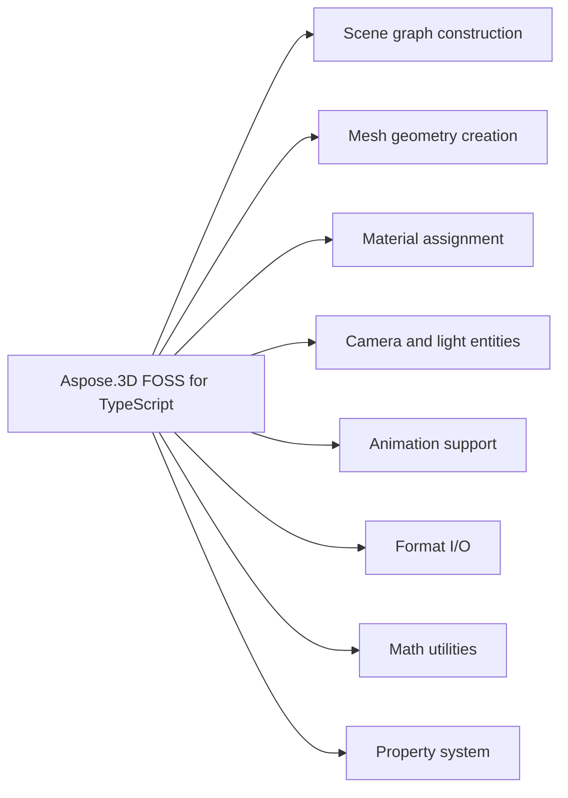

# Aspose.3D FOSS for TypeScript

Aspose.3D FOSS for TypeScript is a free, open-source, MIT-licensed TypeScript/JavaScript library for building and converting 3D scenes in `Node`.js. It exposes an Aspose.3D-compatible scene-graph API — `Scene`, `Node`, `Mesh`, `Material` — for constructing scenes from meshes and vertex attribute data, assigning shading materials, animating node hierarchies with keyframes, and reading and writing widely used interchange formats such as glTF, OBJ, STL, FBX, and COLLADA, as pure TypeScript with no native bindings.

Aspose.3D FOSS for TypeScript is a free, open-source, MIT-licensed TypeScript/JavaScript library
for building and converting 3D scenes in Node.js. It exposes an Aspose.3D-compatible scene-graph
API — `Scene`, `Node`, `Mesh`, `Material` — for constructing scenes from meshes and vertex
attribute data, assigning shading materials, animating node hierarchies with keyframes, and
reading and writing widely used interchange formats such as glTF, OBJ, STL, FBX, and COLLADA, as
pure TypeScript with no native bindings.

## Navigation

- [At a Glance](#at-a-glance)
- [Key Capabilities](#key-capabilities)
- [Installation](#installation)
- [Dependencies](#dependencies)
- [API Reference](#api-reference)
- [Scope and Limitations](#scope-and-limitations)

## At a Glance

## Key Capabilities

- **Scene graph construction.** `Scene` graph construction uses the `Scene` class as the root container, with `Node` instances holding a `Transform`, an optional `Entity` (`Mesh`, `Camera`, or `Light`), and child nodes accessible through childNodes; nodes are added via `Node.addChildNode`, `Node.addEntity`, or `Node.createChildNode`.
- **Mesh geometry creation.** `Mesh` geometry creation relies on the `Mesh` class with control points managed via `Mesh.addControlPoint` and polygons created with `Mesh.createPolygon`; per-vertex attribute channels such as normals (`VertexElementNormal`) and UVs (`VertexElementUV`) are attached through the `VertexElement` hierarchy.
- **Material assignment.** `Material` assignment supports `LambertMaterial` (diffuse-only), `PhongMaterial` (adds specular and shininess), and `PbrMaterial` (metallic/roughness mapping directly to the glTF 2.0 PBR model), with textures managed through `Material.getTexture` and `Material.setTexture`.
- **Camera and light entities.** `Camera` and light entities are placed as scene nodes, with `Camera` exposing projectionType and fieldOfView, and `Light` supporting POINT, DIRECTIONAL, SPOT, AREA, and VOLUME types via lightType, plus direction for directional and spot lights.
- **Animation support.** Animation support uses `AnimationClip` to group `AnimationNode` tracks, each containing `AnimationChannel` instances with `KeyframeSequence` time/value samples and configurable interpolation behavior via `KeyFrame.interpolation`.
- **Format I/O.** Format I/O reads glTF 2.0 (JSON and binary GLB) and Wavefront OBJ scenes and writes STL (ASCII and binary), FBX (ASCII), COLLADA (.dae), and glTF 2.0 JSON scenes through `Scene.fromFile`, `Scene.open`, and `Scene.save`, with behavior configured via dedicated options types.
- **Math utilities.** Math utilities provide `FVector2`, `FVector3`, and `FVector4` vector types, `Matrix4` for 4x4 transformations, `Quaternion` for rotation, and `MathUtils` for common operations.
- **Property system.** The property system exposes `A3DObject.findProperty` and `A3DObject.setProperty` to access and modify named properties, with `Property` and `PropertyCollection` managing the underlying storage and metadata.

- Triangulate raw polygon data with the standalone `PolygonModifier.triangulate()` utility, or
  triangulate an existing mesh's own polygons in place with `Mesh.triangulate()`.
- Read and write 3MF (3D Manufacturing Format) archives — suited to modern 3D printing
  workflows — through `ThreeMfImporter`/`ThreeMfExporter`; see the real npm packaging defect
  disclosed in Scope and Limitations before relying on this format in production.

## Installation

The package `@aspose/3d` is not yet published on npm (package registry: distribution not found on npm).

## Dependencies

### Required Package Dependencies

- `xmldom ^0.6.0`

### Development Dependencies

- `adm-zip ^0.5.16`
- `eslint ^8.57.1`
- `jest ^29.7.0`
- `ts-jest ^29.3.4`
- `@types/adm-zip ^0.5.7`
- `@types/jest ^29.5.12`
- `@types/node ^22.15.17`
- `typescript ^5.8.3`
- `@typescript-eslint/eslint-plugin ^8.33.0`
- `@typescript-eslint/parser ^8.33.0`

## API Reference

Aspose.3D FOSS for TypeScript provides the @aspose/3d package (version 24.12.0) with `Scene` as the primary entry point for loading, saving, and manipulating 3D scenes. `Scene.open`, `Scene.openFromBuffer`, and `Scene.fromFile` load content, `Scene.save` and `Scene.saveToBuffer` write output, and `Scene.rootNode` exposes the node hierarchy.

The verified public surface has 81 types.

View the Complete Public API Surface

### Core API

| Class | Description |
| --- | --- |
| `A3DObject` | A3DObject represents the base class for all 3D objects in Aspose.3D FOSS for TypeScript. |
| `AnimationChannel` | AnimationChannel defines a single animation channel that controls how animation data is applied over time. |
| `AnimationClip` | AnimationClip holds a collection of animation channels that together represent a complete animation sequence. |
| `AnimationNode` | AnimationNode represents a node in the animation system that can be animated and participate in animation blending. |
| `ApertureMode` | ApertureMode specifies the method used to control the camera aperture in rendering. |
| `AssetInfo` | AssetInfo stores metadata about a 3D asset such as author, creation date, and units. |
| `BindPoint` | BindPoint defines a specific location where a mesh can be attached to a skeleton for skinning. |
| `BooleanOperation` | BooleanOperation performs geometric operations such as union, intersection, and difference on 3D shapes. |
| `BoundingBox` | BoundingBox encloses a 3D object using minimum and maximum coordinates in three-dimensional space. |
| `BoundingBox2D` | BoundingBox2D encloses a 2D object using minimum and maximum coordinates in a plane. |
| `BoundingBoxExtent` | BoundingBoxExtent describes the size and position of a bounding box relative to its center. |
| `Camera` | Camera defines a viewing frustum used to render a 3D scene from a specific perspective. |
| `ComposeOrder` | ComposeOrder specifies the sequence in which transformations are applied during rendering. |
| `CustomObject` | CustomObject allows users to define and manage their own custom 3D entities within the scene. |
| `Entity` | Entity is a base class for all objects that can appear in a 3D scene, such as meshes and lights. |
| `Extrapolation` | Extrapolation determines how animation values are computed outside the defined keyframe range. |
| `FMatrix4` | FMatrix4 represents a 4x4 matrix of single-precision floating-point numbers used for transformations. |
| `FVector2` | FVector2 represents a two-dimensional vector of single-precision floating-point numbers. |
| `FVector3` | FVector3 represents a three-dimensional vector of single-precision floating-point numbers. |
| `FVector4` | FVector4 represents a four-dimensional vector of single-precision floating-point numbers. |
| `FileFormat` | FileFormat identifies the format of a 3D file such as OBJ, STL, or GLTF. |
| `FileSystem` | FileSystem provides an abstraction layer for reading and writing files in Aspose.3D FOSS for TypeScript. |
| `Geometry` | Geometry defines the shape of a 3D object through its vertices, normals, and texture coordinates. |
| `GlobalTransform` | GlobalTransform stores the complete transformation matrix that positions an object in world space. |
| `IIndexedVertexElement` | IIndexedVertexElement represents a single vertex element with an index into a vertex buffer. |
| `INamedObject` | INamedObject is an interface for objects that can be assigned a human-readable name. |
| `IOExtension` | IOExtension provides support for reading and writing 3D files through format-specific plugins. |
| `ImageRenderOptions` | ImageRenderOptions controls how a 3D scene is rendered to an image file. |
| `KeyFrame` | KeyFrame stores a value at a specific point in time for animation purposes. |
| `KeyframeSequence` | KeyframeSequence groups a series of keyframes that define how a property changes over time. |
| `LambertMaterial` | LambertMaterial defines a simple diffuse material based on the Lambertian reflectance model. |
| `Light` | Light represents a light source in a 3D scene that affects the appearance of objects. |
| `LightType` | LightType specifies the kind of light source such as point, directional, or spot. |
| `MappingMode` | MappingMode determines how texture coordinates are applied to a 3D surface. |
| `Material` | Material defines the visual properties of a 3D object such as color, shininess, and texture. |
| `MathUtils` | MathUtils provides utility functions for common mathematical operations used in 3D graphics. |
| `Matrix4` | Matrix4 represents a 4x4 matrix of double-precision floating-point numbers used for transformations. |
| `Mesh` | Mesh represents a polygonal 3D object composed of vertices, edges, and faces. |
| `Node` | Node represents an object in a scene hierarchy that can hold geometry and other entities. |
| `ParseException` | ParseException indicates an error that occurred while parsing a 3D file format. |
| `PbrMaterial` | PbrMaterial defines a physically based rendering material with properties such as base color, metallic, and roughness. |
| `PhongMaterial` | PhongMaterial defines a Phong shading material with ambient, diffuse, and specular color properties. |
| `PolygonModifier` | PolygonModifier provides utilities for modifying polygonal geometry, such as triangulation. |
| `ProjectionType` | ProjectionType specifies the type of projection used in a camera, such as perspective or orthographic. |
| `Property` | Property represents a named value that can be attached to scene objects for metadata. |
| `PropertyCollection` | PropertyCollection is a container for a set of properties associated with a scene object. |
| `Quaternion` | Quaternion represents a four-dimensional vector used to describe 3D rotations. |
| `Rect` | Rect defines a rectangle using left, top, width, and height values. |
| `ReferenceMode` | ReferenceMode specifies how a reference to another object is interpreted during import or export. |
| `RelativeRectangle` | RelativeRectangle defines a rectangle using relative coordinates and dimensions. |
| `RotationMode` | RotationMode specifies the method used to interpret rotation values, such as axis-angle or Euler angles. |
| `RotationOrder` | RotationOrder defines the sequence in which rotations around the X, Y, and Z axes are applied. |
| `Scene` | Scene represents a complete 3D scene containing objects, lights, cameras, and animations. |
| `SceneObject` | SceneObject is the base class for all objects that can be part of a 3D scene. |
| `SemanticAttribute` | SemanticAttribute defines the meaning of a vertex attribute, such as position, normal, or texture coordinate. |
| `SplitMeshPolicy` | SplitMeshPolicy specifies how a mesh should be split during export, such as by material or by smoothing groups. |
| `TextureMapping` | TextureMapping specifies how a texture is mapped onto a surface, such as planar, cylindrical, or spherical. |
| `Transform` | Transform represents a 3D transformation including translation, rotation, and scaling. |
| `TransformBuilder` | TransformBuilder provides a fluent interface for constructing complex transformations. |
| `Vector2` | Vector2 represents a two-dimensional vector with X and Y components. |
| `Vector3` | Vector3 represents a three-dimensional vector with X, Y, and Z components. |
| `Vector4` | Vector4 represents a four-dimensional vector with X, Y, Z, and W components. |
| `Vertex` | Vertex represents a single point in 3D space with associated attributes such as position, normal, and texture coordinates. |
| `VertexDeclaration` | VertexDeclaration describes the layout of vertex data for rendering. |
| `VertexElement` | VertexElement is the base class for individual components of a vertex, such as position or normal. |
| `VertexElementFVector` | VertexElementFVector represents a vertex element containing floating-point vector data. |
| `VertexElementIntsTemplate` | VertexElementIntsTemplate represents a vertex element containing integer data. |
| `VertexElementNormal` | VertexElementNormal represents a vertex element containing normal vector data. |
| `VertexElementSmoothingGroup` | VertexElementSmoothingGroup represents a vertex element containing smoothing group information. |
| `VertexElementTangent` | VertexElementTangent represents a vertex element containing tangent vector data. |
| `VertexElementType` | VertexElementType specifies the data type of a vertex element, such as float or integer. |
| `VertexElementUV` | VertexElementUV represents a vertex element containing texture coordinate data. |
| `VertexElementVertexColor` | VertexElementVertexColor represents a vertex element containing vertex color data. |
| `VertexField` | VertexField defines a named field within a vertex declaration that holds a specific type of data. |
| `VertexFieldDataType` | VertexFieldDataType specifies the data type used for a vertex field, such as float32 or int32. |
| `VertexFieldSemantic` | VertexFieldSemantic defines the semantic meaning of a vertex field, such as position or normal. |
| `Watermark` | Watermark represents a visible or invisible mark that can be embedded in exported 3D files. |

#### Enumerations

| Enumeration | Description |
| --- | --- |
| `ExtrapolationType` | ExtrapolationType enumerates the possible methods for extending animation beyond its keyframe range. |
| `Interpolation` | Interpolation defines the method used to calculate intermediate values between keyframes. |
| `StepMode` | StepMode defines how animation keyframes are interpolated between time steps. |
| `WeightedMode` | WeightedMode represents a weighting strategy for mesh operations in Aspose.3D FOSS for TypeScript. |

#### Detailed Member Reference

### Scene

`Scene` serves as the root container for a 3D scene: `Scene.open` and `Scene.openFromBuffer` load a file or buffer with auto-detected format, `Scene.save` writes output, `Scene.fromFile` loads a file in a single call, `Scene.rootNode` exposes the node hierarchy, and `Scene.animationClips`, `Scene.createAnimationClip`, and `Scene.getAnimationClip` manage scene-level animation clips.

### Node

`Node` represents a named node in the scene tree, holding a transform and zero or more child nodes accessible via childNodes, with `Node.addChildNode`, `Node.createChildNode`, and `Node.addEntity` managing the hierarchy, and `Node.globalTransform`, `Node.transform`, and `Node.material` exposing its spatial and material properties.

### Mesh

`Mesh` provides geometry data with `Mesh.controlPoints` and `Mesh.vertexElements`, supports polygon construction via `Mesh.addControlPoint` and `Mesh.createPolygon`, exposes UV vertex elements through `Mesh.getVertexElementOfUV`, and can triangulate polygons via `Mesh.triangulate`.

### Material

`Material`, `LambertMaterial`, `PhongMaterial`, and `PbrMaterial` provide surface appearance definitions, with `Material.getTexture` and `Material.setTexture` managing texture assignments.

### AnimationClip

`AnimationClip`, `AnimationNode`, `AnimationChannel`, `KeyframeSequence`, and `KeyFrame` define animation data structures, supporting keyframe-based animation of transforms and properties.

### FileFormat

`FileFormat` supports format detection and conversion with `FileFormat.canImport`, `FileFormat.canExport`, `FileFormat.getFormatByExtension`, and `FileFormat.registerFormat`.

### Camera

`Camera` defines projection parameters with `Camera.projectionType`, `Camera.fieldOfView`, `Camera.nearPlane`, and `Camera.farPlane`.

### Light

`Light` defines illumination with `Light.lightType`, `Light.direction`, and `Light.fieldOfView`.

### Quaternion

`Quaternion` provides 3D rotation operations with `Quaternion.normalize`, `Quaternion.slerp`, and `Quaternion.toString`.

### Matrix4

`Matrix4` provides 4x4 transformation operations with `Matrix4.identity`, `Matrix4.concatenate`, and `Matrix4.inverse`.

### Property

`Property` and `PropertyCollection` support custom metadata via `A3DObject.findProperty` and `A3DObject.setProperty`.

### FileSystem

`FileSystem` provides file I/O with `FileSystem.readFile` and `FileSystem.writeFile`.

- `xmldom` `^0.6.0` — parses and serializes XML for `ColladaImporter`/`ColladaExporter` and the
  internal XML content inside 3MF archives (`ThreeMfImporter`).

- `typescript` `^5.8.3` — compiler.
- `jest` `^29.7.0`, `ts-jest` `^29.3.4` — test runner.
- `eslint` `^8.57.1`, `@typescript-eslint/eslint-plugin` `^8.33.0`, `@typescript-eslint/parser`
  `^8.33.0` — linting.
- `adm-zip` `^0.5.16`, `@types/adm-zip` `^0.5.7` — 3MF archive handling used in tests (see Scope
  and Limitations for a real packaging gap affecting a published install's use of this package).
- `@types/jest` `^29.5.12`, `@types/node` `^22.15.17` — TypeScript type declarations.

The `entity` accessor gets/sets the first attached entity for convenience, but a node can carry several: `addEntity(entity)`, `removeEntity(entity)`, and `clearEntities()` manage the full collection (mesh, camera, light, or other `SceneObject`). |
| `Entity` | Base class for all objects that can be attached to a `Node` as its primary entity.

## Scope and Limitations

Aspose.3D FOSS for TypeScript reads and writes 3D scenes using formats such as OBJ, STL, GLTF, and others, and provides basic scene construction and traversal capabilities.

- Rendering is not implemented in this FOSS build — `Scene.render()` throws an error, and a real npm packaging defect affects 3MF import/export so that using it throws immediately.
- `Mesh`'s Boolean operations (union, difference, intersect), `optimize()`, and `isManifold()` all throw Error('... is not implemented') in this FOSS build, and the `Mesh` height-map constructor path is also not implemented.
- `VertexElement.setIndices()` and `VertexElement.clear()` throw Error('... is not implemented') in this FOSS build.
- `Node.selectSingleObject()` and `Node.selectObjects()` throw Error('... is not implemented') in this FOSS build.
- The `FileSystem` virtualization abstraction (readFile, writeFile, createZipFileSystem, createLocalFileSystem, createDummyFileSystem) is entirely unimplemented in this FOSS build — every method throws, though ordinary `scene.open()` and `scene.save()` usage remains unaffected.
- Text watermarking is not currently functional in this FOSS build, and OBJ export only writes geometry attached at the very top of the scene graph, omitting geometry attached via standard child-node construction.

- Binary GLB export currently fails for any non-empty mesh; the JSON/ASCII form (the default) is
  unaffected. Binary GLB import is unaffected either way — reading a real, externally-produced
  binary file into a scene works correctly. Confirmed by direct testing.
