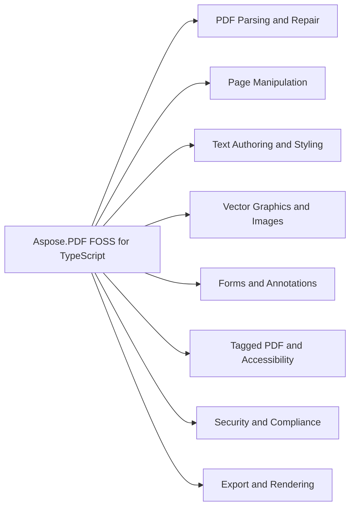

# Aspose.PDF FOSS for TypeScript

Aspose.PDF FOSS for TypeScript reads, writes, and manipulates PDF files in Node.js. It parses a PDF into an in-memory object model on Open and serializes a fresh, renumbered document on Save. It supports page edits, metadata changes, reordering, appending revisions incrementally, and digital signing. The library converts PDF to HTML, Markdown, DOCX, EPUB, SVG, and image formats, and it renders Word documents into PDF.

Aspose.PDF FOSS for TypeScript is a free, open-source, zero-dependency TypeScript library for
reading, manipulating, and writing PDF files in Node.js.

The library parses an entire PDF into an in-memory object model on `Open`. All mutations (page
edits, metadata changes, reordering) act directly on that live model, and `Save()` serializes a
fresh, renumbered document from it — no temp files. Appending a revision instead of rewriting
(`Save({ incremental: true })`, and digital signing) is available where earlier bytes must be kept.

The only runtime dependencies are Node.js built-ins (`node:zlib`, `node:crypto`, `node:fs`) — nothing from npm.

- Requires Node.js 22 or later (`engines.node` in `package.json`); relies on the `node:zlib`,
  `node:crypto`, and `node:fs` built-ins.

- `@types/node` `^20.0.0` — Node.js type definitions.
- `tsx` `^4.23.1` — run TypeScript sources directly (used by the example scripts).
- `typescript` `^5.5.0` — compiler (`npm run build` / `npm run typecheck`).
- `vitest` `^2.0.0` — test runner (`npm test`).

The page size and margins come from the document's last section; pass `format` or
`marginLeft`… to override them. Word's page and column breaks become column breaks in
a flow; `page.AddDocx(bytes, rect)` cannot honour one inside a single rectangle, so it
places the content continuously and reports the break.

Operators buffer in memory and are spliced into `/Contents` on `apply()` (a
no-op if nothing was drawn, and idempotent). Coordinates are PDF user space
(origin bottom-left, points). `save()`/`restore()` map to `q`/`Q` and
`transform(a,b,c,d,e,f)` to `cm`.

Beyond `rect`/`circle`/`ellipse` and the raw `moveTo`/`lineTo`/`curveTo`/`close`,
there are `polyline(points)` and `polygon(points)` (at least two `[x, y]` pairs;
`polygon` closes the path), `roundedRect(x, y, w, h, r)` with `r` clamped to half
the shorter side, and `arc(cx, cy, r, startAngle, endAngle)`. Arc angles are in
**radians**, counter-clockwise from the +x axis as in Canvas 2D; a lower
`endAngle` sweeps clockwise, and sweeps wider than 90° are split into several
cubics. An arc joins the path already under construction with a line to its start
point, or opens a new subpath when none is open — so a corner-by-corner outline
composes without hand-rolled Béziers.

`setFillGradient` fills — and `setStrokeGradient` strokes — with an axial
(linear) `ShadingType 2` or radial `ShadingType 3` ramp:

A gradient stroke's ramp is pinned to page space, not to the path, so its colour
at a point depends on where that point is rather than on how far along the
outline it lies.

A radial gradient runs from its focal point out to the circle `(cx, cy, r)`; a
focus outside that circle is pulled onto it, as SVG does. Gradient coordinates
are in the page's **default** user space and are not affected by `transform()` —
a PDF pattern matrix is relative to the content stream's default space, not the
CTM. `extend` (default `[true, true]`) pads the ramp beyond its endpoints, and a
uniform stop `opacity` folds into the graphics state — on that gradient's own
channel alone (`ca` for a fill, `CA` for a stroke), so a translucent gradient
stroke does not fade the fill of the same path. A gradient with one stop, a
zero-length axis, or a zero radius is drawn as a solid colour. Stops with
*differing* `opacity` are exact too, rendered through a luminosity `/SMask` — a
grayscale twin of the shading inside a transparency group, the same construct the
SVG importer uses. Both alpha forms **override** an earlier `setOpacity()` in
their channel rather than multiplying with it, and like every graphics-state
setting the mask stays in force until a `restore()`, so wrap the paint in
`save()`/`restore()` if later drawing must be unmasked.

A soft mask has no channel split — one `/ExtGState` holds one `/SMask` and it
dims both paints. So a varying-alpha fill gradient and a varying-alpha stroke
gradient cannot be in force at once: setting the second throws
`UnsupportedFeatureError`. Paint the fill and the stroke as two operations.

A **tiling pattern** repeats a tile of vector content across whatever you fill
or stroke. Create it once on the document — it is page-independent, so the same
hatch on forty pages is one object — and use it from any page's builder:

Options are `{ xStep, yStep, x, y, rotation, uncolored }`. The steps default to
the tile's size — larger leaves gaps between cells, smaller makes them overlap.
`x`, `y` and `rotation` (degrees counter-clockwise) place the lattice.

Like a gradient, the lattice is pinned to the page's **default** user space and
ignores the CTM, so a `transform()` before the fill moves the shape and not the
tiling; that is what `x`/`y`/`rotation` are for. Tile content is clipped to the
tile box, so content that should overhang needs a larger tile with smaller steps.

With `{ uncolored: true }` the tile carries shape only and the colour is given
where the pattern is used, so one hatch serves every colour:

Colour operators inside an uncolored tile throw, since a viewer ignores them.
The tile callback receives a `VectorGraphics` — every drawing primitive above,
minus `apply()`, which a tile has nothing to commit to.

A **template** is a piece of content drawn once and placed many times, stored as
a single Form XObject however often it is used — a letterhead, a logo block, a
badge. `doc.NewTemplate(w, h)` hands back a template whose `page` is an ordinary
page in template space that simply is not in the document's page tree, so every
authoring API works on it:

`PlaceOn(page, [x, y, w, h], opts?)` takes `fit` (`'stretch'`, the default,
fills the rect exactly; `'contain'` scales uniformly and centres), `opacity`,
`rotation` (degrees counter-clockwise about the rect's origin, as `AddText`
takes), and the `tag`/`alt`/`artifact` marking options `AddBarcode` and
`AddSVGObject` take — so a placed template can be tagged or artifacted in a
tagged document.

The first `PlaceOn` builds the form and **freezes** the template: drawing into
`tpl.page` afterwards throws, since every placement must show the same content.
Build a second template if you need a variant. A template never drawn into is
refused rather than placed, and one never placed costs nothing in the saved
file.

Logical structure *inside* a template is not supported — `MarkContent` and a
`tag:` on the template's own page would reference a page that is never written.
Tag the placement instead.

JPEG bytes are stored verbatim (`DCTDecode`); PNG is decoded with `node:zlib`
and re-stored as `FlateDecode`, expanding palettes to `/Indexed` and splitting an
alpha channel into an `/SMask`. CMYK JPEG and interlaced PNG throw
`UnsupportedFeatureError`.

Generate 1D (Code128, EAN-13, UPC-A, EAN-8) and 2D (QR) barcodes and place them
on a page as crisp vector graphics (default) or a 1-bit `/ImageMask` stencil:

`MakeSearchable` renders each image-only page, hands it to an OCR engine you supply, and writes the recognized text back as an invisible layer exactly over the words in the picture — so `GetText`, `Search`, copy-paste and indexers find them while the page looks unchanged:

Vision models read well but place boxes coarsely; for exact highlights plug in a dedicated OCR engine through the same interface:

These limitations apply only to Aspose.PDF FOSS for TypeScript — they don't carry over to
[Aspose.PDF — Enterprise Edition](https://products.aspose.com/pdf/), which adds broader
proprietary-format support, rendering, and advanced document-processing capabilities this FOSS
build leaves unimplemented.

## Navigation

- [At a Glance](#at-a-glance)
- [Key Capabilities](#key-capabilities)
- [Installation](#installation)
- [Dependencies](#dependencies)
- [API Reference](#api-reference)
- [Scope and Limitations](#scope-and-limitations)

## At a Glance

## Key Capabilities

- **PDF Parsing and Repair.** It parses PDF content streams with parseContentStream and serializes them back with serializeContentStream, and it repairs damaged files using `Document.recovery` and `Document.Repair` while validating structure with `Document.Validate` and Validate.
- **Page Manipulation.** It manipulates pages with `Document.AddPage`, `Document.InsertPage`, `Document.RemovePage`, `Document.Reorder`, `Document.Split`, `Document.ExtractPages`, `Document.Append`, and `Document.Merge`, and it operates on `Page` objects directly.
- **Text Authoring and Styling.** It adds text with `Page.AddText` and `Page.AddTextBlock`, supports `FontFamily` and `EmbeddedFont`, and controls paragraph flow with `FlowParagraphOptions`.
- **Vector Graphics and Images.** It draws images with `Page.AddImage`, embeds SVG objects with `Page.AddSVGObject`, and uses `Page.Graphics` and `PageGraphics` for vector drawing, including `TilingPattern`.
- **Forms and Annotations.** It adds interactive elements with `Page.AddCheckbox`, `Page.AddComboBox`, `Page.AddTextField`, `Page.AddLink`, and `Page.AddStamp`, and it handles `Form` and `Annotation` objects.
- **Tagged PDF and Accessibility.** It creates and manages logical structure with `Document.CreateStructTree`, `Document.GetStructTree`, and `StructTreeRoot`, tags content with `Document.AutoTag`, and validates or converts to PDF/UA with `Document.ValidatePdfUa` and `Document.ConvertToPdfUa`.
- **Security and Compliance.** It secures documents with `EncryptOptions` and `PubSecEncryptOptions`, signs them with `Document.Sign`, adds validation data with `Document.AddValidationData`, and converts to or validates PDF/A with `Document.ConvertToPdfA` and `Document.ValidatePdfA`, while redacting or sanitizing content with `RedactOptions` and `SanitizeOptions`.
- **Export and Rendering.** It exports documents to HTML, Markdown, DOCX, and EPUB with `Document.ToHtml`, `Document.ToMarkdown`, `Document.ToDocx`, and `Document.ToEpub`, and renders pages to SVG and image formats with `Page.ToSvg` and `Page.ToImage`.

A cell can hold an image (JPEG/PNG) via `cell.setImage(bytes, opts?)`. The image
is embedded (see `AddImage`) and drawn aspect-fit to the cell box; it sizes the
row by default (`imgH * innerWidth / imgW`) unless you pass an explicit `height`.
`align`/`valign` position it in the box (defaulting to the cell's), `opacity`
fades it, and it may sit under cell text. In a tagged table (below) the image
becomes a `/Figure` under its cell carrying the `alt` you pass; `artifact: true`
instead declares it decoration, marking it as an artifact with no `/Figure`. The
two are mutually exclusive, and both are ignored when the table is drawn
untagged.

A table taller than the space on the page paginates. `AddTable` returns an
`AddTableResult` (`{ pages, endY, remainder?, struct? }`). By default it draws the rows
that fit above `bottomMargin` (points from the page bottom, default 0) and
returns the rest as a re-drawable `remainder`:

Or let `AddTable` append pages for you with `autoPaginate: true`. Appended pages
copy the anchor page's size; `topMargin` sets where each continuation starts:

Rows are atomic: a row that will not fit moves whole to the next page (a single
row taller than a full page is drawn anyway). Each page gets its own outer
border.

Pass `{ tagged: true }` to emit logical structure alongside the ink: the table
becomes a `/Table` of `/TR` rows whose cells are `/TD`, or `/TH` for the
repeating-header rows (`setRepeatingRowsCount`) and for any cell built with
`{ header: 'row' | 'column' }` — `header: false` opts a cell back out, so a blank
corner cell in a header row stays a `/TD`. Cell backgrounds and borders are
marked as artifacts, and a cell image gets a `/Figure` carrying the `alt` passed
to `setImage` (or `artifact: true` for purely decorative artwork). Without
`tagged`, output is byte-identical to an untagged call.

A paginated table stays a single `/Table`: automatically in `autoPaginate` mode,
and in manual mode by passing `result.struct` back as `structParent` on the next
call. A header row reprinted on a continuation page appends another `/TR` of
`/TH` cells, in draw order — the ink genuinely exists on both pages.

`page.AddTOC(entries, [x, y, w, h], opts?)` renders a table of contents: wrapped
titles (indented by `level`), a leader rule, right-aligned page labels (defaulting
to each target page's logical `/PageLabels` label), and a borderless GoTo link
per row. Entries that do not fit come back as `result.remainder` for a follow-on
call, or pass `{ autoPaginate: true }` to append pages automatically.

Options: `rowGap`, `indent` (default 18), `leader` (`'dots'` | `'none'`),
`leaderGap` (default 4), `links` (default true), `view` (default `{ type:
'Fit' }`), `autoPaginate`, `tagged`, `structParent`, plus the typography of
`AddTextBlock` — everything but `align`/`valign` (a TOC row owns its own column
alignment), including `behind` to sink the whole TOC beneath the page's existing
content. Rows are atomic — a wrapped title never splits across pages, so
each entry keeps exactly one link rect. The call validates every entry before
painting anything, so a rejected `AddTOC` leaves the document byte-identical.

Pass `{ tagged: true }` to emit logical structure alongside the drawing: one
`/TOC` element with a `/TOCI` per entry (`TOCI > Reference > Link`, holding the
title and page-label marked content plus the link annotation as an OBJR),
`level` mapped onto nested `/TOC` elements, and the leader rule marked as an
`/Artifact` so a screen reader does not read it aloud. `structParent` places the
`/TOC` under an existing element; `result.struct` is that `/TOC`, and passing it
back as the next call's `structParent` keeps a manually paginated TOC a single
table of contents — the continuation also resumes the nesting depth the previous
page left open, so a subtree broken across pages stays one subtree.

Call `table.setRepeatingRowsCount(n)` to reprint the first *n* rows at the top of
every continuation page (a header that repeats). It works in both pagination
modes: with `autoPaginate: true` the header is redrawn on each appended page, and
in manual mode the returned `remainder` already carries the header rows, so
re-drawing it reprints them.

Flow content into multi-column pages that the library appends and paginates
automatically:

`Render()` returns the pages it created. It is single-shot — call it once per
flow. Page size comes from `PageFormat` (`.A4`/`.Letter`/`.Legal`,
`PageFormat.custom(w, h)`, `.landscape()`/`.portrait()`). `AddHeading(level, …)`
takes a level 1–6 that sets a default font size (24/18/14/12/10/8) and a
Helvetica-Bold default, both overridable via the options. `AddParagraph` and
`AddHeading` accept per-element `spaceBefore`/`spaceAfter` (points, additive with
the flow's `paragraphSpacing`, dropped at a column top). By default a heading is
kept with the element after it: if the heading fits at a column bottom but the
next element cannot place even one line beneath it, the heading moves to the next
column. Set `keepHeadingsWithNext: false` on `NewFlow` to disable this flow-wide,
or `keepWithNext: false` (or `true`) on an individual `AddHeading` to override the
flow default. Passing
`tagged: true` to `NewFlow` emits logical structure (`/H1`–`/H6` for headings,
`/P` for paragraphs, `/L`/`/LI`/`/Lbl`/`/LBody` for lists, `/Figure`+`/P` for
float boxes) into the document structure tree; the default is untagged.
`AddList(items, options)` takes a string per item and draws a bullet (`bullet`,
default "•") or numbered (`ordered: true`, `start`) marker, with an auto or
explicit `indent`, `itemSpacing` between items, and list-level `spaceBefore`/
`spaceAfter`. List items may nest: pass `{ text, items: [...] }` for a sub-list —
sub-lists indent per depth, ordered numbering restarts per level, and unordered
markers cycle • ◦ ▪ by depth (drawn as vector shapes). An item's
`ordered`/`bullet`/`start` override its own sub-list. An object item may also
carry per-item style overrides — `font`, `fontSize`, `color`, `align`,
`leading`, `spaceBefore`, `spaceAfter`, `indent` — each overriding the
list-level value for that item only (its marker inherits the item's
font/size/colour). `underline`, `strikethrough` and `background` decorate the
list too, at either level (an item's `underline: false` switches the list-level
rule off). The marker and the item body are decorated as **two separate runs**,
so a rule covers the bullet or ordinal and then the body text, leaving the
gutter between them blank; a background behind a vector bullet is as tall as the
font, so it lines up with the body's. `AddImage(data, options)` places a JPEG/PNG image as its own flow
block: `width` defaults to the column width (clamped down if larger, aspect
preserved), `height` auto-derives from the aspect ratio, `align` is `'left'`
(default)/`'center'`/`'right'`, and `alt` tags the image as `/Figure` when the
flow is tagged. An image paginates atomically (it never splits; one taller than a
full column is **scaled down** to fit, aspect preserved — it used to throw).
Content that cannot be scaled and cannot fit an empty column, such as a line
of text larger than the column, is drawn past the column bottom rather than
refusing the render. Both are last resorts: an image arriving near the foot of
a column still moves to the next column at full size, so a picture's size never
depends on what precedes it. `doc.NewFloatingBox({ width, padding, border, background, spacing,
alt })` builds a box (`AddParagraph`/`AddImage`), which goes into a flow one of
two ways. `flow.AddFloatBox(box, 'left' | 'right')` floats it so surrounding text
wraps in the narrowed channel beside it and resumes full width below.
`flow.AddFloatingBox(box)` instead places it **in** the flow — a pull-quote,
callout or formula card: it consumes the vertical space it needs, excludes no
band, and nothing wraps beside it. An in-flow box keeps its own `width` (it is
neither stretched nor clamped to the column) and paginates atomically — one that
does not fit in what is left of the column moves whole to the next, since a
callout split across a column boundary reads as a fault and its border and
background have no defined way to continue. Its `spacing` applies above and
below, on top of the flow's `paragraphSpacing`, as it does for a side float.

A box `border` takes the same `sides` vocabulary as the table `BorderInfo` —
`'all'` (default), `'none'`, or an object naming the edges — so a left-rule
pull-quote is `sides: { left: true }`. The border width is reserved on every side
whichever edges are drawn, so toggling `sides` changes only the ink and never
reflows the text inside the box. A left and a right box can float at once (text
flows in the middle channel), and several boxes on the same side stack
vertically — a box never shares a side, and only sits beside an opposing box
when it still fits the remaining channel. A float never pushes the text pen
past itself, so text fills the channel beside the upper box first and widens as
each box is passed. Floats are per-column: `AddColumnBreak` (and automatic
pagination) clears them. Any element takes `clear: 'left' | 'right' | 'both'`,
which drops it below the floats on those sides before it places — clearing one
side leaves a deeper float on the other still narrowing the region. A float that
does not fit the remaining column height is carried to the top of the next
column, and the content after it keeps filling the current one.

`border-radius` and `background-image` render on any block box `AddHtml` draws.
A `url()` image goes through your `resolveImage` (a `data:` URI needs none); a
gradient needs nothing at all.

A box split across a column or page rounds only its true top and bottom
corners and continues its gradient on the next slice. One background layer
is drawn; see [Limitations](#scope-and-limitations) for what is not.

A word that does not fit breaks at the rightmost point that leaves its head, hyphen
included, on the line; `minLeft`, `minRight` and `minWord` bound where that may be.
Tables take it through their own cascade (`createTable({ hyphenate })`, a row or a
cell), so a flow's default does not reach them.

`headingNumbering` numbers every heading the flow holds, once at `Render`, in
order — `AddHeading`, and the headings `flow.AddMarkdown` and `flow.AddHtml` add,
count as one sequence. Each level is a Word-style template: `%n` is level n's
counter, written in level n's own format.

`{}` gives 1., 1.1., 1.1.1. A level advancing restarts every deeper one, and a
level never reached shows its start value, as Word does: an H3 straight after an
H1 reads 1.1.1. Formats are `arabic`, `roman`, `Roman`, `alpha`, `Alpha` and
`symbols`. Headings from `AddDocx` keep the labels Word gave them and are not
numbered again.

`onPage` runs as each page is created, before the flow puts anything on it, so
what it draws sits underneath; `onRendered` runs once at the end with every page,
so it knows the total. Both also work through `doc.AddMarkdown`, `doc.AddHtml`
and `doc.AddDocx`.

In a tagged flow, everything the callbacks draw through the authoring APIs
becomes an `/Artifact /Pagination` sequence, so a running head never reads as
untagged content; a drawing you tagged or artifacted yourself is left as is.
Direct content edits (`ReplaceText` and friends) and annotations such as links
are not artifacted.

Options: `render: 'vector' | 'raster'`, `color`, `quietZone`, `text` (human-readable
digits under 1D codes — on by default for EAN/UPC), and `layer`/`tag`. QR supports
all four ECC levels (`L`/`M`/`Q`/`H`) with automatic mode selection and version
sizing (1–40). The low-level generators (`makeCode128`, `makeEan13`, `makeUpcA`,
`makeEan8`, `makeQr`) return a module model for custom placement.

`doc.OptionalContent` enumerates and toggles existing layers; it also creates new
ones and tags authored content into them:

`AddLayer` appends the new group to `/OCProperties /OCGs` and the default config's
`/D /Order` (nested under `parent` when given); `visible: false` adds it to the
config's `/OFF`. `BeginLayer`/`EndLayer` emit `/OC /… BDC … EMC` and register the
group in the page's `/Resources /Properties`. Image and annotation membership is
set on the object's `/OC`. All of it round-trips through `Save()`.

A layer can also state what it is *for* — and have that applied:

`ResolveForEvent('View' | 'Print' | 'Export', ctx?)` starts from the
configuration's `/ON`/`/OFF`/`BaseState` and lets each `/AS` usage application
dictionary whose `/Event` matches move the groups it names; a group no matching
entry names keeps its configured state, whatever its `/Usage` says — `/Usage`
alone is inert, which is why `SetUsage` writes both halves. Several categories,
and several entries, combine so that **any one saying OFF wins**. `/Zoom` and
`/Language` describe a viewer, so they stay silent unless `ctx` supplies a
magnification (`{ zoom: 2 }`) or a BCP 47 tag (`{ language: 'de-AT' }`);
language matching is RFC 4647 whole-subtag, so `de` covers `de-AT` and not
`den`. `/User` is read and written but never evaluated — it names a person or
organisation, and there is no viewer identity here. `ApplyUsage` returns only
the layers that moved and leaves the `/AS` entries in place; because it changes
the configuration's own state, every renderer, extractor and export honours the
result with no further call.

Once the right configuration is in `/D`, `FlattenLayers` collapses the document
to that one rendering and takes the vocabulary away:

Every marked-content span the configuration hides is **deleted** from the
content stream it sits in — page content, form XObjects, tiling patterns, Type 3
glyph procedures, soft-mask groups and annotation appearance streams alike —
hidden XObject draws and hidden annotations go with them (a hidden XObject loses
its `/Resources` entry too, or its bytes would survive the save), every
surviving `/OC` wrapper and `/OC` key is removed, and `/OCProperties` is
deleted. What is left is an ordinary PDF with no layers to toggle that renders
exactly as the configuration rendered, and from which the hidden content cannot
be recovered — the difference from merely dropping `/OCProperties`, which leaves
every hidden group unconditionally *visible*. That is what makes
`ConvertToPdfA('1b')` honest, since ISO 19005-1 prohibits optional content and
the converter deletes `/OCProperties` on its own:

Decodes simple-font encodings (WinAnsi/MacRoman/Standard/PDFDoc + `/Differences`),
`/ToUnicode` CMaps, and composite (Type0) fonts, whose `/Encoding` resolves through
an embedded CMap stream or one of the 195 bundled predefined Adobe CMaps (including
`usecmap` chains); with no `/ToUnicode`, CIDs resolve to characters through Adobe's
table for the collection `/CIDSystemInfo` names. Spacing and line breaks are
heuristic: glyph advances come from embedded width tables (`/Widths`, CID
`/W`/`/DW`) when present, and from the Adobe AFM metrics for a Standard-14 font
that omits `/Widths` (as the spec allows and this library's own stamping does),
falling back to a per-em estimate only for a glyph neither source covers;
vertical writing modes are out of scope. Image-only pages return `""`.

Fragments are emitted in content order; a new fragment begins when the font,
size, or baseline changes, or a wide horizontal gap opens. Image-only pages
return `[]`.

Each `PagePath` describes one paint operation. Geometry is kept **raw**, in the
local user space of the content stream that drew it, alongside the `ctm` that
maps that space to device (page) coordinates — multiply a point by `ctm` (or read
the precomputed device-space `bbox`) to place it on the page. Segments are
uniform: `{op:'move'|'line', pt}` or `{op:'cubic', c1, c2, pt}` (a `re` rectangle
becomes a closed move+3×line subpath; `v`/`y` become full cubics). `fill` and
`stroke` are each `{rgb, space}` or `null` — `rgb` is resolved sRGB (0–255)
through the page's colorspaces (Device\*, ICCBased, Indexed, Separation, DeviceN,
Lab), and `space` names the family. `fillRule` is `'nonzero'`/`'evenodd'`,
`lineWidth` is in device units (0 when not stroked), and `clip` flags a path used
as a clip (`W`/`W*`). Paths inside Form XObjects are included, with `addr.path`
naming the XObject chain and `mcid`/`artifact` reflecting the marked-content scope.
Shadings/gradients are not evaluated (reported as `space:'Pattern'`); dash, cap,
and join are out of scope.

`Search` locates a literal string or `RegExp` over the same word/line assembly
as `GetText` (so matches can span inferred spaces and line breaks). Each match
carries the matched substring, one page-space quad per line it spans, and the
underlying glyph events (`hits`) with op provenance.

Results come back in `/Annots` order, reading order within each annotation, and
each annotation is assembled on its own — a query never matches across two
annotations, or across an annotation and the page text underneath it. Only
annotations a static render would draw are searched (not Hidden, not NoView,
not a `/Popup`), the same rule `ToImage`, `ToSvg` and `FlattenAnnotations` use.
`options.region` scopes it by the same centroid rule as `Search`.

That removes any annotation whose `/Rect` those rects intersect — the whole
annotation, which is the only granularity available without surgery on the
`/AP` stream.

Each match names the entry it came from and carries that entry's whole value.
Three deliberate differences from `SearchAnnotations`, all of which read like
inconsistencies until you know why:

- It searches **every** annotation, hidden ones included. `SearchAnnotations`
  reports what a render *draws*; this reports what the file *carries*, and a
  hidden annotation's text is still in the bytes — and is still what `Redact`
  removes.
- It carries **no geometry**. This text is never drawn, so the only box
  available would be the annotation's whole `/Rect`, and redacting that covers
  whatever innocent content sits under it. Read `annot.Rect` yourself if you
  want it.

`doc.Optimize(opts?)` shrinks the live model in place; the next `Save()` writes
the smaller document.

| Option | Effect |
|---|---|
| `fonts` | Subset already-embedded fonts to the glyphs actually shown |
| `dedup` | Merge duplicate streams: byte-identical ones (font programs, JPEGs), and images whose decoded samples match even when one is stored raw and another Flate/LZW/RunLength/ASCII-coded |
| `compress` | Flate unfiltered streams; re-deflate Flate streams at max level |
| `dr` | Remove `/AcroForm /DR` resources nothing in the document names |
| `unembedStandard14` | Remove the embedded program of a font naming a Latin Standard-14 face exactly. **Off by default**: viewers then draw their own face. Declined per font, into `unembedSkipped`, where the swap could change which glyph a code draws, and for a document declaring PDF/A |
| `images` | **Lossy.** Downsample images to `dpi` and recompress them as JPEG at `quality`; `progressive: true` writes spectral-selection progressive JPEG (no successive approximation) — the same pixels as baseline, measured 1.5–2.2% smaller for a photograph at the default 4:2:0 |

`fonts`, `dedup`, `compress`, and `dr` are lossless and default **on**. `images` is
lossy and is **off unless supplied** — there is no `images: true` shorthand, so
the pass cannot run at settings you did not choose. `report.lossy` records
whether it ran.

Returns an `OptimizeReport`: per-font glyph counts (one entry per font *program*
— a program two font dicts share is shrunk once, against the union of what both
show), a `skipped` list explaining any font left untouched, per-image dimensions
and savings, a `skippedImages` list, and an **estimated** `bytesSaved` (a
raw-delta sum, not a file-size delta — only `Save()` produces bytes).

The `dr` pass removes `/AcroForm /DR` entries — in every category, not only
`/Font` — that nothing in the document can name. A reference is a name in any
`/DA` string (the AcroForm default, a field's, a widget's, a `FreeText`
annotation's) or a name an `/AP` appearance stream cannot resolve against its own
`/Resources`. This is what collects the face a field registered at creation and
kept after `Form.RemoveField` unwired it. `report.dr.removed` names the removed
keys (`'Font/TiBo'`), and `report.dr.bytesSaved` counts the payload of the
streams the removal orphaned.

The pass declines outright — reporting `report.dr.skipped` and changing nothing —
for a document carrying `/AcroForm /XFA`, whose packet can name `/DR` faces this
library never reads, or one whose appearance streams cannot all be decoded and
parsed. A scan that cannot prove itself complete does not get to call a resource
unused.

The image pass measures each image's *effective* DPI from the CTM at every place
it is drawn and downsamples to the most demanding one, so no placement degrades;
it never upsamples, and it replaces a stream only when the re-encode is strictly
smaller. Images are skipped — and reported in `skippedImages` with a reason —
when they are image masks, non-8-bit, indexed, bilevel (JBIG2/CCITT), carry a
`/Mask` or `/Decode`, use a colorspace with no JPEG equivalent, or are never
drawn by the content scan (which is what leaves an `/SMask` untouched).

`doc.ConvertColors({ to })` converts a document's colour to one device space in
place — `'gray'`, `'rgb'` or `'cmyk'` — across page content, form XObjects,
tiling patterns, Type 3 glyph procedures, image XObjects, inline images,
shadings and annotations. `doc.ConvertToGrayscale(opts?)` is the named
shorthand for `{ to: 'gray' }` and produces byte-identical output.

`skipped` is the field to read to answer "did this document fully convert".
Each entry carries a `reason` and a `what` — `'image'`, `'shading'`,
`'content'`, `'inline-image'` or `'annotation'` — with `objNum` naming the
object it could not convert. For `'inline-image'` that is the content stream
that **drew** it, an inline image having no object of its own; expect the
form's stream rather than the page's when one is drawn inside a form XObject.
Such an entry also carries `opIndex`, the index of its `BI` within that
stream, since one stream may draw several — `parseContentStream(inflateStream(obj))[opIndex]`
resolves it. No other kind carries one; they address an object, not an
operator inside one.
An entry means the construct is still in its original colour space: an inline
image that is filtered, carries a `/Decode` array, is not 8 bits per component
or names a colour space outside the six device spellings cannot be rewritten by
a pass that decodes nothing, and an annotation colour array whose width is not
1, 3 or 4 states no colour that can be read, so it is reported and left rather
than guessed at.

Every colour ends up in the target space, DeviceGray content included: a grey
becomes pure K under `'cmyk'`, which renders identically but costs four
operands where one would do. The postcondition is deliberately simple — after
the call, every colour in the document *is* the target space, **except what**
`skipped` **names**. The one entry that means colour genuinely survives is a
`cs` whose `/ColorSpace` resource could not be resolved: its operators are left
exactly as the document wrote them rather than converted from a space nobody
established, since guessing there turns red into white.

If you *are* colour managed, hand the leg in and the library will use it
everywhere — content operators, image samples, shading functions, mesh
vertices and annotation colours alike:

`iccCmykTransform(profile, { intent })` builds that transform from an ICC
destination profile's `B2A` tag, so the conversion is genuinely colour
managed — a mid grey inks all four channels the way the profile says, where
the naive transform leaves three empty. It supports **ICC v2 CMYK output
profiles with a Lab connection space**, which is what press profiles are;
`intent` selects `B2A0` (perceptual, the default), `B2A1` (media-relative) or
`B2A2` (saturation). CLUT interpolation is tetrahedral, which is what a
reference CMS does — verified against Windows Color System, and matching
littlecms and Adobe. A v4 profile, absolute
colorimetric, a non-CMYK device space and a profile with no `B2A` are each
**declined before anything converts**, so a rejected profile leaves the
document byte-identical. If you already have a CMS, pass its output instead.

It replaces that one leg and never the pivot, so a transform sees the same RGB
triple whatever space the document declared. It is validated once before
anything converts — four finite numbers, probed at four corners — so a rejected
call leaves the document byte-identical, and results are clamped to 0..1 on the
way out. Passing it with `to: 'gray'` or `'rgb'` throws rather than being
ignored. **This does not make the library colour managed**; it lets its caller
be. Declaring *which* output condition the numbers are for is a separate job —
an `/OutputIntent` is a standards claim, and `ConvertToPdfX` owns it.

Every colour goes through one rule — Rec. 601 luma, `0.299R + 0.587G + 0.114B`
— reached through the same colour-space resolution the renderer uses, so
ICCBased, Indexed, Separation, DeviceN, CalRGB and Lab all convert without
special cases. Colour *operators* are neutralized rather than colour spaces
retargeted: `rg`/`k`/`sc`/`scn` become `g`/`G`, `cs` becomes `/DeviceGray`, and
the named `/ColorSpace` entries are simply left unreferenced for `Optimize`'s
`dr` pass to collect.

Images take the cheapest faithful route. An **Indexed** image greys by
rewriting its palette alone — lossless, smaller, and the only route that works
below 8 bits per component.

A **YCbCr JPEG** — which is nearly every photographic JPEG — takes a shorter
route still, and only when the target is `'gray'`. Its Y channel already *is*
Rec. 601 luma, so greying it needs no decode at all: component 0's quantized coefficients and its quantization table
are carried over untouched and the two chroma components dropped, giving an
exact, generation-free greying that is smaller than the original and reports
`route: 'jpeg-exact'` without setting `lossy`. Progressive and arithmetic JPEGs
take it too, and come out baseline.

A JPEG that route declines — any target but `'gray'`, or CMYK or YCCK, 12-bit,
lossless, hierarchical, or a three-component file whose colour transform is 0,
where component 0 is red rather than luma — re-encodes as a JPEG in the target
space at `quality` (default 90), which is
the one thing here that loses information beyond the colour, and sets
`report.lossy`. A decline is not a `skipped` entry: the image converts either
way, and `route` is what says how. Other decodable samples become Flate in the
target space;
a JPX image takes that route too, since the library has a JPEG 2000 decoder and
no encoder, and will usually grow — `bytesDelta` says so rather than surprising
you.

Shading functions convert exactly where that is free (type 2 through `/C0` and
`/C1`, type 3 by recursion) and are resampled into a one-output sampled function
otherwise, with one output per target component. A mesh shading (types 4–7)
with no `/Function` states its colour per
vertex in its own stream data rather than in a function, so it is converted by
re-splicing that data: each colour tuple is replaced by the target's components,
the coordinates are copied bit for bit so the geometry cannot drift, and
`/Decode` keeps its coordinate ranges and gains one [0 1] per target component.

A colour-key `/Mask` is converted rather than refused, and not by re-deriving
the range: two colours can share a luma — (255,0,0) and (0,130,0) both grey to
76 — so no grey range is faithful. `/Mask` may be a stencil image as well as a
colour-key array, so the pass records WHICH PIXELS the key matched as a 1-bit
stencil in that same entry, which is exact. An Indexed image needs no
conversion at all: its key indexes sample values, and the palette route leaves
those untouched.

AI features take a model you build and never call a default endpoint. `openAiModel` speaks the OpenAI chat-completions protocol, so it works with OpenAI and with local servers such as Ollama or vLLM:

Each attempt is bounded by `timeoutMs` (default 120 s) and `maxResponseBytes` (default 4 MiB). Rate limits and server errors (429, 500, 502, 503, 504), network errors and timeouts are retried up to `maxRetries` times (default 2), honouring `Retry-After`; a `Retry-After` longer than 30 s fails at once rather than being waited out. Pass credentials through `apiKey` or `headers`: a `baseUrl` carrying a user name, password, query or fragment is refused. Failures raise `AiServiceError`, which never contains your API key. A reply that hit `maxTokens` is an error rather than a silently truncated answer. To use another provider, implement `AiModel`'s single `complete` method yourself.

## Installation

The package `@asposefoss/pdf` is not yet published on npm (package registry: distribution not found on npm).

## Dependencies

### Required Package Dependencies

No required third-party package dependencies; in `package.json`, no `dependencies` a consumer would install is declared.

### Native and System Requirements

- Requires Node.js 22 or later (`engines.node=">=22"` in `package.json`).

### Development Dependencies

- `tsx ^4.23.1`
- `@types/node ^20.0.0`
- `typescript ^5.5.0`
- `vitest ^2.0.0`

## API Reference

Aspose.PDF FOSS for TypeScript provides the `Document` class as the primary entry point for working with PDF documents. It supports opening, creating, and manipulating PDF content through a set of methods that operate on pages, fonts, forms, and other document elements.

The verified public surface has 478 types.

View the Complete Public API Surface

### Core API

| Class | Description |
| --- | --- |
| `AddBarcodeOptions` | AddBarcodeOptions configures the appearance and placement of a barcode added to a PDF page. |
| `AddDocxResult` | AddDocxResult reports the outcome of adding content from a DOCX file to a PDF document. |
| `AddHtmlResult` | What Page.AddHtml reports. |
| `AddImageOptions` | AddImageOptions specifies how an image is positioned, scaled, and rendered when added to a PDF page. |
| `AddImagePagesOptions` | AddImagePagesOptions controls the layout and appearance of one or more images inserted as new pages. |
| `AddImagePagesResult` | AddImagePagesResult provides details about the pages created when inserting images as pages. |
| `AddLayerOptions` | Options for OptionalContent.AddLayer. |
| `AddMarkdownResult` | What Page.AddMarkdown reports. |
| `AddSVGOptions` | Options for Page.AddSVGObject. |
| `AddSVGResult` | The outcome of Page.AddSVGObject. |
| `AddTOCResult` | The outcome of drawTOC / page.AddTOC. |
| `AddTableOptions` | Options for drawTable / page.AddTable. |
| `AddTableResult` | The outcome of drawTable / page.AddTable. |
| `AiContentPart` | One part of a message: text, or an image as encoded PNG/JPEG bytes. |
| `AiMessage` | One chat message. |
| `AiModel` | A language model a caller has configured and handed to an AI feature. |
| `AiOcrOptions` | Options for aiOcrEngine. |
| `AiRequest` | What a feature asks the model. |
| `AiResponse` | What the model answered. |
| `AiServiceError` | An AI model service (3ywf.2) failed, or answered with something unusable:  a non-2xx status, a refusal, a reply cut off at the token limit, a body that  is not a chat completion, a response past the size cap, or no answer in  time. |
| `AiUsage` | Token counts summed across the requests one feature made. |
| `AltTextFigure` | AltTextFigure represents an alt-text entry for a figure element in a tagged PDF structure. |
| `AltTextOptions` | AltTextOptions defines settings for generating and embedding alt-text in a PDF document. |
| `AltTextReport` | AltTextReport summarizes the alt-text generation process and any issues encountered. |
| `AnnotData` | AnnotData holds the raw data of an annotation object extracted from a PDF document. |
| `Annotation` | A live, mutable handle over an annotation dictionary. |
| `AnnotationMatch` | A match in the text one annotation's appearance stream draws. |
| `AnnotationTextKey` | The annotation entries that count as carried text. |
| `AnnotationTextMatch` | A match in the text an annotation CARRIES, rather than the text it draws. |
| `ApplyRedactionsOptions` | Options for Page.ApplyRedactions / Document.ApplyRedactions. |
| `ArtifactBBoxSource` | Where an artifact's PageArtifact.bbox came from. |
| `ArtifactEdge` | Which edges of the page a pagination artifact is attached to (Table 331). |
| `ArtifactEvent` | An /Artifact marked-content scope opening: /Artifact BMC or  /Artifact <<props>> BDC. |
| `AskExcerpt` | AskExcerpt represents a snippet of text returned in response to a natural-language query. |
| `AskOptions` | AskOptions configures the behavior of natural-language queries against a PDF document. |
| `AskResult` | AskResult encapsulates the response from a natural-language query, including excerpts and metadata. |
| `Attachment` | A live handle over one embedded file's /Filespec. |
| `AttachmentOptions` | Options shared by document-level attachments and FileAttachment annotations. |
| `AuthoringFont` | A font for the text-authoring API: one of the 12 Latin Standard-14 faces (by  name) or an embedded font handle from Document.AddFont. |
| `AutoTagOptions` | Options for Document.AutoTag. |
| `AutoTagReport` | Counts of the elements AutoTag produced. |
| `Background` | A bare RGB tuple, or the object form when padding is wanted. |
| `BackgroundStyle` | A fill painted behind the glyphs. |
| `BarcodeModel` | BarcodeModel describes the detected barcode, including its type, value, and bounding box. |
| `BarcodeSpec` | Which barcode to draw. |
| `BatesOptions` | Options for Document.AddBatesNumbering. |
| `BookletOptions` | Options for Document.Booklet. |
| `BorderInfo` | A cell/table border: stroke width (pt), RGB colour (0..1), optional dash, and  which edges to paint. |
| `BorderStyle` | BorderStyle defines the width, color, and dash pattern used for drawing borders around elements. |
| `BoxGradient` | A BOX-RELATIVE gradient (v9j3.4). |
| `ButtonField` | A push button (/FT /Btn with the Pushbutton flag). |
| `ButtonIconPosition` | Where a push button's icon sits relative to its caption — all seven layouts  PDF 32000-1 table 189 defines. |
| `CaretAnnotation` | A /Caret annotation (PDF 32000-1 §12.5.6.11): a text-insertion mark, drawn as  a wedge at the point where text should be added, optionally with a paragraph  sign. |
| `CaretOptions` | Options for Page.AddCaret. |
| `CellBuilder` | One cell in a table row: a text string, optional per-cell style, and how many  columns it spans. |
| `CellHeader` | How a cell is marked in a tagged table: a /TH carrying the given /Scope, or a  /TD. |
| `CellOptions` | addCell options: the per-cell text style plus an optional horizontal span. |
| `CellTextOptions` | Per-cell/row text + visual style; each field falls back through the cascade  (cell ?? |
| `CertInfo` | Summary of the signer's X.509 certificate. |
| `CertifyOptions` | Options for Document.Certify: a SignOptions plus the DocMDP  permitted-changes level (default no-changes). |
| `ChainOptions` | ChainOptions specifies how multiple operations are combined into a single processing chain. |
| `ChainResult` | ChainResult aggregates the outcomes of all operations executed in a processing chain. |
| `Change` | One object that changed in a revision added after a signature. |
| `CheckboxField` | A checkbox (/FT /Btn, neither Pushbutton nor Radio). |
| `CheckboxInit` | Options for Form.AddCheckbox / Page.AddCheckbox. |
| `ChoiceField` | A combo box or list box (/FT /Ch). |
| `ChoiceInit` | Options common to both choice field types. |
| `CmykTransform` | An RGB triple in 0..1 as CMYK in 0..1 — the one leg of a colour conversion that cannot be got right without knowing the destination (85l8.3). |
| `CollectionFieldDef` | CollectionFieldDef describes a field definition used when building a collection of documents. |
| `CollectionFieldType` | A schema column: built-in fields derive from the filespec; custom fields  (string/date/number) read their value from each file's /CI. |
| `CollectionSettings` | CollectionSettings controls how multiple documents are merged into a single collection. |
| `CollectionView` | How a viewer presents the portfolio. |
| `ColorConvertOptions` | Document-wide colour conversion. |
| `ColorConvertReport` | ColorConvertReport documents the color conversion process and any skipped or modified colors. |
| `ColorImageResult` | ColorImageResult provides details about an image after color processing, including dimensions and format. |
| `ColorSkipped` | ColorSkipped indicates a color that was not converted during a color processing operation. |
| `ColoredTilingPattern` | A tiling pattern that carries its own colours. |
| `ColumnWidth` | A column-width spec: an absolute width in points (fixed), or a share of the  leftover space after fixed columns are allotted (fraction). |
| `ComboBoxInit` | Options for Form.AddComboBox / Page.AddComboBox. |
| `CompareTextOptions` | CompareTextOptions configures how text content is compared between two documents. |
| `ComparisonHtmlOptions` | ComparisonHtmlOptions controls the format and styling of HTML output produced by a document comparison. |
| `ComparisonJsonOptions` | ComparisonJsonOptions specifies the structure and content of JSON output from a document comparison. |
| `ComparisonReportOptions` | ComparisonReportOptions defines the level of detail and format for a document comparison report. |
| `Construct` | Every construct this stack can report. |
| `ContentAddr` | Address of an operator within a page's content. |
| `ContentItem` | A marked-content reference owned by a structure element. |
| `ContentOp` | ContentOp represents a single operator and its operands parsed from a PDF content stream. |
| `ContentVisitor` | ContentVisitor provides a callback-based interface for traversing and processing PDF content stream operators. |
| `ContentWalkOptions` | How a content walk treats optional content. |
| `ConversionReport` | The result of a conversion run: what was applied, what still fails, pass flag. |
| `ConvertAction` | One remediation performed by a converter (PDF/A or PDF/UA). |
| `ConvertCategory` | ConvertCategory classifies the type of conversion being performed, such as PDF to image or PDF to DOCX. |
| `ConvertColorsOptions` | ConvertColorsOptions specifies how colors in a PDF document should be transformed during conversion. |
| `ConvertOptions` | ConvertOptions controls the behavior and output format of a document conversion operation. |
| `Crl` | Crl represents a certificate revocation list used in digital signature validation. |
| `CrlEntry` | CrlEntry describes a single entry in a certificate revocation list, including a revoked certificate's serial number. |
| `Decoration` | true uses the font's metrics and the text's own colour; false is off. |
| `DecorationOptions` | The decoration options shared by every text-authoring options type. |
| `DecorationStyle` | A rule drawn beneath (underline) or through (strikethrough) the text. |
| `DigestAlgorithm` | DigestAlgorithm identifies the hash algorithm used to compute a message digest for digital signatures. |
| `DocMdpPermission` | DocMDP permitted-changes level for a certification signature (PDF 32000-1  §12.8.2.2): the /P value in the DocMDP /TransformParams. |
| `Document` | Document represents a PDF file loaded in memory, exposing pages, metadata, and save operations. |
| `DocumentJavaScript` | One entry of the document-level JavaScript name tree. |
| `DocumentTimestampOptions` | Options for Document.AddDocumentTimestamp. |
| `DocumentTimestampReport` | Verdict for one document timestamp (/DocTimeStamp): the RFC 3161 token's  time and imprint/TSA-signature checks, plus coverage and the TSA cert. |
| `DocxExtras` | Parts and relationships a caller adds beside the minimal set — styles,  numbering, images. |
| `DocxFileOptions` | How docxFileToPdf renders: everything doc.AddDocx takes. |
| `DocxFlowOptions` | DocxFlowOptions controls how content from a DOCX file is reflowed into a PDF document. |
| `DocxFlowResult` | DocxFlowResult reports the outcome of reflowing DOCX content into a PDF document. |
| `DocxOptions` | Options for Document.ToDocx and Page.ToDocx. |
| `DssEntry` | Per-signature validation data to embed under one /VRI entry. |
| `Duplex` | /Duplex — how a duplex-capable printer should be driven. |
| `Edged` | A single value, or one-per-edge [top, right, bottom, left]. |
| `EditableContent` | Editable per-stream view of a page's content (Phase 4 foundation, F1). |
| `ElemOpts` | Options for creating a structure element. |
| `ElementPolicy` | What happens to an element's children, and how the element is reported. |
| `EmbeddedFont` | An opaque handle to a font program registered with Document.AddFont. |
| `EncodedImage` | An image XObject encoded as a file: its bytes and their media type. |
| `EncryptOptions` | EncryptOptions specifies how a PDF document is encrypted, including passwords, permissions, and algorithm. |
| `EpubOptions` | Options for Document.ToEpub. |
| `ExportFormDataOptions` | ExportFormDataOptions configures the format and content of form data exported from a PDF document. |
| `ExportJsonOptions` | Options for ExportJson: the FDF/XFDF options minus annotations, which  the JSON format does not carry, plus the indentation. |
| `ExternalSigner` | Sign via an external callback (HSM/KMS/smartcard) — the key never leaves the  device. |
| `ExtractOptions` | What a read API should report about optional content. |
| `ExtractPagesOptions` | ExtractPagesOptions controls how a subset of pages is extracted from a PDF document. |
| `Field` | A terminal AcroForm field: a live, mutable handle over its field dict. |
| `FieldActions` | A field's additional-actions (/AA), PDF 32000-1 table 197. |
| `FieldActionsUpdate` | A field-actions update: an action to set, null to remove that trigger, and  an absent key to leave it as it is — the same shape SetStyle takes. |
| `FieldAppearanceOptions` | Options for regenerating field appearances (jzn8). |
| `FieldBorderStyle` | How a widget's border is drawn (/BS /S). |
| `FieldInit` | Options common to every field-creation entry point. |
| `FieldLock` | Which fields a signature in the field freezes: every field, the listed  ones, or every field except the listed ones. |
| `FieldStyle` | WidgetStyle plus the /DA text half. |
| `FieldType` | FieldType enumerates the supported types of interactive form fields in a PDF document. |
| `FileAttachmentAnnotation` | A /FileAttachment annotation: an icon on the page whose /FS embeds a file. |
| `FileAttachmentOptions` | Options for Page.AddFileAttachment. |
| `FlattenLayersReport` | What Document.FlattenLayers did. |
| `FloatBoxBackgroundImage` | A background image (v9j3.4). |
| `FloatBoxCorner` | One corner's radius: a number, or [rx, ry] for an elliptical corner. |
| `FloatBoxImageOptions` | Options for FloatingBox.AddImage. |
| `FloatBoxOptions` | Options for Document.NewFloatingBox. |
| `FloatBoxRadius` | A box's corner radii (v9j3.4): one for all four, or per corner. |
| `FloatingBox` | A padded/bordered/filled box of paragraphs and/or an image, floated into a  Flow column by flow.AddFloatBox. |
| `Flow` | A flow layout container. |
| `FlowCodeOptions` | Options for codeBlock / Flow.AddCodeBlock. |
| `FlowHeadingOptions` | Options for Flow.AddHeading. |
| `FlowImageOptions` | Options for Flow.AddImage. |
| `FlowListItem` | One nested-list item. |
| `FlowListNode` | A list node: a bare string leaf or a FlowListItem that may nest. |
| `FlowListOptions` | Options for Flow.AddList. |
| `FlowOptions` | Options for Document.NewFlow. |
| `FlowParagraphOptions` | FlowParagraphOptions represents configuration settings for how a paragraph flows within its container. |
| `FlowQuoteBar` | The bar drawn down a quote's gutter. |
| `FlowQuoteOptions` | Options for quote / Flow.AddQuote. |
| `FlowRuleOptions` | Options for rule / Flow.AddRule. |
| `FlowTableOptions` | Options for table / Flow.AddTable. |
| `FontFamily` | The four faces emphasis selects between, loaded from disk. |
| `FontMatch` | What a name resolves to -- reported without loading or embedding anything. |
| `FontOptimization` | FontOptimization specifies options for optimizing font embedding in the output document. |
| `Form` | The document's interactive form: terminal fields of the /AcroForm tree. |
| `FormData` | FormData holds data collected from interactive form fields in a PDF document. |
| `FormDataField` | One field's data, format-neutral. |
| `G4EncodeOptions` | G4EncodeOptions configures parameters for encoding images using the Group 4 compression algorithm. |
| `GlyphEvent` | A positioned glyph with provenance back to the operator that drew it. |
| `GoToAction` | A GoTo action: jump to a page in this document. |
| `Gradient` | Gradient defines a color transition used for filling shapes or text backgrounds. |
| `GradientStop` | One gradient stop. |
| `HeaderFooterBand` | One band of a header/footer: up to three independently-positioned cells. |
| `HeaderFooterOptions` | Options for Document.AddHeaderFooter. |
| `HeadingLevelFormat` | One heading level's label (v9j3.6), Word's model. |
| `HeadingNumbering` | FlowOptions.headingNumbering: up to six HeadingLevelFormats,  level 1 first; a level not given takes the defaults. |
| `HtmlComment` | HtmlComment represents an HTML comment node in the parsed document tree. |
| `HtmlDoctype` | HtmlDoctype represents the HTML document type declaration node in the parsed document tree. |
| `HtmlDocument` | The HTML node model behind tree construction (HTML Standard §13.2.6). |
| `HtmlElement` | HtmlElement represents an HTML element node with tag name, attributes, and child nodes. |
| `HtmlElements` | What htmlElements produced. |
| `HtmlFileOptions` | How htmlFileToPdf reads, renders and resolves. |
| `HtmlFlowOptions` | Options shared by the three AddHtml entry points. |
| `HtmlFlowResult` | What every HTML entry point reports. |
| `HtmlFragment` | A template's content. |
| `HtmlNamespace` | The three namespaces tree construction can produce. |
| `HtmlNode` | HtmlNode is the base type for all nodes in the HTML document tree. |
| `HtmlOptions` | Options for Page.ToHtml and Document.ToHtml. |
| `HtmlProcessingInstruction` | <?target data?>. |
| `HtmlText` | HtmlText represents a text node containing literal text content in the HTML document tree. |
| `HttpTimestampOptions` | Options for httpTimestampProvider. |
| `HyphenationOptions` | Options for opt-in hyphenation. |
| `IccTransformOptions` | IccTransformOptions specifies settings for applying ICC color profile transformations. |
| `ImageEvent` | A placed image with provenance. |
| `ImageFormat` | What ImageOptions.format accepts. |
| `ImageInfo` | A single embedded image XObject: a live, read-only handle over its stream. |
| `ImageMode` | What ImageOptions.mode accepts — a CLOSED union for ImageFormat's  reason, and validated at runtime for its reason too: this ships as  JavaScript, where an unrecognised mode silently returning RGB is a file that  is not what was asked for. |
| `ImageOptions` | ImageOptions configures how images are processed and embedded during conversion or export. |
| `ImportOptions` | Options for the four import methods. |
| `ImportReport` | ImportReport summarizes issues and metadata encountered when importing content. |
| `ImportedAnnot` | An annotation that was applied to the document. |
| `InlineImageInfo` | A single BI … EI image drawn on a page, addressed by its position in the  content stream that draws it. |
| `InsertPagesOptions` | InsertPagesOptions controls how pages are inserted from one document into another. |
| `InvalidPasswordError` | InvalidPasswordError is raised when an encrypted PDF cannot be opened due to an incorrect password. |
| `JavaScriptAction` | A JavaScript action. |
| `KeyUsageName` | An RFC 5280 key usage, in the bit order a /KeyUsage string follows. |
| `Layer` | A single optional-content group (layer): a live handle over its /OCG dict. |
| `LayerConfig` | A viewing configuration (/D or a /Configs entry). |
| `LayerState` | One layer's resolved state, as LayerConfig.ResolveForEvent reports it. |
| `LayoutAttributes` | LayoutAttributes holds properties that affect how content is arranged on a page. |
| `LimitField` | One bounded quantity. |
| `LinearBarcode` | 1D barcode geometry: alternating bar/space run widths in unit modules. |
| `LinearGradient` | An axial (linear) gradient: a colour ramp along the axis from (x1, y1) to  (x2, y2), in the **default** user space of the content stream it paints into  — see the /Matrix note on PageGraphics.setFillGradient. |
| `LinearizationCheck` | LinearizationCheck reports whether a PDF file is linearized for fast web view. |
| `LinkAction` | @deprecated Use PdfAction. |
| `LinkAnnotation` | A /Link annotation. |
| `LinkOptions` | Options for Page.AddLink. |
| `ListAttributes` | ListAttributes defines styling and behavior options for list elements. |
| `ListBoxInit` | Options for Form.AddListBox / Page.AddListBox. |
| `LoadFontOptions` | A style request alongside the ordinary font options. |
| `LoadLimitPatch` | A partial policy for LoadLimits.with. |
| `LoadLimitValues` | The complete policy. |
| `LoadLimits` | An immutable resource policy, read back from a document as doc.loadLimits. |
| `MakeSearchableOptions` | MakeSearchableOptions configures how text recognition is performed on scanned pages. |
| `MakeSearchablePage` | MakeSearchablePage represents the result of making a single page searchable. |
| `MakeSearchableReport` | MakeSearchableReport summarizes the outcome of making multiple pages searchable. |
| `MarkRedactTextOptions` | Options for Page.MarkRedactText — everything AddRedact takes except the  geometry, which comes from the search hit, plus the search scope. |
| `MarkdownAsset` | One image file an external-image export expects to be written. |
| `MarkdownElements` | What markdownElements produced. |
| `MarkdownExportOptions` | Options for Page.ToMarkdown and Document.ToMarkdown. |
| `MarkdownExportResult` | Markdown plus the image files it references. |
| `MarkdownFlowOptions` | Options for the Markdown entry points. |
| `MarkdownFontFamily` | The four faces emphasis selects between. |
| `MarkdownFontSpec` | A single face (whose family is derived when it is Standard-14) or an explicit  family. |
| `MarkdownOptions` | Options for parseMarkdown. |
| `MarkdownResult` | What a Markdown entry point reports. |
| `MarkdownStyle` | How Markdown renders. |
| `MarkupAnnotation` | A text-markup annotation (/Highlight, /Underline, /StrikeOut, /Squiggly)  positioned by /QuadPoints (8 numbers per marked quad). |
| `MarkupOptions` | Options for the Page.Add{Highlight,Underline,StrikeOut,Squiggly} methods. |
| `MarkupType` | The four text-markup subtypes, lower-cased. |
| `MatrixBarcode` | 2D barcode geometry: a square matrix of dark/light modules, row-major. |
| `MdAlign` | GFM table alignment, from the : markers on the delimiter row. |
| `MdBlock` | MdBlock represents a block-level Markdown node such as a paragraph or heading. |
| `MdBlockQuote` | MdBlockQuote represents a Markdown blockquote node. |
| `MdCode` | MdCode represents a Markdown code block node. |
| `MdCodeBlock` | info is the raw info string of a fenced block, entity-decoded and  backslash-unescaped but not split on whitespace; '' for an indented block. |
| `MdDocument` | The CommonMark abstract syntax tree, per CommonMark 0.31.2. |
| `MdEmph` | MdEmph represents an emphasized (italic) Markdown inline node. |
| `MdFootnoteDefinition` | A GFM footnote definition, [^label]: …, a container of blocks. |
| `MdFootnoteReference` | A GFM footnote citation, [^label]. |
| `MdHardBreak` | MdHardBreak represents a hard line break in Markdown content. |
| `MdHeading` | Level 1..6, identical for the ATX (# x) and setext (x\n=) spellings. |
| `MdHtmlBlock` | Raw HTML, verbatim. |
| `MdHtmlInline` | MdHtmlInline represents an inline HTML element within Markdown content. |
| `MdImage` | MdImage represents a Markdown image reference node. |
| `MdInline` | MdInline is the base type for inline Markdown nodes. |
| `MdItem` | MdItem represents a list item node in Markdown content. |
| `MdLink` | Inline and reference links are indistinguishable here: both carry a resolved  destination and title, which is what gl6o.3 wants. |
| `MdList` | tight decides whether an item's paragraphs render as paragraphs (loose) or  as bare content (tight). |
| `MdNode` | MdNode is the base type for all nodes in the Markdown document tree. |
| `MdParagraph` | MdParagraph represents a Markdown paragraph node. |
| `MdSoftBreak` | MdSoftBreak represents a soft line break in Markdown content. |
| `MdStrikethrough` | GFM strikethrough. |
| `MdStrong` | MdStrong represents a strongly emphasized (bold) Markdown inline node. |
| `MdTable` | align carries one entry per column, null where the delimiter row gave  none — which is not the same as 'left', since a renderer may have its own  default. |
| `MdTableCell` | Holds inlines, like a paragraph does. |
| `MdTableRow` | MdTableRow represents a row of cells in a Markdown table node. |
| `MdText` | MdText represents a plain text node in Markdown content. |
| `MdThematicBreak` | MdThematicBreak represents a thematic break (horizontal rule) in Markdown content. |
| `Metadata` | Metadata holds document properties such as title, author, and custom fields. |
| `MetadataField` | /Info ↔ XMP synchronisation (o6uu.4): read both sides as RAW TEXT and  plan the smallest update that makes the target agree with the source. |
| `MetadataSyncReport` | MetadataSyncReport summarizes changes made to document metadata during synchronization. |
| `MetadataUpdate` | MetadataUpdate describes a single change to a document metadata property. |
| `NUpOptions` | NUpOptions represents configuration settings for arranging multiple pages onto a single sheet when converting or printing PDF documents. |
| `NamedDest` | A destination given by name, resolved by the viewer through the document's  named-destination tables rather than at write time. |
| `NamedDestination` | A named destination: a name plus its resolved target. |
| `NonFullScreenPageMode` | /NonFullScreenPageMode — what to show on leaving full-screen. |
| `NotRendered` | One thing a document asked for that did not render as specified. |
| `ObjStmDamage` | What one /ObjStm container yielded, and what it cost. |
| `OcrEngine` | Recognizes the text in a page image. |
| `OcrImage` | A rendered page. |
| `OcrSpan` | One recognized run of text — a word or a whole line — and where it sits:  box is [x0, y0, x1, y1] in image PIXELS, origin top-left, y downward. |
| `OcspResponse` | OcspResponse represents the response returned by an Online Certificate Status Protocol server for certificate revocation checking. |
| `OcspSingleResponse` | OcspSingleResponse represents a single certificate status response within an OCSP response. |
| `OoxmlPart` | One part of an OPC package. |
| `OoxmlRelationship` | One entry of a .rels file. |
| `OpenAction` | What a document does when it is opened: go to a view, or run an action. |
| `OpenAiModelOptions` | Options for openAiModel. |
| `OpenOptions` | OpenOptions specifies parameters used when opening a PDF document, such as password and load limits. |
| `OptimizeOptions` | Which concerns to run. |
| `OptimizeReport` | OptimizeReport provides details about optimization operations performed on a PDF document. |
| `OptionalContent` | The document's optional-content properties (/OCProperties). |
| `OutlineDest` | An outline or link target: an explicit page, or a named destination. |
| `OutlineItem` | A node in the document outline (bookmark) tree. |
| `OutlineView` | A PDF 32000-1 §12.3.2.2 destination view. |
| `OverlayOptions` | OverlayOptions defines settings for applying overlay content onto existing PDF pages. |
| `Padding` | Inner cell padding: one value for every side, or an object naming the sides  that differ. |
| `Page` | A single PDF page: a live, mutable handle over its real page dict. |
| `PageArtifact` | One /Artifact marked-content scope drawn on a page. |
| `PageBoundary` | The page boundary a /ViewArea, /ViewClip, /PrintArea or /PrintClip names. |
| `PageDest` | A page destination: 1-based page number plus an optional view. |
| `PageFormat` | A page size in points (1/72"). |
| `PageGraphics` | A buffered builder for drawing vector content onto a page. |
| `PageLabel` | A logical page-label range in the /Root /PageLabels number tree. |
| `PageLayout` | /PageLayout — how a viewer arranges pages when the document opens  (Table 28). |
| `PageMode` | /PageMode — which of a viewer's panels is open when the document opens  (Table 28). |
| `PagePath` | PagePath represents a sequence of path segments that define a vector graphic path on a PDF page. |
| `PageRenderingComparison` | PageRenderingComparison holds the result of comparing the visual rendering of two PDF pages. |
| `PageTextComparison` | PageTextComparison holds the result of comparing the text content extracted from two PDF pages. |
| `PageTransition` | What a page STATES about the transition to play on arriving at it  (32000-1 Table 165). |
| `PagesToImagesOptions` | How pagesToImages renders. |
| `ParseHtmlBytesOptions` | How parseHtmlBytes should decode. |
| `PathEvent` | A painted vector path, its subpaths flattened to page-space segments. |
| `PathPaint` | PathPaint describes how a path segment is rendered, including stroke and fill properties. |
| `PathSegment` | PathSegment represents a single drawing operation within a path, such as a line or curve. |
| `PathSubpath` | PathSubpath groups a sequence of connected path segments forming a continuous subpath. |
| `PdfALevel` | Conformance target: part (1/2/3/4) + level. |
| `PdfAction` | Any action this library models, for an annotation's /A. |
| `PdfParseError` | PdfParseError indicates that a file could not be parsed as a valid PDF document. |
| `PdfRevision` | One revision of a PDF: the document as it stood at a %%EOF. |
| `PdfUaConvertOptions` | PdfUaConvertOptions specifies settings for converting a document to PDF/UA accessibility standard. |
| `PdfXConvertOptions` | PdfXConvertOptions specifies settings for converting a document to PDF/X compliance standard. |
| `PdfXLevel` | PDF/X conformance target. |
| `PemSigner` | Sign from a PEM private key plus its PEM/DER certificate chain (leaf first). |
| `Permissions` | Permissions defines the allowed and disallowed operations on a protected PDF document. |
| `Pkcs12Signer` | Sign from a PKCS#12 (.pfx/.p12) blob; the key and chain are extracted. |
| `PlaceElementsOptions` | Options for placeElements. |
| `PlaceElementsResult` | Result of placeElements. |
| `PlaceOptions` | Options for Template.PlaceOn. |
| `PrintPageRange` | An inclusive, 1-based [first, last] page sub-range of /PrintPageRange. |
| `PrintScaling` | /PrintScaling — the default page-scaling a print dialog offers. |
| `PrunePolicy` | PrunePolicy determines which unused resources are removed during document optimization. |
| `PubSecEncryptOptions` | PubSecEncryptOptions specifies public key encryption settings for securing a PDF document. |
| `PubSecRecipient` | PubSecRecipient represents a recipient of a publicly secured PDF document. |
| `PubSecRecipientCert` | PubSecRecipientCert holds certificate information for a public key encryption recipient. |
| `PushButtonInit` | Options for Form.AddPushButton / Page.AddPushButton. |
| `QrEcc` | QrEcc specifies the error correction level used when generating a QR code. |
| `QrOptions` | QrOptions defines settings for generating a QR code within a PDF document. |
| `Quantized` | The result of quantizing an image. |
| `RGB` | RGB represents a color defined by red, green, and blue components. |
| `RadialGradient` | A radial gradient: the ramp runs from the focal point out to the circle  (cx, cy, r). |
| `RadioField` | A radio group (/FT /Btn with the Radio flag). |
| `RadioGroupInit` | Options for Form.AddRadioGroup. |
| `RadioOption` | One button of a radio group. |
| `ReadingDirection` | /Direction — the predominant reading order. |
| `RecalculateReport` | What Form.Recalculate() did. |
| `RecalculatedValue` | One value Form.Recalculate() changed. |
| `RecoveryReport` | How Document.Open obtained its cross-reference data. |
| `Rect` | A page-space rectangle [x0,y0,x1,y1] (corners in any order). |
| `RedactAnnotation` | A /Redact annotation (PDF 32000-1 §12.5.6.23): a *mark* over a region, plus  the overlay to paint when it is applied. |
| `RedactAnnotationOptions` | Options for Page.AddRedact. |
| `RedactOptions` | Options for redactPage / page.Redact / doc.Redact. |
| `RegionHits` | Glyph and image events intersecting a set of regions. |
| `RemoveImageOptions` | Options for removeImage / ImageInfo.Remove. |
| `RenderingCompareOptions` | RenderingCompareOptions specifies parameters used when comparing the visual rendering of two PDF pages. |
| `RenderingComparison` | RenderingComparison holds the result of comparing the visual rendering of two PDF pages. |
| `ReplaceAdjust` | See ReplaceTextOptions.adjust. |
| `ReplaceImageOptions` | Options for replaceImage / ImageInfo.Replace. |
| `ReplaceTextOptions` | Options for ReplaceText on a page or a document. |
| `ResetAction` | A ResetForm action: clear the named fields, or every field. |
| `ResizeOptions` | ResizeOptions defines settings for changing the dimensions of PDF pages. |
| `ResolvedFamily` | A family with all four faces filled. |
| `ResolvedPadding` | Padding with every side settled to a number. |
| `ResourceLimitError` | A document exceeded a LoadLimits bound (ibzo). |
| `RestyleTextOptions` | The ReplaceText options that still mean something when only the style  changes. |
| `RevocationFetcher` | A fetcher for revocation material: given the target and its issuer (DER),  return the OCSP response / CRL bytes, or undefined when none is available. |
| `RevocationMaterial` | Raw revocation material for one certificate (DER bytes, as fetched). |
| `RevocationResult` | RevocationResult indicates the revocation status of a certificate obtained via OCSP or CRL. |
| `RevocationStatus` | A revocation verdict for one certificate. |
| `RowBuilder` | One row: an ordered list of cells plus an optional row-level style. |
| `RowOptions` | addRow options: the row-level text style plus row-only geometry. |
| `SanitizeOptions` | What Document.Sanitize removes. |
| `SanitizeReport` | What each toggle removed; a section is undefined when its toggle was off,  so "not asked" reads differently from "nothing found". |
| `SaveImageFormat` | What ImageInfo.Save can be asked to produce. |
| `SaveImageOptions` | How an image is to be saved. |
| `SaveImagesOptions` | How saveImagesFile encodes what it writes: ImageInfo.Save's  options, forwarded verbatim, so this module invents no image vocabulary of  its own. |
| `SaveOptions` | Options for Save/WriteTo. |
| `SearchOptions` | Scope for a text search. |
| `SeedCertRequirement` | The certificate seed value entries that have a /Cert /Ff bit. |
| `SeedCertValue` | A certificate seed value (/Cert, /Type /SVCert, 32000-1 Table 235). |
| `SeedDigestMethod` | An acceptable /DigestMethod (Table 234's list). |
| `SeedLockDocument` | /LockDocument (PDF 2.0): whether the signer should lock the document. |
| `SeedRequirement` | The seed-value entries that have a /Ff bit, and so can be made BINDING. |
| `SeedValue` | A signature field seed value. |
| `SeedValueError` | A signature field's seed value (/SV) makes a demand this signing call  cannot meet (puep.3). |
| `SideBySideOptions` | SideBySideOptions specifies settings for comparing two PDF documents side by side. |
| `SideBySideResult` | SideBySideResult holds the outcome of a side-by-side comparison of two PDF documents. |
| `SigAlg` | Signature algorithm passed to an external signer callback: the public-key  scheme plus the message-digest algorithm to hash the data with. |
| `SignOptions` | SignOptions defines parameters for digitally signing a PDF document. |
| `SignatureAppearance` | A visible signature appearance request. |
| `SignatureField` | Read-side view of a signature field (always available, like doc.Form). |
| `SignatureFieldInit` | Options for Form.AddSignatureField / Page.AddSignatureField. |
| `SignatureReport` | SignatureReport provides details about the digital signatures present in a PDF document. |
| `SignatureScheme` | SignatureScheme identifies the cryptographic algorithm used in a digital signature. |
| `Signer` | Any accepted signer: a credential source, or a pre-resolved CmsSigner  (certificate DER + KeyObject) for callers that already hold a key. |
| `SignerOptions` | Options common to the credential-source signer variants. |
| `SkippedAnnot` | An annotation that was present in the data file but not applied. |
| `SkippedFont` | SkippedFont records information about a font that was not embedded or substituted during document processing. |
| `SkippedFrame` | SkippedFrame records information about a content frame that was not processed during document conversion. |
| `SplitOptions` | SplitOptions defines parameters for splitting a PDF document into multiple files. |
| `StampAnnotation` | A /Stamp (rubber-stamp) annotation. |
| `StampAnnotationOptions` | Options for Page.AddStamp. |
| `StampOptions` | Options for stamping text onto a page. |
| `StampPosition` | Where a stamp anchors in the page's visual frame. |
| `StampWithOptions` | StampWithOptions specifies settings for applying a stamp to PDF pages. |
| `StdFont` | StdFont represents one of the standard 14 fonts defined in the PDF specification. |
| `StreamFilterName` | Byte-filters this pass can re-encode a stream into. |
| `StructElement` | A node in the structure tree: a live handle over its real /StructElem dict. |
| `StructTreeRoot` | The document's logical structure tree: a live handle over /StructTreeRoot. |
| `SubmitAction` | A SubmitForm action: send the form's field values to URL. |
| `SummarizeOptions` | SummarizeOptions defines parameters for generating a summary of a PDF document's text content. |
| `SummarizeResult` | SummarizeResult holds the generated summary of a PDF document's text content. |
| `SvgOptions` | SvgOptions specifies settings for converting PDF pages to SVG format. |
| `SyncDirection` | SyncDirection represents the direction of synchronization for table rows. |
| `TOCEntry` | One row of a table of contents. |
| `TOCOptions` | Options for Page.AddTOC. |
| `TabAlign` | Tab stops (v9j3.1): the vocabulary layout.ts lays tabs out by, stamp.ts  paints leaders by and toc.ts counts its dot leader by. |
| `TabLeader` | TabLeader specifies the character used to fill the space between tab stops and text in a table cell. |
| `TabStop` | One tab stop. |
| `TableAttributes` | TableAttributes holds formatting properties for a table such as borders, padding, and alignment. |
| `TableBuilder` | A page-independent table: ordered rows over shared text defaults. |
| `TableDefaults` | Table-level defaults; the cascade root, plus table-only fields. |
| `TableMetrics` | Measurement result for a table at given resolved column widths. |
| `TableStitchOptions` | TableStitchOptions controls how table rows are split across pages when auto pagination is enabled. |
| `TargetSpace` | The device space a conversion targets. |
| `Template` | A reusable piece of drawn content, placed on any number of pages from a  single Form XObject. |
| `TextAnnotation` | A /Text (sticky-note) annotation: an icon-and-popup markup with no appearance  stream. |
| `TextBlock` | A paragraph-like cluster of consecutive lines, ordered top-to-bottom. |
| `TextBlockOptions` | TextBlockOptions defines formatting and layout settings for text blocks added to a page. |
| `TextChange` | TextChange records a single text modification detected during comparison of two documents. |
| `TextComparison` | TextComparison performs text-level comparison between two PDF documents and reports differences. |
| `TextComparisonStats` | TextComparisonStats summarizes the results of a text comparison operation with counts of changes. |
| `TextField` | A text field (/FT /Tx). |
| `TextFieldInit` | Options for Form.AddTextField / Page.AddTextField. |
| `TextFont` | TextFont describes the font used for text rendering including name, size, and style attributes. |
| `TextFragment` | A positioned text run sharing one font, size, and baseline — the public unit  of structured extraction (Page.GetTextFragments). |
| `TextLine` | TextLine represents a single line of text with its position, content, and formatting. |
| `TextMatch` | A positioned text match. |
| `TextNoteOptions` | Options for Page.AddTextNote. |
| `TextRestyle` | How RestyleText changes matched text. |
| `TextRun` | One styled span of a rich text block. |
| `TextSpan` | Where a change lies in one document: the text it covers on one page and a  page-space box per line, as Search would report the same text. |
| `TiffEncodeOptions` | TiffEncodeOptions specifies encoding parameters when converting pages to TIFF format. |
| `TiffExportOptions` | Options for renderDocumentToTiff. |
| `TiffFrame` | One page of a TIFF. |
| `TilingPattern` | A handle returned by Document.NewTilingPattern. |
| `TilingPatternOptions` | Placement and repetition for a tiling pattern. |
| `TimeStampRequestInfo` | TimeStampRequestInfo holds information about a timestamp request for document signing. |
| `TimeStampRequestOptions` | TimeStampRequestOptions configures the parameters for requesting a timestamp from a timestamp authority. |
| `TimeStampTokenOptions` | TimeStampTokenOptions defines settings for embedding a timestamp token into a signed document. |
| `TimestampInfo` | Verdict on a signature timestamp: the asserted time plus whether the token  binds to the signature (imprint) and whether the TSA's signature is valid. |
| `TimestampProvider` | A timestamp provider: given a DER TimeStampReq, return either the bare  TimeStampToken (a CMS ContentInfo) or a full TimeStampResp. |
| `TransitionDimension` | /Dm — the axis a Split or Blinds runs along. |
| `TransitionDirection` | /Di — the direction in degrees, for Wipe, Glitter, Fly, Cover, Uncover and  Push. |
| `TransitionMotion` | /M — inward toward the centre or outward from it, for Split, Box and Fly. |
| `TransitionStyle` | /S — the transition style. |
| `TstInfo` | TstInfo contains details about a timestamp token including the time, serial number, and authority. |
| `UncoloredTilingPattern` | A tiling pattern whose colour is supplied at use time. |
| `UndrawableText` | A match some of whose characters no available font could draw. |
| `UnrecognisedScript` | A field script that is not one recognised AForm call in its slot. |
| `UnreflowableReason` | Why a paragraph could not be reflowed (u3l5.5). |
| `UnreflowableText` | A paragraph adjust: 'reflow' declined; its matches were replaced  without reflow. |
| `UnsupportedFeatureError` | UnsupportedFeatureError is raised when an operation attempts to use a feature not supported by the library. |
| `UriAction` | A URI action: open an external URL. |
| `ValidationDataOptions` | Options for Document.AddValidationData: callbacks that fetch the  OCSP response / CRL for each signer, plus any extra certificates to embed  (e.g. |
| `ValueCheckReport` | What Form.CheckValues() found. |
| `ValueRejection` | A field value its own recognised keystroke or validate rule rejects. |
| `VectorGraphics` | A buffered builder for vector content: every path constructor, paint  operator, graphics-state setting and marked-content bracket, accumulated in  memory as operator text. |
| `VerifyOptions` | Options for Document.VerifySignatures. |
| `ViewerPreferences` | What a document STATES about how it should be opened and printed  (32000-1 Table 150). |
| `ViewerPreferencesUpdate` | A merge over ViewerPreferences: undefined leaves the entry alone,  null deletes it, a value sets it — MetadataUpdate's convention, not a  second one. |
| `WatermarkOptions` | Options for Document.AddWatermark. |
| `WidgetStyle` | /MK + /BS: what a widget's box looks like. |
| `XfaConvertOptions` | XfaConvertOptions controls how XFA forms are processed during PDF conversion operations. |
| `XfaConvertReport` | XfaConvertReport provides a summary of the conversion process for XFA forms including issues encountered. |
| `XfaFieldResult` | XfaFieldResult reports the outcome of converting a single XFA form field. |
| `XfaSkipped` | XfaSkipped indicates an XFA form element that was not converted due to unsupported features. |
| `XmpMetadata` | Structured view of a document's XMP packet (read side). |
| `XmpUpdate` | A partial XMP update: each known field may be set, or null to delete. |
| `XmpValue` | One XMP property value, read through the XMP value types (o6uu.4). |
| `XmpValueInput` | A typed XMP value for doc.SetXmpValue (o6uu.8): plain JavaScript for  scalars, a tagged object for everything plain values cannot say — an  ordered Seq and an unordered Bag are both "an array", and a URI and a  string that looks like one are different values (o6uu.2). |
| `XmpWriteOptions` | XmpWriteOptions specifies how XMP metadata is written when saving a PDF document. |
| `ZipEntry` | One file in an archive. |

#### Detailed Member Reference

### Document

The `Document` class provides methods to open existing PDF files, create new documents, manage pages through operations such as adding, inserting, removing, reordering, splitting, extracting, appending, and merging pages, and saving the result.

- `AddAttachment`: Embed bytes as an attachment named name, upserting it into the  /Names /EmbeddedFiles name tree (overwriting a same-named entry).
- `AddBatesNumbering`: Stamp a Bates sequence across a page range (bottom-right, {bates}, 10pt  by default).
- `AddDocumentTimestamp`: Append a document timestamp (/DocTimeStamp, ETSI.RFC3161) as an  incremental update, enabling PAdES-B-LTA archival on top of B-LT.
- `AddDocx`: Render a whole Word document (.docx), appending freshly sized pages  (m2fp.5).
- `AddFont`: Parse and register a font program (TrueType/OpenType sfnt bytes), returning  a handle to pass as the font option to Page.AddText /  Page.AddTextBlock.
- `AddFontFile`: Read a font program from disk (synchronous) and register it; the file path  counterpart of AddFont, mirroring WriteTo.
- `AddHeaderFooter`: Stamp header and/or footer text across a page range.
- `AddHtml`: Render a whole HTML document, appending freshly sized pages to the end of  this document.
- `AddImagePages`: Append one page per frame of an image file, sized to each frame.
- `AddMarkdown`: Render a whole Markdown document, appending freshly sized pages to the end  of this document.
- `AddPage`: Append a page: a blank page (of source when it is a PageFormat,  else PageFormat.A4), or a deep copy of source when it is a  Page.
- `AddRenderFont`: Supply one font program as BYTES for use when RENDERING a font the document did not embed — for a face that ships as a bundled asset, or comes out of an archive, with no path to point RegisterRenderFontFolder at.
- `AddValidationData`: Embed long-term-validation (LTV) data in a /DSS (PAdES-B-LT): for each  existing signature, store its certificate chain plus the OCSP/CRL bytes  returned by the opts.getOCSP/opts.getCRL callbacks, indexed by a /VRI  entry, and append the store as an incremental update (existing signatures  preserved verbatim).
- `AddWatermark`: Stamp a repeating text or image watermark across a page range.
- `Append`: Append every page of other to the end of this document.
- `ApplyRedactions`: Apply every /Redact mark across all pages; see Page.ApplyRedactions.
- `Ask`: An answer to question from model, drawn from the passages of the  selected pages that best match it (ranked locally), with the pages it  cites.
- `AutoTag`: Infer and author a /StructTreeRoot from page layout (headings by  font-size clustering, paragraphs, and — with opts.alt — figures).
- `Booklet`: Impose this document's pages as a saddle-stitch booklet into a **new**  Document (this one is unmodified, like NUp/Split/ExtractPages).
- `Certify`: Add a *certification* (author) signature with a DocMDP transform: the  signature carries a /Reference DocMDP entry and the catalog gains  /Perms /DocMDP pointing at it, declaring which later changes are  permitted (opts.permissions, default no-changes).
- `ClearMetadata`: Remove all document metadata: drop the /Info dictionary and the catalog's  /Root /Metadata XMP packet, so /Info and XMP stay consistent (the mirror  counterpart of SetMetadata <-> SetXmp).
- `CompareRendering`: Compare how this document and other RENDER, page by page: which  pixels changed, where (in page space), and optionally a difference image.
- `CompareSideBySide`: Compare this document with other and set the two side by side in a  **new** Document: one sheet per page pair, this document's page on the  left and other's on the right, deletions marked on the left and  insertions on the right.
- `CompareText`: Compare this document's text with other's: what was deleted, what was  inserted and what stayed, each placed on its pages the way Search places  a match.
- `ConvertColors`: Convert the document's colour to opts.to in place — 'gray', 'rgb'  or 'cmyk' — across page content, form XObjects, tiling patterns, Type 3  glyph procedures, image XObjects, inline images, shadings and  annotations.
- `ConvertToGrayscale`: Convert the document's colour to DeviceGray in place: page content, form  XObjects, tiling patterns, Type 3 glyph procedures, image XObjects,  shadings and annotations.
- `ConvertToPdfA`: Remediate the document toward PDF/A level (b/u), then re-validate.
- `ConvertToPdfUa`: Remediate the document toward PDF/UA-1 (mechanical fixes only), then  re-validate.
- `ConvertToPdfX`: Remediate the document toward PDF/X level, then re-validate.
- `ConvertXfaToAcroForm`: Convert this document's XFA form to a real /AcroForm field tree.
- `CreateStructTree`: Build (or return the existing) document structure tree, marking the  document Tagged (/MarkInfo /Marked true).
- `ExportFdf`: Export the current form-field values as an FDF data file.
- `ExportJson`: Export the current form-field values as JSON.
- `ExportXfdf`: Export the current form-field values as an XFDF data file.
- `ExtractPages`: Copy the given 1-based pages into a new self-contained Document, in the  order given (repeats allowed, like Reorder).
- `FlattenAnnotations`: Flatten annotations on every page into static page content; see  Page.FlattenAnnotations.
- `FlattenForm`: Flatten the interactive form into static page content: generate every  field's appearance, bake each widget into its page at its /Rect, then drop  the document /AcroForm.
- `FlattenLayers`: Flatten optional content in place: keep only what the default  configuration SHOWS, then take the vocabulary away.
- `GenerateAltText`: /Alt from model for every /Figure that lacks one.
- `GetAttachments`: All document-level embedded files (the /Names /EmbeddedFiles tree), sorted  by name.
- `GetCollection`: The /Root /Collection portfolio presentation settings, or undefined.
- `GetJavaScripts`: Document-level JavaScript: every entry of the /Names /JavaScript tree,  sorted by name.
- `GetNamedDestinations`: All named destinations, merging the /Names /Dests name tree and the legacy  /Dests dict (legacy wins on a clash), sorted by name.
- `GetOpenAction`: What this document does when it is opened: go to a view (kind: 'dest')  or run an action (kind: 'action').
- `GetOutlines`: The document outline (bookmark) tree; [] when there is no /Outlines.
- `GetPageLabels`: The logical page-label ranges from /Root /PageLabels, ascending; [] when  there is no /PageLabels.
- `GetStructTree`: The document's logical structure tree, or null when untagged.
- `GetTables`: Extract tables from every page and stitch continuations across page  boundaries into single logical tables.
- `GetViewerPreferences`: What the catalog /ViewerPreferences states about how this document should  be opened and printed — 32000-1 Table 150 in full.
- `GetXmp`: The document-level XMP packet at /Root /Metadata as structured data; an  empty object when there is no metadata stream.
- `GetXmpValue`: One XMP property as a typed value (o6uu.4), found by namespace URI and  local name among the packet's top-level properties; undefined when  there is no packet, the property is absent, or the packet will not parse.
- `ImportFdf`: Import field values from an FDF data file.
- `ImportJson`: Import field values from JSON, as ExportJson writes it.
- `ImportXfdf`: Import field values from an XFDF data file.
- `InsertPage`: Insert a page so it becomes 1-based page at (1..Pages.length+1): a blank  page (of source when it is a PageFormat, else PageFormat.A4),  or a deep copy of source when it is a Page (from this or another  Document, keeping that page's own size).
- `InsertPages`: Insert every page of other so the first becomes 1-based page at  (1..Pages.length+1), shifting existing pages down.
- `LoadFontByName`: The face matching family, registered and ready to draw with.
- `LoadFontFamily`: The four faces of family, ready to hand to AddMarkdown({ style: { font } }).
- `MakeSearchable`: Add an invisible, exactly placed text layer to image-only pages so text  extraction, search and copy-paste find their words (3ywf.3).
- `MarkRedactText`: Mark every occurrence of find across all pages; see Page.MarkRedactText.
- `Merge`: Build a new document from copies of all docs, in order.
- `NUp`: Impose this document's pages cols×rows per sheet into a **new**  Document (this one is unmodified, like Split/ExtractPages).
- `New`: Create a new document from scratch: zero pages when format is omitted, or  one blank page of that size when given.
- `NewFloatingBox`: Create a FloatingBox bound to this document.
- `NewFlow`: Create a Flow layout container bound to this document.
- `NewTemplate`: Create a reusable template: a Form XObject you draw once and place on any  number of pages, allocated as a single object however often it is used.
- `NewTilingPattern`: Create a reusable tiling pattern (PDF PatternType 1): draw paints one  tile into a builder scoped to tile space, and the pattern repeats on an  xStep x yStep lattice wherever it is used.
- `OpenFile`: Open a PDF from a file path (synchronous), delegating to Open.
- `Optimize`: Losslessly shrink the document in place: subset already-embedded fonts to  the glyphs actually shown, merge byte-identical streams, and recompress  stream payloads.
- `Overlay`: Stamp a single source page onto many pages of this document as one shared  Form XObject — letterheads, watermarks, backgrounds.
- `PageLabelFor`: Resolve a 0-based page index to its rendered label (prefix + numeral).
- `Pages`: One Page per page, in document order.
- `Redact`: Redact regions on a single page (1-based page number); see Page.Redact.
- `RedactText`: Redact every occurrence of find across all pages; see Page.RedactText.
- `RegisterFontFolder`: Search dir, recursively, when resolving a font by name.
- `RegisterRenderFontFolder`: Search dir, recursively, when RENDERING a font the document did not embed.
- `RegisterRenderSystemFonts`: Also search the platform's own font directories when rendering.
- `RegisterSystemFonts`: Also search the platform's own font directories.
- `RemoveAttachment`: Remove the named attachment from the name tree (and /AF).
- `RemoveCollection`: Remove /Root /Collection.
- `RemoveJavaScript`: Remove a document-level script.
- `RemoveNamedDestination`: Remove name from both the name tree and the legacy /Dests dict, pruning  the now-empty containers.
- `RemoveOpenAction`: Remove the catalog /OpenAction.
- `Reorder`: Rearrange pages: new page i = old page order[i-1] (1-based).
- `Repair`: Fix, in place, what Validate reports about the page tree  (dmin.4), keeping the file's tree shape: a shared node is copied, a  /Kids cycle loses its back edge, a wrong /Count is recounted (and only  there are /Kids entries naming nothing dropped), a stale /Parent is  repointed, and a page with no /MediaBox anywhere gets US Letter — the  size Page.MediaBox already reported for it.
- `ReplaceText`: Replace every occurrence of find with replacement across all pages; see  Page.ReplaceText, whose options it takes.
- `ResolveFontByName`: What family resolves to, without loading or embedding anything.
- `RestyleText`: Restyle every match across all pages; see Page.RestyleText.
- `Sanitize`: Remove what this document carries beyond what it shows, in place, and  report what was removed: metadata (/Info and every XMP packet), every  action and script, attachments, annotations, the interactive form  (flattened), optional content (flattened) and private application data.
- `Save`: Serialize the live document to PDF bytes (mark-sweep from /Root, renumbered).
- `SetCollection`: Write (or replace) the /Root /Collection portfolio settings.
- `SetJavaScript`: Upsert a document-level script, run by the viewer when the document opens.
- `SetNamedDestination`: Upsert name → dest into the /Names /Dests name tree (creating the  containers as needed), writing a single flat node — no balanced-tree  rebalancing.
- `SetOpenAction`: Run action when the document is opened, written as an action dict.
- `SetOpenDestination`: Open the document at dest, written as a destination.
- `SetOutlines`: Replace the document outline with items; an empty array removes it.
- `SetPageLabels`: Replace /Root /PageLabels with labels; an empty array removes it.
- `SetViewerPreferences`: Merge update into the catalog /ViewerPreferences: undefined leaves an  entry alone, null deletes it, a value sets it.
- `SetXmp`: Set/replace the document XMP packet from update (merged over the current  packet; null deletes a field), mirroring shared fields back into /Info.
- `SetXmpValue`: Write one top-level XMP property from a typed value (o6uu.8); null  deletes it.
- `Sign`: Add an (invisible) digital signature.
- `Split`: Split into one new single-page Document per page, in page order.
- `Summarize`: A summary of the selected pages from model.
- `SyncMetadata`: Make /Info and the XMP packet agree on the eight fields they share  (o6uu.4): 'infoToXmp' rewrites XMP from /Info, 'xmpToInfo' the  reverse.
- `ToDocx`: Render every page to a .docx (Office Open XML).
- `ToEpub`: Render every page to one EPUB 3 archive.
- `ToHtml`: Render every page to one standalone HTML document.
- `ToMarkdown`: Render every page to one Markdown document.
- `ToMarkdownAssets`: Render every page to Markdown plus the image files it references.
- `ToTiff`: Rasterize a page selection into ONE multi-page TIFF.
- `Validate`: Check the document's structural integrity (dmin.4): the catalog  resolves to a /Type /Catalog whose /Pages is a /Type /Pages node,  every page-tree node is reached once, every intermediate node's /Count  agrees with the pages under it, every kid's /Parent is the node listing  it, and every page has a /MediaBox on itself or above it.
- `ValidatePdfA`: Validate the document against a curated, machine-decidable subset of  PDF/A (ISO 19005, parts 1-3, levels b/u/a).
- `ValidatePdfUa`: Validate the document against a curated, machine-checkable subset of  PDF/UA (ISO 14289).
- `ValidatePdfX`: Validate the document against a curated, machine-decidable subset of  PDF/X (ISO 15930, levels 1a/3/4/4p).
- `VerifyDocumentTimestamps`: Verify every document timestamp (/DocTimeStamp) in the document: check  each token's message-imprint binding to the /ByteRange and the TSA's CMS  signature, returning one DocumentTimestampReport per field.
- `VerifySignatures`: Verify every signature in the document: recompute each /ByteRange digest,  verify the detached CMS, and diff what changed after each signature.
- `WriteTo`: Serialize and write to a file path (synchronous), mirroring OpenFile.
- `decodeBudget`: @internal What this document's streams have cost to decode (ibzo.3),  shared by every stream registered to it.
- `deleteObject`: @internal Delete an indirect object from the live map.
- `ensureInfo`: @internal The /Info dictionary, created and linked from the trailer when  absent.
- `fontByPostScriptName`: @internal The registered face whose PostScript name (name ID 6) is  EXACTLY postScriptName, through LoadFontByName's memo, or undefined.
- `formEnforceRules`: @internal Form.EnforceRules (jzn8).
- `headerVersion`: @internal The effective PDF version: catalog /Version when present, else  the %PDF-x.y header from the opened bytes, else undefined (in-memory).
- `installXmpText`: @internal Install text as the catalog's /Metadata stream, uncompressed.
- `loadLimits`: The resource policy this document was opened under (ibzo) — what the  caller passed as OpenOptions.limits, else {@link  LoadLimits.defaults}.
- `loadRenderFace`: One render substitute face, parsed and memoized.
- `markModified`: @internal Record that the in-memory model has diverged from originalBytes,  so the next signature must be a full rewrite, and invalidate any cached  signed output.
- `objectEntries`: @internal Every indirect object with a gen-0 ref.
- `pageForRef`: @internal Map a page object ref to its Page handle, or undefined.
- `pageNumberOf`: @internal Resolve a destination's page object to its 1-based page number,  or undefined.
- `pageRef`: @internal The indirect ref for a 1-based page number; throws when that page  is not an indirect object.
- `recovery`: Set when Open had to recover from a damaged cross-reference structure;  undefined after a clean parse.
- `registeredFaceSfnt`: @internal One registered face parsed for measurement only, memoized per  path and face; undefined when it will not parse.
- `registeredFontFaces`: @internal The faces of the folders LoadFontByName searches, in  registration order.
- `renderFaceCoverage`: The code points one render face covers, for fontsubst.ts's coverage rung.
- `renderFontFaces`: Every face the registered render folders hold.
- `replaceObject`: @internal Replace the object stored at num in place, so every existing  indirect reference to it sees the new value (used to rewrite a shared  stream — whose raw is immutable — without repointing each referrer).
- `resolve`: Resolve a value: if it's a ref, fetch the object; otherwise return as-is.

### AddFont

The `Document` class supports adding fonts to a document by loading them from bytes or files, loading fonts by name or family, and working with `FontFamily` and `EmbeddedFont` objects.

### formEnforceRules

The `Document` class provides form handling capabilities through the `Form` object, which supports adding various form fields such as checkboxes, combo boxes, list boxes, push buttons, radio groups, signature fields, and text fields, checking field values, and enforcing form rules.

### Sign

The `Document` class supports digital signing and certification of PDF documents through methods that add signatures, certify documents, add validation data and document timestamps, and verify existing signatures and timestamps using options such as `EncryptOptions`, `PubSecEncryptOptions`, `ExternalSigner`, `Signer`, `SignOptions`, and `SignatureReport`.

### Validate

The `Document` class provides validation and conversion capabilities for PDF/A, PDF/UA, and PDF/X standards through methods such as Validate, Repair, recovery, `ValidatePdfA`, `ValidatePdfUa`, `ValidatePdfX`, `ConvertToPdfA`, `ConvertToPdfUa`, `ConvertToPdfX`, and `ValidationDataOptions`.

### GetStructTree

The `Document` class supports structural tree operations for tagged PDF documents through methods such as `GetStructTree`, `AutoTag`, `CreateStructTree`, and `StructTreeRoot`.

### GetTables

The `Document` class provides table extraction capabilities through the `GetTables` method, which works with `Page` and `PagePath` objects to identify tables in a document.

### ToHtml

The `Document` class supports conversion to various formats including HTML, Markdown, DOCX, and EPUB, as well as page-level conversion to SVG and image formats using `ImageOptions`.

### Sanitize

The `Document` class provides document sanitization capabilities through the Sanitize method using `RedactOptions` to remove sensitive content.

### FlattenLayers

The `Document` class supports layer management through the `FlattenLayers` method and `OptionalContent` handling.

### GetXmp

The `Document` class provides XMP metadata handling through methods such as `GetXmp`, `SetXmp`, `GetXmpValue`, `SetXmpValue`, and `SyncMetadata`.

### GetAttachments

The `Document` class supports attachment and collection management through methods such as `GetAttachments`, `AddAttachment`, `RemoveAttachment`, `GetCollection`, `SetCollection`, and `RemoveCollection` using `Attachment` objects.

The
**box turns with the text**: wrapping, alignment and the overflow remainder are
computed in the rect as given and the laid result is rotated as a unit, so
`rotate` never changes where the lines break and `measureTextBlock` needs no
knowledge of it.

Two things are deliberate. Matching is on the family name, trimmed and case-insensitive. The scan opens files with a font extension (`.ttf`, `.otf`, `.ttc`, `.otc`) and
files with **no extension at all**, since a font checked into a repo or
unpacked from an archive routinely loses one; either way the file's magic
decides.

Selection follows [CSS Fonts 4 §5.2](https://www.w3.org/TR/css-fonts-4/#font-style-matching):
**slant first, then the desired-weight walk.** Two consequences are worth
stating because neither is the obvious one. Slant outranks weight, so asking a
family holding *Regular, Bold, Italic* for `{ weight: 700, italic: true }`
returns the **Italic** face rather than the Bold one. And a list is a preference
chain over **families**, not a search for the best face: the first name any
installed face belongs to wins outright and matching runs inside it, so
`['Arial', 'Liberation Sans']` at weight 700 gives Arial Regular on a machine
whose Arial ships upright only.

Raw sfnt (`.ttf`, `.otf`) as well as
**WOFF** and **WOFF2** web fonts are accepted — WOFF's per-table zlib and WOFF2's
Brotli stream plus glyf/loca (and optional hmtx) transforms are reconstructed to
sfnt in memory, then fed through the same subset/embed pipeline. That conversion drops the font's hinting — outlines carry none — which costs a
little stem regularity at small sizes in some viewers; everything else about the
face is preserved. A `.pfb` in a registered folder is also findable by family
name, with its `/Weight` and `/ItalicAngle` driving style matching. Macintosh **`.dfont`** suitcases are accepted too. A suitcase holding several
faces — the usual Mac packaging for a family — exposes each of them, so
`LoadFontByName('Skia', { weight: 700 })` reaches the bold face inside one file. TrueType (`glyf`) fonts are subset and embedded as
`FontFile2`; CFF (`.otf`) fonts are subset and embedded as `FontFile3`
`/Subtype /CIDFontType0C` (a compact CID-keyed CFF whose charset carries the
CID→glyph map), falling back to whole-embedding for malformed CFF. Characters
absent from the font's cmap are dropped, matching the WinAnsi path.

- Unicode **bidi/RTL** reordering (UAX #9) with `dir: 'auto' | 'ltr' | 'rtl'`.
- **Arabic** cursive joining (init/medi/fina/isol) and ligatures.

Shaped, ligated, and reordered text still round-trips to the original Unicode
via `/ToUnicode` (verified by `GetText()`).

A
group by itself taller than the page draws anyway and overflows, exactly as a
single oversized row does.

Three more features take any `AiModel`. `Summarize` handles a document of any length — one request when it fits, otherwise the parts are summarized and the summaries combined. `Ask` ranks the document's passages against the question locally (no extra model calls), sends the best few, and returns the answer with the pages it cites; `found` is false when those passages do not contain it. `GenerateAltText` writes `/Alt` for every figure that lacks one — in an untagged document it describes each picture and then auto-tags the document:

The tables below are the library's own, more granular member-by-member reference — every public
method and property grouped by the object it belongs to, each with a one-line description.

Errors: `PdfParseError`, `UnsupportedFeatureError`, `InvalidPasswordError`, `ResourceLimitError`, `SeedValueError`, `AiServiceError`.

`parseHtml(src)` parses a string as a full HTML document and returns the node
tree, following the WHATWG HTML Standard's tokenizer and tree-construction
stages. It **never throws**: every string is a valid HTML document, and the
spec defines a recovery for every parse error.

`parseHtmlBytes(bytes, options?)` is the sibling entry for HTML that arrives as
**bytes**, and works the encoding out the way the HTML Standard says to: a byte
order mark decides outright, else `options.encoding` (any Encoding Standard
label — `windows-1251`, `cp1251`, `Shift_JIS`), else UTF-8 corrected by the
document's own `<meta charset>`. Reach for it whenever you did not choose the
encoding yourself — `readFile(p, 'utf8')` on a legacy page is silent mojibake,
and the document is the only thing that knows better.

There is deliberately **no prescan**. HTML's exists so a *streaming* parser can
start tokenizing before it has seen a `<meta>`; with the whole buffer in hand
the `<meta>` rule in tree construction reaches the same answer, and reaches it
for a late `<meta>` a browser misses. The decoders are `TextDecoder`'s, so
legacy coverage depends on the Node build's ICU: on a `small-icu` build an
unresolvable label is ignored and the current encoding stands, never throwing.
A UTF-16 document with **no** BOM is not detected — the spec leaves that
implementation-defined and we decline to guess.

## Scope and Limitations

Aspose.PDF FOSS for TypeScript reads and writes PDF documents, converts them to SVG, HTML, Markdown, and DOCX, and supports form filling, annotation, and digital signing. It targets Node.js applications running on >=22 and is version 0.1.0.

- `LoadLimits` bounds memory and object counts for `Document.Open` and related operations, but it does not bound CPU time or combined memory across structures, and Process documents you did not write in a separate process with an operating system memory and time limit — `ResourceLimitError` is thrown when a bound is reached.
- `Document.recovery` scans damaged files for object headers and recovers objects stored in /`ObjStm` containers, but an encrypted document that lost its trailer also lost /ID, which RC4 and AES-128 hash into the file key, so those are refused with an error naming /ID, and `ObjStmDamage` records what each container recovered and why.
- `Page.ToSvg` emits text as positioned elements styled by font family and weight, so exact glyph shapes depend on the viewer's fonts, and `SvgOptions` controls whether annotations and form-field appearances composite; JPXDecode and JBIG2Decode decode but render as gray placeholders.
- `FlowParagraphOptions` and `FlowHeadingOptions` configure text added via `Flow.AddMarkdown`, but complex-text shaping is opt-in for embedded fonts, Standard-14 fonts do not shape, and text is shaped as-is with no Unicode normalization — supply input in NFC form for best results.
- `Flow.AddDocx` maps `WordprocessingML` onto the same flow engine `AddHtml` and `AddMarkdown` use, so a document reflows with no page break between pages, and `DocxFlowResult` reports skipped items such as headers, footers, comments, and internal hyperlinks rather than drawing them.
- `Document.Sign` produces CMS or PAdES signatures with optional `DocMDP` permissions and RFC 3161 timestamps, and `SaveOptions` and `SignOptions` control encryption, appearance, and incremental appending, but incremental-append requires the in-memory model to be unchanged since Open.

Code128 auto-selects code sets A/B/C, so the full ASCII range (0x00–0x7F),
including control characters used by GS1-128, encodes. Generation only — barcode
**recognition/decoding** is out of scope.

An `/OC` operand that is an inline dictionary — or a name no `/Properties` entry
claims — is left exactly as written rather than guessed at, so its content
survives and `report.unresolved` counts it. The flatten is one-way, and throws
`UnsupportedFeatureError` for a signed document.

`/RC` (markup rich content) is not searched: it holds an XHTML fragment, and
reducing that to searchable plain text needs a rule this does not yet have.

`pagesToImages` is the one category off by default, because it is lossy. It replaces every
page's content with its rendering, which removes what a page hides in its own content: white text
on white, text under an image, glyphs clipped away. Each page keeps its size, rotation and every
link or bookmark that points at it; kept annotations stay annotations and are not baked in. No
text layer is kept, since one built from the page's own text would carry exactly the hidden text
being removed — run `MakeSearchable` afterwards to OCR the rendering instead:

Save the result with a plain `Save()` or `WriteTo()`. That writes a fresh file holding only
what the document still reaches, so earlier revisions and removed objects are gone. After
`Sanitize`, `Save({ incremental: true })` is refused: an incremental update appends to the
bytes the document was opened from, and those still hold everything that was removed.

A GoTo action on a link or bookmark becomes a plain destination, so navigation survives while
the action does not; every other action and every `/AA` goes. A section of the report is
`undefined` when its category was kept. Removing XMP also removes any PDF/A or PDF/UA
identification. A signed document is refused, as is an unknown option, before anything changes.

**RGB → CMYK is naive and has no colour management by default.** Without the
destination profile there is no way to know what ink these values produce, so
the result is structurally CMYK but **not** colorimetrically correct; do not
send it to press expecting matched colour. This is the same transform PDF/X
remediation uses, and for the same reason it is opt-in there.

Conversion is lossy in general and **not** reversible. An unknown target throws
`RangeError` before anything is converted, so a rejected call leaves the
document byte-identical. A signed document throws `UnsupportedFeatureError`,
since converting one would invalidate the signature and `Save()` would discard
the change.

What cannot convert is reported in `skipped` rather than silently
left in colour: a mesh whose data ends mid-record, or whose `/Decode` states no
range for its colour components; an image carrying both a colour-key `/Mask`
and an `/SMask`, which 32000-1 makes mutually exclusive; an
image carrying a `/Decode` array; and a filtered inline image.

`/OutputIntents` is deliberately left alone — a DeviceCMYK intent on a greyed
document is odd but not invalid, and replacing it is PDF/X remediation's job.

Pages that already have text are skipped and reported unless `force: true` (which adds a layer and removes none). A page the engine fails on is reported and the run continues. The layer uses a built-in glyphless font, so every script extracts with no font files, and PDF/A and PDF/UA validation are unaffected; in a tagged document the layer is marked as an artifact. A document with signature fields is refused, since a new layer on every page would invalidate them.

Budgets are in characters (`maxInputChars`, default 48,000 per request) because the library does not know your model's tokenizer; lower it for a small local model. `Ask` ranks by shared words, so a question phrased very differently from the text may miss the passage that answers it. Identical pictures are described once. An author's `/Alt` is kept unless `overwrite: true`, and in a tagged document a picture the model calls decorative is reported, not re-tagged — so, writing nothing, it is asked about again on the next run, as is one whose request failed. A reply wrapped in a markdown code fence is accepted. `Ask` cites no pages when `found` is false, and refuses with a `RangeError` a question too long to leave room for one passage within `maxInputChars`. An untagged document with no pictures is left untagged.

- **Resource limits reduce known amplification; they do not make a hostile file safe** —
  `LoadLimits` bounds the paths listed under *Open Untrusted PDFs Under Resource Limits*, but it
  bounds each structure separately, not the process: the defaults together admit several
  gigabytes (a 2^28-pixel render canvas alone is about 4 GB of `Float32Array`), and nothing
  bounds CPU time. Process documents you did not write in a separate process with an operating
  system memory and time limit — `worker_threads` `resourceLimits` cap the V8 heap, not the
  `ArrayBuffer` memory where decoded streams and canvases live. See the detailed reference for the
  paths that are not covered.
- **Encrypted output passwords are UTF-8, not SASLprep-normalized** (R6), matching the read side. Opening an RC4/AES-128 file requires the *user* password (the reader does not derive the user key from the owner password for R≤4).
- **Classic xref output by default** — `Save()` writes an uncompressed classic cross-reference table unless `{ compressed: true }` is passed, which emits a cross-reference stream and compressed object streams.
- **Page copies are pruned** — pages copied between documents lose document-level links such as `GoTo` actions, `/Dest`, and `/StructParents` (see `defaultPrunePolicy` / the `PrunePolicy` option to customize).
- **FDF/XFDF scope** — `ExportFdf`/`ExportXfdf`/`ImportFdf`/`ImportXfdf` round-trip text, checkbox, radio, and choice values, plus (with `{ annotations: true }`) the 18 XFDF annotation types. Field reconfiguration entries (`/SetFf`, `/ClrFf`, `/SetF`, `/ClrF`), embedded FDF JavaScript, and page-level FDF data (`/Pages`, `/Differences`) are **not** carried. An annotation whose type is outside the XFDF vocabulary is reported in `skippedAnnots` rather than guessed at.
- **Emphasis is inferred, not read** (in all three exports) — a PDF records a *font*, not an emphasis. Bold and italic are derived from the producing font's descriptor and `/BaseFont` name, so a document that sets bold by using a bold face is recovered and one that fakes it with a stroke width is not.

- **The package writer has no ZIP64**, so it refuses an archive above 4 GB or 65535 entries, and **Word compatibility is unverified in CI**: the tests prove the package is structurally conformant to ECMA-376, not that any particular consumer opens it.
- **XMP writes are not type-checked against the predefined schemas** — `SetXmpValue` writes what it is given (a Bag to `dc:creator`, whose schema says Seq, is accepted); checking values against their schema types is a PDF/A validation layer not yet implemented.
- **No CFF2 and no variable-font instancing, by decision** — the two halves are separate. *An embedded CFF2 program* (PDF 2.0's `/FontFile3 /Subtype /OpenType` carrying a `CFF2` table) is not read: there is no CFF2 charstring interpreter and no subsetting of an `ItemVariationStore`. Such a document still opens, and its text still extracts through `/Widths` and `/ToUnicode`, but its glyphs are not drawn from the program. `AddFont` does not accept a CFF2 font either; it throws `UnsupportedFeatureError` naming CFF2. *A variable font found on the system*, as a render substitute (`RegisterRenderFontFolder`) or through `LoadFontByName`, is used at its **default instance**. `fvar`, `gvar` and `avar` are not applied, and its named instances are not indexed as separate faces, so asking for Bold from a variable family gets the default face. A system face whose only outlines are CFF2 is left out of the index altogether, so a lookup falls through to the next usable face rather than choosing one it cannot draw. Few PDFs embed a CFF2 font today. Rendering through a Bahnschrift- or SF-style system face is the case that shows the limit: it draws in the family's default weight.
- **Network calls only through a client you build, by decision** — the library never reaches a host on its own initiative, so opening, rendering, converting or exporting a document makes no network request, whatever URLs the document contains. A call happens only through a client object the caller constructs and hands in. Today there are two: `httpTimestampProvider(url)`, an RFC 3161 timestamp client, and `openAiModel(baseUrl, opts)`, a chat-completions client for OpenAI-compatible servers — both over Node's built-in `fetch`, bounded by a timeout and a response-size cap, with no default endpoint. There is one narrow exception, and a caller opts into it by signing a prepared field: when a signature field's seed value **requires** a timestamp and the call brought no TSA, `Sign` builds that client for the field's own `/TimeStamp` URL, over http(s) only and never for a merely suggested URL. Every href an HTML, Markdown or SVG source names goes through your `resolveImage` instead. Future network-backed features follow the same rule, AI assistance included: they take a client or a callback you supply and never call a default endpoint.
- **DOCX import is a documented subset, not a Word layout engine; legacy `.doc` is out of scope, by decision** — `AddDocx` maps WordprocessingML onto the same flow engine `AddHtml` and `AddMarkdown` use, so a document **reflows**: line and page breaks fall where this engine puts them, not where Word did, and a document relying on absolute positioning will not look the same. What renders: paragraphs and their resolved styles, headings by outline level, character formatting, numbered and bulleted lists with Word's own labels, tables with column spans and vertical merges, inline and block images (JPEG, PNG, BMP, TIFF), external hyperlinks, and the last section's page size and margins. What is **reported in `skipped` rather than drawn**: headers and footers, comments, a note reference inside another note (Word never writes one), a note placement Word allows and the engine does not (notes beneath the text, endnotes at each section's end), a section whose note format or start differs from the last section's (the last one's is used), text boxes and floating drawings (a floating picture is placed in line), section-level layout (columns, per-section page sizes — only the last section's geometry is used), tab stops (a tab is one space), internal hyperlinks and bookmarks, fields such as a table of contents (the stored result text is kept), tracked changes (shown as final text), table borders and column widths beyond the grid (every table draws a uniform 0.5pt grid), block structure inside a table cell (its paragraphs are joined by line breaks and a nested table is flattened), sub/superscript, EMF/WMF images, and a bullet glyph from Symbol or Wingdings (drawn as `•`). An empty paragraph's height is that of the default 10pt size, since the model does not carry the paragraph mark's own. There is **no oracle for the rendering**: the reader beneath it is checked against Word 2010 and LibreOffice on a vendored corpus and the spacing rule against Word through COM, while where the ink lands is held by hand-built cases. Legacy binary `.doc` is not read at all: its OLE compound-file container is a separate format that nothing else in the library needs.
- **Document JavaScript is stored, never executed, by decision** — scripts are written and read (`SetJavaScript`, `GetJavaScripts`, JavaScript actions, and a field's `format`, `keystroke`, `validate` and `calculate` actions through `SetActions`), but the library runs none of them. XFA's FormCalc does not run either. Running script a document supplies is a security decision before it is an engineering one, and Node's `vm` module is not a sandbox. Calculations and formats are therefore **not run as JavaScript**. Instead, Acrobat's 17 standard AForm calls are **recognised by shape** — a script that is exactly one such call with literal arguments — and implemented natively when you opt in: `form.Recalculate()` for `AFSimple_Calculate` in `/CO` order, `{ format: true }` on `GenerateAppearances` and `FlattenForm` (and `field.FormattedValue`) for the format functions, `form.CheckValues()` and `form.EnforceRules` for the keystroke and validate rules. Without those calls nothing changes: a total keeps whatever value you write and appearances draw the stored value (`1234.5`, not `$1,234.50`). Any other script is reported, never run. The semantics are pdf.js's, checked against goldens generated from it, with three stated divergences: a date that does not match its picture exactly is left unformatted and rejected (pdf.js then guesses, defaulting to the current year), negative styles 1 and 3 get their parentheses but not their red colour, and `EnforceRules` accepts or rejects a value but never rewrites it. `Recalculate()` is not refused on a signed or certified document: changing `/V` is form filling, which DocMDP permits, so the caller decides.
- **No lazy or streaming open, by decision** — `Document.Open` parses every object in the file (about 670 bytes each) and keeps the input bytes alive, because an encoded stream payload is a view into them rather than a copy. Stream payloads are *not* decoded on open: page content, images and fonts are decompressed only when something reads them, and the decoded bytes are not retained by the object model. So what separates this from a streaming opener (such as Aspose.PDF for Python's `open_streaming`) is the number of objects, not the size of the content. Lazy object parsing is declined because the whole-document operations depend on a fully materialized model: `Save()`'s mark-sweep and compact renumbering, the incremental-update delta that compares every object against the document as opened, and the all-objects validation scans. A partly parsed model would have to report objects nobody had looked at as unchanged, and that is exactly the assumption the incremental writer refuses to make for the objects it can see. To bound memory on large or untrusted input, lower `LoadLimits`' `maxObjects` and `maxFileBytes` (see *Open Untrusted PDFs Under Resource Limits*).
- **No facade layer, by decision** — there is no Aspose-shaped facade (`PdfFileEditor`, `PdfExtractor`, `PdfFileSignature`, `FormEditor`, … as in Aspose.PDF for Java) and no plugin layer (`Merger`, `Splitter`, `Optimizer`, `TextExtractor` over file/byte/stream data sources, as in Aspose.PDF for Python), and neither is planned. Both would compose operations this library already has, so they add migration convenience and no capability — at the price of a second, permanent public surface for every operation, whose two spellings would have to be kept in agreement forever. `Document` and `Page` are the API; the file-based helpers (`splitPdfFile`, `saveImagesFile`, `htmlFileToPdf`, …) are the low-code tier; and a data source is simply `Document.Open(bytes)` or `Document.OpenFile(path)`, a result `doc.Save()` (bytes) or `doc.WriteTo(path)`. The table below maps the common facade and plugin operations to their equivalents here.

| Aspose facade / plugin | Here |
|---|---|
| `PdfFileEditor.Concatenate`, Python `Merger` | `Document.Merge(...docs)` |
| `PdfFileEditor.SplitToPages`, Python `Splitter` | `doc.Split()`, or `splitPdfFile(inPath, outDir)` |
| `PdfFileEditor.Extract` | `doc.ExtractPages(numbers)` |
| `PdfExtractor.ExtractText`, Python `TextExtractor` | `page.GetText()` |
| `PdfExtractor.ExtractImage` | `page.Images`, or `saveImagesFile(inPath, outDir)` |
| Python `Optimizer` | `doc.Optimize(opts?)` |
| `PdfFileStamp` | `doc.AddWatermark(opts)`, `page.StampWith(src, opts?)`, `doc.Overlay(src, opts?)` |
| `PdfPageEditor` | `page.Rotate`, `page.Resize(box, opts?)`, `doc.NUp(cols, rows, opts?)` |
| `FormEditor` | `doc.Form` |
| `PdfFileSignature` | `doc.Sign(opts)`, `doc.Certify(opts)` |
| `PdfConverter` | `page.ToImage(opts?)` |

- **A document opened encrypted is saved encrypted again**, reusing its original `/Encrypt` dictionary and file key. Reusing them is the only faithful route rather than an optimization: the owner password is hashed into `/O` and cannot be recovered, so re-deriving encryption would have to invent one — and doing so would silently equate the owner and user passwords. Pass `Save({ encrypt: false })` to write plaintext, or `Save({ encrypt })` to re-encrypt with stated credentials. Preserving requires the trailer's `/ID`, which the file key is derived from, and throws `UnsupportedFeatureError` without it.
- **Public-key (PubSec) encryption** supports RSA recipients (RSAES-PKCS1-v1_5 or RSAES-OAEP key transport), EC recipients (ECDH-ES via `KeyAgreeRecipientInfo`, `dhSinglePass-stdDH-*kdf` + AES key wrap), and per-recipient permission groups (recipients sharing a permission set are grouped into one CMS envelope over a shared seed). Not supported: cofactor-DH KDF schemes, the `RecipientKeyIdentifier` rid form (only `issuerAndSerialNumber` is emitted/matched), and mixing password and certificate recipients in one document. Permissions are surfaced via `doc.Permissions` but not enforced.
- **Linearization is classic-xref and plaintext only** — `Save({ linearized: true })` rejects `compressed: true` and `encrypt` (they throw `UnsupportedFeatureError`). Only the two mandatory hint tables (page-offset, shared-object) are emitted; the optional thumbnail / outline / thread / named-destination / form hint tables are not. The primary hint stream is `FlateDecode`-compressed (uncompressed when that would not shrink it). `qpdf --check` is the external conformance gate.
- **Text decoration is per-call, not per-run** — `underline` / `strikethrough` / `background` apply to a whole `AddText` / `AddTextBlock` call; there is no per-character or per-span decoration, and no double / wavy / dotted rule styles. Each stamp is decorated independently, which shows in a TOC row: it is three stamps (title, dot leader, page number), so its underline breaks at the `leaderGap` blanks either side of the leader rather than running unbroken across the row. `flow.AddList` decorates the item marker and the item body the same way — two runs with a blank gutter between them, not one rule spanning both. Standard-14 vertical metrics are per family (Helvetica / Times / Courier), not per face — bold and italic differ from their family's roman by under 2% of an em.
- **Auto-tagging is heuristic** — `doc.AutoTag` infers structure from layout: reading order follows `GetStructuredText`, headings are font-size based (modal size = body; larger sizes rank `H1`..`H6`), and undescribed images are marked `/Artifact` (no fabricated alt text). Tables are tagged from `GetTables` (`Table > TR > TH/TD`, first-row-header heuristic), but `THead`/`TBody`/`TFoot` grouping, nested tables (a cell's inner table is not separately tagged), and exact rotated-table cell regions are out of scope; lists remain untagged. It does not tag content nested inside Form XObjects, or blocks whose ops span multiple content streams; `MarkContent` wraps the contiguous op span of the single top-level stream with the most content in the region. A passing structure tree is a starting point for accessibility remediation, not a guarantee of correct semantics or reading order.

- **One backend does not stroke text** — fixed-mode `ToHtml` (and the DOCX textbox backdrop built on it) suppresses a non-painting run like the other backends but paints a *stroking* run filled, CSS having no portable glyph stroke; `ToImage` and `ToSvg` stroke for real.
- **PDF/UA validation is a curated subset** — `doc.ValidatePdfUa()` checks objectively decidable PDF/UA-1 rules only. It does not validate reading-order correctness, table header / `/Headers` association, or link-text adequacy, and performs no rendering-based checks. The untagged-content check covers text, images *and* vector paths, but it is heuristic and reported at `warning` severity (one per page) — it tells you something on the page is unmarked, not what. A passing report is necessary but not sufficient for full PDF/UA conformance. At part 2, two scopes are deliberately narrower than the standard: the private-use check on human-readable strings covers a curated set of entries this library models as text (document metadata, outline titles, annotation and field text, structure `/Alt`, `/ActualText`, `/E` and `/T`, and attachment descriptions) rather than every string in the file, which would report on binary values such as `/ID` and encryption or signature data; and a `/Lang` on a marked-content sequence is examined only when that sequence encloses at least one glyph.
- **PDF/A validation is a curated, decidable subset** — `doc.ValidatePdfA(level)` checks objectively decidable ISO 19005 (parts 1–3) rules from the object model, catalog, metadata, resources, and content streams. It reads an output-intent profile’s ICC header far enough to learn the data colour space it declares, but does **not** otherwise parse ICC profiles for validity, verify glyph presence inside embedded font programs, perform any rendering-based or visual-fidelity check, recursively validate *embedded* PDFs as PDF/A, or validate XMP extension schemas. Some checks are heuristic (device-color detection from content operators; standalone ICC-stream `/N`). A passing report is therefore **necessary but not sufficient** for certified PDF/A conformance.
- **PDF/X validation is a curated, decidable subset** — `doc.ValidatePdfX(level)` checks objectively decidable ISO 15930 rules from the object model, catalog, metadata, resources, and content streams. It does **not** parse ICC profiles for validity, verify that spot-colour names resolve against the output intent, check ink coverage or overprint semantics, or perform any rendering-based check; X-5 is not covered. The registered-characterization-name list is a subset of the ICC registry, so an unlisted but genuine condition name is reported. A passing report is **necessary but not sufficient** for certified PDF/X conformance.
- **PDF/X conversion never silently changes printed appearance** — `doc.ConvertToPdfX` fixes structural defects and reports the rest as `unresolved`: it cannot flatten live transparency for X-1a/X-3 (target X-4 instead), embed a font whose program is absent, re-encode RGB raster images, or move an annotation that overlaps the trim area (moving it would change the printed page). `passed: false` with a populated `unresolved` list is an expected outcome, not a failed call. The opt-in `convertColor` RGB → CMYK rewrite is a naive maximum-black-removal formula applied to content-stream operators only (not images, not Form XObjects); without the destination profile the resulting ink values are **not** colorimetrically correct, so it is unsuitable for colour-critical work.

- **Optimize's image pass recompresses photographic XObjects only** — `doc.Optimize({ images })` re-encodes 8-bit Gray/RGB/CMYK images (already-JPEG, or Flate/LZW-coded) as JPEG. It skips image masks, indexed palettes, bilevel (JBIG2/CCITT), anything carrying a `/Mask` or `/Decode`, colorspaces with no JPEG equivalent, and any image the content scan never saw drawn — including `/SMask` soft masks, which are referenced rather than drawn and so are left at full resolution. Inline images (`BI`) are not recompressed: replacing one means rewriting its content stream. Images drawn from a Type3 glyph procedure are skipped, since their effective DPI depends on text state the scan does not model.
- **Annotation coordinates are untransformed** — `rect`, `coords`, `vertices`, `inklist`, `start`/`end` are exchanged in unrotated PDF user space, exactly as the annotation dictionary holds them. `/Rotate` and `/UserUnit` are not applied in either direction. Rich text (`/RV`) is transported verbatim, and is also **rendered** into the generated appearance when the field sets the RichText flag; a field without it, or whose markup will not parse, has its appearance built from the plain `/V`. The FDF writer emits no cross-reference table (permitted for FDF); the reader scans objects sequentially and ignores an xref if one is present. Imported values are validated exactly as `Field.Value` validates them, so a value the field rejects is reported in `skipped`, not applied.
- **Markdown rendering covers the block and inline vocabulary** — `AddMarkdown` renders headings, paragraphs with inline styling (emphasis, strong, code spans, strikethrough), lists (tight/loose, nested, task items), code blocks, block quotes, thematic breaks, figures, GFM tables and links. What it does **not** do: raw HTML (`html_block`/`html_inline`) and syntax highlighting are out of scope and reported in `skipped`; an inline image is drawn everywhere inline text can go — a paragraph, a heading, a list item and a GFM table cell — and falls back to its alt text, reported, only when its bytes cannot be had or decoded; a link with an empty destination (`[text]()`) is styled but not linked. A table's columns are sized from their content (proportional to each column's widest unwrapped line, floored at its widest word), since GFM declares no widths — use `flow.AddTable` with `setColumnWidths` for exact control. Emphasis selects from a four-face family, so an embedded face with no bold/italic sibling falls back to its regular face rather than being synthetically slanted or emboldened. **Nesting deeper than the column can hold squeezes rather than failing**: an indent is scaled to whatever room is left above a 12pt floor, so quotes or lists nested past that point (26 and 49 levels on a default A4 flow) render in a narrow, very tall column instead of throwing — a quote whose indent has run out draws its gutter bar over its own text. The squeeze is reported, as `squeezed` in `skipped`, once per block however many levels did the squeezing; a block drawn past the column bottom is reported as `overflow` and an over-tall image scaled to fit as `image:scaled-to-fit`. Those three are decided while placing, so `doc.AddMarkdown` and `page.AddMarkdown` fold them into `skipped` while a `Flow`, whose `AddMarkdown` returns before `Render`, takes an `onSkipped: (s) => void` callback instead.

- **Image insertion is JPEG, PNG, BMP and TIFF** — `AddImage` accepts JPEG (`DCTDecode`, including CMYK), PNG (`FlateDecode`, including interlaced/Adam7 and palette `tRNS`), BMP and TIFF (both decoded to samples and stored as `FlateDecode`; the saved file carries no trace of the original container). Still unsupported in PNG: 16-bit-with-alpha, grayscale/RGB `tRNS` color-key masks, interlaced below 8-bit, and palette `tRNS` below 8-bit. For BMP, an embedded ICC profile in a `BITMAPV5HEADER` is ignored and the image read as sRGB; and a V4/V5 file that *declares* an alpha mask and then writes zeros everywhere renders fully transparent — that is the producer contradicting itself, and honouring the declaration is the reading the format supports, but it will look like a defect here. For TIFF, declined with a named reason: BigTIFF, `PlanarConfiguration` 2, photometric YCbCr/CIELab/transparency-mask outside the JPEG route, old-style JPEG (compression 6), 16- and 32-bit samples, and floating-point `Predictor` 3. Other raster formats remain out of scope.
- **Redaction is rectangle-driven and removes whole glyphs/images** — `Redact` takes explicit regions; `RedactText` derives them from a text search (still rectangle-based underneath — a neighboring glyph whose box overlaps a match's union quad may be removed too, and device-space quads assume unrotated pages); any glyph whose box touches a region is dropped entirely. A fully-covered image is deleted; a partially-covered image is decoded, its covered pixels destroyed, and the image re-encoded — sample-preservingly (keeping the original colorspace and bit-depth) for `FlateDecode`/`LZWDecode`/`CCITTFaxDecode`, or as DeviceRGB for baseline/progressive/arithmetic/lossless/hierarchical JPEG (`DCTDecode`) and any image carrying an `/SMask`/`/Mask`. This covers both image XObjects and inline images, and rotated/skewed placements. Only `JPXDecode`, `JBIG2Decode`, and non-mask inline images that decode with an alpha channel throw `UnsupportedFeatureError` (transparency can't be represented inline). Rasterized text inside images is not detected (no OCR), and vector artwork under a region is covered by the marker box but not removed.
- **Vertical writing reaches extraction, `ToImage`, `ToSvg` and HTML fixed mode** — `/WMode 1` (the `-V` CMaps) advances glyphs down the page by `/W2`/`/DW2`, places each at its vertical origin, and extracts columns top-to-bottom ordered right-to-left. `page.ToHtml({ mode: 'fixed' })` emits one absolutely positioned `` per glyph for a vertical run (one per *run* horizontally), so a column stacks by the font's own vertical metrics rather than by whatever advance a browser would choose. That makes a vertical page markedly more markup than a horizontal one.
- **Table extraction: tagged `/Table` tree first, else geometry** — for a tagged PDF, `GetTables` uses the `/Table → TR → TH/TD` structure tree as the authoritative source for rows/cells/spans (`options.structure = 'off'` forces geometry). Otherwise it reconstructs tables from horizontal/vertical ruling lines and text position, axis-aligned or rotated. The ruled path needs at least one *interior* rule: a bare rectangle outline yields a 1×1 grid, which is page furniture rather than a one-cell table, and is not reported (this also keeps it out of `AutoTag`'s structure tree, where a one-cell `Table` announces decoration as data). Borderless-table detection is heuristic and conservative (loosely-aligned columns may be missed, and a candidate is rejected unless every column carries text in most rows), and `toMarkdown()` approximates spanning cells (colspan repeats the text, rowspan leaves blanks below). Nested tables are extracted in both paths — from the tagged `/Table` tree, and (for ruled tables) in the geometry path via rule-hierarchy detection (a rule spanning < 90% of the table extent is treated as confined; a container cell whose confined rules form a ≥2×2 grid becomes a nested table). Each nested table is attached to its parent cell's `tables`, rendered as an inner `<table>` by `toHtml()`, and its text removed from the parent cell. The ruled geometry path also returns multiple tables per page: page rules are partitioned into connected stroke components (a component whose bbox sits inside a larger one is treated as a nested table, not a separate one), so two or more distinct ruled grids surface as separate `Table[]` entries in top→bottom, left→right order. Geometry nesting is heuristic: a borderless/whitespace table is always **flat**, so a sub-grid inside one of its cells is flattened into extra columns of the outer grid rather than nested (a 2×2 whose right column holds its own 2×2 comes back as one 3×3), and it infers a **column span** conservatively: a row holding a single fragment whose text clears the column boundary the *other* rows imply, by a margin, becomes one cell with a `colSpan` (a header over two columns is the usual case). The boundary it is measured against is derived from the rows with the most common fragment count, because a spanning row distorts the boundary it crosses — so the yardstick has to exclude it. A long wrapped cell in one column is geometrically identical to a spanning header, which is why the margin is deliberately conservative and a missed span leaves the previous flat output rather than a wrong merge. **`rowSpan` is never inferred** here: rows come from baselines, so a cell covering two bands is indistinguishable from ordinary wrapped text. Right-aligned numeric columns are handled: the column gap is found from a whitespace-coverage histogram, so the cells need not share a left edge. Multiple borderless tables per page *are* detected — the whitespace path recursively XY-cuts the page on full-span whitespace bands and reports one table per region. Cross-page tables are stitched by `doc.GetTables()` when the continuation shares the same column count and aligned column positions (repeated headers dropped); non-tail continuations, column-count changes across the break, and spanning-cell reflow across the seam are not handled. Rotated and skewed tables are detected (the geometry runs in the table's upright frame, with `Table.angle` recording the rotation), but the angle is resolved **once per page** from the dominant glyph baseline — falling back to rule direction mod 90° when a candidate has no text — so two tables at different rotations on the same page cannot both be recovered, and `AutoTag` does not compute exact rotated-table cell regions.
- **Annotation subtypes are a curated set** — create/edit covers `/Text`, `/Stamp`, the text-markup family (`/Highlight`, `/Underline`, `/StrikeOut`, `/Squiggly`), `/Link` (GoTo/URI), the geometric shapes (`/Line`, `/Square`, `/Circle`), the path shapes (`/Polygon`, `/PolyLine`, `/Ink`), `/FreeText` (with callout leaders), `/Popup`, `/Redact` (see Redaction — `/RO` is read but never authored), and `/Caret` (`/Sy` symbol; `/RD` is read but never authored). Remaining subtypes (`/Sound`, `/Movie`, `/Screen`, `/Widget`, ...) still read back as a base `Annotation` (use `.Dict`) but have no typed setters. **Multimedia is out of scope as a decision, not an oversight**: `/Screen` annotations and `/Rendition` actions embed audio and video, almost no viewer honours them, and Node has nothing to play them with — so this library will not grow typed constructors for them. They survive a round trip like any other annotation, and `.Dict` is there if you must author one by hand. Path shapes stroke straight segments through their points (no Bézier smoothing). Authored borders are a solid width only (no dashed `/BS /D`, and no API writes a `/BE`), but a **cloudy `/BE /S /C` border is drawn** on a `/Square` or `/Polygon` whose appearance is regenerated — see Annotations. It is a uniform scallop approximation rather than a viewer-exact screen, since 32000-1 12.5.4 names the effect and prescribes no drawing; `/Circle` keeps its straight ellipse, and a polygon whose `/Rect` was not padded for the effect has its outermost scallops clipped. Highlights use a plain fill at `/CA` opacity (no blend modes), `/QuadPoints` are supplied by the caller (not derived from a text search), and `/D` (down) appearances are not rendered (`page.ToImage`/`ToSvg` composite `/N` only, as a static render has no mouse state).
- **Transparency groups** — `page.ToImage()` buffers any `/Group` that composites as a unit (group alpha, a blend mode, or an active soft mask) regardless of `/I`, so overlapping content inside a group does not double-darken. For a non-isolated group whose contents also blend, the buffer is seeded with the page backdrop and the backdrop is subtracted back out at composite time (ISO 32000-1 §11.4.6), so inner blend modes see the page. `page.ToSvg()` is exact for every case except a non-isolated group that *both* composites as a unit *and* blends internally: SVG group `opacity` forces a stacking context, which isolates, so that one combination has no SVG expression. Knockout groups (`/K true`) — where each element composites against the group's initial backdrop rather than the accumulated result (§11.4.6.2) — render correctly in `page.ToImage()` (isolated and non-isolated); `page.ToSvg()` has no expression for per-element backdrop reset and renders a knockout group as an ordinary group. Offscreen nesting is capped at 8 deep and a single buffer at 16M pixels; past either, the construct draws inline instead of allocating further.

- **SVG `<image>` needs the bytes handed to it** — `page.AddSVGObject` decodes an `<image>` (or an `feImage`) href itself only when it is a `data:` URI. A relative path or an `http:` href is never fetched: the library never fetches an href itself and takes no dependency. Supply those bytes synchronously through `opts.resolveImage` — `(href) => Uint8Array | undefined`, called for any href the library cannot decode itself, with `undefined` declining — or the element is skipped and named in `result.skipped`. Resolved bytes may be a PNG, a JPEG, or an `image/svg+xml` payload, which is drawn as a nested Form XObject (a separate document: its ids, stylesheet and markers are not shared with the enclosing file) up to 4 levels of nesting.
- **Sub/superscript is inferred too, and only on `TextFragment`** — a PDF states no such thing, so `TextFragment.script` is derived from two pieces of evidence that must both hold: the run is materially smaller than its line's dominant size *and* its baseline is materially shifted from that size's baseline. Requiring both is what keeps OpenType mark positioning (a raised glyph at an unchanged size) from being labelled a script. It is producer-agnostic — it reads size and position, not `Ts` — so it catches the many producers that write a superscript by moving the text matrix. Three things it deliberately does not do: a raised run with no larger text on its line is not marked, since there is nothing to be a script *of*; a run whose baseline shift exceeds the line-grouping tolerance reads as its own line rather than a script; and all three exports consume it — DOCX as `w:vertAlign`, HTML as ``/``, and Markdown as raw ``/``, since CommonMark has no syntax for it and dropping it would lose the information (the same rule that makes `Table.toMarkdown` emit ` ` for a cell newline) — so `H₂O` survives a round trip through any of them. It reaches DOCX from a tagged PDF too: the structure tree carries no line context of its own, so the classification runs once per **page** and each glyph looks its answer up — which is what makes the tagged answer identical to the untagged one rather than an approximation of it.
- **Stream decoding covers the byte filters; `Save({ streamFilter })` re-filters** — decoding supports `FlateDecode`, `LZWDecode`, `ASCII85Decode`, `ASCIIHexDecode`, and `RunLengthDecode` (with predictors and multi-filter chains), plus `DCTDecode` (baseline/progressive/arithmetic/lossless/hierarchical JPEG), `CCITTFaxDecode` (Group 3 1D/2D and Group 4), `JPXDecode` (JPEG 2000, to 8-bit samples), and `JBIG2Decode` (arithmetic generic/symbol/text + MMR, to 1-bit samples) at the image layer. Matching **encoders** (`ascii85Encode`, `asciiHexEncode`, `lzwEncode`, `runLengthEncode`) and an `encodeStream(bytes, filter)` helper build streams in those filters. `Save({ streamFilter })` now applies a document-wide re-encode pass over eligible data streams (ASCII targets armor over existing compression; `LZWDecode`/`RunLengthDecode` replace it); image-codec streams (`DCTDecode`/`CCITTFaxDecode`/`JPXDecode`/`JBIG2Decode`), XMP `/Metadata`, and structural streams are left as-is.
- **Markdown export covers headings, paragraphs, lists, code blocks, quotes, tables and images** — `ToMarkdown` reuses the same document reconstruction as semantic `ToHtml`, so it inherits that path's strengths and limits: tagged documents drive off the `/StructTree`, untagged ones off font-size ranks (a document whose headings are not larger than its body text yields paragraphs throughout). A tagged `/L` becomes a nested bullet, ordered (`start` preserved) or task list, a `/P` > `/Code` becomes a fenced block with its indentation intact, and a `/BlockQuote` becomes `>`-prefixed lines. **Untagged documents recover lists and code blocks from page geometry too**, provided the marker is text on the page: a line opening with `•`, `-`, `1.`, `(3)`, `iv.` or `☐` starts an item, nesting comes from the marker's indent, and a run of lines set in a monospaced face becomes a code block. Two limits there, both deliberate. A marked line needs corroboration — a neighbouring item or a continuation indented to its body — so a genuinely single-item list is missed rather than reading `1990. It was a good year` as a list; and a block quote has no untagged form at all, since indentation alone is not evidence of quoting. One consequence is worth stating plainly: documents *this library* renders draw their bullets and task boxes as vector geometry (WinAnsi has no ballot-box glyph), so an untagged rendering of a **bullet** list carries no marker to recognise — round-tripping one needs `{ tagged: true }`, while an ordered list round-trips either way. Links are recovered as `[text](uri)` on both paths: tagged from the `/Link` element's annotation, untagged by resolving each `/Link` annotation's rectangle to the glyphs it covers. Only external URIs become links — an internal `GoTo` names a page object rather than an address, so it renders as its text — and a linked phrase that appears twice on one line is left unlinked rather than guessed at. Images are emitted inline as `data:` URIs by default; `ToMarkdownAssets({ images: 'external' })` instead references one file per distinct image and returns the bytes to write (`saveMarkdownFile` does both from disk). Identical images are deduplicated by content in either mode, so a picture repeated across pages is encoded once and, externally, written once. `ToMarkdown` throws on `images: 'external'`, since a string has nowhere to return the bytes and the links would point at files nobody wrote. Table cells go through `Table.toMarkdown()`, which escapes the full inline set, so a cell containing `*`, `_`, `` ` `` or `[…](…)` reads back as its own text. What GFM's table grammar cannot express is reported rather than dropped: a nested table follows its parent as a separate table, a `/Summary` becomes a paragraph above it, and a cell's line breaks become ` `. Column alignment is not emitted, because extraction records none. A table that reports its structure and names no header row gets an empty header row (GFM requires one); a geometry-detected table, which reports no header information either way, keeps its first row as the header.
- **EPUB navigation is chapter-level** — `ToEpub` splits at the shallowest heading level the document actually contains, so the navigation lists chapters but not the sub-headings inside them; a nested TOC would need an `id` anchor on every heading, which the shared HTML serializer does not emit. A document with no headings at all is one chapter, and inference quality is inherited from the document model: a tagged PDF splits off its `/StructTree`, while an untagged one splits off font-size ranking and yields one chapter when its headings are not larger than its body text. There is no `Page.ToEpub`: a book is a document. Structural conformance to EPUB 3 is tested — the stored first-entry `mimetype`, a container resolving to the OPF, every manifest href resolving to a part, every spine idref to a manifest item, and well-formed XML throughout — The suite stays hermetic, so no test opens a reader — but opening in **Calibre 7.26.0** was verified by hand and recorded in [docs/epub-calibre-verification.md](docs/epub-calibre-verification.md), including which evidence does and does not prove the navigation document is read. Other readers, `epubcheck`, and fixtures carrying images, tables or CJK text remain unverified.

This project is licensed under the [MIT License](LICENSE). The MIT License permits use, copying,
modification, distribution, sublicensing, and commercial use, provided its copyright and
permission notice are retained. The software is provided without warranty.
