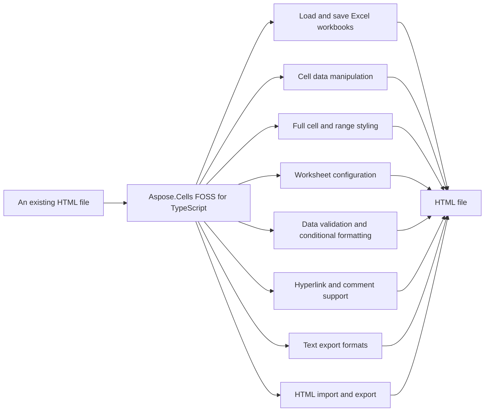

# Aspose.Cells FOSS for TypeScript

Aspose.Cells FOSS for TypeScript is a free, open-source TypeScript library for creating, loading, editing, and saving Excel .xlsx (Office Open XML / SpreadsheetML) workbooks without requiring Microsoft Excel. It exposes an Aspose.Cells-compatible API surface — `Workbook`, `Worksheet`, `Cell`, `Style` — and additionally reads and writes `.html`, and exports to CSV, JSON, and Markdown for reporting and data-interchange scenarios.

Aspose.Cells FOSS for TypeScript is a free, open-source TypeScript library for creating,
loading, editing, and saving Excel `.xlsx` (Office Open XML / SpreadsheetML) workbooks
without requiring Microsoft Excel. It exposes an Aspose.Cells-compatible API surface —
`Workbook`, `Worksheet`, `Cell`, `Style` — and additionally reads and writes HTML, and
exports to CSV, JSON, and Markdown for reporting and data-interchange scenarios.

A npm package has not been published yet. Install from source:

```bash
git clone https://github.com/aspose-cells-foss/Aspose.Cells-FOSS-for-TypeScript.git
cd Aspose.Cells-FOSS-for-TypeScript
npm install
```

- `@zip.js/zip.js` ^2.8.21 — reads and writes the XLSX ZIP container.
- `@xmldom/xmldom` ^0.8.10 — parses and serializes the OOXML part XML.
- `adm-zip` ^0.5.16 — used alongside `@zip.js/zip.js` for ZIP entry handling.

- Requires Node.js 18 or later and TypeScript 5 or later.

- `@types/node` ^25.3.3, `typescript` ^5.9.3 — TypeScript compilation and type checking.
- `ts-node` ^10.9.2, `tsx` ^4.21.0 — running TypeScript examples/tests directly.

## Navigation

- [At a Glance](#at-a-glance)
- [Key Capabilities](#key-capabilities)
- [Installation](#installation)
- [Dependencies](#dependencies)
- [API Reference](#api-reference)
- [Scope and Limitations](#scope-and-limitations)

## At a Glance



## Key Capabilities

- **Load and save Excel workbooks.** It reads Excel workbooks from disk using `Workbook.load`, which auto-detects `.html` files, and writes them back with `Workbook.save`.
- **Cell data manipulation.** It sets cell values, formulas, and shared strings via `Cell.putValue`, `Cell.setFormula`, and `Cell.setSharedStrings`.
- **Full cell and range styling.** It applies font, fill, border, alignment, and number formats to cells using `Style`, `Font`, `Fill`, `Border`, and `Alignment` objects.
- **Worksheet configuration.** It configures worksheet layout by setting column widths, row heights, merged cells, auto filters, and hidden rows through `Worksheet` methods.
- **Data validation and conditional formatting.** It adds data validation areas and applies conditional formatting rules including color scale, data bar, and icon set rules.
- **Hyperlink and comment support.** It inserts hyperlinks and comments into worksheets using `Worksheet.addHyperlink`, `Worksheet.addComment`, `HyperlinkCollection.add`, and `CommentCollection.add`.
- **Text export formats.** It exports workbook data as text using `Workbook.toCsv`, `Workbook.toJson`, and `Workbook.toMarkdown`.
- **HTML import and export.** It imports `.html` files into a workbook via `Workbook.load` and exports a styled HTML document using `Workbook.toHtml`.

- Access embedded pictures and shapes through `Workbook.images` (`ImageInfo[]`) and
  `Worksheet.shapes` (`ShapeInfo[]`).

## Installation

The package `excel-cells` is not yet published on npm (package registry: distribution not found on npm).

## Dependencies

### Required Package Dependencies

- `adm-zip ^0.5.16`
- `@xmldom/xmldom ^0.8.10`
- `@zip.js/zip.js ^2.8.21`

### Development Dependencies

- `ts-node ^10.9.2`
- `tsx ^4.21.0`
- `@types/node ^25.3.3`
- `typescript ^5.9.3`

## API Reference

Aspose.Cells FOSS for TypeScript provides a real class surface centered on `Workbook`, `Worksheet`, `Cell`, and `Style` — `Workbook.worksheets` is a `WorksheetCollection` of `Worksheet` objects, each exposing a `Cells` collection for reading and writing values, formulas, and styles.

The verified public surface has 31 types.

<details>
<summary>View the Complete Public API Surface</summary>

### Core API

| Class | Description |
| --- | --- |
| `Alignment` | Alignment represents the alignment settings for cell content. |
| `AutoFilter` | AutoFilter provides filtering capabilities for a range of cells in a worksheet. |
| `Border` | Border represents the border formatting of a cell or range. |
| `BorderLine` | BorderLine defines the style and color of a border line. |
| `Cell` | Cell represents a single cell in a worksheet. |
| `CellCoordinates` | CellCoordinates specifies the row and column position of a cell. |
| `CellRange` | CellRange defines a rectangular range of cells. |
| `CellValue` | CellValue holds the data stored in a cell. |
| `Cells` | Cells is a collection of Cell objects in a worksheet. |
| `ColorScaleRule` | ColorScaleRule applies a color scale conditional formatting to a range. |
| `Comment` | Comment represents a comment attached to a cell. |
| `CommentCollection` | CommentCollection contains all comments in a worksheet. |
| `ConditionalFormat` | ConditionalFormat applies conditional formatting rules to a range. |
| `ConditionalFormatCollection` | ConditionalFormatCollection holds all conditional formatting rules for a worksheet. |
| `ConditionalFormatRule` | ConditionalFormatRule defines a single conditional formatting rule. |
| `DataBarRule` | DataBarRule applies a data bar conditional formatting to a range. |
| `DataValidation` | DataValidation enforces input restrictions on a cell or range. |
| `DataValidationCollection` | DataValidationCollection contains all data validation rules in a worksheet. |
| `Fill` | Fill defines the background fill formatting for a cell. |
| `FilterColumn` | FilterColumn represents a filtered column in an AutoFilter range. |
| `Font` | Font specifies the font properties for cell text. |
| `Hyperlink` | Hyperlink represents a hyperlink attached to a cell. |
| `HyperlinkCollection` | HyperlinkCollection contains all hyperlinks in a worksheet. |
| `IconSetRule` | IconSetRule applies an icon set conditional formatting to a range. |
| `Protection` | Protection specifies the protection settings for a cell. |
| `Style` | Style defines the formatting attributes applied to a cell. |
| `Workbook` | Workbook represents an Excel workbook and provides access to its worksheets. |
| `Worksheet` | Worksheet represents a single worksheet within a workbook. |
| `WorksheetCollection` | WorksheetCollection contains all worksheets in a workbook. |

#### Enumerations

| Enumeration | Description |
| --- | --- |
| `EncryptionType` | EncryptionType specifies the encryption algorithm used for a workbook. |
| `SaveFormat` | SaveFormat indicates the file format used when saving a workbook. |

#### Detailed Member Reference

### Workbook

The `Workbook` class serves as the main entry point, supporting loading from files via `Workbook.load`, saving to disk via `Workbook.save`, and exporting to multiple formats including HTML, CSV, JSON, and Markdown through `Workbook.toHtml`, `Workbook.toCsv`, `Workbook.toJson`, and `Workbook.toMarkdown` respectively; it exposes its collection of worksheets via `Workbook.worksheets`.

### Worksheet

Each `Worksheet` represents a single sheet in a workbook, identified by its name via `Worksheet.name`, and provides access to its cells through `Worksheet.cells`; cells can be retrieved using `Worksheet.getCell`, `Worksheet.getCell2`, or `Worksheet.getCellByRef`, values can be written with `Worksheet.putValue`, and cell styles can be applied using `Worksheet.setCellStyle`.

### Cell

A `Cell` represents an individual cell in a worksheet, exposing its content via `Cell.value` and `Cell.formula`, supporting hyperlinks via `Cell.hyperlink`, and allowing programmatic updates through `Cell.putValue` and `Cell.setFormula`; its formatting is managed via `Cell.style`.

### Style

The `Style` class enables formatting control through its constructor, exposing properties for font via `Style.font`, fill via `Style.fill`, border via `Style.border`, alignment via `Style.alignment`, number format via `Style.numberFormat`, and protection via `Style.protection`.

</details>

## Scope and Limitations

Aspose.Cells FOSS for TypeScript reads and writes Excel files in the XLSX format and exports worksheet data to text-based formats including CSV, JSON, and Markdown. It provides methods such as `Workbook.toCsv`, `Workbook.toJson`, and `Workbook.toMarkdown` to convert workbook content into string representations.

- Text export is available as a returned string, not as a direct file-write helper — pass the result of `Workbook.toCsv`, `Workbook.toJson`, or `Workbook.toMarkdown` to your own file-writing code, and text export is one-way — there is no corresponding import path back into a `Workbook`.
- A npm package has not been published yet. Install from source:.
- This project is licensed under the MIT License, which permits use, copying, modification, distribution, sublicensing, and commercial use, provided its copyright and permission notice are retained, and the software is provided without warranty.

This project is licensed under the [MIT License](License/LICENSE.txt). The MIT License
permits use, copying, modification, distribution, sublicensing, and commercial use,
provided its copyright and permission notice are retained. The software is provided
without warranty.
