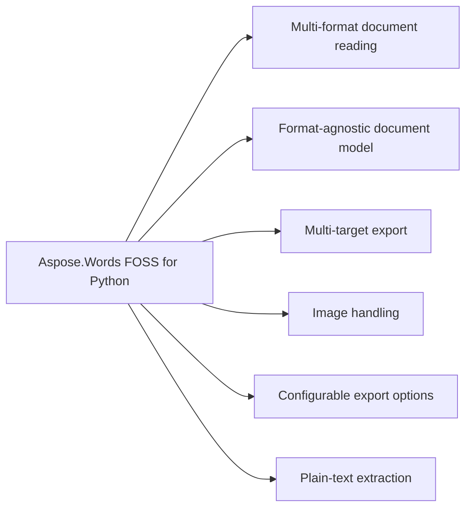

# Aspose.Words FOSS for Python

[](https://pypi.org/project/aspose-words-foss/) 

It reads DOCX, DOC, RTF, Markdown, and plain-text files using dedicated readers and exports the shared Light `Document` Model to DOCX, Markdown, PDF, or plain text. The `Document` class exposes `first_section`, `last_section`, sections, `get_child_nodes`, `get_text`, `page_count`, save, lists, styles, and `light_document_model` to inspect and manipulate documents.

Aspose.Words FOSS for Python is a free, open-source, MIT-licensed Python library for working with
Word documents. It reads DOCX, DOC (Word 97-2003), RTF, Markdown, and plain-text files into a
shared Light Document Model, and exports that model to DOCX, Markdown, PDF, or plain text — all
without Microsoft Word or any COM/Office automation. It follows a compatible API shape (`Document`,
`SaveFormat`) to the commercial Aspose.Words for Python.

## Navigation

- [At a Glance](#at-a-glance)
- [Key Capabilities](#key-capabilities)
- [Installation](#installation)
- [Dependencies](#dependencies)
- [API Reference](#api-reference)
- [Scope and Limitations](#scope-and-limitations)

## At a Glance



## Key Capabilities

- **Multi-format document reading.** It reads DOCX, DOC, RTF, Markdown, and plain text files automatically based on file extension using dedicated readers and a unified `Document` constructor.
- **Format-agnostic document model.** It represents parsed documents with a shared Light `Document` Model that preserves headings, lists, emphasis, tables, block quotes, code blocks, links, and images as typed Pydantic models.
- **Multi-target export.** It exports documents to DOCX, PDF, Markdown, and plain text using dedicated writers and the `SaveFormat` enumeration.
- **Image handling.** It handles inline, captioned, table, and header/footer images by embedding them as base64 data URIs in Markdown, rendering them via a built-in `ShapeRenderer` in PDF, and round-tripping them losslessly in DOCX.
- **Configurable export options.** It configures Markdown and PDF export behavior through `MarkdownLoadOptions` and `PdfSaveOptions`, supporting underline formatting, encoding, and other tunable options.
- **Plain-text extraction.** It extracts plain text from any loaded document using `Document.get_text()` or saves it directly with `SaveFormat`.TEXT.

- Open any supported input with a single `Document(filepath)` constructor — the concrete reader is
  chosen automatically from the `.docx`/`.doc`/`.rtf`/`.md`/`.txt` file extension.
- Read DOCX with a pure-Python parser built on the standard library `zipfile`/`xml.etree` modules —
  no compiled dependencies.
- Read legacy Word 97-2003 `.doc` binary files via `olefile`, and RTF documents through the same
  OLE2 delegation path.

Requires Python 3.10 or later; runtime dependencies install automatically via pip — see
[Dependencies](#dependencies) below for the full required and native-requirement breakdown.

- `olefile` >=0.46 — reads legacy Word 97-2003 .doc binary files and RTF documents via OLE2 delegation.
- `fpdf2` >=2.7.5 — backs the built-in PDF renderer.

- Requires Python 3.10 or later (tested through 3.12; `pyproject.toml` caps at `<3.13`).

- `Pillow>=10.0.0` — used by the `dev` extra's example/test tooling for image-containing documents.
- `pytest>=9.0.2` — the test runner used to execute `ApiExamples/`.

None of these are required to install or use the published package; they apply only when
installing with `pip install -e ".[dev]"` for local development and testing.

## Installation

Install the published package from PyPI (`aspose-words-foss`, version 26.7.0):

```bash
pip install aspose-words-foss
```

The package declares `python_requires` as `>=3.10,<3.13`.

## Dependencies

### Required Package Dependencies

- `fpdf2>=2.7.5`
- `olefile>=0.46`
- `pydantic>=2.0.0`

### Native and System Requirements

- Requires Python `>=3.10,<3.13` (`python_requires` in `pyproject.toml`).

### Development Dependencies

- `Pillow>=10.0.0` (extra `dev`)
- `pytest>=9.0.2` (extra `dev`)

## API Reference

Aspose.Words FOSS for Python provides the `aspose.words_foss.Document` class as the primary entry point for reading and writing documents. It supports loading from file paths or streams and saving to multiple formats using `SaveFormat` constants or dedicated writer options. The library ships 146 public types across the DOC/DOCX/RTF/Markdown/Text readers, the DOCX/Markdown/PDF writers, and the shared Light `Document` Model, summarized in the module-grouped table below.

The verified public surface has 198 types.

<details>
<summary>View the Complete Public API Surface</summary>

### Core API

| Class | Description |
| --- | --- |
| `ConvertDocument` | Demonstrates every supported input -> output format pair. |
| `DocsExamplesBase` | Base class for API example tests, mirroring Aspose.Words DocsExamples. |
| `LoadingDocument` | Demonstrates loading documents from files and streams. |
| `LoadingMarkdown` | Demonstrates loading Markdown straight from a string/bytes, no file needed. |
| `WorkingWithImages` | Convert image-containing documents to all output formats. |
| `WorkingWithMarkdownSaveOptions` | ApiExamples.working_with_markdown_save_options.WorkingWithMarkdownSaveOptions provides examples for exporting documents to Markdown format with configurable options such as underline formatting, encoding, and paragraph break handling. |
| `WorkingWithOoxmlSaveOptions` | ApiExamples.working_with_ooxml_save_options.WorkingWithOoxmlSaveOptions provides examples for saving documents in Office Open XML format with options for pretty formatting and compression level control. |
| `WorkingWithPdfSaveOptions` | ApiExamples.working_with_pdf_save_options.WorkingWithPdfSaveOptions provides examples for exporting documents to PDF format from various input formats and with configurable save options. |
| `WorkingWithTxtSaveOptions` | ApiExamples.working_with_txt_save_options.WorkingWithTxtSaveOptions provides examples for extracting plain text content and exporting documents to plain text format from various input formats. |
| `Document` | Represents a Word document. |
| `LoadOptions` | Options for loading a document. |
| `MarkdownLoadOptions` | Load options specific to Markdown (.md) input. |
| `NodeType` | Node type discriminators, valued as in aspose.words. |
| `ListHandler` | Handles parsing and conversion of lists. |
| `ParagraphConverter` | Handles conversion of paragraphs to Markdown. |
| `TableConverter` | Handles conversion of tables to Markdown. |
| `DocFileReader` | Full DOC reader with LDM (Light Document Model) building capability. |
| `DocFileReaderCore` | Core reader for Word 97-2003 (.doc) files. |
| `FibData` | Parsed FIB (File Information Block) data. |
| `BlipInfo` | Parsed BSE (Blip Store Entry) with location of image data. |
| `ChildAnchorInfo` | Position of a child shape within its parent group's coordinate system. |
| `GroupShapeInfo` | Coordinate system of a shape group (from Spgr record). |
| `ShapeAnchor` | Parsed SPA (Shape Address) from PlcSpaMom / PlcSpaHdr. |
| `ShapeCropInfo` | Escher crop properties for a shape (from FOpt records). |
| `ShapeLineProps` | Escher line/fill properties for a shape (from FOpt records). |
| `ListDef` | Parsed list definition with full level information. |
| `ListLevelData` | One parsed LVL record (measurements in points). |
| `CharProps` | Properties extracted from CHPX for a text run. |
| `ParaProps` | Properties extracted from PAPX for a single paragraph. |
| `TableRowProps` | Properties extracted from PAPX SPRMs on table row-end paragraphs. |
| `StyleData` | Properties parsed from a style definition (STSH UPX). |
| `DocTableBuilderMixin` | Mixin that adds table-building helpers to the DOC reader. |
| `CellData` | Table cell. |
| `DocumentReader` | Reads DOCX documents and produces abstracted data structures. |
| `NumberingInfo` | Numbering definition. |
| `NumberingLevel` | List level definition. |
| `ParagraphData` | Paragraph with style and content. |
| `RowData` | Table row. |
| `RunData` | Text run with formatting. |
| `TableData` | Table structure. |
| `LdmBuilderMixin` | Mixin that adds :meth:to_light_document to :class:DocumentReader. |
| `FontBuilder` | Build a non-cascaded :class:ldm.Font from one <w:rPr>. |
| `FontResolver` | Compose a fully cascaded :class:ldm.Font. |
| `ParagraphFormatBuilder` | Build a non-cascaded :class:ldm.ParagraphFormat from one <w:pPr>. |
| `ParagraphFormatResolver` | Compose a fully cascaded :class:ldm.ParagraphFormat. |
| `StyleChainResolver` | Walk the <w:basedOn> graph for a styleId. |
| `ListBuilder` | Translate <w:numbering> into a list of :class:ldm.DocList. |
| `StyleBuilder` | Translate <w:styles> into a list of :class:ldm.Style. |
| `ParagraphBuilder` | Build :class:ldm.Paragraph from a <w:p> element. |
| `RunBuilder` | Build a single :class:ldm.Run with a resolved font cascade. |
| `PageSetupBuilder` | Build :class:ldm.PageSetup from a <w:sectPr> element. |
| `SectionBuilder` | Split the body into :class:ldm.Section\ s at sectPr boundaries. |
| `CellBuilder` | Build :class:ldm.Cell from a <w:tc> element. |
| `RowBuilder` | Build :class:ldm.Row from a <w:tr> element. |
| `TableBuilder` | Build :class:ldm.Table from a <w:tbl> element. |
| `ShapeParserMixin` | Mixin providing drawing/shape parsing methods for DocumentReader. |
| `DocxWriterLossyWarning` | Warns the caller that the writer is dropping known LDM constructs. |
| `LdmDocxWriter` | Convert an :class:ldm.Document into a DOCX file. |
| `BookmarkState` | Hands out monotonically increasing bookmark ids and pairs |
| `ImageEntry` | One image to add to word/media/ plus its relationship row. |
| `ImageRenderState` | Accumulator threaded through paragraph rendering for inline shapes. |
| `ImageData` | aspose.words_foss.drawing.ImageData represents image data with a content type and supports creation from MIME type strings. |
| `ImageType` | Specifies the type (format) of an image in a document. |
| `Shape` | aspose.words_foss.drawing.Shape represents a drawing object in a document that can contain image content and other visual elements. |
| `WrapType` | Specifies how text is wrapped around a shape or picture. |
| `Body` | aspose.words_foss.light_document_model.Body represents the main content container of a document section, providing access to paragraphs and tables. |
| `BookmarkEnd` | aspose.words_foss.light_document_model.BookmarkEnd represents the ending node of a bookmark in a document. |
| `BookmarkStart` | Marks the beginning of a Word bookmark (<w:bookmarkStart>). |
| `Border` | aspose.words_foss.light_document_model.Border represents the formatting properties of a single border line. |
| `Cell` | aspose.words_foss.light_document_model.Cell represents a single cell within a table row. |
| `CellFormat` | aspose.words_foss.light_document_model.CellFormat represents the formatting properties of a table cell. |
| `ConditionalStyleMask` | Parsed <w:cnfStyle> 12-bit bitmask for banded-table regions. |
| `DocList` | aspose.words_foss.light_document_model.DocList represents a list structure in a document. |
| `FieldEnd` | aspose.words_foss.light_document_model.FieldEnd represents the ending node of a field in a document. |
| `FieldSeparator` | aspose.words_foss.light_document_model.FieldSeparator represents the separator node between field code and field result in a document. |
| `FieldStart` | aspose.words_foss.light_document_model.FieldStart represents the starting node of a field in a document. |
| `Font` | aspose.words_foss.light_document_model.Font represents the font formatting properties applied to text. |
| `FrameFormat` | Floating text-frame definition.  Numeric dimensions are in points. |
| `HeaderFooter` | aspose.words_foss.light_document_model.HeaderFooter represents a header or footer section within a document. |
| `ListFormat` | aspose.words_foss.light_document_model.ListFormat represents the list formatting properties applied to a paragraph. |
| `ListLabel` | Snapshot of a list-item's rendered bullet/number label. |
| `ListLevel` | aspose.words_foss.light_document_model.ListLevel represents the formatting properties of a single level in a list. |
| `ListLevelOverride` | One <w:lvlOverride> inside a concrete <w:num>. |
| `NodeCastMixin` | as_*() casts mirroring aspose.words.Node; identity here. |
| `PageSetup` | aspose.words_foss.light_document_model.PageSetup represents the page setup properties for a document section. |
| `Paragraph` | A paragraph whose children — Run, BookmarkStart / End, |
| `ParagraphFormat` | aspose.words_foss.light_document_model.ParagraphFormat represents the formatting properties applied to a paragraph. |
| `PreferredWidth` | Preferred width of a table / cell. |
| `Row` | aspose.words_foss.light_document_model.Row represents a single row within a table. |
| `RowFormat` | aspose.words_foss.light_document_model.RowFormat represents the formatting properties of a table row. |
| `Run` | aspose.words_foss.light_document_model.Run represents a sequence of characters with the same formatting in a document. |
| `Section` | aspose.words_foss.light_document_model.Section represents a section in a document containing page setup and content properties. |
| `Shading` | aspose.words_foss.light_document_model.Shading represents the background shading properties applied to a document element. |
| `Style` | aspose.words_foss.light_document_model.Style represents a named style that defines formatting for document elements. |
| `TabStop` | aspose.words_foss.light_document_model.TabStop represents a single tab stop position and its alignment. |
| `TabStopCollection` | aspose.words_foss.light_document_model.TabStopCollection represents a collection of tab stops with methods to add, remove, and clear entries. |
| `light_document_model.Table` | aspose.words_foss.light_document_model.Table represents a table structure in a document with rows and cells. |
| `TableStyleFormat` | Table-level properties stored on table styles (w:tblPr inside w:style). |
| `TableStyleProperty` | Conditional formatting for a table region (w:tblStylePr). |
| `TextColumn` | aspose.words_foss.light_document_model.TextColumn represents a single column in a multi-column text layout. |
| `TextColumns` | aspose.words_foss.light_document_model.TextColumns represents a collection of text columns for a document section. |
| `UnknownNode` | aspose.words_foss.light_document_model.UnknownNode represents an unrecognized node type in the document model. |
| `MarkdownReader` | Reads Markdown (.md) files, producing the same data structures as |
| `AtxHeadingBlock` | aspose.words_foss.md_import.AtxHeadingBlock represents an ATX-style Markdown heading block. |
| `AutolinkBlock` | aspose.words_foss.md_import.AutolinkBlock represents an automatic link Markdown block. |
| `Block` | Base class for every node in the Markdown block tree. |
| `BoldInlineBlock` | aspose.words_foss.md_import.BoldInlineBlock represents a bold inline Markdown block. |
| `BulletListItemBlock` | aspose.words_foss.md_import.BulletListItemBlock represents a bullet list item Markdown block. |
| `CellBlock` | aspose.words_foss.md_import.CellBlock represents a table cell Markdown block. |
| `DocumentBlock` | aspose.words_foss.md_import.DocumentBlock represents the root block of a Markdown document. |
| `FencedCodeBlock` | FencedCodeBlock represents a fenced code block in Markdown, typically delimited by triple backticks. |
| `FootnoteDefinitionBlock` | FootnoteDefinitionBlock represents a footnote definition in Markdown, containing the footnote reference and its content. |
| `FootnoteReferenceBlock` | FootnoteReferenceBlock represents a footnote reference in Markdown, pointing to a corresponding footnote definition. |
| `HeadingBlock` | HeadingBlock represents a Markdown heading, typically marked with one or more hash symbols. |
| `HorizontalRuleBlock` | HorizontalRuleBlock represents a horizontal rule in Markdown, usually rendered as a thematic break. |
| `HtmlInsertOptions` | Flags for :meth:MarkdownDocumentBuilder.insert_html (mirrors |
| `HtmlTagBlock` | A raw HTML tag, block-level or inline (Markdig's HtmlBlock / |
| `IndentedCodeBlock` | IndentedCodeBlock represents an indented code block in Markdown, formed by indenting lines with four spaces or a tab. |
| `InlineCodeBlock` | InlineCodeBlock represents inline code in Markdown, typically enclosed in backticks. |
| `ItalicInlineBlock` | ItalicInlineBlock represents italic text in Markdown, usually enclosed in asterisks or underscores. |
| `LineBreakBlock` | LineBreakBlock represents a hard line break in Markdown, produced by two or more trailing spaces. |
| `LinkTextBlock` | LinkTextBlock represents the visible text of a link in Markdown, associated with a destination URL. |
| `ListBlock` | Container grouping sibling ListItemBlocks (Markdig's ListBlock). |
| `ListItemBlock` | ListItemBlock represents a list item in Markdown, which may belong to an unordered or ordered list. |
| `MarkdownDocumentBuilder` | LDM cursor/writer used by :class:MarkdownReaderContext. |
| `MarkdownReaderContext` | Drives Markdown block-tree events into a fresh LDM Document. |
| `OrderedListItemBlock` | OrderedListItemBlock represents an ordered list item in Markdown, typically numbered sequentially. |
| `ParagraphBlock` | ParagraphBlock represents a paragraph in Markdown, consisting of one or more lines of text. |
| `QuoteBlock` | QuoteBlock represents a blockquote in Markdown, typically introduced with the greater-than symbol. |
| `RowBlock` | RowBlock represents a row in a Markdown table, containing one or more cells. |
| `SetextHeadingBlock` | SetextHeadingBlock represents a Setext-style heading in Markdown, underlined with equals or hyphen characters. |
| `StrikethroughBlock` | StrikethroughBlock represents text with a strikethrough in Markdown, typically enclosed in double tildes. |
| `TableBlock` | TableBlock represents a Markdown table, composed of header and data rows. |
| `TextBlock` | A literal run of text (Markdig's LiteralInline). |
| `UnderlineBlock` | UnderlineBlock represents underlined text in Markdown, typically enclosed in double underscores. |
| `LdmMarkdownWriter` | Converts a light_document_model.Document to a Markdown string. |
| `CellMerge` | Specifies how a cell in a table is merged with other cells. |
| `CellVerticalAlignment` | Specifies vertical justification of text inside a table cell. |
| `HeightRule` | Specifies the rule for determining the height of an object. |
| `LineSpacingRule` | Specifies values for line spacing. |
| `LineStyle` | Specifies line style of a border. |
| `NumberStyle` | Specifies the number style for a list, footnotes, endnotes, |
| `Orientation` | Specifies page orientation. |
| `ParagraphAlignment` | Specifies text alignment in a paragraph. |
| `PreferredWidthType` | Specifies the unit of measurement for the preferred width of a table or cell. |
| `SectionStart` | Specifies the type of break at the beginning of the section. |
| `StyleIdentifier` | Locale-independent built-in style identifier. |
| `StyleType` | Specifies type of the style. |
| `TabAlignment` | Tab stop alignment. |
| `TabLeader` | Tab stop leader character. |
| `Underline` | Specifies type of the underline applied to a font. |
| `ConversionOptions` | Options for controlling DOCX to Markdown conversion. |
| `ParagraphInfo` | Information about a paragraph's style and context. |
| `RunFormatting` | Text run formatting properties. |
| `models.Table` | Represents a table structure. |
| `TableCell` | Represents a table cell. |
| `TableRow` | Represents a table row. |
| `NumberingParser` | Parser for DOCX numbering definitions. |
| `StyleParser` | Parser for DOCX style names and properties. |
| `ListInfo` | Information about a list. |
| `ListLevelInfo` | Information about a list level. |
| `ParsedStyle` | Parsed style information. |
| `LdmPdfWriter` | Converts a light_document_model.Document to a PDF file. |
| `ParagraphRenderer` | Renders LDM paragraphs into PDF. |
| `RunRenderer` | Renders formatted runs (text segments with fonts, colors, links). |
| `ShapeRenderer` | Renders shapes, images, and positioned elements. |
| `TableRenderer` | Renders LDM tables into PDF. |
| `DocumentFormatReader` | Protocol defining the interface all document readers must implement. |
| `RtfFileReader` | Reads RTF files (OLE2-format) and produces the same data structures |
| `MarkdownSaveOptions` | Options for saving documents as Markdown. |
| `OoxmlSaveOptions` | Options for saving a document as DOCX (Office Open XML). |
| `OutlineOptions` | Controls how outlines (bookmarks panel) are generated in the PDF. |
| `PdfSaveOptions` | Options for saving documents as PDF. |
| `MarkdownFileReader` | Reads Markdown (.md) files and yields one Paragraph per line. |
| `TextFileReader` | Reads plain-text (.txt) files and yields one Paragraph per line. |

#### Enumerations

| Enumeration | Description |
| --- | --- |
| `LoadFormat` | Document load format constants, valued as in aspose.words. |
| `SaveFormat` | Document save format constants, valued as in aspose.words. |
| `BlockType` | aspose.words_foss.md_import.BlockType enumerates the different types of Markdown blocks supported for import. |
| `md_import.ListMarker` | Bullet/ordered list marker, mirroring Aspose.Words' ListMarker. |
| `MarkdownBlockLevel` | Where a block sits in the tree. |
| `CodeBlockStyle` | Code block style preference. |
| `HeadingStyle` | Heading export style preference. |
| `models.ListMarker` | Bullet list marker style. |
| `ColorMode` | Color rendering mode. |
| `CompressionLevel` | Compression level for OOXML files. |
| `MarkdownEmptyParagraphExportMode` | Controls how empty paragraphs are exported. Note NONE is 2, not 0. |
| `MarkdownExportAsHtml` | Controls which elements are exported as raw HTML. |
| `MarkdownLinkExportMode` | Link export mode options. |
| `MarkdownListExportMode` | List export mode options. |
| `OoxmlCompliance` | OOXML standards compliance level. |
| `PdfCompliance` | PDF standards compliance level. |
| `PdfFontEmbeddingMode` | Font embedding mode in PDF. Note EMBED_NONE is 2, not 1. |
| `PdfImageCompression` | Image compression in PDF. |
| `PdfPageMode` | PDF page display mode. |
| `PdfTextCompression` | Text compression in PDF. |
| `PdfZoomBehavior` | Mirrors public API. |
| `TableContentAlignment` | Table content alignment options. |
| `Zip64Mode` | Controls when to use ZIP64 format extensions for OOXML files. |

#### Detailed Member Reference

### Document

The `aspose.words_foss.Document` class represents a Word document and provides properties such as sections, `first_section`, `last_section`, `page_count`, styles, lists, and methods like save, `get_text`, and `get_child_nodes`.

- `first_section`: The first section of the document.
- `get_child_nodes`: Child nodes, optionally filtered by :class:NodeType.
- `get_text`: Extract plain text from the loaded document.
- `last_section`: The last section of the document.
- `light_document_model`: Access the internal Light Document Model.
- `lists`: All document list definitions.
- `page_count`: Estimated page count.
- `save`: Save the document to the specified format.
- `sections`: All document sections.
- `styles`: All document styles.

### SaveFormat

The `aspose.words_foss.SaveFormat` enumeration provides constants for document save formats including MARKDOWN, PDF, DOCX, and TEXT.

### md_writer

The `aspose.words_foss.md_writer` converts a `Document` to Markdown format using options defined in `MarkdownSaveOptions`.

### pdf_writer

The `aspose.words_foss.pdf_writer` converts a `Document` to PDF format using options defined in `PdfSaveOptions`.

### docx_writer

The `aspose.words_foss.docx_writer` converts a `Document` to DOCX format using options defined in `OoxmlSaveOptions`.

### MarkdownLoadOptions

The `aspose.words_foss.MarkdownLoadOptions` class controls how Markdown documents are loaded, including options for encoding, empty paragraph handling, and link export behavior.

### LoadOptions

The `aspose.words_foss.LoadOptions` class provides base options for loading documents, including specifying the load format when loading from streams.

### light_document_model

The `aspose.words_foss.light_document_model` provides an abstracted data structure representation of a document used internally by readers and writers.

### doc_reader

The `aspose.words_foss.doc_reader` reads legacy Word 97-2003 (.doc) files and produces structured data for further processing.

### docx_reader

The `aspose.words_foss.docx_reader` reads Office Open XML (.docx) files and produces structured data for further processing.

### rtf_reader

The `aspose.words_foss.rtf_reader` reads Rich Text Format (.rtf) files and produces structured data for further processing.

| Class | Description |
|---|---|
| `ListHandler` | Handles parsing and conversion of lists. |
| `ParagraphConverter` | Handles conversion of paragraphs to Markdown. |
| `TableConverter` | Handles conversion of tables to Markdown. |

| Class | Description |
|---|---|
| `ListInfo` | Information about a list. |
| `ListLevelInfo` | Information about a list level. |
| `NumberingParser` | Parser for DOCX numbering definitions. |
| `ParsedStyle` | Parsed style information. |
| `StyleParser` | Parser for DOCX style names and properties. |

</details>

## Scope and Limitations

Aspose.Words FOSS for Python reads and writes DOCX, Markdown, PDF, and plain text documents, and it reads legacy DOC files. It supports Python versions >=3.10,<3.13 and is distributed under the MIT license.

- Saving to `SaveFormat.DOC` is not implemented — the writer raises `ValueError` when attempting to write a .doc file, and only four save formats are implemented.
- Saving DOCX with `OoxmlSaveOptions.compliance` set to `OoxmlCompliance.ISO29500_2008_STRICT` is not implemented — the writer raises `NotImplementedError` rather than emitting non-strict output.
- Eight `PdfSaveOptions` fields — `text_compression`, `embed_full_fonts`, `use_core_fonts`, `font_embedding_mode`, `page_mode`, `color_mode`, `preserve_form_fields`, and `memory_optimization` — exist for API forward-compatibility with the commercial Aspose.Words API and are not yet consumed by the PDF writer.

For DOC writing, strict ISO 29500 compliance, and the additional load/save formats and page-layout
features beyond this edition's scope, see
[Aspose.Words for Python — Enterprise Edition](https://products.aspose.com/words/python-net/),
which adds the full commercial feature set on top of the same compatible document model.
