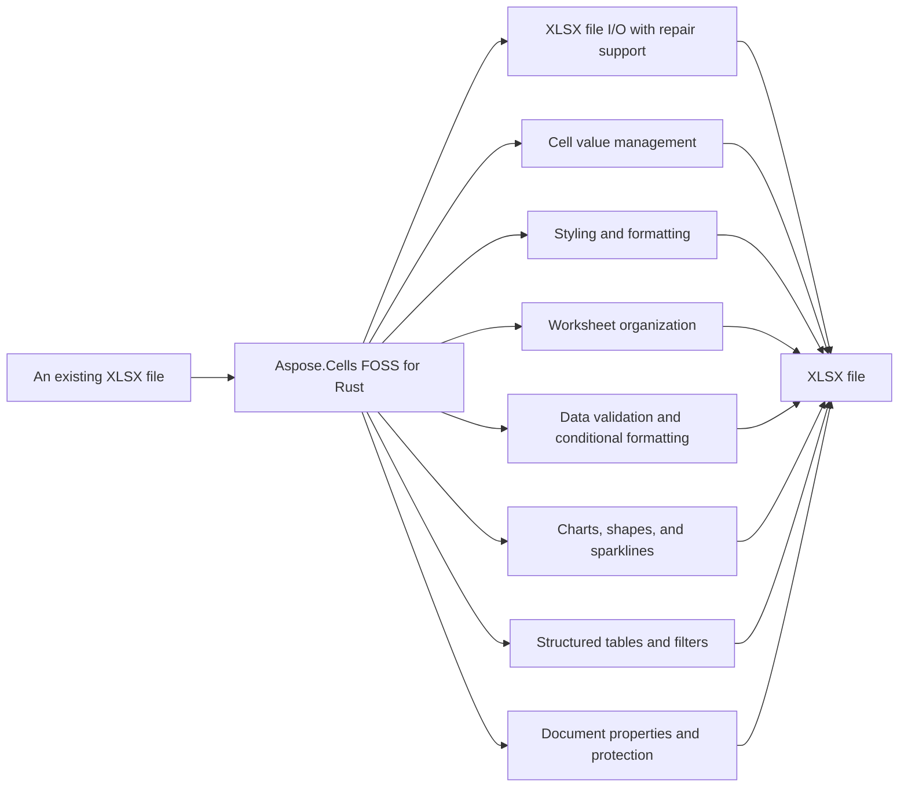

# Aspose.Cells FOSS for Rust

Aspose.Cells FOSS for Rust reads and writes Excel `.xlsx` workbooks. It loads workbooks from files, byte arrays, or streams using `Workbook.load_xlsx`, `Workbook.load_xlsx_from_bytes`, or `Workbook.load_xlsx_from_stream`, and saves them using `Workbook.save_xlsx`, `Workbook.save_xlsx_to_bytes`, or `Workbook.save_xlsx_to_stream`. It provides methods to inspect and repair damaged packages via `LoadOptions.try_repair_package` and `LoadOptions.try_repair_xml`, and exposes diagnostics through `Workbook.get_load_diagnostics`. The library implements the OOXML packaging format from scratch on top of general-purpose crates, with no proprietary runtime, no Microsoft Office installation, and no external Aspose dependency.

Aspose.Cells FOSS for Rust is a free, open-source, pure-Rust library for creating,
loading, editing, and saving Excel `.xlsx` (Office Open XML / SpreadsheetML) workbooks.
It exposes an API modeled after Aspose.Cells, so
the familiar `Workbook` / `Worksheet` / `Cells` object model is available to Rust
programs with no proprietary runtime, no Microsoft Office installation, and no external
Aspose dependency. The OOXML packaging — ZIP container, relationships, shared strings,
styles, worksheet XML, and charts — is implemented from scratch on top of a small set of
general-purpose crates: `zip` (package container), `roxmltree` (XML parsing), `chrono`
(date/time), `sha2` / `base64` / `getrandom` (protection hashing), and `serde_json`.

The package name is `aspose-cells-foss-rust`; the library is imported as
`aspose_cells_foss_rust`. Requires a recent stable Rust toolchain (2021 edition or later).
No proprietary Aspose runtime and no Microsoft Office installation is required.

## Navigation

- [At a Glance](#at-a-glance)
- [Key Capabilities](#key-capabilities)
- [Installation](#installation)
- [Dependencies](#dependencies)
- [API Reference](#api-reference)
- [Scope and Limitations](#scope-and-limitations)

## At a Glance

## Key Capabilities

- **XLSX file I/O with repair support.** It reads and writes `.xlsx` files from a path, a stream, or in-memory bytes, with repair options via `LoadOptions.try_repair_package` and `LoadOptions.try_repair_xml`, and exposes structured diagnostics through `Workbook.get_load_diagnostics`.
- **Cell value management.** It reads typed cell values—string, double, boolean, and date-time—via `Cell.get_string_value`, `Cell.get_double_value`, `Cell.get_bool_value`, and `Cell.get_date_time_value`, and writes values and formulas with cached results using `CellMut.put_value_string`, `CellMut.put_value_i32`, `CellMut.put_value_bool`, `CellMut.put_value_date_time`, and `CellMut.put_formula_with_cached_value`.
- **Styling and formatting.** It applies styling through `CellStyle.font`, `CellStyle.fill`, `CellStyle.borders`, `CellStyle.number_format`, `CellStyle.horizontal_alignment`, `CellStyle.vertical_alignment`, and `CellStyle.wrap_text`, with `Font.set_color`, `Font.set_is_bold`, `Font.set_is_italic`, and `Font.set_underline` for font-level control.
- **Worksheet organization.** It manages worksheets by adding them with `WorksheetsMut.add`, renaming with `Worksheet.set_name`, controlling visibility via `Worksheet.set_visibility_type`, freezing and unfreezing panes with `Worksheet.freeze_panes` and `Worksheet.unfreeze_panes`, and sizing rows and columns using `Worksheet.set_row_height` and `Worksheet.set_column_width`, while protecting and unprotecting sheets via `Worksheet.protect` and `Worksheet.unprotect`.
- **Data validation and conditional formatting.** It enforces data validation rules with `ValidationCollection.add`, `Validation.set_type`, and `Validation.set_operator`, and applies conditional formatting through `ConditionalFormattingCollection.add`, `FormatCondition.set_type`, and `FormatCondition.set_style` for cell-value, expression, color-scale, data-bar, and icon-set rules.
- **Charts, shapes, and sparklines.** It creates charts with `ChartCollection.add` and `Chart.chart_type`, embeds pictures via `PictureCollection.add`, inserts drawing shapes using `ShapeCollection.add`, and builds sparkline groups with `SparklineGroupCollection.add` and `SparklineGroup.sparkline_type`.
- **Structured tables and filters.** It builds structured tables with `ListObjectCollection.add` and `ListObject.show_totals`, applies auto-filters via `Worksheet.auto_filter` and `AutoFilter.set_range`, and retrieves sort state details through `AutoFilter.get_sort_state` and `AutoFilterSortState.get_sort_conditions`.
- **Document properties and protection.** It reads core document properties like `DocumentProperties.get_author` and `ExtendedDocumentProperties.get_company`, sets properties such as `DocumentProperties.set_title`, and manages workbook protection using `Workbook.protection`, `WorkbookProtection.get_is_protected`, `Workbook.protect`, and `Workbook.unprotect`.

- Create a new `Workbook` with `Workbook::new` (starts with one sheet, `"Sheet1"`), or
  load an existing `.xlsx` file from a path (`Workbook::load_xlsx`), a stream
  (`load_xlsx_from_stream`), or in-memory bytes (`load_xlsx_from_bytes`) — with defensive
  repair options via `LoadOptions` (`try_repair_package`, `try_repair_xml`) and structured
  `LoadDiagnostics` for the issues found along the way.
- Manage worksheets through `WorksheetsMut` / `Worksheets` (add, look up by index or
  name, active-sheet state) and `Worksheet` (name, visibility, tab color, gridlines,
  zoom, right-to-left layout, and protection).
- Read and write typed cell values through `Cell` / `CellMut` — `put_value_string`,
  `put_value_i32`, `put_value_bool`, `put_value_decimal`, `put_value_date_time` —
  addressed by A1 name (`get`) or row/column index (`get_by_index`), and enter formulas
  with cached results via `put_formula_with_cached_value`.
- Apply cell styling through `CellStyle` with `Font`, `Fill`, and `Borders`, targeted
  updates via `StyleFlag`, and custom `NumberFormat` strings.
- Size and organize rows, columns, and merged cell areas through `Rows` / `Columns` and `Cells`.
- Enforce data validation rules (`Validation`, `ValidationType`, `OperatorType`) and apply
  conditional formatting — cell-value, expression, color-scale, data-bar, and icon-set
  rules — through `FormatCondition` and `ConditionalFormattingCollection`.
- Build charts through `ChartType` on a worksheet's chart collection — column, line, bar,
  area, pie, doughnut, scatter, radar, bubble, and stock families, plus their stacked and
  3D variants, each rendered as real OOXML chart markup.
- Embed pictures with `Picture` and drawing shapes with `Shape` / `AutoShapeType`
  (rectangles, stars, arrows, and other preset geometries).
- Build structured Excel tables with `ListObject` (table styles, totals), auto-filters
  with `AutoFilter`, and compact in-cell trend charts with `SparklineGroup`.
- Attach hyperlinks (`Hyperlink`), workbook- and sheet-scoped defined names
  (`DefinedName`), and cell comments (`Comment`) with author, note, and visibility
  control.
- Read and write core and extended document properties (`DocumentProperties`,
  `ExtendedDocumentProperties`) and configure print and page layout through `PageSetup`
  (paper size, orientation, margins, page breaks) and `FreezePane`.
- Save back to `.xlsx` — to a file path (`save` / `save_xlsx`), a stream
  (`save_xlsx_to_stream`), or in-memory bytes (`save_xlsx_to_bytes`) — with `SaveOptions`.

## Installation

The package `aspose-cells-foss-rust` is not yet published on crates.io (package registry: distribution not found on cargo).

## Dependencies

### Required Package Dependencies

- `base64 0.22`
- `chrono 0.4`
- `getrandom 0.3`
- `roxmltree 0.20`
- `serde_json 1`
- `sha2 0.10`
- `zip 0.6`

### Native and System Requirements

- Requires Rust edition `2021` (`edition` in `Cargo.toml`).

## API Reference

The primary entry point is `Workbook`, which owns a `Worksheets` / `WorksheetsMut` collection of `Worksheet` objects. Each `Worksheet` exposes its cells through `get_cells()` / `get_cells_mut()`, returning a `Cells` / `CellsMut` accessor used for individual `Cell` / `CellMut` access, row/column collections, and merged ranges.

The verified public surface has 115 types.

View the Complete Public API Surface

### Core API

| Class | Description |
| --- | --- |
| `AutoFilter` | Represents auto filter. |
| `AutoFilterColorFilter` | Represents auto filter color filter. |
| `AutoFilterCustomFilter` | Represents auto filter custom filter. |
| `AutoFilterCustomFilterCollection` | Represents a collection of auto filter custom filter objects. |
| `AutoFilterDynamicFilter` | Represents auto filter dynamic filter. |
| `AutoFilterSortCondition` | Represents auto filter sort condition. |
| `AutoFilterSortConditionCollection` | Represents a collection of auto filter sort condition objects. |
| `AutoFilterSortState` | Represents auto filter sort state. |
| `AutoFilterTop10` | Represents auto filter top10. |
| `Border` | Represents border. |
| `Borders` | Represents borders. |
| `CalculationProperties` | Represents calculation properties. |
| `Cell` | Represents a single worksheet cell and exposes value, formula, and style operations. |
| `CellArea` | Represents cell area. |
| `CellMut` | Represents a single worksheet cell and exposes value, formula, and style operations. |
| `CellStyle` | Represents a mutable cell style facade that can be applied to one or more cells. |
| `Cells` | Provides access to worksheet cells, rows, columns, and merged ranges. |
| `CellsException` | Represents an error that occurs during cells. |
| `CellsMut` | Provides access to worksheet cells, rows, columns, and merged ranges. |
| `Chart` | Represents a chart embedded in a worksheet. |
| `ChartCollection` | Represents collection of charts on a worksheet. |
| `Color` | Represents color. |
| `Column` | Represents column. |
| `ColumnMut` | Represents column. |
| `ColumnProperties` | Encapsulates a single worksheet and its supported v0.1 worksheet features. |
| `Columns` | Represents a collection of column objects. |
| `ColumnsMut` | Represents a collection of column objects. |
| `Comment` | Represents a worksheet comment (legacy note) anchored to a single cell. |
| `CommentCollection` | Represents the collection of comments (legacy notes) on a worksheet. |
| `ConditionalFormattingCollection` | Represents a collection of conditional formatting objects. |
| `CoreDocumentProperties` | Represents core document properties. |
| `DefinedName` | Represents defined name. |
| `DefinedNameCollection` | Represents a collection of defined name objects. |
| `DocumentProperties` | Represents document properties. |
| `ExtendedDocumentProperties` | Represents extended document properties. |
| `Fill` | Represents a mutable cell style facade that can be applied to one or more cells. |
| `FilterColumn` | Represents filter column. |
| `FilterColumnCollection` | Represents a collection of filter column objects. |
| `FilterValueCollection` | Represents a collection of filter value objects. |
| `Font` | Represents font. |
| `FormatCondition` | Represents format condition. |
| `FormatConditionCollection` | Represents a collection of format condition objects. |
| `FormulaException` | Represents an error that occurs during formula. |
| `FreezePane` | Encapsulates a single worksheet and its supported v0.1 worksheet features. |
| `Hyperlink` | Represents hyperlink. |
| `HyperlinkCollection` | Encapsulates the hyperlinks defined for a worksheet. |
| `IWarningCallback` | Defines a callback that receives load warnings. |
| `InvalidFileFormatException` | Represents an error that occurs during invalid file format. |
| `ListColumn` | Represents a single column in an Excel table. |
| `ListColumnCollection` | Represents the ordered collection of columns in an Excel table. |
| `ListObject` | Represents an Excel table (structured reference / ListObject). |
| `ListObjectCollection` | Represents the collection of Excel tables on a worksheet. |
| `LoadDiagnostics` | Represents load diagnostics. |
| `LoadIssue` | Represents load issue. |
| `LoadOptions` | Specifies how a workbook should be loaded. |
| `NumberFormat` | Provides number format operations. |
| `PageSetup` | Represents worksheet print and page-layout settings. |
| `Picture` | Represents a picture (image) anchored to a worksheet. |
| `PictureCollection` | Represents collection of pictures anchored to a worksheet. |
| `Row` | Represents row. |
| `RowMut` | Represents row. |
| `RowProperties` | Encapsulates a single worksheet and its supported v0.1 worksheet features. |
| `Rows` | Represents a collection of row objects. |
| `RowsMut` | Represents a collection of row objects. |
| `SaveOptions` | Specifies how a workbook should be saved. |
| `Shape` | Represents a drawing object (auto shape) anchored to a worksheet. |
| `ShapeCollection` | Represents collection of drawing objects (shapes) on a worksheet. |
| `SparklineGroup` | A sparkline group contains sparkline items that share type and settings. |
| `SparklineGroupCollection` | Represents a collection of sparkline groups on a worksheet. |
| `StyleException` | Represents an error that occurs during style. |
| `StyleFlag` | Represents flags which indicate applied formatting properties. |
| `UnsupportedFeatureException` | Represents an error that occurs during unsupported feature. |
| `Validation` | Represents validation. |
| `ValidationCollection` | Represents a collection of validation objects. |
| `WarningInfo` | Represents warning info. |
| `Workbook` | Represents the root spreadsheet object used to create, load, modify, and save an XLSX workbook. |
| `WorkbookLoadException` | Represents an error that occurs during workbook load. |
| `WorkbookProperties` | Represents workbook properties. |
| `WorkbookProtection` | Represents workbook protection. |
| `WorkbookSaveException` | Represents an error that occurs during workbook save. |
| `WorkbookSettings` | Represents workbook-level settings that affect date handling and display formatting. |
| `WorkbookView` | Represents workbook view. |
| `Worksheet` | Encapsulates a single worksheet and its supported v0.1 worksheet features. |
| `WorksheetProtection` | Represents worksheet protection. |
| `Worksheets` | Encapsulates the workbook's worksheets and active-sheet state. |
| `WorksheetsMut` | Encapsulates the workbook's worksheets and active-sheet state. |

#### Enumerations

| Enumeration | Description |
| --- | --- |
| `AutoShapeType` | Specifies the type of an auto shape (preset geometry). |
| `BorderLineStyle` | Represents border. |
| `BorderStyleType` | Specifies border style type. |
| `CellObjectValue` | CellObjectValue represents the type of value stored in a cell. |
| `CellValue` | CellValue represents the actual data stored in a cell, such as a string, number, boolean, or decimal. |
| `CellValueType` | Specifies cell value type. |
| `CellsError` | CellsError indicates an error condition encountered while processing cell data. |
| `ChartType` | Specifies the chart type. |
| `DateSystem` | DateSystem specifies the date system used for date calculations in a workbook. |
| `DiagnosticSeverity` | DiagnosticSeverity indicates the severity level of a diagnostic issue found during workbook loading. |
| `FillPattern` | Specifies fill pattern. |
| `FilterOperatorType` | Represents FilterOperatorType. |
| `FontUnderlineType` | Enumerates font underline types. |
| `FormatConditionType` | Specifies format condition type. |
| `HorizontalAlignment` | HorizontalAlignment specifies the horizontal alignment of text within a cell. |
| `ImageType` | Represents the format of an image stored in a worksheet. |
| `LoadFormat` | Specifies load format. |
| `OperatorType` | Specifies operator type. |
| `PageOrientationType` | Specifies page orientation type. |
| `PaperSizeType` | Specifies paper size type. |
| `SaveFormat` | Specifies save format. |
| `SparklineType` | Represents SparklineType. |
| `TableStyleType` | Represents the built-in Excel table style types. |
| `TargetModeType` | Specifies target mode type. |
| `TotalsCalculation` | Represents the aggregation function shown in a table totals row cell. |
| `ValidationAlertType` | Specifies validation alert type. |
| `ValidationType` | Specifies validation type. |
| `VerticalAlignment` | VerticalAlignment specifies the vertical alignment of text within a cell. |
| `VisibilityType` | Specifies visibility type. |

#### Detailed Member Reference

### Cell

The `Cell` and `CellMut` types represent a single worksheet cell and expose value, formula, and style operations, with `CellValue` and `CellValueType` enumerations defining the kinds of values a cell can hold.

- `bool_value`: Gets the associated value.
- `border`: Gets the associated value.
- `column`: Gets the associated value.
- `date_time_value`: Gets the associated value.
- `display_string_value`: Gets the display text generated from the cell value, style, and workbook culture.
- `double_value`: Gets the associated value.
- `formatted_string_value`: Gets the associated value.
- `formula_cached_value`: Gets the associated value.
- `get_bool_value`: Gets the associated value.
- `get_border`: Gets the associated value.
- `get_column`: Gets the associated value.
- `get_date_time_value`: Gets the associated value.
- `get_display_string_value`: Gets the display text generated from the cell value, style, and workbook culture.
- `get_double_value`: Gets the associated value.
- `get_formatted_string_value`: Gets the associated value.
- `get_formula_cached_value`: Gets the associated value.
- `get_int_value`: Gets the associated value.
- `get_long_value`: Gets the associated value.
- `get_name`: Gets the associated value.
- `get_raw_string_value`: Gets the associated value.
- `get_row`: Gets the associated value.
- `get_string_value`: Gets a stable string representation of the cell value without applying style-based display formatting.
- `get_style`: Gets the associated value.
- `get_style_with_borders`: Gets the associated value.
- `get_type`: Gets the current logical cell value type.
- `get_value`: Gets the logical cell value.
- `int_value`: Gets the associated value.
- `long_value`: Gets the associated value.
- `name`: Gets the associated value.
- `raw_string_value`: Gets the associated value.
- `row`: Gets the associated value.
- `string_value`: Gets a stable string representation of the cell value without applying style-based display formatting.
- `style`: Gets the associated value.
- `value`: Gets the logical cell value.
- `value_type`: Gets the current logical cell value type.

### Cells

The `Cells` and `CellsMut` types provide access to worksheet cells, rows, columns, and merged ranges, with `CellArea` identifying ranges and `CellsMut.merge` supporting range merging operations.

- `check_cell`: Returns whether the specified A1-style cell currently exists.
- `check_cell_or_cells_exception`: Returns whether the specified A1-style cell currently exists, wrapping failures in CellsException.
- `columns`: Gets column-level settings for the worksheet.
- `count`: Gets the number of items.
- `get`: Gets the item from the collection.
- `get_by_index`: Gets the associated value.
- `get_columns`: Gets column-level settings for the worksheet.
- `get_count`: Gets the number of items.
- `get_merged_cells`: Gets the current merged-cell regions in worksheet order.
- `get_or_cells_exception`: Gets the associated value.
- `get_rows`: Gets row-level settings for the worksheet.
- `get_style`: Gets the default style of the worksheet cells scope.
- `item`: Gets the item from the collection.
- `item_by_index`: Gets the item from the collection.
- `merged_cells`: Gets the current merged-cell regions in worksheet order.
- `rows`: Gets row-level settings for the worksheet.
- `style`: Gets the default style of the worksheet cells scope.

### CellStyle

The `CellStyle` type represents a mutable cell style facade that can be applied to one or more cells, with `Font`, `Fill`, `Borders`, and `Border` types defining font, fill pattern, and border properties.

- `borders`: Gets border settings.
- `clear_horizontal_alignment`: Clears horizontal alignment.
- `clear_number_format`: Clears number format.
- `clear_vertical_alignment`: Clears vertical alignment.
- `copy`: Copies data from another style object.
- `copy_from`: Copies all style values from another style instance.
- `fill`: Gets the associated value.
- `font`: Gets the font settings.
- `get_borders`: Gets border settings.
- `get_borders_mut`: Gets mutable border settings, so that borders can be changed in place: style.get_borders_mut().top_mut().set_color("FFFF0000").
- `get_custom`: Gets the custom number format code.
- `get_fill`: Gets the associated value.
- `get_font`: Gets the font settings.
- `get_font_mut`: Gets mutable font settings, so that font properties can be changed in place: style.get_font_mut().set_size(14.0).
- `get_horizontal_alignment`: Gets the horizontal alignment.
- `get_indent_level`: Gets the indentation level.
- `get_is_hidden`: Gets whether the cell formula is hidden when worksheet protection is enabled.
- `get_is_locked`: Gets whether the cell is locked when worksheet protection is enabled.
- `get_is_text_wrapped`: Gets the associated value.
- `get_number`: Gets the numeric format identifier.
- `get_number_format`: Gets the resolved number format string.
- `get_quote_prefix`: Gets whether the cell value starts with a single quote mark.
- `get_reading_order`: Gets the reading order.
- `get_relative_indent`: Gets the relative indent.
- `get_shrink_to_fit`: Gets whether the cell content shrinks to fit.
- `get_text_rotation`: Gets the text rotation.
- `get_vertical_alignment`: Gets the vertical alignment.
- `new`: Initializes a new instance.
- `set_borders`: Sets border settings.
- `set_custom`: Sets the custom number format code.
- `set_fill`: Sets the associated value.
- `set_font`: Sets the font settings.
- `set_horizontal_alignment`: Sets the horizontal alignment.
- `set_indent_level`: Sets the indentation level.
- `set_is_hidden`: Sets whether the cell formula is hidden when worksheet protection is enabled.
- `set_is_locked`: Sets whether the cell is locked when worksheet protection is enabled.
- `set_is_text_wrapped`: Sets the associated value.
- `set_number`: Sets the numeric format identifier.
- `set_number_format`: Sets the resolved number format string.
- `set_quote_prefix`: Sets whether the cell value starts with a single quote mark.
- `set_reading_order`: Sets the reading order.
- `set_relative_indent`: Sets the relative indent.
- `set_shrink_to_fit`: Sets whether the cell content shrinks to fit.
- `set_text_rotation`: Sets the text rotation.
- `set_vertical_alignment`: Sets the vertical alignment.

### Chart

The `Chart` type represents a chart embedded in a worksheet, with `ChartCollection` managing multiple charts and `ChartType` specifying the chart type.

- `chart_type`: Gets the chart type.
- `data_range`: Gets the chart data range formula.
- `delete`: Deletes the chart from its owning worksheet.
- `get_chart_type`: Gets the chart type.
- `get_data_range`: Gets the chart data range formula.
- `get_extent_cx`: Gets the width extent in EMU.
- `get_extent_cy`: Gets the height extent in EMU.
- `get_lower_right_column`: Gets the zero-based lower-right column of the chart anchor.
- `get_lower_right_row`: Gets the zero-based lower-right row of the chart anchor.
- `get_name`: Gets the chart display name.
- `get_upper_left_column`: Gets the zero-based upper-left column of the chart anchor.
- `get_upper_left_row`: Gets the zero-based upper-left row of the chart anchor.
- `lower_right_column`: Gets the zero-based lower-right column of the chart anchor.
- `lower_right_row`: Gets the zero-based lower-right row of the chart anchor.
- `name`: Gets the chart display name.
- `set_name`: Sets the chart display name.
- `upper_left_column`: Gets the zero-based upper-left column of the chart anchor.
- `upper_left_row`: Gets the zero-based upper-left row of the chart anchor.

### AutoFilter

The `AutoFilter` type represents auto filter functionality, with `AutoFilter.get_range`, `AutoFilter.set_range`, and `AutoFilter.get_sort_state` methods supporting range configuration and sort state retrieval.

- `clear`: Clears the current state.
- `filter_columns`: Gets the filter columns.
- `get_filter_columns`: Gets the filter columns.
- `get_range`: Gets the range.
- `get_sort_state`: Gets the sort state.
- `range`: Gets the range.
- `set_range`: Sets the range.
- `sort_state`: Gets the sort state.

### ListObject

The `ListObject` type represents an Excel table (structured reference / `ListObject`), with `ListObjectCollection` managing multiple tables and `ListObject.show_totals` controlling totals row visibility.

- `comment`: Gets an optional comment for the table.
- `convert_to_range`: Removes the table structure, leaving the cell data in place.
- `data_range`: Gets the table range in A1 notation.
- `display_name`: Gets the user-visible table name.
- `end_column`: Gets the zero-based column index of the last column.
- `end_row`: Gets the zero-based row index of the last row.
- `get_comment`: Gets an optional comment for the table.
- `get_data_range`: Gets the table range in A1 notation.
- `get_display_name`: Gets the user-visible table name.
- `get_end_column`: Gets the zero-based column index of the last column.
- `get_end_row`: Gets the zero-based row index of the last row.
- `get_list_columns`: Gets the collection of columns in this table.
- `get_show_auto_filter`: Gets whether the header row shows auto-filter drop-down buttons.
- `get_show_header_row`: Gets whether the first row of the table range is a header row.
- `get_show_table_style_column_stripes`: Gets whether alternating column stripes are shown.
- `get_show_table_style_first_column`: Gets whether the first column receives highlight formatting.
- `get_show_table_style_last_column`: Gets whether the last column receives highlight formatting.
- `get_show_table_style_row_stripes`: Gets whether alternating row stripes are shown.
- `get_show_totals`: Gets whether the last row of the table range is a totals row.
- `get_start_column`: Gets the zero-based column index of the first column.
- `get_start_row`: Gets the zero-based row index of the first row.
- `get_table_style_name`: Gets the raw table style name stored in SpreadsheetML.
- `get_table_style_type`: Gets the built-in table style type.
- `list_columns`: Gets the collection of columns in this table.
- `remove_auto_filter`: Hides the auto-filter drop-down buttons from the table header row.
- `resize`: Resizes the table to the specified range.
- `set_comment`: Sets an optional comment for the table.
- `set_display_name`: Sets the user-visible table name.
- `set_show_header_row`: Sets whether the first row of the table range is a header row.
- `set_show_table_style_column_stripes`: Sets whether alternating column stripes are shown.
- `set_show_table_style_first_column`: Sets whether the first column receives highlight formatting.
- `set_show_table_style_last_column`: Sets whether the last column receives highlight formatting.
- `set_show_table_style_row_stripes`: Sets whether alternating row stripes are shown.
- `set_show_totals`: Sets whether the last row of the table range is a totals row.
- `set_table_style_name`: Sets the raw table style name stored in SpreadsheetML.
- `set_table_style_type`: Sets the built-in table style type.
- `show_auto_filter`: Shows the auto-filter drop-down buttons on the table header row.
- `show_auto_filter_enabled`: Gets whether the header row shows auto-filter drop-down buttons.
- `show_header_row`: Gets whether the first row of the table range is a header row.
- `show_table_style_column_stripes`: Gets whether alternating column stripes are shown.
- `show_table_style_first_column`: Gets whether the first column receives highlight formatting.
- `show_table_style_last_column`: Gets whether the last column receives highlight formatting.
- `show_table_style_row_stripes`: Gets whether alternating row stripes are shown.
- `show_totals`: Gets whether the last row of the table range is a totals row.
- `start_column`: Gets the zero-based column index of the first column.
- `start_row`: Gets the zero-based row index of the first row.
- `table_style_name`: Gets the raw table style name stored in SpreadsheetML.
- `table_style_type`: Gets the built-in table style type.

### Picture

The `Picture` type represents a picture (image) anchored to a worksheet, with `PictureCollection` managing multiple pictures.

- `data`: Gets the raw binary bytes of the image.
- `delete`: Deletes this item from its owning collection.
- `extension`: Gets the associated value.
- `get_data`: Gets the raw binary bytes of the image.
- `get_extension`: Gets the associated value.
- `get_image_type`: Gets the image format derived from the file extension.
- `get_lower_right_column`: Gets the zero-based column index of the lower-right anchor cell.
- `get_lower_right_row`: Gets the zero-based row index of the lower-right anchor cell.
- `get_name`: Gets the display name of the picture.
- `get_upper_left_column`: Gets the zero-based column index of the upper-left anchor cell.
- `get_upper_left_row`: Gets the zero-based row index of the upper-left anchor cell.
- `image_type`: Gets the image format derived from the file extension.
- `lower_right_column`: Gets the zero-based column index of the lower-right anchor cell.
- `lower_right_row`: Gets the zero-based row index of the lower-right anchor cell.
- `name`: Gets the display name of the picture.
- `set_data`: Sets the raw binary bytes of the image.
- `set_lower_right_column`: Sets the zero-based column index of the lower-right anchor cell.
- `set_lower_right_row`: Sets the zero-based row index of the lower-right anchor cell.
- `set_name`: Sets the display name of the picture.
- `set_upper_left_column`: Sets the zero-based column index of the upper-left anchor cell.
- `set_upper_left_row`: Sets the zero-based row index of the upper-left anchor cell.
- `upper_left_column`: Gets the zero-based column index of the upper-left anchor cell.
- `upper_left_row`: Gets the zero-based row index of the upper-left anchor cell.

### Shape

The `Shape` type represents a drawing object (auto shape) anchored to a worksheet, with `ShapeCollection` managing multiple shapes.

- `auto_shape_type`: Gets the shape type.
- `auto_shape_type_to_geometry`: Converts an auto shape type to its DrawingML geometry name.
- `delete`: Deletes this item from its owning collection.
- `geometry_to_auto_shape_type`: Converts a DrawingML geometry name to an auto shape type.
- `get_auto_shape_type`: Gets the shape type.
- `get_lower_right_column`: Gets the zero-based column index of the lower-right anchor cell.
- `get_lower_right_row`: Gets the zero-based row index of the lower-right anchor cell.
- `get_name`: Gets the display name of the shape.
- `get_upper_left_column`: Gets the zero-based column index of the upper-left anchor cell.
- `get_upper_left_row`: Gets the zero-based row index of the upper-left anchor cell.
- `lower_right_column`: Gets the zero-based column index of the lower-right anchor cell.
- `lower_right_row`: Gets the zero-based row index of the lower-right anchor cell.
- `name`: Gets the display name of the shape.
- `set_auto_shape_type`: Sets the shape type.
- `set_lower_right_column`: Sets the zero-based column index of the lower-right anchor cell.
- `set_lower_right_row`: Sets the zero-based row index of the lower-right anchor cell.
- `set_name`: Sets the display name of the shape.
- `set_upper_left_column`: Sets the zero-based column index of the upper-left anchor cell.
- `set_upper_left_row`: Sets the zero-based row index of the upper-left anchor cell.
- `upper_left_column`: Gets the zero-based column index of the upper-left anchor cell.
- `upper_left_row`: Gets the zero-based row index of the upper-left anchor cell.

### SparklineGroup

The `SparklineGroup` type represents a sparkline group containing sparkline items that share type and settings, with `SparklineGroupCollection` managing multiple sparkline groups.

- `data_range`: Gets the data range for the sparkline group.
- `get_data_range`: Gets the data range for the sparkline group.
- `get_location_range`: Gets the location range where sparkline cells are placed.
- `get_sparkline_type`: Gets the sparkline type.
- `location_range`: Gets the location range where sparkline cells are placed.
- `remove`: Removes this sparkline group from its owning worksheet.
- `set_data_range`: Sets the data range for the sparkline group.
- `set_location_range`: Sets the location range where sparkline cells are placed.
- `set_sparkline_type`: Sets the sparkline type.
- `sparkline_type`: Gets the sparkline type.

### Hyperlink

The `Hyperlink` type represents a hyperlink, with `HyperlinkCollection` managing hyperlinks defined for a worksheet.

- `address`: Gets the address.
- `area`: Gets the area.
- `delete`: Performs delete.
- `get_address`: Gets the address.
- `get_area`: Gets the area.
- `get_screen_tip`: Gets the screen tip.
- `get_text_to_display`: Gets the text to display.
- `screen_tip`: Gets the screen tip.
- `set_address`: Sets the address.
- `set_screen_tip`: Sets the screen tip.
- `set_text_to_display`: Sets the text to display.
- `text_to_display`: Gets the text to display.

### DefinedName

The `DefinedName` type represents a defined name, with `DefinedNameCollection` managing defined names at workbook or worksheet scope.

- `get_comment`: Gets the comment.
- `get_formula`: Gets the formula.
- `get_local_sheet_index`: Gets the local sheet index.
- `get_name`: Gets the name.
- `is_hidden`: Returns whether hidden.
- `set_comment`: Sets the comment.
- `set_formula`: Sets the formula.
- `set_hidden`: Sets a value indicating whether hidden.
- `set_local_sheet_index`: Sets the local sheet index.
- `set_name`: Sets the name.

### Comment

The `Comment` type represents a worksheet comment (legacy note) anchored to a single cell, with `CommentCollection` managing comments on a worksheet.

- `author`: Gets the comment author name.
- `cell_name`: Gets the associated value.
- `column`: Gets the zero-based column index of the annotated cell.
- `delete`: Deletes this item from its owning collection.
- `get_author`: Gets the comment author name.
- `get_cell_name`: Gets the associated value.
- `get_column`: Gets the zero-based column index of the annotated cell.
- `get_height`: Gets the comment box height in pixels.
- `get_is_visible`: Gets whether the comment box is always shown (true) or hidden until hover (false).
- `get_note`: Gets the plain-text note content of the comment.
- `get_row`: Gets the zero-based row index of the annotated cell.
- `get_width`: Gets the comment box width in pixels.
- `height`: Gets the comment box height in pixels.
- `is_visible`: Gets whether the comment box is always shown (true) or hidden until hover (false).
- `note`: Gets the plain-text note content of the comment.
- `row`: Gets the zero-based row index of the annotated cell.
- `set_author`: Sets the comment author name.
- `set_height`: Sets the comment box height in pixels.
- `set_is_visible`: Sets whether the comment box is always shown (true) or hidden until hover (false).
- `set_note`: Sets the plain-text note content of the comment.
- `set_width`: Sets the comment box width in pixels.
- `visible`: Gets whether the comment box is always shown (true) or hidden until hover (false).
- `width`: Gets the comment box width in pixels.

The
public API surface includes 213 public types, summarized in the module-grouped table
below.

## Scope and Limitations

Aspose.Cells FOSS for Rust reads and writes `.xlsx` (OOXML/`SpreadsheetML`) workbooks and provides a Rust API to manipulate worksheets, cells, formulas, and formatting.

- It supports only the `.xlsx` format for input and output, with no support for legacy .xls (BIFF), ODS, or CSV, and the public API surface is broad but not a complete match for Aspose.Cells — some features are still partial, and the crate is early-stage and evolving.
- A workbook must always keep at least one worksheet: `WorksheetsMut.remove_at` returns a `CellsError`::Unsupported error when asked to remove the last remaining worksheet.
- No automated test suite ships yet (cargo test --all-targets currently reports 0 tests).
- The crate is not yet published to crates.io.
- Installation requires a git-dependency workaround.
- The package uses Rust edition 2021 and version 26.7.0.
