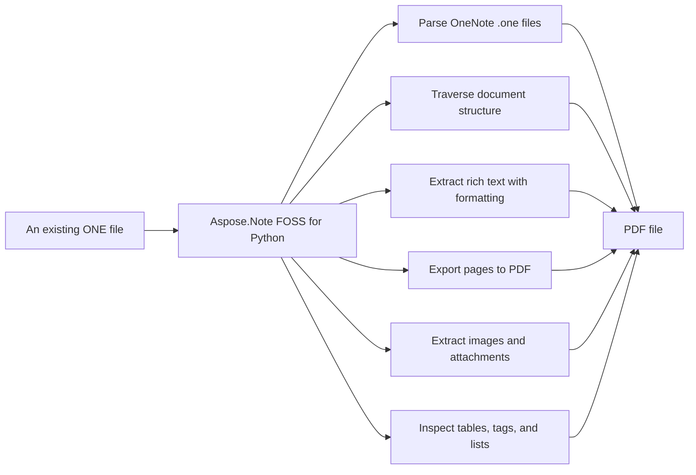

# Aspose.Note FOSS for Python

[](https://pypi.org/project/aspose-note-foss/) 

It reads Microsoft OneNote `.one` files and writes `.pdf` files, supporting extraction of pages, rich text, images, attachments, tables, tags, and numbered lists, and allows custom processing via the `DocumentVisitor` pattern.

Aspose.Note FOSS for Python is a free, open-source Python library for working with Microsoft
OneNote `.one` files. It gives Python programs read access to OneNote notebooks — pages, rich
text, images, attachments, tables, tags, and numbered lists — and can export pages to PDF, with
no Microsoft OneNote installation or COM automation involved.

## Navigation

- [At a Glance](#at-a-glance)
- [Key Capabilities](#key-capabilities)
- [Installation](#installation)
- [Dependencies](#dependencies)
- [Quick Start](#quick-start)
- [Additional Examples](#additional-examples)
- [API Reference](#api-reference)
- [Scope and Limitations](#scope-and-limitations)

## At a Glance



## Key Capabilities

- **Parse OneNote .one files.** It reads `.one` files from a file path or binary stream into a document object model, supporting `Document` with `Page`, `OutlineElement`, `RichText`, `Image`, `Table`, and `AttachedFile` nodes without requiring Microsoft OneNote or COM automation.
- **Traverse document structure.** It traverses the parsed document tree using `CompositeNode.GetChildNodes()` for type-based node retrieval or the `DocumentVisitor` pattern to visit `Page`, `Outline`, `OutlineElement`, `RichText`, `Image`, `Table`, and `AttachedFile` nodes in order.
- **Extract rich text with formatting.** It extracts rich text content and per-run formatting through `TextRun` with `TextStyle` properties such as bold, italic, underline, strikethrough, superscript, subscript, font, color, and hyperlinks, plus paragraph-level styling via `ParagraphStyle`.
- **Export pages to PDF.** It exports pages to `.pdf` files using `SaveFormat.Pdf` or `PdfSaveOptions` to tune JPEG quality and compression settings, supporting both direct path output and stream-based saving.
- **Extract images and attachments.** It extracts embedded images and attached files by accessing their bytes, file names, and metadata, enabling direct saving to disk using `Image.Bytes` and `AttachedFile.Bytes`.
- **Inspect tables, tags, and lists.** It inspects tables through `Table`, `TableRow`, and `TableCell` to access rows, cells, and their rich text content; OneNote tags via `NoteTag` with labels and statuses attached to text, images, and tables; and numbered lists through `NumberList` with format, number format, and restart settings.

## Installation

Install the published package from PyPI (`aspose-note-foss`, version 26.9.0):

```bash
pip install aspose-note-foss
```

To work from a source checkout instead, install the clone with pip:

```bash
git clone https://github.com/aspose-note-foss/Aspose.Note-FOSS-for-Python.git
cd Aspose.Note-FOSS-for-Python
pip install .
```

Verify the install:

```bash
python -c "import aspose.note"
```

The package declares `python_requires` as `>=3.10`.

## Dependencies

### Required Package Dependencies

No required third-party package dependencies; in `pyproject.toml`, the `project.dependencies` list is empty.

### Optional Dependencies

- `reportlab>=3.6` (extra `pdf`)
- `Pillow>=10.0` (extra `test-pdf`)
- `PyMuPDF>=1.25` (extra `test-pdf`)
- `pypdf>=5.3` (extra `test-pdf`)

### Native and System Requirements

- Requires Python 3.10 or later (`python_requires=">=3.10"` in `pyproject.toml`).

### Development Dependencies

- `build>=1.2` (extra `dev`)
- `twine>=5.0` (extra `dev`)

## Quick Start

The example loads a OneNote file and converts it to PDF by creating a `Document` from `SimpleTable.one` and calling Save with `SaveFormat.Pdf`.

```python
from aspose.note import Document, SaveFormat

doc = Document("SimpleTable.one")
doc.Save("out.pdf", SaveFormat.Pdf)
```

The example opens a OneNote file in binary mode, constructs a `Document` from the file handle, and prints its `DisplayName` and page count.

```python
from aspose.note import Document

with open("SimpleTable.one", "rb") as f:
    doc = Document(f)
print(doc.DisplayName, len(list(doc)))
```

## Additional Examples

The following workflows demonstrate reading embedded images, extracting tables, saving attached files, inspecting tags, counting document elements, exporting to PDF, and analyzing numbered lists.

### Save Embedded Images to Disk

```python
from pathlib import Path
from aspose.note import Document, Image

out_dir = Path("out_images")
out_dir.mkdir(exist_ok=True)

doc = Document("3ImagesWithDifferentAlignment.one")
for i, img in enumerate(doc.GetChildNodes(Image), start=1):
    name = img.FileName or f"image_{i}.png"
    (out_dir / name).write_bytes(img.Bytes)
```

<details>
<summary>View Additional Examples</summary>

### Traverse Tables and Extract Cell Text

```python
from aspose.note import Document, Table, TableRow, TableCell, RichText

doc = Document("SimpleTable.one")
for table in doc.GetChildNodes(Table):
    for row in table.GetChildNodes(TableRow):
        cells = row.GetChildNodes(TableCell)
        values = [" ".join(rt.Text for rt in cell.GetChildNodes(RichText)) for cell in cells]
        print(values)
```

### Extract Attached Files from a Document

```python
from pathlib import Path
from aspose.note import Document, AttachedFile

doc = Document("OnePageWithFile.one")
for i, af in enumerate(doc.GetChildNodes(AttachedFile), start=1):
    name = af.FileName or f"attachment_{i}.bin"
    Path(name).write_bytes(af.Bytes)
```

### Inspect Tag Labels and Statuses

```python
from aspose.note import Document, RichText

doc = Document("TagSizes.one")
for rt in doc.GetChildNodes(RichText):
    for tag in rt.Tags:
        print(tag.Label, tag.Status)
```

### Count Pages, Rich Text, and Images

```python
from aspose.note import Document, DocumentVisitor, Page, Image, RichText

class Counter(DocumentVisitor):
    def __init__(self):
        self.pages = 0
        self.rich_texts = 0
        self.images = 0

    def VisitPageStart(self, page: Page) -> None:
        self.pages += 1

    def VisitRichTextStart(self, rich_text: RichText) -> None:
        self.rich_texts += 1

    def VisitImageStart(self, image: Image) -> None:
        self.images += 1

doc = Document("3ImagesWithDifferentAlignment.one")
counter = Counter()
doc.Accept(counter)
print(counter.pages, counter.rich_texts, counter.images)
```

### Extract Plain Text from Rich Text Nodes

```python
from aspose.note import Document, RichText

doc = Document("FormattedRichText.one")
texts = [rt.Text for rt in doc.GetChildNodes(RichText)]
print("\n".join(texts))
```

### Export to PDF with Custom JPEG Quality

```python
from aspose.note import Document, SaveFormat
from aspose.note.saving import PdfSaveOptions

doc = Document("TagSizes.one")
opts = PdfSaveOptions(JpegQuality=90)
doc.Save("out.pdf", opts)
```

### Identify Hyperlinks and Their Addresses

```python
from aspose.note import Document, RichText

doc = Document("FormattedRichText.one")
for rt in doc.GetChildNodes(RichText):
    for run in rt.TextRuns:
        if run.Style.IsHyperlink and run.Style.HyperlinkAddress:
            print(run.Text, "->", run.Style.HyperlinkAddress)
```

### Inspect Numbered List Formatting Properties

```python
from aspose.note import Document, OutlineElement

doc = Document("NumberedListWithTags.one")
for oe in doc.GetChildNodes(OutlineElement):
    nl = oe.NumberList
    if nl is None:
        continue
    print("format=", nl.Format, "number_format=", nl.NumberFormat, "restart=", nl.Restart)
```

PDF export needs the optional `pdf` extra, which pulls in [ReportLab](https://pypi.org/project/reportlab/):

```bash
pip install "aspose-note-foss[pdf]"
```

The PyPI distribution is named `aspose-note-foss`; the import package is
`aspose.note` — `from aspose.note import Document`.

- `build`, `twine` — used to build and publish the package release; not needed to use or test the library.

Export the same document to PDF:

More real, runnable scripts are available in [`examples/`](examples/). The most illustrative one
beyond Quick Start is saving every embedded image to disk.

</details>

## API Reference

Aspose.Note FOSS for Python reads and writes `.one` files and converts them to `.pdf`. The primary entry point is `aspose.note.Document`, which loads a `.one` file and exposes its pages as a tree of `Page`, `Outline`, `OutlineElement`, `RichText`, `Image`, `Table`, and `AttachedFile` nodes; `Document.Save()` is the sole write path, currently limited to PDF via `PdfSaveOptions`. The supported public entry points are `aspose.note` and `aspose.note.saving`.

The verified public surface has 37 types.

<details>
<summary>View the Complete Public API Surface</summary>

### Core API

| Class | Description |
| --- | --- |
| `AttachedFile` | The aspose.note.AttachedFile class represents an attached file node in a document. |
| `Document` | The aspose.note.Document class represents a document that can be loaded, modified, and saved. |
| `DocumentVisitor` | The aspose.note.DocumentVisitor class provides methods to traverse and process document nodes. |
| `FileCorruptedException` | The aspose.note.FileCorruptedException class represents an error thrown when a file is corrupted. |
| `Image` | The aspose.note.Image class represents an image node in a document. |
| `IncorrectDocumentStructureException` | The aspose.note.IncorrectDocumentStructureException class represents an error thrown when a document structure is incorrect. |
| `IncorrectPasswordException` | The aspose.note.IncorrectPasswordException class represents an error thrown when a document password is incorrect. |
| `License` | The aspose.note.License class allows setting a license for the product. |
| `LoadOptions` | The aspose.note.LoadOptions class specifies options for loading a document. |
| `Metered` | The aspose.note.Metered class allows setting metered key for usage tracking. |
| `Node` | The aspose.note.Node class is the base class for all document nodes. |
| `NoteTag` | The aspose.note.NoteTag class represents a note tag with an icon and status. |
| `NumberList` | The aspose.note.NumberList class defines a numbered list with formatting options. |
| `Outline` | The aspose.note.Outline class represents an outline node in a document. |
| `OutlineElement` | The aspose.note.OutlineElement class represents an outline element node in a document. |
| `Page` | The aspose.note.Page class represents a page node in a document. |
| `PageHistory` | The aspose.note.PageHistory class manages the history of page versions. |
| `ParagraphStyle` | The aspose.note.ParagraphStyle class defines paragraph formatting options. |
| `RichText` | The aspose.note.RichText class represents rich text content in a document. |
| `Table` | The aspose.note.Table class represents a table node in a document. |
| `TableCell` | The aspose.note.TableCell class represents a table cell node in a document. |
| `TableColumn` | The aspose.note.TableColumn class defines a table column. |
| `TableRow` | The aspose.note.TableRow class represents a table row node in a document. |
| `TextRun` | The aspose.note.TextRun class represents a run of text with consistent formatting. |
| `TextStyle` | The aspose.note.TextStyle class defines text formatting options. |
| `Title` | The aspose.note.Title class represents a title node in a document. |
| `UnsupportedFileFormatException` | The aspose.note.UnsupportedFileFormatException class represents an error thrown when a file format is unsupported. |
| `UnsupportedSaveFormatException` | The aspose.note.UnsupportedSaveFormatException class represents an error thrown when a save format is unsupported. |
| `AsposeNoteError` | The aspose.note.exceptions.AsposeNoteError class is the base exception for Aspose.Note errors. |
| `CompositeNode` | The aspose.note.model.CompositeNode class represents a node that can contain child nodes. |
| `PdfSaveOptions` | The aspose.note.model.PdfSaveOptions class specifies options for saving a document as PDF. |
| `SaveOptions` | The aspose.note.model.SaveOptions class specifies options for saving a document. |

#### Enumerations

| Enumeration | Description |
| --- | --- |
| `FileFormat` | The aspose.note.FileFormat class specifies supported file formats for documents. |
| `HorizontalAlignment` | The aspose.note.HorizontalAlignment class specifies horizontal alignment options. |
| `NodeType` | The aspose.note.NodeType class specifies node types in a document. |
| `SaveFormat` | The aspose.note.SaveFormat class specifies supported save formats for documents. |
| `TagStatus` | The aspose.note.TagStatus class specifies the status of a note tag. |

#### Detailed Member Reference

### Document

The `aspose.note.Document` class loads a `.one` file or stream and exposes its pages as a tree of child nodes; it provides `Document.Save()` to export to `.pdf` and `Document.GetPageHistory()` to access page revision history.

### Page

The `aspose.note.Page` class represents a single OneNote page and provides access to its `Title`, author, timestamps, and child nodes; `Page.Clone()` creates a copy of the page.

### RichText

The `aspose.note.RichText` class holds formatted text content with alignment, tags, and a list of `TextRun` objects; each `TextRun` carries its own `TextStyle` with character-level formatting options.

### Image

The `aspose.note.Image` class exposes embedded image bytes, file name, dimensions, alignment, and OneNote tags; `Image.Replace()` updates the image content.

### Table

The `aspose.note.Table` class represents a table on a page with columns, border visibility, and tags; it contains `TableRow` objects, each holding `TableCell` nodes with rich text or other content.

### AttachedFile

The `aspose.note.AttachedFile` class exposes a file attached to a page with its raw bytes, file name, and tags; it is accessible via `Document.GetChildNodes`(`AttachedFile`).

### DocumentVisitor

The `aspose.note.DocumentVisitor` class provides a base for traversing the document tree via `VisitPageStart`, `VisitRichTextStart`, `VisitImageStart`, and other callback methods; subclasses implement custom traversal logic.

### SaveFormat

The `aspose.note.SaveFormat` enumeration specifies the output format accepted by `Document.Save()`; currently only `.pdf` is supported.

### NoteTag

The `aspose.note.NoteTag` class represents a OneNote tag attached to text, images, or tables, exposing its label, status, icon, and creation or completion time.

### NumberList

The `aspose.note.NumberList` class defines numbered-list formatting applied to an `OutlineElement`, including format, number format, font settings, and restart behavior.

### exceptions

The `aspose.note.exceptions` module provides exception classes for error handling, including `FileCorruptedException` for malformed source files, `IncorrectPasswordException` for password-protected documents, `UnsupportedFileFormatException` for unrecognized formats, and `UnsupportedSaveFormatException` for unsupported output formats.

### saving

The `aspose.note.saving` module provides save-related classes such as `PdfSaveOptions` for configuring PDF export options including image compression and JPEG quality.

The
supported public entry points are `aspose.note` and `aspose.note.saving` — everything under
`aspose.note._internal` is an implementation detail and may change.

| Class | Description |
|---|---|
| `AsposeNoteError` | Base exception for the library; all other library exceptions inherit from it. |
| `AttachedFile` | A file attached to a page — exposes its raw `Bytes`, `FileName`, and `Tags`. |
| `CompositeNode` | Base class for every container node (`Document`, `Page`, `Table`, ...); provides child-node access and `GetChildNodes()`. |
| `Document` | The root DOM object — loads a `.one` file or stream, exposes its `Page` children, and is the sole `Save()` entry point. |
| `DocumentVisitor` | Base visitor class for traversing the DOM via `Visit*Start`/`Visit*End` callbacks. |
| `FileCorruptedException` | Raised when the source file's OneStore container is malformed. |
| `Image` | An embedded image — bytes, file name, dimensions, alignment, and OneNote tags. |
| `IncorrectDocumentStructureException` | Raised when the parsed OneStore object graph doesn't match the expected document structure. |
| `IncorrectPasswordException` | Raised when `LoadOptions.DocumentPassword` is supplied — password-protected documents are not supported. |
| `License` | Compatibility surface for the commercial licensing API; see Scope and Limitations. |
| `LoadOptions` | Options passed to `Document()` — `DocumentPassword` and `LoadHistory`. |
| `Metered` | Compatibility surface for the commercial metered-licensing API; see Scope and Limitations. |
| `Node` | Base class for every DOM node — `ParentNode`, `Document`, and `Accept()`. |
| `NoteTag` | A OneNote tag (yellow star, question mark, musical note, or custom) attached to text, images, or tables. |
| `NumberList` | Numbered-list formatting applied to an `OutlineElement`. |
| `Outline` | A positioned container of `OutlineElement` nodes on a page. |
| `OutlineElement` | A single outline item — may hold `RichText`, `Image`, `Table`, or nested content, plus an optional `NumberList`. |
| `Page` | A single OneNote page — title, author, timestamps, level, and revision history. |
| `PageHistory` | The ordered revision history for a `Page`, returned by `Document.GetPageHistory()`. |
| `ParagraphStyle` | Default paragraph-level text formatting used by `RichText.ParagraphStyle`. |
| `RichText` | A run of formatted text content — `Text`, `TextRuns`, alignment, and tags. |
| `Table` | A table on a page — columns, border visibility, and tags. |
| `TableCell` | A single cell within a `TableRow`, holding rich text, images, or nested content as child nodes. |
| `TableColumn` | A table column's width and lock state. |
| `TableRow` | A row within a `Table`, containing one `TableCell` per column. |
| `TextRun` | A single formatted run within `RichText.Text` — `Text` plus its `TextStyle`. |
| `TextStyle` | Character-level formatting — bold, italic, underline, font, color, hyperlink, and more. |
| `Title` | A page's title — `TitleText`, `TitleDate`, and `TitleTime`, each a `RichText`. |
| `UnsupportedFileFormatException` | Raised when the source isn't a recognized OneNote format; carries the detected `FileFormat`. |
| `UnsupportedSaveFormatException` | Raised by `Document.Save()` for anything other than `SaveFormat.Pdf`. |

| Enumeration | Description |
|---|---|
| `FileFormat` | The detected OneNote source format (`Unknown`, `OneNote2010`, `OneNoteOnline`, `OneNote2007`). |
| `HorizontalAlignment` | Horizontal text/image alignment (`Left`, `Center`, `Right`). |
| `NodeType` | The DOM node kind used by `CompositeNode.GetChildNodes(node_type)`. |
| `SaveFormat` | The output format accepted by `Document.Save()` — currently only `Pdf`. |
| `TagStatus` | A `NoteTag`'s completion state (`Open`, `Completed`, `Disabled`). |

| Class | Description |
|---|---|
| `AttachmentTagFlowable` | Internal ReportLab `Flowable` that lays out an attachment's tag icon in the generated PDF. |
| `OutlinePrefixFlowable` | Internal ReportLab `Flowable` that lays out an outline element's numbered-list prefix in the generated PDF. |
| `PdfSaveOptions` | Options for PDF export — image compression, JPEG quality, page settings, and page range. |
| `SaveOptions` | Abstract base for save-options types; exposes `SaveFormat`, `PageIndex`, `PageCount`, `FontsSubsystem`. |

</details>

## Scope and Limitations

Aspose.Note FOSS for Python reads `OneNote` files and exports them to PDF. It supports the `aspose.note.SaveFormat.Pdf` export target and raises `aspose.note.UnsupportedSaveFormatException` for any other format or options object.

- Writing back to `.one` files is not implemented, and `SaveFormat` currently declares only Pdf so `Document.Save()` raises `UnsupportedSaveFormatException` for any other format or options object.
- `LoadOptions.DocumentPassword` and encrypted documents are not supported; supplying a password raises `IncorrectPasswordException`.
- `License.SetLicense()` and `Metered.SetMeteredKey()` are present for API-shape compatibility with the commercial product but are no-ops in this edition; no license is required to use this library.
- `DetectLayoutChanges()` is a compatibility stub and performs no layout computation.
- `FileFormat` is present for API-shape compatibility but provides no additional functionality beyond what `Document.FileFormat` exposes.
- This library only reads `OneNote` files and does not support writing back to `.one` files, encrypted documents, or any export format other than PDF.

This project is licensed under the [MIT License](LICENSE). The MIT License permits use, copying,
modification, distribution, sublicensing, and commercial use, provided its copyright and
permission notice are retained. The software is provided without warranty. The optional PDF-export
dependency, [ReportLab](https://pypi.org/project/reportlab/), is BSD-3-Clause licensed; see
[THIRD_PARTY_NOTICES.md](THIRD_PARTY_NOTICES.md) for the full text.
