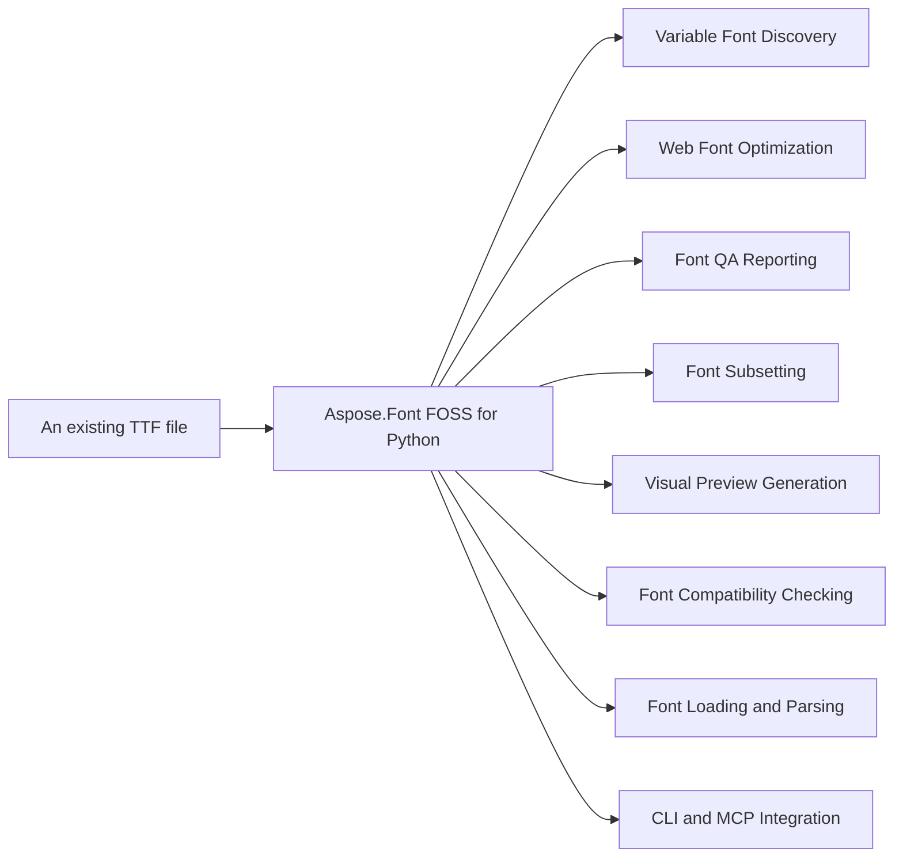

# Aspose.Font FOSS for Python

[](https://pypi.org/project/aspose-font-foss/) 

Aspose.Font FOSS for Python reads and writes `.ttf` fonts and converts them to web-ready formats. It builds optimized font packages for the web, generates quality assurance reports, and creates variable font instances with naming policies. The product supports variable font inspection, subsetting, and compatibility checking through dedicated classes.

Public GitHub repository: [aspose-font-foss/Aspose.Font-FOSS-for-Python](https://github.com/aspose-font-foss/Aspose.Font-FOSS-for-Python)

## Navigation

- [At a Glance](#at-a-glance)
- [Key Capabilities](#key-capabilities)
- [Installation](#installation)
- [Dependencies](#dependencies)
- [Quick Start](#quick-start)
- [Additional Examples](#additional-examples)
- [API Reference](#api-reference)
- [Scope and Limitations](#scope-and-limitations)

## At a Glance



## Key Capabilities

- **Variable Font Discovery.** It exposes variable font axes and named instances through the `aspose_font.TtfFont.axes` and `aspose_font.TtfFont.named_instances` members, resolves coordinates for named instances using `aspose_font.TtfFont.smart_instancer.resolve`, suggests axis values with `aspose_font.TtfFont.smart_instancer.suggest_axis_values`, retrieves localized labels and language profiles via `aspose_font.VariableAxis.localized_labels` and `aspose_font.VariableAxis.language_profiles`, and presents axis and instance data in user-friendly formats using `aspose_font.VariableAxis.to_presentation` and `aspose_font.VariableInstance.to_presentation`.
- **Web Font Optimization.** It builds optimized web font packages with `aspose_font.WebFontOptimizer.build`, generates CSS and specimen HTML using `aspose_font.WebFontOptimizer.build_fonts_css` and `aspose_font.WebFontOptimizer.build_specimen_html`, produces decision reports via `aspose_font.WebFontOptimizer.generate_decision_report`, and exposes readiness, size summary, and `write_to` on `aspose_font.WebFontOptimizerPackage` for deployment.
- **Font QA Reporting.** It builds QA packages and full reports using `aspose_font.FontQaReporter.build_package` and `aspose_font.FontQaReporter.build_full_report`, and exports reports in HTML, JSON, Markdown, and PDF formats via `aspose_font.FontQaReport.write_html`, `aspose_font.FontQaReport.write_json`, `aspose_font.FontQaReport.write_markdown`, `aspose_font.FontQaReport.write_pdf`, `aspose_font.FontQaReport.to_dict`, and `aspose_font.FontQaReport.to_json`.
- **Font Subsetting.** It subsets fonts by text, codepoints, glyph IDs, or presets using `aspose_font.FontSubsetter.subset_by_text`, `aspose_font.FontSubsetter.resolve_codepoints`, `aspose_font.FontSubsetter.subset`, and `aspose_font.FontSubsetter.subset_by_presets`, supports variable fonts with `aspose_font.FontSubsetter.subset_variable_font`, analyzes coverage with `aspose_font.FontSubsetter.analyze_coverage` and `aspose_font.FontSubsetter.analyze_web_coverage`, and provides web-optimized presets via `aspose_font.FontSubsetter.available_presets`.
- **Visual Preview Generation.** It builds axis sweep, named instance, and showcase packages using `aspose_font.AnimationPreviewBuilder.build_axis_sweep_package`, `aspose_font.AnimationPreviewBuilder.build_named_instance_path`, and `aspose_font.AnimationPreviewBuilder.build_path_showcase_package`, generates review and export packages with `aspose_font.AnimationPreviewBuilder.build_path_review_package` and `aspose_font.AnimationPreviewBuilder.build_export_package`, and constructs paths and packages for animation previews via `aspose_font.AnimationPreviewBuilder.build_path` and `aspose_font.AnimationPreviewBuilder.build_path_package`.
- **Font Compatibility Checking.** It compares fonts and variable instances using `aspose_font.CompatibilityChecker.compare_fonts` and `aspose_font.CompatibilityChecker.compare_variable_instances`, reports compatibility status with `aspose_font.CompatibilityReport.is_compatible`, and exports compatibility data in JSON and dictionary forms via `aspose_font.CompatibilityReport.to_dict`, `aspose_font.CompatibilityReport.to_json`, and `aspose_font.CompatibilityReport.write_json`, while `aspose_font.DeltaInspector.inspect_variable_glyph`, `aspose_font.DeltaInspector.inspect_variable_text`, `aspose_font.DeltaInspector.compare_variable_glyph`, `aspose_font.DeltaInspector.compare_variable_text`, and `aspose_font.DeltaInspector.build_delta_sheet` provide detailed glyph- and text-level delta analysis.
- **Font Loading and Parsing.** It loads fonts from paths, bytes, or streams using `aspose_font.FontLoader.open` and `aspose_font.FontLoader.load`, and parses TTF, CFF, CFF2, WOFF, WOFF2, EOT, and Type 1 fonts as `aspose_font.TtfFont`, `aspose_font.CffFont`, `aspose_font.Cff2Font`, `aspose_font.WoffFont`, `aspose_font.Woff2Font`, `aspose_font.EotFont`, and `aspose_font.Type1Font`, while `aspose_font.FontSourceInfo.is_path` and `aspose_font.FontSourceInfo.is_bytes` identify the source type.
- **CLI and MCP Integration.** It provides a CLI via `aspose_font.cli.main` and an MCP server via `aspose_font.mcp.main`, exposing commands for font conversion, subsetting, web building, variable font compatibility, font info, glyph outline, and text layout through `aspose_font.mcp.font_convert`, `aspose_font.mcp.font_info`, `aspose_font.mcp.font_subset`, `aspose_font.mcp.glyph_outline`, `aspose_font.mcp.main`, `aspose_font.mcp.text_layout`, `aspose_font.mcp.var_compat`, `aspose_font.mcp.web_build`, and `aspose_font.mcp.web_family_package`.

| Area | What You Can Do Now |
| --- | --- |
| **Load and inspect** | Open TTF, OTF, CFF, Type 1, WOFF, WOFF2, and EOT fonts from paths, bytes, or streams; inspect names, metrics, encodings, glyphs, kerning, and loader source metadata. |
| **Convert** | Convert between desktop and web-facing formats in pure Python. |
| **Clean metadata** | Strip legacy sfnt metadata tables and old Mac `name` records before web or distribution export. |
| **Subset** | Build smaller fonts from text, glyph IDs, codepoints, or web-oriented preset groups including Latin, Cyrillic, Greek, Hebrew, Arabic, Devanagari, and Thai. |
| **Preview** | Generate PNG and SVG previews, APNG animation sweeps, scripted animation frame packages, preview batches, axis sweeps, specimen sheets, and before/after comparison boards with diff and overlay panels. |
| **Variable fonts** | Explore axes and named instances, resolve coordinates, suggest guided preset grids, instantiate static outputs with `HVAR`-aware widths, and auto-name exported instances with multiple naming policies plus optional custom family suffixes such as `Beta` or `Web`. |
| **Web packaging** | Emit WOFF2/WOFF bundles, JSON manifests, CSS, specimen HTML with reusable templates and live variable-axis sliders, navigable family packages with style filters, comparative preview artifacts, reusable family review export packs for docs and marketing handoff, variable-font subset flows that fall back to a clear static export mode when needed, explicit `auto`/`live`/`static` variable export selection, configurable naming strategies, family suffix controls, opt-in static STAT metadata, and coordinate-aware axis-grid web bundles or shared packages for custom sweeps. |
| **QA workflows** | Generate Font QA Reports as JSON/HTML deliverables, run compatibility checks with richer shape and interpolation diagnostics, and create Delta Inspector reports/boards with overlay, glyph-diagram, component-aware composite diagnostics, and richer text-level comparison review cards for variable-font review. |
| **Animation** | Export APNG sweeps and scripted paths with presets, easing controls, baked frame captions, frame-sequence packages, presentation-ready review bundles, and showcase packages that bundle APNG, storyboard, landing HTML, and manifests for downstream sharing. |
| **Automation** | Use the CLI directly or expose the library through the built-in MCP server, including machine-readable variable-font compatibility reports. |

## Installation

Install the published package from PyPI (`aspose-font-foss`, version 1.0.0):

```bash
pip install aspose-font-foss
```

To work from a source checkout instead, install the clone with pip:

```bash
git clone https://github.com/aspose-font-foss/Aspose.Font-FOSS-for-Python.git
cd Aspose.Font-FOSS-for-Python
pip install .
```

Verify the install:

```bash
python -c "import aspose_font"
```

The package declares `python_requires` as `>=3.10`.

## Dependencies

### Required Package Dependencies

No required third-party package dependencies; in `pyproject.toml`, no `project.dependencies` is declared.

### Optional Dependencies

- `mcp>=1.0` (extra `mcp`)

### Native and System Requirements

- Requires Python 3.10 or later (`python_requires=">=3.10"` in `pyproject.toml`).

### Development Dependencies

- `build>=1.2` (extra `dev`)
- `pytest>=7.4` (extra `dev`)
- `ruff>=0.4` (extra `dev`)

## Quick Start

The first example opens a variable font file and uses `aspose_font.WebFontOptimizer` to build a web-optimized package with Latin coverage and WOFF support, then writes the result to a specified directory.

```python
from aspose_font import FontLoader, WebFontOptimizer

font = FontLoader.open("testdata/Roboto-VariableFont_wdth,wght.ttf")
package = WebFontOptimizer.build(
    font,
    presets=("latin",),
    text="Variable Font Web Demo 0123456789",
    variable_mode="auto",
    include_woff=True,
)
package.write_to("demo/web_opt_demo")
```

The second example opens a variable font file and uses `aspose_font.FontQaReporter` to build a quality assurance package with Latin coverage and a named preview instance, then prints paths to the generated JSON, HTML, and preview files.

```python
from aspose_font import FontLoader, FontQaReporter

font = FontLoader.open("Roboto-VariableFont_wdth,wght.ttf")
package = FontQaReporter.build_package(
    font,
    "qa-package",
    presets=("latin",),
    text="QA",
    preview_instance_name="Bold",
)
print(package.json_path)
print(package.html_path)
print(package.preview_path)
```

## Additional Examples

Aspose.Font FOSS for Python supports variable-font workflows through `aspose_font.FontLoader.open`, axis inspection, named-instance resolution, and smart instancing. Example 004 demonstrates discovery of variable axes, presets, localized labels, and coordinate formatting.

### Inspect Variable Axes, Named Instances, and Localized Labels for Roboto-VariableFont_wdth,`wght.ttf`

```python
from aspose_font import FontLoader

font = FontLoader.open("Roboto-VariableFont_wdth,wght.ttf")
print(font.is_variable)
print([axis.tag for axis in font.axes])
print(len(font.named_instances))
print(font.get_axis("wght").get_preset("Bold").value)
print(font.smart_instancer.resolve({"wght": "Bold", "wdth": "Condensed"}).label)
print(font.smart_instancer.suggest_axis_values("wght", include_bounds=True))
print(font.get_axis("wght").name(("fr-CA", "en")))
print(font.get_axis("wght").range_summary)
print(font.get_named_instance("Condensed Bold").format_coordinates(font.variable_axes, include_tags=True))
print(font.get_axis("wght").localized_labels(("pt-PT", "fr-CA")))
print(font.variable_presentation(preferred_languages=("en",))["axes"][0]["range_summary"])
print(font.variable_presentation(preferred_languages=("fr-CA", "en"))["axes"][0]["language_profiles"][0])
```

- `font.axes`, `font.named_instances`, and `font.smart_instancer`
- `font.variable_axes` with labels, presets, and presentation metadata for common axes
- additive axis summaries such as `axis.range_summary`, `axis.default_ratio`, and preset-aware `axis.describe_value(...)`
- locale-aware axis and named-instance labels through `axis.name(...)`, `instance.name(...)`, and `var-info --language`
- ordered localization inventory through `axis.localized_labels(...)`, `instance.localized_labels(...)`, and broader common `name`-table locale coverage
- display-ready requested-language profile payloads through `axis.language_profiles(...)`, `instance.language_profiles(...)`, and `font.variable_presentation(...)`
- axis-aware named-instance coordinate labels through `instance.format_coordinates(...)` and richer `var-info` output
- JSON-ready Axes Explorer snapshots through `axis.to_presentation(...)`, `instance.to_presentation(...)`, `font.variable_presentation(...)`, and `var-info --json-output`; see `docs/variable-presentation-schema.md` for the stable integration contract
- preset-aware coordinate selection such as `wght="Bold"` or `wdth="Condensed"`
- guided axis-grid suggestions through `SmartInstancer.suggest_axis_values(...)` and preset-driven grid exports
- `HVAR`-aware static instancing so exported widths can follow horizontal metric variation data
- configurable naming strategies for generated static instances and web handoff packages, including `menu-safe` and `ribbi-safe` policies plus optional custom family suffixes and explicit family/style overrides for safer app/menu coexistence and release-channel labeling
- high-level previews through `FontPreviewBuilder`
- web handoff packaging through `WebFontOptimizer`, `WebFontBuilder`, `SmartInstancer.build_web_bundle(...)`, axis-grid web bundles, and coordinate-aware shared family-package generation
- QA reporting through `FontQaReporter`, `CompatibilityChecker`, and `DeltaInspector`
- deeper compatibility issue notes for segment mix, control points, contour closure, and endpoint movement
- additive interpolation diagnostics for active `gvar` tuple changes between compared instance states

```text
is_variable = True
axes = ['wght', 'wdth']
named_instances = 18
bold_preset = 700.0
preset_resolve = Condensed Bold
suggested_wght = [100.0, 200.0, 300.0, 400.0, 500.0, 600.0, 700.0, 800.0, 900.0]
localized_axis_name = Weight
weight_range_summary = 100 -> 900 (default: Regular (400))
condensed_bold_coordinates = ('Width [wdth]=Condensed (75%)', 'Weight [wght]=Bold (700)')
ordered_localizations = (('en', 'Weight'),)
presentation_snapshot_range = 100 -> 900 (default: Regular (400))
language_profile = {'requested_language': 'fr-ca', 'display_label': 'Weight', 'resolved_language': 'en', 'fallback_reason': 'english-fallback', 'has_requested_language_label': False}
```

Expose the library to AI clients and local toolchains:

```bash
pip install "aspose-font[mcp]"
python -m aspose_font.mcp
```

The MCP server now covers low-level inspection tools, machine-readable variable-font compatibility
reports through `var_compat`, and high-level web export workflows including single-bundle web
packaging and shared family-package generation.

## API Reference

Aspose.Font FOSS for Python provides tools for font processing, including loading, subsetting, optimization, and quality assurance. It exposes core functionality through entry-point classes such as `FontLoader`, `WebFontOptimizer`, and `FontQaReporter`. The verified public surface has 179 types.

The verified public surface has 179 types.

<details>
<summary>View the Complete Public API Surface</summary>

### Core API

| Class | Description |
| --- | --- |
| `ActiveTupleSummary` | ActiveTupleSummary represents a summary of active variation tuples for a variable font glyph. |
| `AnimationAsset` | AnimationAsset represents an asset used in font animation sequences. |
| `AnimationFramePackage` | AnimationFramePackage represents a package of frames for font animation output. |
| `AnimationPreset` | AnimationPreset defines a reusable configuration for font animation settings. |
| `AnimationPreviewBuilder` | AnimationPreviewBuilder constructs preview representations for font animation sequences. |
| `AnimationReviewPackage` | AnimationReviewPackage packages animation assets for review purposes. |
| `AnimationShowcasePackage` | AnimationShowcasePackage packages animation assets for showcase presentations. |
| `AnimationStep` | AnimationStep represents a single step in a font animation sequence. |
| `AutonomousWorkflowDecision` | Automated decision result for font processing strategy. |
| `AutonomousWorkflowResult` | Complete autonomous workflow result with all generated artifacts. |
| `AxisDescription` | Human-readable description for a font axis. |
| `AxisRecord` | AxisRecord describes a variation axis in a variable font. |
| `CSSHints` | CSS implementation hints for a font. |
| `CapabilitySummary` | Plain-language summary of font capabilities. |
| `Cff2Font` | High-level CFF2 variable font API. |
| `CffFont` | CffFont represents a font in Compact Font Format (CFF). |
| `ClosePath` | ClosePath represents a path-closing command in font outline data. |
| `CompatibilityChecker` | CompatibilityChecker compares font instances to determine compatibility. |
| `CompatibilityReport` | CompatibilityReport summarizes compatibility issues between font instances. |
| `CompositeComponentMovement` | CompositeComponentMovement describes movement of components in a composite glyph. |
| `CompositeGlyphComponent` | CompositeGlyphComponent represents a single component in a composite glyph. |
| `CorpusManifest` | JSON-serializable corpus manifest with coverage metrics and failure taxonomy. |
| `CoverageGroup` | Coverage diagnostics for one request source such as a preset, text, or range. |
| `CurveTo` | CurveTo represents a cubic Bézier curve command in font outline data. |
| `DeltaInspector` | DeltaInspector analyzes variation deltas for font glyphs and text. |
| `DeltaPoint` | DeltaPoint represents a single point in a variation delta. |
| `DeltaTupleReport` | DeltaTupleReport summarizes variation delta information for a tuple. |
| `EotFont` | Embedded OpenType (EOT) wrapper over an inner TrueType/OpenType font. |
| `FamilyReviewExportPackage` | FamilyReviewExportPackage packages font family data for review export. |
| `FixtureEntry` | Represents a single fixture file with coverage metadata. |
| `Font` | Font represents a font file and its associated data and operations. |
| `FontCapabilityBuilder` | Build plain-language capability reports for fonts. |
| `FontCapabilityReport` | Complete capability report for a font. |
| `FontCleaner` | Font metadata and technical table cleaner. |
| `FontConversionException` | FontConversionException is raised when font conversion fails. |
| `FontEncoding` | FontEncoding describes the character encoding of a font. |
| `FontException` | FontException is raised for general font processing errors. |
| `FontLoader` | FontLoader provides methods to load font files. |
| `FontMetrics` | FontMetrics contains typographic measurements for a font. |
| `FontNotSupportedException` | FontNotSupportedException is raised when a font format is not supported. |
| `FontParseException` | FontParseException is raised when font parsing fails. |
| `FontPreviewBuilder` | FontPreviewBuilder constructs preview images for font instances. |
| `FontQaPackage` | Paths and report data for a self-contained QA report package. |
| `FontQaReport` | Structured QA report with JSON and HTML writers. |
| `FontQaReporter` | Build first-slice QA reports from existing public font APIs. |
| `FontSourceInfo` | Describe the origin of loaded bytes. |
| `FontSubsetter` | FontSubsetter creates subsets of fonts for web or print use. |
| `FvarTable` | FvarTable contains variation axis definitions for a variable font. |
| `Glyph` | Glyph represents a single character glyph in a font. |
| `GlyphAccessor` | GlyphAccessor provides access to glyph data within a font. |
| `GlyphCompatibilityIssue` | GlyphCompatibilityIssue describes a compatibility problem for a specific glyph. |
| `GlyphDeltaComparisonReport` | GlyphDeltaComparisonReport compares variation deltas for a glyph across instances. |
| `GlyphDeltaReport` | GlyphDeltaReport summarizes variation delta information for a glyph. |
| `GlyphId` | GlyphId uniquely identifies a glyph within a font. |
| `GlyphInterpolationIssue` | GlyphInterpolationIssue describes a problem with glyph interpolation. |
| `GlyphLayout` | A single glyph positioned in world-space layout coordinates. |
| `GlyphNotFoundException` | GlyphNotFoundException is raised when a requested glyph is missing. |
| `GlyphOutlineStats` | GlyphOutlineStats represents statistics about glyph outlines. |
| `GlyphPath` | GlyphPath represents a sequence of path commands that define a glyph outline. |
| `KernPair` | KernPair represents a kerning pair consisting of two glyph identifiers and a kerning value. |
| `LanguageProfile` | LanguageProfile represents a set of language tags supported by a font. |
| `LineTo` | LineTo represents a line-to path command in a glyph outline. |
| `LoadedFont` | Friendly loader result that wraps a font plus source metadata. |
| `LocalizationCoverage` | LocalizationCoverage reports how many requested languages are available, matched, and missing. |
| `LocalizationResolution` | LocalizationResolution indicates whether a localization request was an exact match. |
| `MoveTo` | MoveTo represents a move-to path command in a glyph outline. |
| `NamedInstance` | NamedInstance represents a named instance defined in a font's name table. |
| `NamingPolicyPreview` | Dry-run result for generated static-instance name records. |
| `PathCommand` | PathCommand is the base class for path commands in glyph outlines. |
| `PerformanceBaselineReport` | Complete performance baseline report for a workflow. |
| `PerformanceBenchmark` | Performance baseline for a specific workflow. |
| `PerformanceMeasurement` | Single measurement of a workflow performance. |
| `PerformanceRegressionPackage` | Self-contained performance regression package. |
| `PlatformNamingDiagnostics` | PlatformNamingDiagnostics provides diagnostics for platform-specific naming. |
| `PreviewImage` | PreviewImage represents a rendered preview image of a font instance. |
| `QuadraticTo` | QuadraticTo represents a quadratic Bezier curve-to path command in a glyph outline. |
| `Rasterizer` | Scanline rasterizer for GlyphPath outlines with pure-Python PNG export. |
| `ReleaseRisk` | Release risk flag with severity and explanation. |
| `RequestedLanguageHint` | RequestedLanguageHint indicates whether a requested language label is present. |
| `ResolvedInstance` | ResolvedInstance represents a resolved font instance with its label and coordinates. |
| `ScriptCoverage` | Summary of script coverage for a font. |
| `SmartInstancer` | SmartInstancer provides methods to instantiate, inspect, and compare font instances. |
| `StatNamingDiagnostics` | StatNamingDiagnostics provides diagnostics for STAT table naming. |
| `SubsetCoverage` | Aggregate Unicode coverage diagnostics for a subsetting request. |
| `SubsetResult` | Subsetting output bundled with the coverage report used to produce it. |
| `TextDeltaComparisonReport` | TextDeltaComparisonReport summarizes differences between two text renderings. |
| `TextDeltaReport` | TextDeltaReport summarizes glyph-level differences in a text rendering. |
| `TextLayout` | Result of a TextRenderer.layout() call. |
| `TextRenderer` | Lays out text using a font's glyph metrics and optional kern pairs. |
| `TtfFont` | TtfFont represents a font file in the specified format. |
| `TupleScalarDelta` | TupleScalarDelta represents a scalar delta applied to a variation tuple. |
| `Type1Font` | Type1Font represents a font file in the specified format. |
| `UnsupportedFontFormatException` | UnsupportedFontFormatException is raised when a font format is not supported. |
| `VariableAxis` | VariableAxis represents a variation axis in a variable font. |
| `VariableAxisPreset` | VariableAxisPreset defines standard variation axis presets. |
| `VariableInstance` | VariableInstance represents a specific instance of a variable font. |
| `VariableInstanceBuilder` | Build variable instance release packages from variable fonts. |
| `VariableInstancePackage` | Single-folder deliverable for variable font instance releases. |
| `WebFontAsset` | WebFontAsset represents a single web font asset file. |
| `WebFontBuilder` | WebFontBuilder constructs web font packages from font instances. |
| `WebFontBundle` | WebFontBundle represents a collection of web font assets for one instance. |
| `WebFontFamilyPackage` | WebFontFamilyPackage represents a complete family package for web deployment. |
| `WebFontOptimizer` | WebFontOptimizer optimizes fonts for web use with subsetting and optimization. |
| `WebFontOptimizerDecision` | Automated decision result for web export mode. |
| `WebFontOptimizerPackage` | WebFontOptimizerPackage represents the result of web font optimization. |
| `WebFontOptimizerPackageWithDecision` | Enhanced web package that includes optimization decision metadata. |
| `Woff2Font` | Woff2Font represents a font file in the specified format. |
| `WoffFont` | WoffFont represents a font file in the specified format. |
| `AnimationExportPackage` | AnimationExportPackage represents a package for exporting animated font previews. |
| `BatchResult` | Per-font processing result. |
| `BatchSummary` | Top-level batch processing summary. |
| `CffCharset` | CffCharset represents the charset table in a CFF font. |
| `CffDict` | CffDict represents a dictionary in a CFF font. |
| `CffEncoding` | CffEncoding represents the encoding table in a CFF font. |
| `CffIndex` | CffIndex represents an index table in a CFF font. |
| `PrivateDict` | PrivateDict represents the private dictionary in a CFF font. |
| `TopDict` | TopDict represents the top-level dictionary in a CFF font program. |
| `Type2Interpreter` | Interprets Type 2 charstrings into GlyphPath commands. |
| `PrivateDictOp` | PrivateDictOp represents an operator in a CFF PrivateDict. |
| `TopDictOp` | TopDictOp represents an operator in a CFF TopDict. |
| `Cff2Diagnostic` | JSON-serializable CFF2 font diagnostic report. |
| `Cff2Instancer` | Instancer for CFF2 variable fonts. |
| `Cff2DiagnosticAxis` | Single axis diagnostic record. |
| `perf.PerformanceMetric` | Single benchmark measurement. |
| `PerformanceRegressionError` | Raised when a performance benchmark exceeds its allowed threshold. |
| `perf.RegressionReport` | Full regression analysis report. |
| `perf_var_package.PerformanceMetric` | Single benchmark measurement. |
| `perf_var_package.RegressionReport` | Full regression analysis report. |
| `CurveAdapter` | CurveAdapter provides methods to convert between cubic and quadratic Bézier curve segments. |
| `FontConverter` | FontConverter provides functionality to convert fonts between different formats. |
| `EotHeader` | EotHeader represents the header structure of an EOT font. |
| `CffSerializer` | CffSerializer serializes font data into the Compact Font Format. |
| `EotSerializer` | EotSerializer serializes font data into the EOT format. |
| `TtfSerializer` | TtfSerializer serializes font data into the TTF format. |
| `Type1Serializer` | Type1Serializer serializes font data into PostScript Type 1 format, supporting both PFA and PFB encodings. |
| `TtfTableSet` | TtfTableSet provides access to raw table data and allows setting it. |
| `TtcFaceRecord` | TtcFaceRecord represents a single face record within a TTC file. |
| `TtfGlyphParser` | TtfGlyphParser parses glyph data from font files. |
| `TtfInstancer` | TtfInstancer provides methods to instantiate variable fonts at specific axis values. |
| `AvarTable` | AvarTable stores axis variation mapping data for variable fonts. |
| `CmapTable` | CmapTable stores character to glyph mapping information. |
| `CvarTable` | Parsed CVAR table with value records for custom metric variations. |
| `FeatureVariationRecord` | FeatureVariationRecord describes a feature variation rule in a variable font. |
| `FeatureVariationTable` | FeatureVariationTable contains feature variation rules for variable fonts. |
| `GlyfTable` | GlyfTable stores the actual glyph outline data. |
| `HMetric` | HMetric holds horizontal metrics for a single glyph. |
| `HeadTable` | HeadTable contains global information about the font. |
| `HheaTable` | HheaTable provides horizontal header metrics for the font. |
| `HmtxTable` | HmtxTable stores horizontal metrics for all glyphs. |
| `HvarTable` | HvarTable stores horizontal variation data for variable fonts. |
| `KernTable` | KernTable stores kerning pair information for the font. |
| `LocaTable` | LocaTable stores offsets to glyph data in the glyf table. |
| `MaxpTable` | MaxpTable contains maximum profile information for the font. |
| `MvarTable` | Parsed MVAR table with value records for metric variations. |
| `NameTable` | NameTable stores typographic names such as family and style names. |
| `Os2Table` | Os2Table contains OS/2 and Windows specific metrics and metadata. |
| `PostTable` | PostTable stores PostScript information for the font. |
| `VvarTable` | Parsed VVAR table with value records for vertical metric variations. |
| `AvarAxisMap` | AvarAxisMap defines the mapping of normalized axis values in the avar table. |
| `CmapSubtable` | CmapSubtable represents a single subtable within the character mapping table. |
| `CvarValueRecord` | Single CVAR value record mapping axis + metric to delta set index. |
| `GvarTable` | GvarTable stores glyph variation data for variable fonts. |
| `TupleVariation` | TupleVariation describes a single variation tuple within the gvar table. |
| `DeltaSetIndex` | DeltaSetIndex specifies a set of variation deltas for a given item. |
| `DeltaSetIndexMap` | DeltaSetIndexMap maps items to their corresponding delta set indices. |
| `ItemVariationData` | ItemVariationData stores variation delta data for a subset of items. |
| `ItemVariationStore` | ItemVariationStore holds all variation data for horizontal metrics in a variable font. |
| `VariationRegion` | VariationRegion defines a region in variation space for horizontal variation data. |
| `VariationRegionAxis` | VariationRegionAxis describes a single axis within a variation region. |
| `MvarValueRecord` | Single MVAR value record mapping axis + metric to delta set index. |
| `NameRecord` | The NameRecord class represents a single name table record containing a name identifier, platform, encoding, language, and the actual name string. |
| `VvarValueRecord` | Single VVAR value record mapping axis + vertical metric to delta set index. |
| `AfmData` | The AfmData class holds metrics and metadata for a Type 1 font extracted from an AFM file, including glyph metrics, kerning data, and font-wide information. |
| `AfmGlyphMetric` | The AfmGlyphMetric class describes the horizontal and vertical metrics for a single glyph in a Type 1 font, such as character width, bounding box, and ligature information. |
| `PfbSegment` | The PfbSegment class represents a segment of a PFB file, containing either ASCII or binary data from a Type 1 font program. |
| `Type1FontData` | The Type1FontData class encapsulates the complete data for a Type 1 font, including metrics from AFM and the binary program from PFB segments. |
| `Type1Interpreter` | The Type1Interpreter class interprets Type 1 font program data to reconstruct glyph outlines and metrics. |
| `VisualProofBuilder` | Build visual proof packages for fonts or designspace directories. |

#### Enumerations

| Enumeration | Description |
| --- | --- |
| `FontType` | FontType indicates the format category of a font file. |

#### Detailed Member Reference

### aspose_font

The `aspose_font` module serves as the top-level namespace for font processing operations, exposing core classes including `FontLoader` for loading fonts, `WebFontOptimizer` for web font optimization, and `FontQaReporter` for quality assurance reporting.

### FontLoader

`FontLoader` provides methods to load font data from files, with open and load methods supporting different input patterns for TTF and variable fonts.

- `load`: Load a font and keep friendly metadata about where it came from.
- `open`: Load a font from a file path, raw bytes, or stream.

### WebFontOptimizer

`WebFontOptimizer` builds optimized web font packages, supporting preset-based subsetting, specimen generation, and decision reports, with output written via `WebFontOptimizerPackage.write_to`.

- `build_decision_html`: Build an HTML page from a DecisionReport.
- `build_decision_report`: Return a concise decision report with decision and reason.
- `decide_output`: Generate a decision report for variable font export mode.
- `generate_decision_report`: Read optimizer-manifest.json and build a concise decision report.
- `generate_readme_example`: Write example.html and README_EXAMPLE.md to output directory.
- `generate_summary`: Generate a markdown summary string for README visibility.
- `generate_summary_markdown`: Generate and write markdown summary to output directory.

### FontQaReporter

`FontQaReporter` builds quality assurance packages and full reports for fonts, with `FontQaReport` instances supporting export to HTML and JSON formats.

### FontSubsetter

`FontSubsetter` supports subsetting fonts for web use, by presets, by text, and with coverage analysis via `analyze_coverage`.

- `analyze_coverage`: Report which requested Unicode codepoints the font can encode.
- `analyze_web_coverage`: Report coverage for combined preset, text, codepoint, and range inputs.
- `benchmark_subsetting`: Run subsetting multiple times and return timing statistics in seconds.
- `subset_for_web`: Subset a font for web use with optional preservation of variable-font tables.
- `subset_for_web_with_coverage`: Subset from web selection inputs and include grouped coverage diagnostics.
- `subset_with_coverage`: Subset by codepoints and return both the new font and coverage diagnostics.

### TtfFont

`TtfFont` exposes variable font capabilities including axes, named instances, and smart instancing via `get_axis`, axes, `named_instances`, and `smart_instancer`.

- `cvar`: Return parsed CVAR table or None if not present.
- `feature_variation_table`: Lazily parse and return the FeatureVariations table.
- `feature_variations`: Return parsed FeatureVariations records or None if not present.
- `feature_variations_list`: Return list of feature variation tags (e.g., ['FW01', 'FW02']) or None if not present.
- `fvar`: Lazily parse and return the FVAR table, or None if not a variable font.
- `get_gvar_table`: Get cached GVAR table or parse and cache it if not already cached.
- `mvar`: Return parsed MVAR table or None if not present.
- `vvar`: Return parsed VVAR table or None if not present.

### VariableAxis

`VariableAxis` represents a variable font axis with properties such as name, `localized_labels`, `language_profiles`, and a `to_presentation` method.

- `to_summary_dict`: Return a machine-readable summary of this axis.

### VariableInstance

`VariableInstance` represents a specific instance of a variable font with methods to `format_coordinates`, access `localized_labels`, and `to_presentation`.

### CompatibilityChecker

`CompatibilityChecker` compares fonts and variable instances, producing `CompatibilityReport` instances with an `is_compatible` property.

### DeltaInspector

`DeltaInspector` inspects and compares variable font glyphs and text, supporting `inspect_variable_glyph`, `inspect_variable_text`, and `compare_variable_glyph` operations.

### AnimationPreviewBuilder

`AnimationPreviewBuilder` builds axis sweep and path animations for variable fonts, with `build_axis_sweep`, `build_path`, and `build_path_review_package` methods.

### main

The `aspose_font.cli.main` entry point provides command-line interface functionality for font processing operations.

</details>

## Scope and Limitations

Aspose.Font FOSS for Python reads and writes `.ttf` font files and supports `CffFont`, `Cff2Font`, `WoffFont`, and `Woff2Font` formats.

- The package requires Python version 3.10 or higher.
- The package supports only `.ttf` as an input format and does not support `EotFont` or `Type1Font`.
- The package provides access to variable font tables hvar, vvar, cvar, mvar, and `get_gvar_table` on `TtfFont` but does not expose additional variable font processing capabilities beyond these members.
- The package exposes `available_naming_strategies` and `preview_naming_policy` on `TtfFont` and `NamingPolicyPreview` with `to_dict` and `name_ids` members but does not provide naming policy creation or modification beyond these.
- The package exposes `available_languages`, `language_profiles`, `localization_coverage`, and `localized_labels` on `VariableAxis` but does not expose `VariableInstance` or `requested_language_hints` beyond what is listed.
- The package exposes `build_baseline_report`, `measure_workflow_performance`, and `run_performance_regression_check` in the performance module but does not expose additional performance analysis capabilities beyond these.

```bash
uv run python -m pytest tests/ -q
uv run --with ruff ruff check src tests setup.py
uv run --with build python -m build
```

[MIT](./LICENSE.txt)
