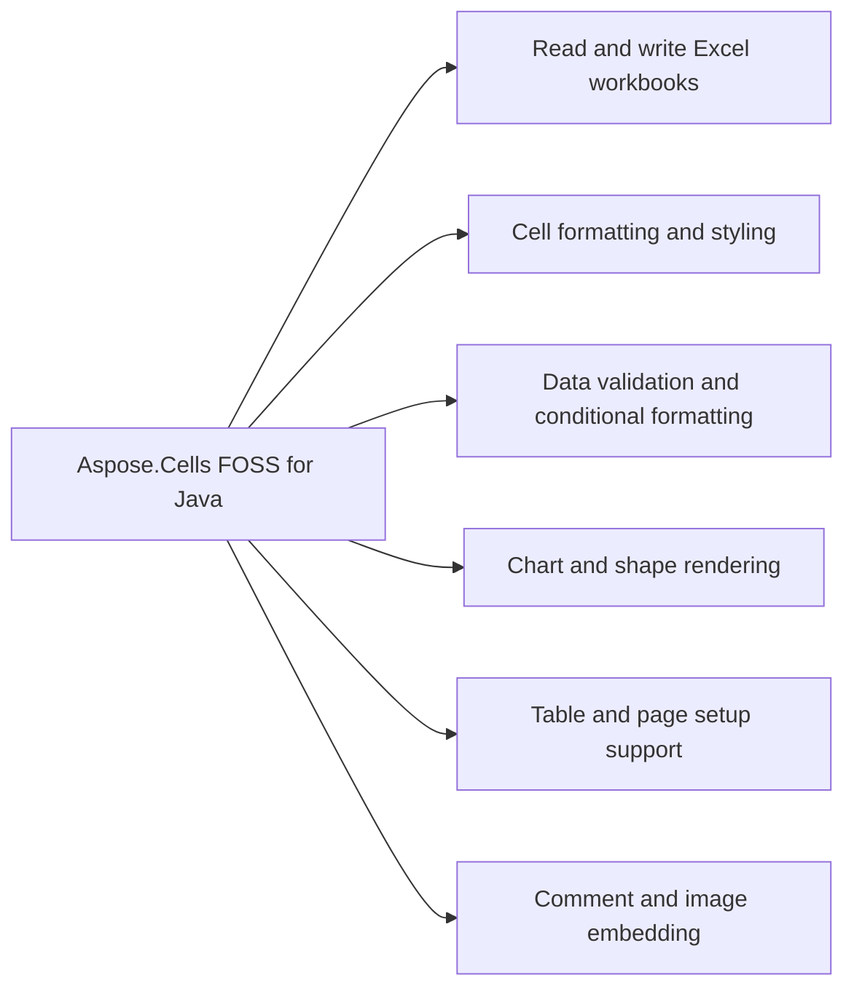

# Aspose.Cells FOSS for Java


Aspose.Cells FOSS for Java reads and writes Excel .xlsx workbooks. It loads, modifies, and saves workbooks while preserving OOXML packaging, XML mapping, and XLSX serialization. It supports cell values and formulas, styling, page setup, data validation, conditional formatting, auto filters, comments, embedded pictures and charts, drawing shapes, and Excel tables (ListObjects). Saving is currently limited to .xlsx.

Aspose.Cells FOSS for Java is a free, open-source, pure-Java spreadsheet library for creating,
loading, modifying, and saving Excel `.xlsx` workbooks. It targets Java 17, and keeps OOXML
packaging, XML mapping, and XLSX serialization inside this repository — Apache POI is used only
in `test` scope for compatibility checks, never at runtime. It covers cell values and formulas,
styling, page setup, data validation, conditional formatting, auto filters, comments, embedded
pictures and charts, drawing shapes, and Excel tables (ListObjects). Saving is currently limited
to `.xlsx`.

## Navigation

- [At a Glance](#at-a-glance)
- [Key Capabilities](#key-capabilities)
- [Installation](#installation)
- [Dependencies](#dependencies)
- [API Reference](#api-reference)
- [Scope and Limitations](#scope-and-limitations)

## At a Glance



## Key Capabilities

- **Read and write Excel workbooks.** It reads, writes, and edits Excel .xlsx workbooks through `Workbook`, which owns a `WorksheetCollection` of `Worksheet` objects, supports adding, removing, and renaming sheets, selecting the active sheet, and controlling per-sheet visibility via `getVisibilityType()`/`setVisibilityType()` with `VisibilityType`; each worksheet exposes a `Cells` collection of `Cell` objects for reading and writing string, numeric, boolean, date/time, and formula values, and `LoadOptions` exposes strict-mode toggles and package/XML repair while `Workbook.getLoadDiagnostics()` returns a load diagnostics report with repair details and preservation notes for unsupported package parts.
- **Cell formatting and styling.** `Cell` formatting and styling are handled by `Style`, which carries font, borders, fill, alignment, number format, and protection flags, set through `Cell.getStyle()`/`setStyle()`, and `NumberFormat` looks up and resolves built-in Excel number-format codes, while row and column layout is controlled with explicit sizing, hiding, and outline grouping via `Row`/`Column`, and `Worksheet` exposes tab color, zoom, gridline visibility, row/column header visibility, zero display, and right-to-left layout.
- **Data validation and conditional formatting.** Data validation and conditional formatting are applied to worksheet ranges via `ValidationCollection` and `ConditionalFormattingCollection`, both scoped to `CellArea`, and `AutoFilter` supports color filters, dynamic filters, top-10 filters, custom filters, and sort conditions on a worksheet range.
- **Chart and shape rendering.** `Chart` and shape rendering supports creating 18 of the 25 real `ChartType` values programmatically via `ChartCollection.add()`, while the other 7 ChartEx types (Waterfall, Treemap, Sunburst, Histogram, Box and Whisker, Funnel, and Map) round-trip verbatim from a loaded workbook but cannot be created through the API, and `ShapeCollection` adds, retrieves, and removes drawing objects across 38 preset geometries (`AutoShapeType`) while preserving complex shapes loaded from an XLSX file verbatim.
- **Table and page setup support.** Table and page setup support includes configuring print layout and page setup via `PageSetup`, freezing rows and/or columns by coordinate or cell name and inspecting or clearing the frozen state, locking structure, windows, and revisions with separate passwords via `WorksheetProtection`/`WorkbookProtection`, and persisting window layout and document-level metadata through `WorkbookView`/`DocumentProperties`/`WorkbookProperties`, while `ListObjectCollection` creates, resizes, styles, and removes structured Excel tables (ListObjects), including column definitions and totals rows.
- **Comment and image embedding.** `Comment` and image embedding is supported by `CommentCollection`, which adds, edits, and removes cell comments (notes) with author, text, visibility, and size, and `PictureCollection`, which embeds images from bytes, streams, or file paths with two-cell anchor positioning and detects JPEG, PNG, GIF, and BMP formats.

## Installation

Install the published package from Maven Central (`org.aspose:aspose-cells-foss`, version 26.7.0):

```bash
mvn dependency:get -Dartifact=org.aspose:aspose-cells-foss:26.7.0
```

Or declare it in Maven:

```xml
<dependency>
  <groupId>org.aspose</groupId>
  <artifactId>aspose-cells-foss</artifactId>
  <version>26.7.0</version>
</dependency>
```

Or declare it in Gradle:

```groovy
implementation 'org.aspose:aspose-cells-foss:26.7.0'
```

## Dependencies

### Required Package Dependencies

No required third-party package dependencies; in `pom.xml`, every `<dependency>` the POM declares is `test`, `provided` or optional.

### Native and System Requirements

- Requires Java `17` (`maven.compiler.target` in `pom.xml`).

### Development Dependencies

- `org.apache.poi:poi-ooxml 5.3.0`
- `org.junit.jupiter:junit-jupiter 5.10.2`

## API Reference

Aspose.Cells FOSS for Java reads and writes spreadsheet files and provides a public entry point at `org.aspose.cells_foss`. The classes below cover the full supported public API surface — 183 public types organized into one module.

The verified public surface has 183 types.

<details>
<summary>View the Complete Public API Surface</summary>

### Core API

| Class | Description |
| --- | --- |
| `AutoFilter` | Represents an auto-filter in a worksheet. |
| `AutoFilterColorFilter` | Represents the AutoFilterColorFilter component. |
| `AutoFilterCriteria` | Represents auto-filter criteria for filtering data in a worksheet. |
| `AutoFilterCustomFilter` | Represents the AutoFilterCustomFilter component. |
| `AutoFilterCustomFilterCollection` | Represents the AutoFilterCustomFilterCollection component. |
| `AutoFilterDynamicFilter` | Represents the AutoFilterDynamicFilter component. |
| `AutoFilterSortCondition` | Represents the AutoFilterSortCondition component. |
| `AutoFilterSortConditionCollection` | Represents the AutoFilterSortConditionCollection component. |
| `AutoFilterSortState` | Represents the AutoFilterSortState component. |
| `AutoFilterSupport` | Provides utility methods for auto-filter support. |
| `AutoFilterTop10` | Represents the AutoFilterTop10 component. |
| `Border` | Represents a border with line style and color. |
| `Borders` | Represents the border properties for a cell or range in an Excel worksheet. |
| `CalculationProperties` | Represents workbook calculation settings. |
| `Cell` | Represents a cell in a worksheet. |
| `CellArea` | Represents a cell area with row and column bounds. |
| `CellFormatValue` | Inner class representing cell format value. |
| `Cells` | Represents a collection of cells in a worksheet. |
| `CellsException` | Represents an exception thrown by the Aspose.Cells library. |
| `Chart` | Represents an embedded chart in a worksheet (read-only; charts are round-tripped verbatim). |
| `ChartCollection` | Collection of embedded charts on a worksheet. |
| `Color` | Represents an ARGB color value. |
| `Column` | Represents a column in a worksheet. |
| `ColumnCollection` | Represents a collection of columns in a worksheet. |
| `Comment` | Represents a cell comment (note). |
| `CommentCollection` | Collection of cell comments on a worksheet. |
| `ConditionalFormattingCollection` | A collection of conditional formatting objects. |
| `DefinedName` | Represents a defined name in the workbook. |
| `DefinedNameCollection` | Represents a collection of defined names in a workbook. |
| `DisplayFormatSectionInfo` | Holds metadata about a single section of a number format code string. |
| `DisplayTextFormatterSupport` | Internal utility class for selecting and formatting display text sections. |
| `DocumentProperties` | Represents the document properties of a workbook (docProps/core.xml and docProps/app.xml). |
| `FillValue` | Inner class representing fill value. |
| `FilterColumn` | Represents the FilterColumn component. |
| `FilterColumnCollection` | Represents the FilterColumnCollection component. |
| `FilterValueCollection` | Represents the FilterValueCollection component. |
| `Font` | Represents a font with its properties. |
| `FormatCondition` | Represents a conditional formatting rule. |
| `FormatConditionCollection` | Represents a collection of format conditions in Excel. |
| `FormulaException` | Represents an exception that occurs during formula processing. |
| `Hyperlink` | Represents a hyperlink in a worksheet. |
| `HyperlinkCollection` | Represents a collection of hyperlinks in a worksheet. |
| `IWarningCallback` | Provides a callback mechanism for reporting warnings during workbook operations. |
| `InvalidFileFormatException` | Represents an exception thrown when an invalid file format is encountered. |
| `ListColumn` | Represents a column within an Excel table (ListObject). |
| `ListColumnCollection` | Ordered collection of columns in an Excel table. |
| `ListObject` | Represents an Excel table (structured reference / ListObject). |
| `ListObjectCollection` | Collection of Excel tables (ListObjects) on a worksheet. |
| `LoadDiagnostics` | Represents diagnostics information during workbook loading. |
| `LoadIssue` | Represents an issue that occurred during workbook loading. |
| `LoadOptions` | Represents options for loading a workbook. |
| `NumberFormat` | Provides built-in number format functionality. |
| `PageSetup` | Represents page setup options for a worksheet. |
| `Picture` | Represents an embedded image in a worksheet. |
| `PictureCollection` | Collection of embedded pictures on a worksheet. |
| `Row` | Represents a row in a worksheet. |
| `RowCollection` | Represents a collection of rows in a worksheet. |
| `SaveOptions` | Represents save options for workbook saving. |
| `Shape` | Represents a drawing object (auto shape) anchored to a worksheet. |
| `ShapeCollection` | Collection of drawing objects (shapes) on a worksheet. |
| `Style` | Represents the full style of a cell: font, borders, alignment, fill, number format, and protection. |
| `StyleException` | Represents an exception that occurs during style processing. |
| `StyleValueSanitizer` | Sanitizes style values to ensure they fall within valid ranges. |
| `UnsupportedFeatureException` | Thrown when an unsupported feature is encountered. |
| `Validation` | Represents a data validation rule applied to one or more cell areas. |
| `ValidationCollection` | Represents the collection of data validation rules for a worksheet. |
| `WarningInfo` | Represents information about a warning that occurred during workbook operations. |
| `Workbook` | Represents an Excel workbook. |
| `WorkbookLoadException` | Represents an exception that occurs when loading a workbook. |
| `WorkbookProperties` | Represents the properties of a workbook (workbookPr attributes). |
| `WorkbookProtection` | Represents workbook-level protection settings (structure, windows, revision). |
| `WorkbookSaveException` | Represents an exception that occurs when saving a workbook. |
| `WorkbookSettings` | Represents workbook settings for an Excel file. |
| `WorkbookView` | Represents the view / window settings stored in bookViews. |
| `Worksheet` | Represents a worksheet in a workbook. |
| `WorksheetCollection` | Represents a collection of worksheets in a workbook. |
| `WorksheetProtection` | Represents protection settings for a worksheet. |
| `XlsxDocumentProperties` | Helper class for handling XLSX document properties (core and extended). |
| `XlsxWorkbookSerializer` | Serializer for XLSX workbook files 鈥?thin coordinator that delegates to helper classes. |
| `XlsxWorkbookStylesValueHelpers` | Provides helper methods for parsing and formatting workbook style values. |
| `XlsxWorkbookStylesXml` | Provides methods for reading and writing XLSX workbook styles XML. |
| `AlignmentValue` | Represents alignment settings for a cell style. |
| `AutoFilterColorFilterModel` | Represents the AutoFilterColorFilterModel component. |
| `AutoFilterCustomFilterModel` | Represents the AutoFilterCustomFilterModel component. |
| `AutoFilterDynamicFilterModel` | Represents the AutoFilterDynamicFilterModel component. |
| `AutoFilterModel` | Represents a model for auto-filter configuration in Excel. |
| `AutoFilterSortConditionModel` | Represents the AutoFilterSortConditionModel component. |
| `AutoFilterSortStateModel` | Represents the AutoFilterSortStateModel component. |
| `AutoFilterTop10Model` | Represents the AutoFilterTop10Model component. |
| `BorderSideValue` | Represents a border side value with style and color. |
| `BordersValue` | Represents the border values for a cell style, including left, right, top, bottom, and diagonal borders, as well as diagonal direction flags. |
| `CalculationPropertiesModel` | Represents the CalculationPropertiesModel component. |
| `CellAddress` | Represents a cell address with row and column indices. |
| `CellRecord` | Represents a cell record in the Excel file. |
| `ChartModel` | Internal model for an embedded chart. |
| `ColorValue` | Represents a color value with alpha, red, green, and blue components. |
| `ColumnRangeModel` | Represents a range of columns with formatting properties. |
| `CommentModel` | Internal model for a cell comment (note). |
| `ConditionalFormattingModel` | Represents the conditional formatting model for a worksheet. |
| `CoreDocumentPropertiesModel` | Represents the CoreDocumentPropertiesModel component. |
| `DateSerialConverter` | Converts between LocalDateTime values and Excel serial date numbers. |
| `DefinedNameModel` | Represents a defined name model in the Excel file. |
| `DiagnosticBag` | Represents a bag of diagnostic entries. |
| `DiagnosticEntry` | Represents a diagnostic entry with details about a problem or warning. |
| `DocumentPropertiesModel` | Represents the document properties model for an Excel file. |
| `ExtendedDocumentPropertiesModel` | Represents the ExtendedDocumentPropertiesModel component. |
| `FilterColumnModel` | Represents the FilterColumnModel component. |
| `FontValue` | Represents a font value with its properties. |
| `FormatConditionModel` | Represents a format condition model used in Excel conditional formatting. |
| `HeaderFooterModel` | Represents the header and footer model for a worksheet. |
| `HyperlinkModel` | Represents a hyperlink model with its properties. |
| `ListColumnModel` | Internal model for a table (ListObject) column. |
| `ListObjectModel` | Internal model for a table (ListObject / structured reference). |
| `MergeRegion` | Represents a merge region in an Excel worksheet. |
| `NumberFormatValue` | Represents a number format value with its number format index and custom format string. |
| `PageMarginsModel` | Represents page margins for a worksheet in an Excel file. |
| `PageSetupModel` | Represents page setup model for an Excel worksheet. |
| `PictureModel` | Internal model for an embedded picture/image. |
| `PrintOptionsModel` | Represents print options for a worksheet. |
| `ProtectionValue` | Represents protection settings for a cell or range. |
| `RowModel` | Represents a row model in the Excel file. |
| `ShapeModel` | Internal model for a drawing object (auto shape) anchored to a worksheet. |
| `SharedStringRepository` | A repository that manages shared strings for Excel files. |
| `StyleRepository` | Represents a repository for style values. |
| `StyleValue` | Represents a style value with various formatting properties. |
| `ValidationModel` | Represents a data validation model in the Excel file. |
| `WorkbookModel` | Represents the top-level model of a workbook. |
| `WorkbookPropertiesModel` | Represents the workbook properties model. |
| `WorkbookProtectionModel` | Represents the WorkbookProtectionModel component. |
| `WorkbookSettingsModel` | Represents workbook settings model. |
| `WorkbookViewModel` | Represents the WorkbookViewModel component. |
| `WorksheetModel` | Represents the model of a worksheet in the Excel file. |
| `WorksheetProtectionModel` | Represents the protection model for a worksheet in an Excel file. |
| `WorksheetViewModel` | Represents a view model for a worksheet with display settings. |
| `IPackageReader` | Provides a reader interface for reading package models from streams. |
| `IPackageWriter` | Provides a contract for writing package models to a stream. |
| `MissingPartException` | Thrown when a required part is missing from the package structure. |
| `PackageLoadContext` | Represents the context for loading a package. |
| `PackageModel` | Represents the model of a package (e.g., XLSX file structure) with parts, relationships, and unsupported parts. |
| `PackagePartDescriptor` | Represents a descriptor for a package part in the XLSX package. |
| `PackageStructureException` | Thrown when the package structure of the Excel file is invalid. |
| `PackagingConventions` | Defines constants for Open XML package part paths and relationship types. |
| `RelationshipDescriptor` | Represents a relationship descriptor in the XLSX package. |
| `RelationshipResolutionException` | Exception thrown when a relationship cannot be resolved in the package structure. |
| `ValidationMessage` | Represents a validation message with code, severity, and message text. |
| `WorkbookValidator` | A validator for workbook models that produces validation messages. |
| `SharedStringTableXmlMapper` | Maps shared string tables to/from XML. |
| `StylesheetXmlMapper` | Maps style information to and from XML. |
| `WorkbookXmlMapper` | Maps workbook data to/from SpreadsheetML XML format. |
| `WorksheetXmlMapper` | Maps worksheet XML data. |
| `XmlParsingException` | Represents an exception that occurs during XML parsing. |

#### Enumerations

| Enumeration | Description |
| --- | --- |
| `AutoShapeType` | Specifies the type of an auto shape (preset DrawingML geometry). |
| `BorderStyleType` | Represents the style of a border. |
| `CellValueType` | Represents the type of a cell value. |
| `ChartType` | Identifies the type of an embedded chart. |
| `cells_foss.DiagnosticSeverity` | Represents the severity level of a diagnostic message. |
| `FillPattern` | Represents the fill pattern used in cell styling. |
| `FormatConditionType` | Represents the type of a format condition. |
| `HorizontalAlignmentType` | Represents the type of horizontal alignment for cell content. |
| `ImageType` | Identifies the format of an embedded image. |
| `LoadFormat` | Specifies the format of the workbook to be loaded. |
| `OperatorType` | Represents the operator type used in conditional formatting and filtering. |
| `PageOrientationType` | Represents the page orientation type for a worksheet. |
| `PaperSizeType` | Represents the paper size type for a worksheet. |
| `SaveFormat` | Specifies the format in which a workbook will be saved. |
| `TableStyleType` | Identifies a built-in Excel table style. |
| `TargetModeType` | Represents the target mode type for cell references. |
| `TotalsCalculation` | Aggregation function applied to a table's totals row. |
| `ValidationAlertType` | Represents the alert type for data validation. |
| `ValidationType` | Represents the type of cell validation. |
| `VerticalAlignmentType` | Represents vertical alignment options for cell content. |
| `VisibilityType` | Represents the visibility type of a worksheet. |
| `BorderStyle` | Represents the style of a border line in a cell. |
| `CellValueKind` | Represents the kind of a cell value. |
| `DateSystem` | Represents the date system used in Excel. |
| `core.DiagnosticSeverity` | Represents the severity of a diagnostic entry. |
| `FillPatternKind` | Represents the pattern used to fill a cell. |
| `FilterOperatorType` | Enumerates the supported FilterOperatorType values. |
| `HorizontalAlignment` | Represents horizontal alignment options for cell content in Excel. |
| `PageOrientation` | Represents the page orientation for a worksheet. |
| `SheetVisibility` | Represents the visibility state of a worksheet in an Excel workbook. |
| `VerticalAlignment` | Represents vertical alignment options for cell content. |
| `ValidationMessageSeverity` | Represents the severity level of a validation message. |

#### Detailed Member Reference

### cells_foss

The `org.aspose.cells_foss` package serves as the public entry point and contains the core classes for working with spreadsheet documents.

Requires JDK 17+ and Maven as the build tool. Run the test suite:

</details>

## Scope and Limitations

Aspose.Cells FOSS for Java reads and writes Excel workbooks in the .xlsx format, supports Java 17 or later, and has no required third-party package dependencies.

- Saving is currently limited to .xlsx, `ChartEx` types (Waterfall, Treemap, Sunburst, Histogram, Box and Whisker, Funnel, and Map) cannot be created programmatically, formulas are stored and round-tripped but the library is not a full spreadsheet calculation engine, a handful of public XML-mapper classes are unimplemented skeleton code, and some APIs exist mainly to preserve OOXML metadata and package fidelity rather than to provide full Excel feature parity.
- The library is not a full spreadsheet calculation engine, so formulas are stored and round-tripped without performing calculations.
- A handful of public XML-mapper classes are unimplemented skeleton code carried over from an early scaffold, and some APIs exist mainly to preserve OOXML metadata and package fidelity rather than to provide full Excel feature parity.

- Java 17 or later (`maven.compiler.source`/`maven.compiler.target` are both pinned to `17` in
  `pom.xml`).

- `org.junit.jupiter:junit-jupiter` 5.10.2 — test runner used by the Maven `test` phase; not
  needed to use the published library.
- `org.apache.poi:poi-ooxml` 5.3.0 — used across the test suite as an independent XLSX
  implementation for round-trip and compatibility verification; not needed to use the published
  library.
