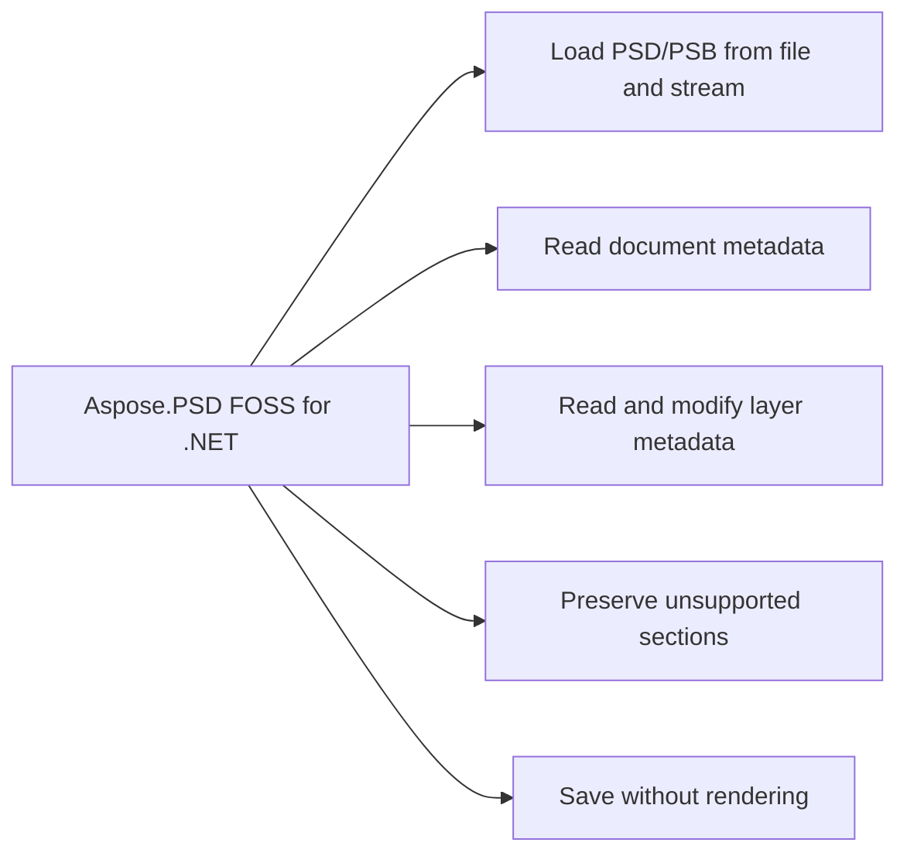

# Aspose.PSD FOSS for .NET

[](https://www.nuget.org/packages/Aspose.PSD.FOSS/) 

It reads and writes PSD and PSB files, inspects metadata, and edits a small subset of their metadata without rendering. It exposes types such as `Aspose.PSD.Image`, `Aspose.PSD.Rectangle`, `Aspose.PSD.RectangleF`, `Aspose.PSD.Point`, and `Aspose.PSD.Size` to support metadata operations. Methods including `Image.Load`, `Image.Save`, and `Image.Dispose` enable file handling and resource management.

## Navigation

- [At a Glance](#at-a-glance)
- [Key Capabilities](#key-capabilities)
- [Installation](#installation)
- [Dependencies](#dependencies)
- [API Reference](#api-reference)
- [Scope and Limitations](#scope-and-limitations)

## At a Glance



## Key Capabilities

- **Load PSD/PSB from file and stream.** It loads PSD and PSB files from file paths or streams using the `Aspose.PSD.Image.Load` method and `Aspose.PSD.ImageLoader.Load` method, supporting input via `Aspose.PSD.StreamContainer`.
- **Read document metadata.** It reads document metadata such as width, height, color mode, compression, and layer count through properties on `Aspose.PSD.Image`, and provides `Aspose.PSD.Rectangle` and `Aspose.PSD.Size` structures for geometric inspection.
- **Read and modify layer metadata.** It reads and modifies layer metadata including name, bounds, visibility, opacity, and blend mode using `Aspose.PSD.FileFormats` layer types, with `Aspose.PSD.Point`, `Aspose.PSD.RectangleF`, and related structures for coordinate and dimension handling.
- **Preserve unsupported sections.** It preserves unsupported file sections during load and save operations by retaining raw stream data through `Aspose.PSD.StreamContainer` and `Aspose.PSD.ImageLoader`, ensuring round-trip fidelity.
- **Save without rendering.** It saves files back to disk or stream without rendering pixels by calling `Aspose.PSD.Image.Save`, maintaining all layers and resources in their original structure.

## Installation

Install the published package from NuGet (`Aspose.PSD.FOSS`, version 1.0.0):

```bash
dotnet add package Aspose.PSD.FOSS
```

## Dependencies

### Required Package Dependencies

No required third-party package dependencies; in `src/Aspose.PSD.FOSS/Aspose.PSD.FOSS.csproj`, no `PackageReference` a consumer would install is declared.

### Native and System Requirements

- Requires .NET `netstandard2.1;net10.0` (`TargetFrameworks` in `src/Aspose.PSD.FOSS/Aspose.PSD.FOSS.csproj`).

## API Reference

Aspose.PSD FOSS for .NET provides the Aspose.PSD namespace as its primary entry point, with `Aspose.PSD.BuildVersionInfo` exposing version metadata. The `Aspose.PSD.Image` class serves as the base for image handling, while `Aspose.PSD.FileFormats` contains supporting types for file format operations.

The verified public surface has 26 types.

<details>
<summary>View the Complete Public API Surface</summary>

### Core API

| Class | Description |
| --- | --- |
| `BuildVersionInfo` | Contains the current build version information. |
| `BlendRange` | Represents a PSD layer blend range. |
| `ChannelInformation` | Represents PSD layer channel information. |
| `GlobalLayerMaskInfo` | Represents global layer mask information. |
| `Layer` | Represents a single PSD layer with basic metadata used by the FOSS library. |
| `LayerBlendingRangesData` | Represents PSD layer blending ranges data. |
| `LayerMaskData` | Defines the base class for PSD layer mask data. |
| `LayerMaskDataShort` | Defines layer mask data for layers that have only a raster or vector mask. |
| `LayerResource` | Represents a PSD layer resource. |
| `PsdImage` | Represents a PSD image that can be loaded, inspected, and saved without rendering. |
| `PsdLoadException` | Exception that is thrown when an error occurs while loading a PSD file. |
| `PsdSaveException` | Exception that is thrown when an error occurs while saving a PSD file. |
| `ResourceBlock` | Represents a PSD image resource block. |
| `Image` | Provides the Aspose.PSD-compatible base image entry point for loading PSD/PSB documents. |
| `ImageLoader` | Provides the Load functionality for Images. |
| `Point` | Represents an ordered pair of integer x- and y-coordinates that defines a point in a two-dimensional plane. |
| `Rectangle` | Stores a set of four integers that represent the location and size of a rectangle. |
| `RectangleF` | Stores a set of four floating-point numbers that represent the location and size of a rectangle. |
| `Size` | Represents an ordered pair of integer width and height values that defines a size. |
| `StreamContainer` | Represents a stream container used by resource save APIs. |

#### Enumerations

| Enumeration | Description |
| --- | --- |
| `BlendMode` | Defines the blend modes used for layers in PSD files. |
| `ColorModes` | Defines the color modes supported by PSD files. |
| `CompressionMethod` | Defines the compression methods used for image data in PSD files. |
| `LayerMaskFlags` | Defines PSD layer mask flags. |
| `PsdVersion` | Represents the supported PSD container versions. |
| `ResourceBlockState` | Represents resource block state. |

#### Detailed Member Reference

### PSD

The Aspose.PSD namespace includes `Aspose.PSD.BuildVersionInfo`, which provides `AssemblyVersion`, `FileVersion`, Product, `ProductMajor`, `ProductMinor`, and `ReleaseDate` properties to inspect the library version details.

### Image

The `Aspose.PSD.Image` class offers core image functionality including Bounds, Height, Width, Load, and Save members, while `Aspose.PSD.ImageLoader` provides the Load method for loading images, and `Aspose.PSD.StreamContainer` supplies the Stream property and `StreamContainer` constructor for stream-based operations.

- `Bounds`: Gets the image bounds.
- `Dispose`: Releases resources used by the image.
- `Height`: Gets the image height in pixels.
- `Load`: Loads a new image from the specified file path.
- `Save`: Saves the image data to the specified file path.
- `Width`: Gets the image width in pixels.

### FileFormats

The `Aspose.PSD.FileFormats` namespace includes `Aspose.PSD.RectangleF` and `Aspose.PSD.Point`, where `RectangleF` provides geometric properties such as Bottom, Empty, Equals, `GetHashCode`, Height, `IsEmpty`, Left, `RectangleF`, Right, `ToString`, Top, Width, X, and Y, and `Point` provides Empty, Equals, `GetHashCode`, `IsEmpty`, `Point`, `ToString`, X, and Y members.

</details>

## Scope and Limitations

Aspose.PSD FOSS for .NET reads and writes PSD and PSB files for metadata-safe inspection and limited structural editing. It exposes the `Aspose.PSD.FileFormats` and `Aspose.PSD.ImageLoader` namespaces and supports the netstandard2.1 and net10.0 target frameworks.

- It is not a rendering engine, a raster editor, or an open-source replacement for the full commercial Aspose.PSD product.
- It does not render PSD/PSB content, edit pixels, export raster images, interpret the full Photoshop feature set semantically, or replace the commercial Aspose.PSD API surface one-to-one.
- It does not support full image resource editing, semantic recognition of specific image resource kinds, full tagged block editing, or rendering of text, vector, effects, smart filters, and adjustment layers.
- It does not support exporting to PNG, JPEG, or other raster formats.
