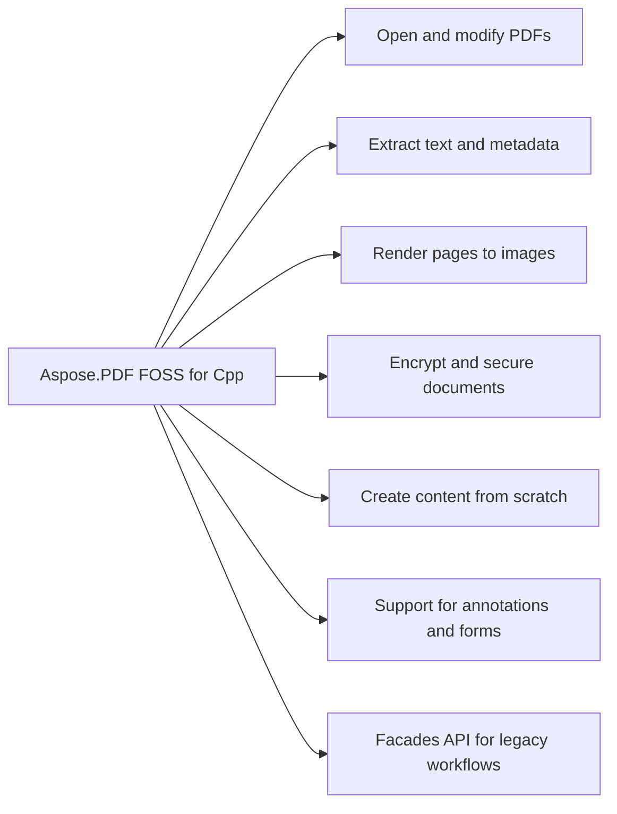

# Aspose.PDF FOSS for Cpp


It opens PDF files, extracts text using `TextAbsorber`, and saves pages as PNG images using `PngDevice` with configurable resolution. It reads encrypted PDFs when provided with a user or owner password, and it encrypts documents using AESx256 with user and owner passwords. It reads document metadata such as Title and Author, and it updates and saves those metadata fields. It builds new documents by adding pages and inserting text, tables, vector graphics, watermarks, annotations, AcroForm fields, and bookmarks.

Aspose.PDF FOSS for C++ is a free, open-source, modern C++20 library for working with PDF
documents — opening and saving existing files, extracting text, rasterising pages to image
formats, and building documents from scratch (text, tables, vector graphics, watermarks,
annotations, AcroForm fields, and bookmarks). It links against nothing but the C++ standard
library: every primitive, including the TIFF, JPEG, and PNG codecs and the page rasteriser, is
implemented from scratch with no dependency on any commercial PDF stack. Its public API is a
strict subset of the commercial Aspose.PDF for .NET library — class names, method names, and
shapes mirror it where natural for migrants — and spec references throughout follow ISO 32000-1
(PDF 1.7) and ISO 32000-2 (PDF 2.0).

## Navigation

- [At a Glance](#at-a-glance)
- [Key Capabilities](#key-capabilities)
- [Installation](#installation)
- [Dependencies](#dependencies)
- [Quick Start](#quick-start)
- [Additional Examples](#additional-examples)
- [API Reference](#api-reference)
- [Scope and Limitations](#scope-and-limitations)

## At a Glance



## Key Capabilities

- **Open and modify PDFs.** It opens existing PDFs with the `Document` class, supports password-protected files by passing the user or owner password to `Document`(path, password), and reports encryption state via `IsEncrypted()` before proceeding to read pages or extract content.
- **Extract text and metadata.** It extracts text with Text::`TextAbsorber`, which walks a whole `Document` or a single `Page`, and reads document metadata through typed `DocumentInfo` accessors for title, author, subject, keywords, creator, producer, and dates.
- **Render pages to images.** It renders pages to raster images through `PngDevice`, `JpegDevice`, and `BmpDevice` (single page per call) with a 150 DPI resolution setting, producing anti-aliased output without third-party runtime dependencies.
- **Encrypt and secure documents.** It encrypts documents with `Document`::Encrypt(user, owner, permissions, algorithm) using RC4-40, RC4-128, AES-128, or AES-256 (PDF 2.0, R=6) and governs permissions via a granular `Permissions` flags enum.
- **Create content from scratch.** It builds documents from scratch using positioned and word-wrapped text through Text::`TextBuilder`, `TextFragment`, and `TextParagraph` with font lookup via `FontRepository`::`FindFont`, tabular layout through `Table`, `Row`, and `Cell`, vector shapes through Drawing::`Graph`, and rotated, semi-transparent text overlays through `WatermarkArtifact`.
- **Support for annotations and forms.** It adds and manages annotations across subtypes including Highlight, Underline, Squiggly, `StrikeOut`, Square, `Circle`, `Line`, Ink, Text, FreeText, Stamp, Link with `GoToAction`/`GoToURIAction`, and FileAttachment, each with a pre-generated appearance stream for spec-conforming viewers.
- **Facades API for legacy workflows.** It provides the classic Aspose::Pdf::Facades API including `PdfConverter`, `PdfExtractor`, `PdfFileSecurity`, `PdfFileSignature`, `PdfBookmarkEditor`, `PdfFileEditor`, and `PdfFileStamp`, each binding independently to a `Document`.

## Installation

The library is published on NuGet as `Aspose.PDF.Cpp.FOSS`.

To work from a source checkout instead, configure the clone with cmake:

```bash
git clone https://github.com/aspose-pdf-foss/Aspose.PDF-FOSS-for-Cpp.git
cd Aspose.PDF-FOSS-for-Cpp
cmake -S . -B build
```

## Dependencies

### Required Package Dependencies

No required third-party package dependencies; in `CMakeLists.txt`, no dependency is on the library target's public link interface, so a consumer links nothing beyond the library itself.

### Native and System Requirements

- Requires C++ `20` (`CMAKE_CXX_STANDARD` in `CMakeLists.txt`).
- Requires CMake 3.20 or later (`cmake_minimum_required` in `CMakeLists.txt`).

### Development Dependencies

- `aspose_pdf_foss`
- `googletest`
- `Python3`

## Quick Start

This example opens a PDF file, counts its pages, extracts all text from the document, and renders the first page as a PNG image at 150 DPI using Aspose.PDF FOSS for Cpp.

```cpp
#include <aspose/pdf/document.hpp>
#include <aspose/pdf/page_collection.hpp>
#include <aspose/pdf/text_absorber.hpp>
#include <aspose/pdf/png_device.hpp>
#include <aspose/pdf/resolution.hpp>
#include <fstream>
#include <iostream>

int main() {
    Aspose::Pdf::Document doc("input.pdf");
    std::cout << "Pages: " << doc.Pages().Count() << "\n";

    Aspose::Pdf::Text::TextAbsorber absorber;
    absorber.Visit(doc);
    std::cout << absorber.Text() << "\n";

    Aspose::Pdf::Devices::PngDevice png(Aspose::Pdf::Devices::Resolution(150));
    std::ofstream out("page1.png", std::ios::binary);
    png.Process(doc.Pages()[1], out);
}
```

This library builds as a static library you link into your project. Either way, include the whole
public API through the single-entry header, or include individual headers from `aspose/pdf/`:

## Additional Examples

The following workflows demonstrate opening a password-protected document, reading and updating document metadata, and encrypting a document with AES-256.

### Encrypt a Document with AES-256

```cpp
#include <aspose/pdf/document.hpp>

int main() {
    Aspose::Pdf::Document doc("input.pdf");
    doc.Encrypt("user-password", "owner-password",
                Aspose::Pdf::Permissions(),
                Aspose::Pdf::CryptoAlgorithm::AESx256);
    doc.Save("encrypted.pdf");
}
```

<details>
<summary>View Additional Examples</summary>

### Open a Password-Protected PDF Document

```cpp
#include <aspose/pdf/document.hpp>

// Encrypted files: pass the user or owner password
Aspose::Pdf::Document locked("locked.pdf", "secret");
if (locked.IsEncrypted()) {
    // proceed to read pages, extract text, etc.
}
```

### Read and Update Document Metadata

```cpp
#include <aspose/pdf/document.hpp>
#include <aspose/pdf/document_info.hpp>
#include <iostream>

int main() {
    Aspose::Pdf::Document doc("input.pdf");
    auto& info = doc.Info();
    std::cout << "Title: " << info.Title() << "\n";
    std::cout << "Author: " << info.Author() << "\n";

    doc.SetTitle("Updated Report Title");
    doc.Save("output.pdf");
}
```

### Include the Main Header File

```cpp
#include <aspose.pdf.foss.hpp>
```

- `Python3` — required by the CMake configure step
  (`find_package(Python3 REQUIRED COMPONENTS Interpreter)` in `CMakeLists.txt`) to run a
  generator script that embeds the bundled Standard-14 font outlines into a generated source
  file; needed only to configure/build the library, not by the compiled library at runtime.

- `googletest` (1.14.0) — fetched via CMake FetchContent in `CMakeLists.txt`; builds the
  `aspose_pdf_foss_tests` ctest binary only, never linked into the shipped `aspose_pdf_foss`
  library.

Additional Examples below extends this into a from-scratch showcase
([`examples/12_create_features.cpp`](examples/12_create_features.cpp), one of the 12 programs
under `examples/` — see `examples/README.md`, built via `cmake --build build` into
`build/examples/<name>`): `Table`/`Row`/`Cell` layouts, `Drawing::Graph`
shapes (`Line`, `Rectangle`, `Circle`, `Ellipse`), annotations and AcroForm fields with a
pre-generated `/AP` appearance stream, `Form::Flatten()`-ready fields (`TextBoxField`,
`CheckboxField`, `RadioButtonField`, `ComboBoxField`, `ListBoxField`, `ButtonField`), an outline
(bookmark) tree, `CryptoAlgorithm`-based encryption (`RC4x40`/`RC4x128`/`AESx128`/`AESx256`) with
a `[Flags]` `Permissions` enum (not a DRM mechanism), a digital-signature walkthrough (see
`tests/facades_pdf_file_signature_smoke_test.cpp`), the `/Info`-metadata gotcha for from-scratch
documents, and the by-reference lifetime rule for `Paragraphs`/`Annotations`/`Form`/`Artifacts`/
`Outlines` — each parked in a `shared_ptr` until `Save()`.

12 runnable examples live in [`examples/`](examples/), covering the whole public surface —
opening documents, metadata, text extraction, save round-trips, every raster device, and a
from-scratch content-creation showcase. After `cmake --build build`, executables land at
`build/examples/<name>`; run them in numeric order, since each builds on the previous (see
[`examples/README.md`](examples/README.md) for the full tour).

The most illustrative beyond Quick Start is `12_create_features`, a 10-page showcase exercising
the whole creation surface — positioned text, a table, vector graphics, and a watermark, built
onto a page from an empty `Document`:

| Example | Shows |
|---|---|
| `01_pages` | open a PDF, count pages, iterate the 1-based indexer |
| `02_read_metadata` / `03_write_metadata` | read `DocumentInfo`; edit + incremental-update save |
| `04_text_extraction` | `TextAbsorber::Visit(Document)` |
| `05_save_roundtrip` | byte-verbatim save |
| `06_devices_surface` | construct + round-trip device properties |
| `07_render_png` | end-to-end `PngDevice::Process(Page, ostream)` |
| `08_render_tiff` | multi-page TIFF via `TiffDevice::Process(Document, …)` |
| `09_indexed_tiff` | 8-bpp palettised TIFF (median-cut) |
| `10_render_text_pdf` | render a page with an embedded TrueType font |
| `11_render_standard14` | render `/Helvetica` with no embedded font (fallback path) |
| `12_create_features` | from-scratch 10-page showcase: text, image, tables, graphics, annotations, AcroForm fields, bookmarks |

Read existing `/Info` entries and update the document title through `DocumentInfo`:

`CryptoAlgorithm` covers `RC4x40`, `RC4x128`, `AESx128`, and `AESx256`. `Permissions` is a
`[Flags]` enum (ISO 32000-1 §7.6.3.2 Table 22) — compose with `|`. Permissions are enforced by
viewers; the library itself is not a DRM mechanism.

</details>

## API Reference

Aspose.PDF FOSS for Cpp exposes the `Aspose.Pdf.Document` class as its primary entry point for loading, manipulating, and saving PDF documents. Other modules such as `Aspose.Pdf.Text`, `Aspose.Pdf.Devices`, `Aspose.Pdf.CryptoAlgorithm`, `Aspose.Pdf.Annotations`, `Aspose.Pdf.Forms`, and `Aspose.Pdf.Facades` provide specialized functionality for text extraction, rendering, encryption, annotations, form handling, and high-level document operations.

The verified public surface has 249 types.

<details>
<summary>View the Complete Public API Surface</summary>

### Core API

| Class | Description |
| --- | --- |
| `Annotation` | Annotation represents a graphical annotation that can be placed on a PDF page. |
| `AnnotationCollection` | AnnotationCollection provides a collection of annotations attached to a PDF page. |
| `AnnotationSelector` | AnnotationSelector provides a visitor interface for iterating over annotations. |
| `BleedMarkAnnotation` | BleedMarkAnnotation represents a bleed mark annotation used in printing. |
| `Border` | Border defines the border characteristics of an annotation. |
| `CaretAnnotation` | CaretAnnotation represents a caret annotation used to indicate text insertion. |
| `Characteristics` | Characteristics specifies the visual characteristics of an annotation. |
| `CircleAnnotation` | CircleAnnotation represents a circular annotation on a PDF page. |
| `ColorBarAnnotation` | ColorBarAnnotation represents a color bar annotation used for color reference. |
| `CommonFigureAnnotation` | CommonFigureAnnotation represents a common figure annotation on a PDF page. |
| `CornerPrinterMarkAnnotation` | CornerPrinterMarkAnnotation represents a corner printer mark annotation. |
| `DefaultAppearance` | DefaultAppearance specifies the default appearance for text in a free text annotation. |
| `ExplicitDestination` | ExplicitDestination represents a destination within the PDF document. |
| `FileAttachmentAnnotation` | FileAttachmentAnnotation represents a file attachment annotation. |
| `FitBExplicitDestination` | FitBExplicitDestination represents a destination that fits the page bounds. |
| `FitBHExplicitDestination` | FitBHExplicitDestination represents a destination that fits the page height. |
| `FitBVExplicitDestination` | FitBVExplicitDestination represents a destination that fits the page view bounds. |
| `FitExplicitDestination` | FitExplicitDestination represents a destination that fits the page. |
| `FitHExplicitDestination` | FitHExplicitDestination represents a destination that fits the page width. |
| `FitRExplicitDestination` | FitRExplicitDestination represents a destination that fits a rectangle. |
| `FitVExplicitDestination` | FitVExplicitDestination represents a destination that fits the page vertically. |
| `FreeTextAnnotation` | FreeTextAnnotation represents a free text annotation on a PDF page. |
| `GoToAction` | GoToAction represents a go-to action that navigates to a destination. |
| `GoToURIAction` | GoToURIAction represents a go-to URI action that opens a web link. |
| `HighlightAnnotation` | HighlightAnnotation represents a highlight annotation used to mark text. |
| `IAppointment` | IAppointment represents an appointment annotation in a PDF document. |
| `InkAnnotation` | InkAnnotation represents an ink annotation that captures freehand drawing strokes. |
| `JavascriptAction` | JavascriptAction represents an action that executes a JavaScript script. |
| `LineAnnotation` | LineAnnotation represents a line annotation that draws a straight line between two points. |
| `LinkAnnotation` | LinkAnnotation represents a link annotation that navigates to a destination or executes an action. |
| `MarkupAnnotation` | MarkupAnnotation is a base class for markup annotations that provide comments or annotations on a page. |
| `MovieAnnotation` | MovieAnnotation represents a movie annotation that plays a video clip. |
| `NamedAction` | NamedAction represents a predefined action identified by a standard name. |
| `NamedDestination` | NamedDestination represents a named destination that can be referenced by a link. |
| `PageInformationAnnotation` | PageInformationAnnotation represents a page information annotation that stores metadata about a page. |
| `PdfAction` | PdfAction is a base class for actions that can be executed in a PDF document. |
| `PolyAnnotation` | PolyAnnotation is a base class for polygon and polyline annotations. |
| `PolygonAnnotation` | PolygonAnnotation represents a polygon annotation defined by a series of connected line segments. |
| `PolylineAnnotation` | PolylineAnnotation represents a polyline annotation defined by a series of connected line segments. |
| `PopupAnnotation` | PopupAnnotation represents a popup annotation that displays a note when opened. |
| `PrinterMarkAnnotation` | PrinterMarkAnnotation represents a printer mark annotation used for printing alignment. |
| `RedactionAnnotation` | RedactionAnnotation represents a redaction annotation that hides content from the document. |
| `RegistrationMarkAnnotation` | RegistrationMarkAnnotation represents a registration mark annotation used for alignment during printing. |
| `RichMediaAnnotation` | RichMediaAnnotation represents a rich media annotation that embeds interactive content. |
| `ScreenAnnotation` | ScreenAnnotation represents a screen annotation that creates a media player for video or audio. |
| `SoundAnnotation` | SoundAnnotation represents a sound annotation that plays an audio clip. |
| `SquareAnnotation` | SquareAnnotation represents a square annotation that draws a rectangle around content. |
| `SquigglyAnnotation` | SquigglyAnnotation represents a squiggly underline annotation used to mark text. |
| `StampAnnotation` | StampAnnotation represents a stamp annotation that applies a visual stamp to content. |
| `StrikeOutAnnotation` | StrikeOutAnnotation represents a strikeout annotation that draws a line through text. |
| `SubmitFormAction` | SubmitFormAction represents an action that submits form data to a URL. |
| `TextAnnotation` | TextAnnotation represents a text annotation that displays a note as a pop-up. |
| `TextMarkupAnnotation` | Aspose.Pdf.Annotations.TextMarkupAnnotation represents a text markup annotation such as highlight, underline, or strikeout applied to text in a PDF document. |
| `TextStyle` | Aspose.Pdf.Annotations.TextStyle defines the visual appearance of text including alignment, font name, font size, and horizontal alignment for annotations. |
| `TrimMarkAnnotation` | Aspose.Pdf.Annotations.TrimMarkAnnotation represents a trim mark annotation used to indicate where a page should be trimmed during printing. |
| `UnderlineAnnotation` | Aspose.Pdf.Annotations.UnderlineAnnotation represents an underline annotation that draws a line beneath a specified text region in a PDF document. |
| `WatermarkAnnotation` | Aspose.Pdf.Annotations.WatermarkAnnotation represents a watermark annotation that displays a text or image overlay on a PDF page. |
| `WidgetAnnotation` | Aspose.Pdf.Annotations.WidgetAnnotation represents a widget annotation used for interactive form fields in a PDF document. |
| `XYZExplicitDestination` | Aspose.Pdf.Annotations.XYZExplicitDestination represents an explicit destination that specifies the view of a page using left, top, and zoom coordinates. |
| `Artifact` | Aspose.Pdf.Artifact represents a non-interactive graphical element such as a watermark or background image added to a PDF page. |
| `ArtifactCollection` | Aspose.Pdf.ArtifactCollection provides methods to manage a collection of artifact objects associated with a PDF page. |
| `BaseParagraph` | Aspose.Pdf.BaseParagraph is the base class for paragraph-like content that supports alignment, hyperlink, and layout properties. |
| `BitmapInfo` | Aspose.Pdf.BitmapInfo holds metadata about a bitmap image including its width, height, format, and pixel data characteristics. |
| `BorderInfo` | Aspose.Pdf.BorderInfo defines the border properties of a table cell or annotation including side-specific widths and rounded corner radius. |
| `Cell` | Aspose.Pdf.Cell represents a single cell within a table row in a PDF document. |
| `Cells` | Aspose.Pdf.Cells provides access to a collection of cells belonging to a table row in a PDF document. |
| `Color` | Aspose.Pdf.Color represents a color value used for drawing and filling graphical elements in a PDF document. |
| `BmpDevice` | Aspose.Pdf.Devices.BmpDevice renders PDF pages to BMP image format. |
| `Device` | Aspose.Pdf.Devices.Device is the base class for all rendering devices that convert PDF content to other formats. |
| `DocumentDevice` | Aspose.Pdf.Devices.DocumentDevice is a base class for devices that process entire PDF documents. |
| `ImageDevice` | Aspose.Pdf.Devices.ImageDevice is the base class for devices that render PDF pages to raster image formats. |
| `JpegDevice` | Aspose.Pdf.Devices.JpegDevice renders PDF pages to JPEG image format. |
| `Margins` | Aspose.Pdf.Devices.Margins defines the margin space around a rendered page when using a rendering device. |
| `PageDevice` | Aspose.Pdf.Devices.PageDevice is the base class for devices that render a single PDF page. |
| `PngDevice` | Aspose.Pdf.Devices.PngDevice renders PDF pages to PNG image format. |
| `Resolution` | Aspose.Pdf.Devices.Resolution specifies the horizontal and vertical resolution in dots per inch for rendering PDF pages to images. |
| `TextDevice` | Aspose.Pdf.Devices.TextDevice renders PDF pages to plain text format. |
| `TiffDevice` | Aspose.Pdf.Devices.TiffDevice renders PDF pages to TIFF image format. |
| `TiffSettings` | Aspose.Pdf.Devices.TiffSettings specifies additional settings such as compression and color depth for TIFF output. |
| `Document` | Aspose.Pdf.Document represents a PDF document and provides methods to create, load, manipulate, and save PDF files. |
| `DocumentInfo` | Aspose.Pdf.DocumentInfo holds metadata properties such as title, author, subject, and keywords for a PDF document. |
| `Circle` | Aspose.Pdf.Drawing.Circle represents a circle shape that can be added to a drawing graph in a PDF document. |
| `Ellipse` | Aspose.Pdf.Drawing.Ellipse represents an ellipse shape that can be added to a drawing graph in a PDF document. |
| `Graph` | Aspose.Pdf.Drawing.Graph represents a container for vector shapes such as lines, circles, and ellipses in a PDF document. |
| `Line` | Aspose.Pdf.Drawing.Line represents a line segment that can be added to a drawing graph in a PDF document. |
| `Drawing.Rectangle` | Aspose.Pdf.Drawing.Rectangle represents a rectangle defined by its lower-left and upper-right coordinates. |
| `Shape` | Aspose.Pdf.Drawing.Shape represents a vector shape with geometry and rendering information. |
| `EmbeddedFileCollection` | Aspose.Pdf.EmbeddedFileCollection manages a collection of embedded files within a PDF document. |
| `AlignmentType` | Aspose.Pdf.Facades.AlignmentType specifies horizontal alignment options for text or content. |
| `Bookmark` | Aspose.Pdf.Facades.Bookmark represents a single bookmark entry in a PDF document's outline. |
| `Bookmarks` | Aspose.Pdf.Facades.Bookmarks provides access to the collection of bookmarks in a PDF document. |
| `DocumentPrivilege` | Aspose.Pdf.Facades.DocumentPrivilege specifies permissions granted to users for a secured PDF document. |
| `Facade` | Aspose.Pdf.Facades.Facade provides a base class for high-level PDF manipulation operations. |
| `FormEditor` | Aspose.Pdf.Facades.FormEditor provides methods to edit form fields in a PDF document. |
| `FormFieldFacade` | Aspose.Pdf.Facades.FormFieldFacade provides access to properties and behavior of a form field. |
| `IFacade` | Aspose.Pdf.Facades.IFacade defines the interface for facade classes in the facades namespace. |
| `ISaveableFacade` | Aspose.Pdf.Facades.ISaveableFacade defines the interface for facades that can be saved to a file. |
| `PdfAnnotationEditor` | Aspose.Pdf.Facades.PdfAnnotationEditor provides methods to edit annotations in a PDF document. |
| `PdfBookmarkEditor` | Aspose.Pdf.Facades.PdfBookmarkEditor provides methods to edit bookmarks in a PDF document. |
| `PdfContentEditor` | Aspose.Pdf.Facades.PdfContentEditor provides methods to edit content in a PDF document. |
| `PdfConverter` | Aspose.Pdf.Facades.PdfConverter converts PDF documents to other formats such as TIFF. |
| `PdfExtractor` | Aspose.Pdf.Facades.PdfExtractor extracts text and other content from a PDF document. |
| `PdfFileEditor` | Aspose.Pdf.Facades.PdfFileEditor provides methods to edit pages and content in a PDF file. |
| `PdfFileInfo` | Aspose.Pdf.Facades.PdfFileInfo retrieves information about a PDF file without loading it fully. |
| `PdfFileSecurity` | Aspose.Pdf.Facades.PdfFileSecurity manages encryption and security settings for a PDF file. |
| `PdfFileSignature` | Aspose.Pdf.Facades.PdfFileSignature signs PDF files using digital certificates. |
| `PdfFileStamp` | Aspose.Pdf.Facades.PdfFileStamp adds stamps or watermarks to PDF files. |
| `PdfPageEditor` | Aspose.Pdf.Facades.PdfPageEditor provides methods to edit individual pages in a PDF document. |
| `PdfXmpMetadata` | Aspose.Pdf.Facades.PdfXmpMetadata manages XMP metadata embedded in a PDF document. |
| `SaveableFacade` | Aspose.Pdf.Facades.SaveableFacade provides a base implementation for facades that support saving. |
| `SignatureName` | Aspose.Pdf.Facades.SignatureName specifies the name of a digital signature field in a PDF document. |
| `VerticalAlignmentType` | VerticalAlignmentType specifies the vertical alignment options for content, with values for Top, Center, and Bottom. |
| `FileSpecification` | FileSpecification stores metadata and references for embedded files, including name, description, MIME type, and relationship. |
| `FloatingBox` | FloatingBox is a container that holds paragraphs and can be positioned freely on a page with defined width and height. |
| `BarcodeField` | BarcodeField represents a form field that displays a barcode using a specified symbology, caption, and resolution. |
| `ButtonField` | ButtonField is a push-button form field that can display different captions for normal, rollover, and alternate states. |
| `CheckboxField` | CheckboxField is a form field that allows users to select or clear a check box, supporting multiple states and export values. |
| `ChoiceField` | ChoiceField is a base class for form fields that present a list of options for user selection, supporting single or multiple selections. |
| `ComboBoxField` | ComboBoxField is a choice field that combines a drop-down list with an editable text box for user input. |
| `DateField` | DateField is a text field that accepts and formats date values according to a specified date format. |
| `DocMDPSignature` | DocMDPSignature represents a digital signature that applies document modification detection and prevention rules. |
| `ExternalSignature` | ExternalSignature provides a way to sign a document using a signature stored outside the PDF file. |
| `Field` | Field is the base class for all interactive form fields in a PDF document. |
| `FileSelectBoxField` | FileSelectBoxField is a form field that allows users to select a file from their system for inclusion in the PDF. |
| `Form` | Form provides access to the interactive form fields contained in a PDF document. |
| `IconFit` | IconFit defines how an icon is scaled and positioned within a button field. |
| `ListBoxField` | ListBoxField is a choice field that displays a list of options in a scrollable box for user selection. |
| `NumberField` | NumberField is a text field that accepts numeric input and can apply numeric formatting. |
| `Option` | Option represents a single selectable item within a choice field. |
| `OptionCollection` | OptionCollection is a container that holds the options available in a choice field. |
| `PKCS1` | PKCS1 represents a PKCS#1 signature type used for digital signatures. |
| `PKCS7` | PKCS7 represents a PKCS#7 signature type used for digital signatures. |
| `PKCS7Detached` | PKCS7Detached represents a detached PKCS#7 signature, commonly used for PDF document signing. |
| `PasswordBoxField` | PasswordBoxField is a text field that masks user input for secure password entry. |
| `RadioButtonField` | RadioButtonField is a form field that allows users to select one option from a group of mutually exclusive choices. |
| `RadioButtonOptionField` | RadioButtonOptionField represents a single radio button option within a radio button group. |
| `RichTextBoxField` | RichTextBoxField is a text field that supports rich text formatting for user input. |
| `Signature` | Signature represents a digital signature applied to a PDF document. |
| `SignatureCustomAppearance` | SignatureCustomAppearance allows customization of the visual appearance of a signature field. |
| `SignatureField` | SignatureField is a form field that contains a digital signature. |
| `TextBoxField` | TextBoxField is a single-line text field that accepts user input. |
| `XFA` | Aspose.Pdf.Forms.XFA represents XFA data associated with a PDF document. |
| `GraphInfo` | Aspose.Pdf.GraphInfo holds graphical attributes such as color, line width, rotation, and scaling for vector graphics. |
| `Hyperlink` | Aspose.Pdf.Hyperlink represents a hyperlink annotation in a PDF document. |
| `IIndexBitmapConverter` | Aspose.Pdf.IIndexBitmapConverter provides methods to convert indexed bitmaps to 1-bpp, 4-bpp, and 8-bpp formats. |
| `LoadOptions` | Aspose.Pdf.LoadOptions controls how a PDF document is loaded, including options such as disabling font license verifications. |
| `MarginInfo` | Aspose.Pdf.MarginInfo stores margin values for the top, bottom, left, and right sides of a page or element. |
| `Metadata` | Aspose.Pdf.Metadata provides a dictionary interface to manage PDF document metadata properties. |
| `NamedDestinationCollection` | Aspose.Pdf.NamedDestinationCollection manages named destinations within a PDF document. |
| `OutlineCollection` | Aspose.Pdf.OutlineCollection represents the top-level outline container in a PDF document. |
| `OutlineItemCollection` | Aspose.Pdf.OutlineItemCollection represents an individual outline item with properties such as title, bold, italic, and destination. |
| `Outlines` | Aspose.Pdf.Outlines provides access to the document's outline tree structure. |
| `Page` | Aspose.Pdf.Page represents a single page in a PDF document. |
| `PageCollection` | Aspose.Pdf.PageCollection manages the ordered set of pages in a PDF document. |
| `PageLabel` | Aspose.Pdf.PageLabel defines the label format for a page, such as Roman numerals or page numbers. |
| `PageLabelCollection` | Aspose.Pdf.PageLabelCollection manages page label definitions across ranges of pages. |
| `PageSize` | Aspose.Pdf.PageSize specifies standard page sizes such as A4 or Letter. |
| `Paragraphs` | Aspose.Pdf.Paragraphs manages the collection of paragraph-level elements on a page. |
| `Point` | Aspose.Pdf.Point represents a coordinate pair (x, y) in a two-dimensional space. |
| `Pdf.Rectangle` | Aspose.Pdf.Rectangle defines a rectangular area using coordinates and dimensions. |
| `RenderingOptions` | Aspose.Pdf.RenderingOptions controls how a PDF document is rendered to an image or other output format. |
| `Resources` | Aspose.Pdf.Resources holds fonts, images, and other resources used in a PDF page. |
| `Row` | Aspose.Pdf.Row represents a single row in a table. |
| `Rows` | Aspose.Pdf.Rows manages the collection of rows in a table. |
| `SvgLoadOptions` | Aspose.Pdf.SvgLoadOptions controls how an SVG document is loaded and converted to PDF. |
| `Table` | Aspose.Pdf.Table represents a table element that can be added to a PDF page. |
| `Encoding` | Aspose.Pdf.Text.Encoding specifies text encoding schemes used in PDF content. |
| `Font` | Aspose.Pdf.Text.Font represents a font used for text rendering in a PDF document. |
| `FontRepository` | Aspose.Pdf.Text.FontRepository provides access to available fonts and font management. |
| `Position` | Aspose.Pdf.Text.Position specifies the coordinates for placing text on a page. |
| `TextAbsorber` | Aspose.Pdf.Text.TextAbsorber extracts text content from a PDF document. |
| `TextBuilder` | Aspose.Pdf.Text.TextBuilder appends text fragments to a page. |
| `TextFragment` | Aspose.Pdf.Text.TextFragment represents a segment of text with its own formatting and content. |
| `TextFragmentAbsorber` | Aspose.Pdf.Text.TextFragmentAbsorber extracts text fragments from a PDF page. |
| `TextFragmentCollection` | TextFragmentCollection represents a collection of text fragments in a PDF document. |
| `TextFragmentState` | TextFragmentState holds the visual formatting attributes for a text fragment. |
| `TextParagraph` | TextParagraph represents a paragraph of text with layout and positioning properties. |
| `TextState` | TextState defines the font, size, color, and other styling attributes applied to text. |
| `WatermarkArtifact` | WatermarkArtifact represents a watermark that can be added to a PDF page. |
| `XImage` | XImage represents an image object that can be embedded in a PDF document. |
| `XImageCollection` | XImageCollection manages a collection of XImage objects associated with a PDF document. |
| `XmpValue` | XmpValue encapsulates a value in XMP metadata, supporting multiple data types. |

#### Enumerations

| Enumeration | Description |
| --- | --- |
| `AFRelationship` | AFRelationship defines the relationship between an embedded file and the PDF document. |
| `AnnotationFlags` | AnnotationFlags specifies flags that control the appearance and behavior of an annotation. |
| `AnnotationState` | AnnotationState represents the current state of an annotation. |
| `AnnotationStateModel` | AnnotationStateModel defines the model for annotation states. |
| `AnnotationType` | AnnotationType specifies the type of a PDF annotation. |
| `BorderEffect` | BorderEffect specifies the border effect style for an annotation. |
| `BorderStyle` | BorderStyle defines the style of an annotation's border. |
| `CapStyle` | CapStyle specifies the cap style for lines in an annotation. |
| `CaptionPosition` | CaptionPosition specifies the position of a caption relative to an annotation. |
| `CaretSymbol` | CaretSymbol specifies the symbol used for a caret annotation. |
| `ColorsOfCMYK` | ColorsOfCMYK specifies the CMYK color components for an annotation. |
| `ExplicitDestinationType` | ExplicitDestinationType specifies the type of an explicit destination. |
| `FileIcon` | FileIcon specifies the icon used for a file attachment annotation. |
| `FreeTextIntent` | FreeTextIntent specifies the intent of a free text annotation. |
| `HighlightingMode` | HighlightingMode specifies the highlighting mode for a text annotation. |
| `Justification` | Justification specifies the alignment of text within an annotation. |
| `LineEnding` | LineEnding specifies the style of the ending cap for a line annotation. |
| `LineIntent` | LineIntent defines the purpose of a line annotation, such as a callout or dimension line. |
| `PolyIntent` | PolyIntent specifies the purpose of a polygon or polyline annotation. |
| `PredefinedAction` | PredefinedAction represents an action with a predefined behavior, such as going to the first page. |
| `PrinterMarkCornerPosition` | PrinterMarkCornerPosition specifies the corner position of a printer mark. |
| `PrinterMarkSidePosition` | PrinterMarkSidePosition specifies the side position of a printer mark. |
| `PrinterMarksKind` | PrinterMarksKind specifies the type of printer mark, such as registration or trim marks. |
| `ReplyType` | ReplyType specifies the type of reply for a markup annotation. |
| `RichTextFontStyles` | RichTextFontStyles specifies the font styles for rich text in an annotation. |
| `SoundIcon` | SoundIcon specifies the icon used to represent a sound annotation. |
| `StampIcon` | StampIcon specifies the icon used for a stamp annotation. |
| `TextAlignment` | TextAlignment specifies the horizontal alignment of text in an annotation. |
| `TextIcon` | Aspose.Pdf.Annotations.TextIcon represents a text icon annotation used to display a predefined icon on a PDF page. |
| `BorderSide` | Aspose.Pdf.BorderSide specifies which sides of a border are applied to a table cell or annotation. |
| `CryptoAlgorithm` | Aspose.Pdf.CryptoAlgorithm specifies the encryption algorithm used to secure a PDF document. |
| `ColorDepth` | Aspose.Pdf.Devices.ColorDepth specifies the color depth used when rendering PDF pages to image formats. |
| `CompressionType` | Aspose.Pdf.Devices.CompressionType specifies the compression algorithm used when rendering PDF pages to image formats. |
| `FormPresentationMode` | Aspose.Pdf.Devices.FormPresentationMode specifies how form fields are presented when rendering PDF pages to images. |
| `ShapeType` | Aspose.Pdf.Devices.ShapeType specifies the type of shape used when rendering vector graphics from a PDF page. |
| `Algorithm` | Aspose.Pdf.Facades.Algorithm specifies the encryption algorithm used for securing a PDF document. |
| `AutoRotateMode` | Aspose.Pdf.Facades.AutoRotateMode controls automatic page rotation during conversion operations. |
| `BlendingColorSpace` | Aspose.Pdf.Facades.BlendingColorSpace defines the color space used for blending operations. |
| `DataType` | Aspose.Pdf.Facades.DataType specifies the data type of a form field value. |
| `DefaultMetadataProperties` | Aspose.Pdf.Facades.DefaultMetadataProperties defines standard metadata properties for a PDF document. |
| `EncodingType` | Aspose.Pdf.Facades.EncodingType specifies the encoding used for text in a PDF document. |
| `FieldType` | Aspose.Pdf.Facades.FieldType specifies the type of a form field in a PDF document. |
| `FontStyle` | Aspose.Pdf.Facades.FontStyle specifies font style attributes such as bold or italic. |
| `ImageMergeMode` | Aspose.Pdf.Facades.ImageMergeMode specifies how images are merged during conversion operations. |
| `KeySize` | Aspose.Pdf.Facades.KeySize specifies the encryption key length used for securing a PDF document. |
| `PositioningMode` | Aspose.Pdf.Facades.PositioningMode specifies how content is positioned during conversion operations. |
| `PropertyFlag` | Aspose.Pdf.Facades.PropertyFlag specifies flags that control the appearance and behavior of PDF elements. |
| `StampType` | Aspose.Pdf.Facades.StampType specifies the type of stamp to apply to a PDF document. |
| `SubmitFormFlag` | Aspose.Pdf.Facades.SubmitFormFlag specifies how form data is submitted when a PDF form is submitted. |
| `WordWrapMode` | WordWrapMode defines how text wraps within a text field. |
| `FileEncoding` | FileEncoding represents the encoding used for file names and descriptions in file specifications. |
| `BoxStyle` | BoxStyle defines the visual style options for a form field's border and background. |
| `DocMDPAccessPermissions` | DocMDPAccessPermissions specifies the permission level granted to a document when it is signed with a document modification detection and prevention signature. |
| `FormType` | FormType indicates whether a form is an AcroForm or a XFA form. |
| `IconCaptionPosition` | IconCaptionPosition specifies where the caption text appears relative to an icon on a button field. |
| `ScalingMode` | ScalingMode defines how a field's content is scaled to fit its appearance rectangle. |
| `ScalingReason` | ScalingReason indicates why a field's content was scaled during appearance generation. |
| `SubjectNameElements` | SubjectNameElements specifies the components of a subject name used in a digital certificate. |
| `Symbology` | Symbology defines the barcode symbology used to encode data in a barcode field. |
| `HorizontalAlignment` | Aspose.Pdf.HorizontalAlignment specifies horizontal alignment options for content. |
| `NumberingStyle` | Aspose.Pdf.NumberingStyle defines numbering styles for lists and outlines. |
| `PageCoordinateType` | Aspose.Pdf.PageCoordinateType specifies the coordinate system used for page content. |
| `PasswordType` | Aspose.Pdf.PasswordType indicates the type of password used for PDF security operations. |
| `PdfFormat` | Aspose.Pdf.PdfFormat specifies the PDF standard version for document output. |
| `Permissions` | Aspose.Pdf.Permissions defines the permission flags that control user actions on a PDF document. |
| `Rotation` | Aspose.Pdf.Rotation specifies rotation angles for page content or images. |
| `VerticalAlignment` | VerticalAlignment specifies the vertical positioning options for content within a container. |

#### Detailed Member Reference

### Document

The `Aspose.Pdf.Document` class enables opening encrypted PDFs by providing a user or owner password, inspecting document metadata such as title and author, optimizing document resources, managing pages and outlines, and saving the result with optional encryption using AESx256.

### Text

The `Aspose.Pdf.Text` module provides the `TextAbsorber` class to extract all text content from a loaded document, supporting full-page or range-based extraction.

### Devices

The `Aspose.Pdf.Devices` module includes rasterization devices such as `PngDevice` to convert specific pages or entire documents into image formats, with configurable resolution settings.

### CryptoAlgorithm

The `Aspose.Pdf.CryptoAlgorithm` class supports AESx256 encryption when securing a PDF document via the `Document.Encrypt` method.

### Annotations

The `Aspose.Pdf.Annotations` module provides classes for adding and managing interactive annotations on PDF pages, such as highlight annotations.

### Forms

The `Aspose.Pdf.Forms` module enables working with interactive form fields, including adding text box fields and flattening form content into static page content.

### Facades

The `Aspose.Pdf.Facades` module offers high-level convenience classes such as `PdfFileSignature` for signing documents and `PdfConverter` for converting PDFs to other formats like TIFF.

</details>

## Scope and Limitations

Aspose.PDF FOSS for Cpp reads and writes PDF documents, supports encryption with AESx256, and provides a subset of the commercial Aspose.PDF for .NET library functionality. It targets C++20 and requires CMake 3.20 or later.

- Version 1.0.1 includes stubbed `XmpValue` type-checking helpers that always return false, limited Standard-14 font fallback covering only Helvetica, Times-Roman, and Courier in four styles each, no bundled fallback for Symbol or `ZapfDingbats`, and metadata writing that fails for new documents because there is no existing /Info object to patch.
- Objects such as `Paragraphs`, Annotations, `Form`, Artifacts, and `Outlines` store added items by reference, so every table, graph, annotation, field, watermark, and outline item must remain alive until `Save()` completes.
- `Permissions` set via encryption are enforced by the consuming PDF viewer, not by this library—the encryption bitfield is written into the file, but the library itself is not a DRM mechanism.
- Incremental-update metadata writing patches an existing /Info object; a from-scratch document has no /Info to patch, so setting metadata on one and saving throws.

> **Lifetime rule for creation.** `Paragraphs`, `Annotations`, `Form`, `Artifacts`, and `Outlines`
> store the object added to them **by reference**, so every table, graph, annotation, field,
> watermark, and outline item must outlive `Save()`.

> The incremental-update writer patches an existing `/Info` object; a from-scratch document has
> no `/Info` to patch, so setting metadata on one and saving throws.
