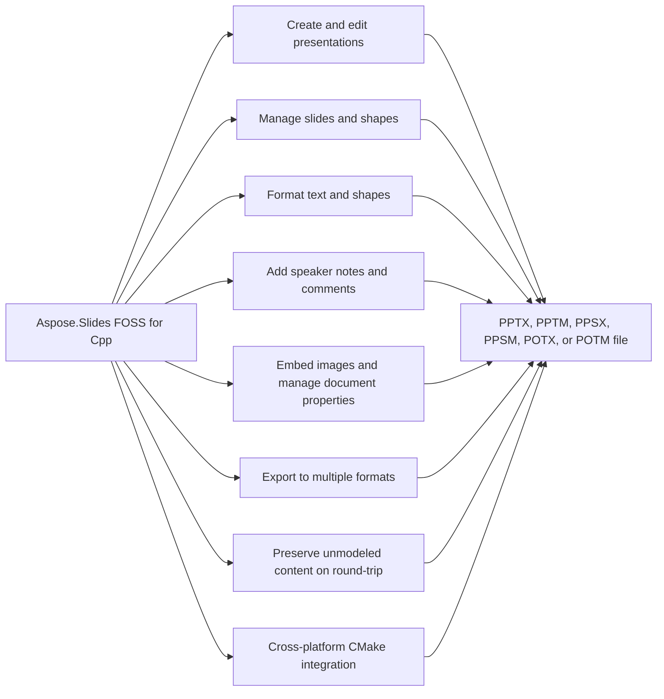

# Aspose.Slides FOSS for Cpp


It reads and writes PowerPoint presentations in formats including `.pptx`, `.pptm`, `.ppsx`, `.ppsm`, `.potx`, `.potm`, `.fodp`, `.gif`, `.html`, `.html5`, `.md`, `.odp`, `.otp`, `.pdf`, `.pot`, `.pps`, `.ppt`, `.swf`, `.tiff`, `.xml`, and `.xps`. It supports creating, reading, and editing presentations, including comment authors, comments, replies, and document properties.

Aspose.Slides FOSS for C++ is a free, open-source, MIT-licensed C++ library for creating, reading, and editing PowerPoint `.pptx` presentations. It integrates into CMake-based build systems via `FetchContent` and requires no Microsoft PowerPoint installation, COM interop, or other proprietary runtime.

## Navigation

- [At a Glance](#at-a-glance)
- [Key Capabilities](#key-capabilities)
- [Installation](#installation)
- [Dependencies](#dependencies)
- [Quick Start](#quick-start)
- [API Reference](#api-reference)
- [Scope and Limitations](#scope-and-limitations)

## At a Glance



## Key Capabilities

- **Create and edit presentations.** It creates new presentations with the default constructor or loads existing ones from a file path, then saves them to `.pptx`, `.pptm`, `.ppsx`, `.ppsm`, `.potx`, or `.potm` formats using the save method.
- **Manage slides and shapes.** It manages slides through the `SlideCollection` interface, adding empty slides, removing slides, and cloning slides, while inserting AutoShapes, Tables, Connectors, and PictureFrames onto a slide via its `ShapeCollection`.
- **Format text and shapes.** It formats text at the character, paragraph, and text-frame level through `TextFrame`, `Paragraph`, and `Portion` objects, applying bold, italic, underline, font size, highlight color, alignment, spacing, indentation, margins, bulleting, and text-frame wrapping and columns.
- **Add speaker notes and comments.** It adds speaker notes per slide through `NotesSlideManager` and inserts comments with authors, timestamps, and positions via `CommentAuthorCollection` and `CommentCollection`, supporting reply comments linked via `set_parent_comment`.
- **Embed images and manage document properties.** It embeds images from in-memory byte buffers via `ImageCollection` and manages core, application, and custom document properties such as title, author, and typed custom values through `DocumentProperties`.
- **Export to multiple formats.** It exports presentations to `.pptx`, `.pptm`, `.ppsx`, `.ppsm`, `.potx`, and `.potm` formats using the save method with the appropriate `SaveFormat` value.
- **Preserve unmodeled content on round-trip.** It preserves unknown XML parts encountered on load by storing them verbatim and writing them back on save, ensuring round-trip fidelity for content this library does not yet understand.
- **Cross-platform CMake integration.** It integrates with CMake projects using a minimum version of 3.20 and C++20, depending on the pugixml and miniz libraries.

- Apply solid, gradient, pattern, or picture fills to any shape's `FillFormat`, and control outline
  width, dash style, cap style, compound style, join style, arrowheads, and alignment through
  `LineFormat`.
- Add outer shadow, inner shadow, preset shadow, glow, blur, soft edge, and reflection effects to a
  shape via its `EffectFormat`.

## Installation

The library is published on NuGet as `Aspose.Slides.Cpp.FOSS`.

To work from a source checkout instead, configure the clone with cmake:

```bash
git clone https://github.com/aspose-slides-foss/Aspose.Slides-FOSS-for-Cpp.git
cd Aspose.Slides-FOSS-for-Cpp
cmake -S . -B build
```

## Dependencies

### Required Package Dependencies

- `pugixml`

### Native and System Requirements

- Requires C++ `20` (`CMAKE_CXX_STANDARD` in `CMakeLists.txt`).
- Requires CMake 3.20 or later (`cmake_minimum_required` in `CMakeLists.txt`).

### Development Dependencies

- `AsposeSlidesFoss`
- `googletest`
- `GTest`
- `miniz`

## Quick Start

Example 008 creates a new presentation, adds a comment author and two comments with a reply relationship, and saves the result as `comments.pptx`.

```cpp
#include <Aspose/Slides/Foss/presentation.h>
#include <Aspose/Slides/Foss/comment_author_collection.h>
#include <Aspose/Slides/Foss/comment_author.h>
#include <Aspose/Slides/Foss/comment_collection.h>
#include <Aspose/Slides/Foss/comment.h>
#include <Aspose/Slides/Foss/drawing/point_f.h>
#include <Aspose/Slides/Foss/export/save_format.h>
#include <chrono>

using namespace Aspose::Slides::Foss;
using namespace Aspose::Slides::Foss::Drawing;

Presentation pres;
auto& author = pres.comment_authors().add_author("Jane Smith", "JS");
auto& slide = pres.slides()[0];

auto& comment = author.comments().add_comment(
    "Review this slide", slide, PointF(2.0f, 2.0f),
    std::chrono::system_clock::now());

auto& reply = author.comments().add_comment(
    "Agreed", slide, PointF(2.5f, 2.5f), std::chrono::system_clock::now());
reply.set_parent_comment(&comment);

pres.save("comments.pptx", SaveFormat::PPTX);
```

Example 009 creates a new presentation, sets built-in and custom document properties, and saves the result as `deck.pptx`.

```cpp
#include <Aspose/Slides/Foss/presentation.h>
#include <Aspose/Slides/Foss/document_properties.h>
#include <Aspose/Slides/Foss/export/save_format.h>

using namespace Aspose::Slides::Foss;

Presentation pres;
pres.document_properties().set_title("Q1 Results");
pres.document_properties().set_author("Finance Team");
pres.document_properties().set_custom_property_value("Version", 3);
pres.save("deck.pptx", SaveFormat::PPTX);
```

Build from source with CMake on any platform — it ships as CMake source you build and link
directly — or, on Windows with MSVC, install the prebuilt NuGet package.

```bash
cmake -B build -DCMAKE_BUILD_TYPE=Release
cmake --build build
```

Dependencies are fetched automatically via CMake `FetchContent`:

- [pugixml](https://github.com/zeux/pugixml) v1.14 — XML parsing
- [miniz](https://github.com/richgel999/miniz) 3.0.2 — ZIP archive I/O
- [GoogleTest](https://github.com/google/googletest) v1.15.2 — Testing (build only)

Requires a C++20 compiler and CMake 3.20+ (`CMAKE_CXX_STANDARD 20` is set in `CMakeLists.txt`).

To pull the library directly into your own CMake project instead of building it standalone:

```cmake
include(FetchContent)
FetchContent_Declare(
  aspose_slides_foss
  GIT_REPOSITORY https://github.com/aspose-slides-foss/Aspose.Slides-FOSS-for-Cpp.git
  GIT_TAG main
)
FetchContent_MakeAvailable(aspose_slides_foss)
target_link_libraries(your_target PRIVATE aspose_slides_foss)
```

`CMakeLists.txt` exposes its `include/` directory as a `PUBLIC` include path on the
`aspose_slides_foss` target, so no separate `target_include_directories()` call is needed.

```bash
cmake -B build -DCMAKE_BUILD_TYPE=Release -DCMAKE_INSTALL_PREFIX=/your/prefix
cmake --build build
cmake --install build
```

The prefix then contains the headers, the static library, a generated
`Aspose/Slides/Foss/version.h`, a CycloneDX bill of materials, and a CMake package configuration.
A consumer needs nothing but the prefix:

```cmake
cmake_minimum_required(VERSION 3.20)
project(my_app LANGUAGES CXX)

find_package(AsposeSlidesFoss CONFIG REQUIRED)

add_executable(my_app main.cpp)
target_link_libraries(my_app PRIVATE AsposeSlidesFoss::AsposeSlidesFoss)
```

```bash
cmake -B build -DCMAKE_PREFIX_PATH=/your/prefix
```

`examples/consumer/` is exactly that project, and it is built and run against a fresh install on
every CI run, so the instructions above are checked rather than asserted.

Version compatibility is `SameMinorVersion`. The version is CalVer — `YY.M.PATCH` — so the major
number is a year and carries no compatibility meaning at all:
`find_package(AsposeSlidesFoss 26.9 CONFIG REQUIRED)` accepts any `26.9.x` and rejects `26.10`,
which is the only promise a monthly release train can keep.

**A consumer needs pugixml's headers, not just its library.** 44 of the headers a consumer
includes — everything under `include/Aspose/Slides/Foss/` outside `_internal/` — include
`<pugixml.hpp>`, and 37 of them keep a `pugi::xml_node` as a data member. The installed
`AsposeSlidesFossConfig.cmake` calls `find_dependency(pugixml)` for that reason; if the library
was built with a fetched pugixml rather than an installed one, that pugixml is installed into the
same prefix alongside it, so `find_dependency` resolves either way. This is a leak of an
implementation detail into the interface, disclosed here rather than quietly fixed because the fix
is not small — see [Scope and Limitations](#scope-and-limitations) for the real scale of it. miniz
has no such problem: it appears in no installed header, is linked privately, and is required only
at link time.

## API Reference

Aspose.Slides FOSS for Cpp provides the Aspose.Slides FOSS for Cpp class as its primary entry point, which exposes core presentation functionality through the `Presentation` class. The `Presentation` class owns a `SlideCollection` of `Slide` objects, and each `Slide` exposes its shapes through `ShapeCollection` and its per-slide notes through `NotesSlideManager`.

The verified public surface has 234 types.

<details>
<summary>View the Complete Public API Surface</summary>

### Core API

| Class | Description |
| --- | --- |
| `AdjustValue` | Aspose.Slides.Foss.AdjustValue represents a value used to adjust a shape's geometry. |
| `AdjustValueCollection` | Aspose.Slides.Foss.AdjustValueCollection is a collection of AdjustValue objects associated with a shape. |
| `AutoShape` | Aspose.Slides.Foss.AutoShape represents a predefined geometric shape that can be added to a slide. |
| `BaseHandoutNotesSlideHeaderFooterManager` | Aspose.Slides.Foss.BaseHandoutNotesSlideHeaderFooterManager manages header and footer elements for handout and notes slides. |
| `BasePortionFormat` | Aspose.Slides.Foss.BasePortionFormat provides formatting properties for a text portion. |
| `BaseShapeLock` | Aspose.Slides.Foss.BaseShapeLock defines lock settings that restrict modifications to a shape. |
| `BaseSlide` | Aspose.Slides.Foss.BaseSlide is the base class for all slide types in a presentation. |
| `BulletFormat` | Aspose.Slides.Foss.BulletFormat provides formatting properties for a bullet in a text paragraph. |
| `Camera` | Aspose.Slides.Foss.Camera defines the camera perspective used for a 3D shape. |
| `Cell` | Aspose.Slides.Foss.Cell represents a single cell in a table. |
| `CellCollection` | Aspose.Slides.Foss.CellCollection is a collection of cells belonging to a table row. |
| `CellFormat` | Aspose.Slides.Foss.CellFormat provides formatting properties for a table cell. |
| `ColorFormat` | Aspose.Slides.Foss.ColorFormat represents a color used in formatting. |
| `Column` | Aspose.Slides.Foss.Column represents a single column in a table. |
| `ColumnCollection` | Aspose.Slides.Foss.ColumnCollection is a collection of columns in a table. |
| `ColumnFormat` | Aspose.Slides.Foss.ColumnFormat provides formatting properties for a table column. |
| `Comment` | Aspose.Slides.Foss.Comment represents a comment attached to a slide or shape. |
| `CommentAuthor` | Aspose.Slides.Foss.CommentAuthor represents the author of a comment. |
| `CommentAuthorCollection` | Aspose.Slides.Foss.CommentAuthorCollection is a collection of comment authors. |
| `CommentCollection` | Aspose.Slides.Foss.CommentCollection is a collection of comments associated with a slide or shape. |
| `Connector` | Aspose.Slides.Foss.Connector represents a line that connects two shapes. |
| `DocumentProperties` | Aspose.Slides.Foss.DocumentProperties provides access to the document's built-in properties. |
| `Color` | Aspose.Slides.Foss.Drawing.Color represents a color value. |
| `PointF` | Aspose.Slides.Foss.Drawing.PointF represents a point with floating-point coordinates. |
| `RectangleF` | Aspose.Slides.Foss.Drawing.RectangleF represents a rectangle with floating-point coordinates. |
| `Size` | Aspose.Slides.Foss.Drawing.Size represents a size with integer dimensions. |
| `SizeF` | Aspose.Slides.Foss.Drawing.SizeF represents a size with floating-point dimensions. |
| `EffectFormat` | Aspose.Slides.Foss.EffectFormat provides access to visual effects applied to a shape. |
| `Blur` | Aspose.Slides.Foss.Effects.Blur represents a blur effect applied to a shape. |
| `FillOverlay` | Aspose.Slides.Foss.Effects.FillOverlay represents a fill overlay effect applied to a shape. |
| `Glow` | Aspose.Slides.Foss.Effects.Glow represents a glow effect applied to a shape. |
| `IBlur` | Aspose.Slides.Foss.Effects.IBlur is an interface for blur effects. |
| `IFillOverlay` | Aspose.Slides.Foss.Effects.IFillOverlay is an interface for fill overlay effects. |
| `IGlow` | Aspose.Slides.Foss.Effects.IGlow is an interface for glow effects. |
| `IImageTransformOperation` | Aspose.Slides.Foss.Effects.IImageTransformOperation is an interface for image transform operations. |
| `IInnerShadow` | Aspose.Slides.Foss.Effects.IInnerShadow is an interface for inner shadow effects. |
| `IOuterShadow` | IOuterShadow represents an outer shadow effect with properties such as blur radius, direction, distance, shadow color, and scaling or skewing transforms. |
| `IPresetShadow` | IPresetShadow represents a preset shadow effect with properties such as direction, distance, shadow color, and a preset type. |
| `IReflection` | IReflection represents a reflection effect with properties such as blur radius, direction, distance, fade direction, start and end opacity, and scaling or skewing transforms. |
| `ISoftEdge` | ISoftEdge represents a soft edge effect that applies a blur radius to the edges of a shape. |
| `ImageTransformOperation` | ImageTransformOperation is the base interface for image transform operations such as shadows, reflections, and soft edges. |
| `InnerShadow` | InnerShadow represents an inner shadow effect with properties such as blur radius, direction, distance, and shadow color. |
| `OuterShadow` | OuterShadow represents an outer shadow effect with properties such as blur radius, direction, distance, shadow color, and scaling or skewing transforms. |
| `PresetShadow` | PresetShadow represents a preset shadow effect with properties such as direction, distance, shadow color, and a preset type. |
| `Reflection` | Reflection represents a reflection effect with properties such as blur radius, direction, distance, fade direction, start and end opacity, and scaling or skewing transforms. |
| `SoftEdge` | SoftEdge represents a soft edge effect that applies a blur radius to the edges of a shape. |
| `FillFormat` | FillFormat provides access to the fill properties of a shape, such as fill type, solid color, gradient, or pattern. |
| `FontData` | FontData holds information about a font, such as its name, height, bold, italic, and underline settings. |
| `GeometryShape` | GeometryShape represents a shape defined by a geometric path and provides access to its geometry and formatting. |
| `GlobalLayoutSlideCollection` | GlobalLayoutSlideCollection provides access to the global layout slides in a presentation. |
| `GradientFormat` | GradientFormat provides access to the gradient fill properties of a shape, such as direction, style, and stops. |
| `GradientStop` | GradientStop defines a single color stop in a gradient fill, including its position and color. |
| `GradientStopCollection` | GradientStopCollection is a collection of gradient stops used in a gradient fill. |
| `GraphicalObject` | GraphicalObject is the base class for all graphical objects in a slide, such as shapes, tables, and charts. |
| `GraphicalObjectLock` | GraphicalObjectLock specifies which operations are locked for a graphical object. |
| `GroupShape` | GroupShape represents a container that groups multiple shapes together. |
| `HeadingPair` | HeadingPair represents a pair of heading and value used in document properties. |
| `IAdjustValue` | IAdjustValue represents an adjustable value in a shape's geometry. |
| `IAdjustValueCollection` | IAdjustValueCollection is a collection of adjustable values in a shape's geometry. |
| `IAutoShape` | IAutoShape represents an auto shape with predefined geometry and formatting options. |
| `IBaseHandoutNotesSlideHeaderFooterManager` | IBaseHandoutNotesSlideHeaderFooterManager provides access to header and footer settings for handout and notes slides. |
| `IBaseHeaderFooterManager` | IBaseHeaderFooterManager provides access to header and footer settings for a slide. |
| `IBasePortionFormat` | IBasePortionFormat provides access to the formatting properties of a text portion. |
| `IBaseSlide` | IBaseSlide is the base interface for all slide types in a presentation. |
| `IBaseSlideHeaderFooterManager` | IBaseSlideHeaderFooterManager provides access to header and footer settings for a slide. |
| `IBulkTextFormattable` | IBulkTextFormattable allows bulk formatting of text within a text frame. |
| `IBulletFormat` | IBulletFormat provides access to the bullet formatting properties of a paragraph. |
| `ICamera` | ICamera represents a camera used to define 3D view settings for a shape. |
| `ICell` | ICell represents a cell in a table, providing access to its text, formatting, and borders. |
| `ICellCollection` | ICellCollection is a collection of cells in a table row. |
| `ICellFormat` | ICellFormat provides access to the formatting properties of a table cell, such as fill, borders, and margins. |
| `IColorFormat` | IColorFormat represents a color value and its type, providing access to red, green, and blue components as well as preset and scheme colors. |
| `IColumn` | IColumn represents a single column in a table, exposing its width, format, and ability to be converted to bulk text formattable or cell collection interfaces. |
| `IColumnCollection` | IColumnCollection is a collection of table columns supporting addition, insertion, removal, and size queries. |
| `IColumnFormat` | IColumnFormat defines formatting properties specific to a table column. |
| `IComment` | IComment represents a comment attached to a slide, including its author, creation time, position, text, and parent comment relationships. |
| `ICommentAuthor` | ICommentAuthor represents a comment author identified by name and initials, with a collection of their comments. |
| `ICommentAuthorCollection` | ICommentAuthorCollection manages a set of comment authors, supporting addition, removal, and lookup by name or initials. |
| `ICommentCollection` | ICommentCollection is a collection of comments attached to a slide, allowing iteration and removal of individual comments. |
| `IConnector` | IConnector represents a connector shape linking two shapes in a slide, with properties for start and end shape connections. |
| `IDocumentProperties` | IDocumentProperties provides access to built-in and custom document properties of a presentation. |
| `IEffectFormat` | IEffectFormat exposes effects such as shadows, glows, and 3D formatting applied to a shape. |
| `IEffectParamSource` | IEffectParamSource defines the source of effect parameters used in shape formatting. |
| `IFillFormat` | IFillFormat describes the fill properties of a shape, including solid, gradient, pattern, and picture fills. |
| `IFillParamSource` | IFillParamSource defines the source of fill parameters used in shape formatting. |
| `IFontData` | IFontData holds font information such as name, height, bold, italic, and underline settings. |
| `IGeometryShape` | IGeometryShape represents a shape with geometric properties and text content. |
| `IGlobalLayoutSlideCollection` | IGlobalLayoutSlideCollection contains all global layout slides available in a presentation. |
| `IGradientFormat` | IGradientFormat defines gradient fill properties including direction, style, and stops. |
| `IGradientStop` | IGradientStop represents a single color stop in a gradient fill, with position and color properties. |
| `IGradientStopCollection` | IGradientStopCollection is a collection of gradient stops used in gradient fill formatting. |
| `IGraphicalObject` | IGraphicalObject is the base interface for all graphical objects on a slide, such as shapes, tables, and charts. |
| `IGraphicalObjectLock` | IGraphicalObjectLock specifies which operations are locked for a graphical object. |
| `IGroupShape` | IGroupShape represents a group of shapes that can be manipulated as a single unit. |
| `IHeadingPair` | IHeadingPair represents a pair of heading and text for document property navigation. |
| `IHyperlinkContainer` | IHyperlinkContainer provides access to hyperlink settings associated with a shape or text. |
| `IImage` | IImage represents an image embedded in a presentation, exposing its binary data and format. |
| `IImageCollection` | IImageCollection is a collection of images used in a presentation, supporting addition and removal. |
| `ILayoutSlide` | ILayoutSlide defines the layout and placeholder structure for slides in a presentation. |
| `ILayoutSlideCollection` | ILayoutSlideCollection contains all layout slides associated with a master slide. |
| `ILightRig` | ILightRig defines a 3D lighting configuration applied to a shape. |
| `ILineFillFormat` | ILineFillFormat specifies the fill properties of a shape's outline. |
| `ILineFormat` | ILineFormat defines the line properties of a shape's outline, including weight, dash style, and color. |
| `ILineParamSource` | ILineParamSource defines the source of line parameters used in shape formatting. |
| `ILoadOptions` | ILoadOptions specifies settings used when loading a presentation from a file or stream. |
| `IMasterLayoutSlideCollection` | IMasterLayoutSlideCollection contains all layout slides associated with a master slide. |
| `IMasterSlide` | IMasterSlide represents a master slide that defines the default layout and formatting for related slides. |
| `IMasterSlideCollection` | IMasterSlideCollection contains all master slides in a presentation. |
| `INotesSize` | INotesSize defines the dimensions and orientation of notes pages in a presentation. |
| `INotesSlide` | INotesSlide holds the notes content associated with a slide, including text and formatting. |
| `INotesSlideHeaderFooterManager` | INotesSlideHeaderFooterManager manages header and footer elements on a notes slide. |
| `INotesSlideManager` | INotesSlideManager manages notes slides for a slide, providing methods to add and remove notes slides. |
| `IPPImage` | IPPImage represents a picture placeholder image with properties such as binary data, content type, dimensions, and position. |
| `IParagraph` | IParagraph represents a paragraph within a text frame, containing portions and a paragraph format. |
| `IParagraphCollection` | IParagraphCollection is a collection of paragraphs that supports enumeration, indexing, and modification operations. |
| `IParagraphFormat` | IParagraphFormat defines formatting properties for a paragraph, including alignment, indentation, line break behavior, and spacing. |
| `IPatternFormat` | IPatternFormat specifies pattern fill properties for a shape or frame. |
| `IPictureFillFormat` | IPictureFillFormat defines picture fill properties for a shape or frame. |
| `IPictureFrame` | IPictureFrame represents a picture frame shape that contains an image. |
| `IPictureFrameLock` | IPictureFrameLock specifies locking options for a picture frame to prevent user modifications. |
| `IPortion` | IPortion represents a portion of text with a uniform format within a paragraph. |
| `IPortionCollection` | IPortionCollection is a collection of text portions that supports enumeration, indexing, and modification operations. |
| `IPortionFormat` | IPortionFormat defines formatting properties for a text portion, such as font height, bold, italic, and color. |
| `IPresentation` | IPresentation represents a PowerPoint presentation and provides access to its slides, sections, and other components. |
| `IPresentationComponent` | IPresentationComponent is a base interface for presentation components. |
| `IRow` | IRow represents a row in a table, containing cells and row formatting. |
| `IRowCollection` | IRowCollection is a collection of table rows that supports enumeration, indexing, and modification operations. |
| `IRowFormat` | IRowFormat defines formatting properties for a table row. |
| `ISection` | ISection represents a section in a presentation, containing layout slides and slides. |
| `IShape` | IShape is a base interface for all shape types in a slide. |
| `IShapeBevel` | IShapeBevel defines bevel properties for a shape. |
| `IShapeCollection` | IShapeCollection is a collection of shapes on a slide that supports enumeration, indexing, and modification operations. |
| `IShapeFrame` | IShapeFrame defines the geometric properties of a shape, such as position and size. |
| `IShapeStyle` | IShapeStyle defines style properties for a shape. |
| `ISlide` | ISlide represents a slide in a presentation, containing shapes, text frames, and other content. |
| `ISlideCollection` | ISlideCollection is a collection of slides in a presentation that supports enumeration, indexing, and modification operations. |
| `ISlideComponent` | ISlideComponent is a base interface for slide components. |
| `ISlidesPicture` | ISlidesPicture represents a picture in a slide. |
| `ITable` | ITable represents a table in a slide, containing rows and cells. |
| `ITableFormat` | ITableFormat defines formatting properties for a table. |
| `ITextFrame` | ITextFrame represents a text frame that contains paragraphs of text. |
| `ITextFrameFormat` | ITextFrameFormat defines formatting properties for a text frame. |
| `IThreeDFormat` | IThreeDFormat defines three-dimensional formatting properties for a shape. |
| `IThreeDParamSource` | IThreeDParamSource specifies the source of three-dimensional parameters for a shape. |
| `Image` | Image represents an image in the presentation's image collection. |
| `ImageCollection` | ImageCollection is a collection of images in a presentation that supports enumeration, indexing, and modification operations. |
| `Images` | Images provides access to the collection of images in a presentation. |
| `LayoutSlide` | LayoutSlide represents a layout slide that defines the arrangement of placeholders for slides. |
| `LayoutSlideCollection` | LayoutSlideCollection is a collection of layout slides in a presentation that supports enumeration and indexing. |
| `LightRig` | LightRig defines lighting properties for three-dimensional shapes. |
| `LineFillFormat` | LineFillFormat provides access to the fill formatting properties of a line. |
| `LineFormat` | LineFormat provides access to the formatting properties of a line. |
| `MasterLayoutSlideCollection` | MasterLayoutSlideCollection contains the collection of master layout slides in a presentation. |
| `MasterReference` | MasterReference represents a reference to a master slide. |
| `MasterSlide` | MasterSlide represents a master slide in a presentation. |
| `MasterSlideCollection` | MasterSlideCollection contains the collection of master slides in a presentation. |
| `NotesSize` | NotesSize specifies the size of notes pages in a presentation. |
| `NotesSlide` | NotesSlide contains the notes content associated with a slide. |
| `NotesSlideHeaderFooterManager` | NotesSlideHeaderFooterManager manages header and footer elements on a notes slide. |
| `NotesSlideManager` | NotesSlideManager manages the notes slide for a presentation slide. |
| `NotesSlidePart` | NotesSlidePart represents the part of a slide that contains notes. |
| `PPImage` | PPImage represents a picture object in a presentation. |
| `PVIObject` | PVIObject is the base class for all presentation object implementations. |
| `Paragraph` | Paragraph represents a paragraph of text within a text frame. |
| `ParagraphCollection` | ParagraphCollection contains the collection of paragraphs in a text frame. |
| `ParagraphFormat` | ParagraphFormat provides access to the formatting properties of a paragraph. |
| `PatternFormat` | PatternFormat specifies the pattern used to fill an area. |
| `Picture` | Picture represents a picture object in a presentation. |
| `PictureFillFormat` | PictureFillFormat provides access to the fill formatting properties of a picture. |
| `PictureFrame` | PictureFrame represents a picture frame shape in a presentation. |
| `PictureFrameLock` | PictureFrameLock specifies which operations are restricted on a picture frame. |
| `Portion` | Portion represents a portion of text with the same formatting within a paragraph. |
| `PortionCollection` | PortionCollection contains the collection of portions in a paragraph. |
| `PortionFormat` | PortionFormat provides access to the formatting properties of a portion. |
| `Presentation` | Presentation represents a PowerPoint presentation file. |
| `Row` | Row represents a single row in a table, providing access to its content and formatting. |
| `RowCollection` | RowCollection is a collection of rows in a table, supporting iteration and modification. |
| `RowFormat` | RowFormat holds formatting properties for a table row, such as height and fill. |
| `Shape` | Shape is a base class for all drawing objects on a slide, including text frames and auto shapes. |
| `ShapeBevel` | ShapeBevel defines the bevel style applied to a shape's edges. |
| `ShapeCollection` | ShapeCollection is a collection of shapes on a slide, supporting iteration and management. |
| `ShapeFrame` | ShapeFrame specifies the position and size of a shape on a slide. |
| `SimpleColorFormat` | SimpleColorFormat provides a simple way to specify a solid color for formatting. |
| `Slide` | Slide represents a single slide in a presentation, containing shapes and other content. |
| `SlideCollection` | SlideCollection is a collection of slides in a presentation, supporting iteration and manipulation. |
| `SlideReference` | SlideReference holds a reference to a slide for external linking or embedding. |
| `Table` | Table represents a table object on a slide, composed of rows and cells. |
| `TableFormat` | TableFormat holds formatting properties for a table, such as style and borders. |
| `TextFrame` | TextFrame contains text content and provides access to its formatting and paragraphs. |
| `TextFrameFormat` | TextFrameFormat holds formatting properties for a text frame, such as margins and anchoring. |
| `IThemeable` | IThemeable is an interface for objects that can be styled using the presentation theme. |
| `ThreeDFormat` | ThreeDFormat specifies three-dimensional properties for a shape, such as extrusion and lighting. |

#### Enumerations

| Enumeration | Description |
| --- | --- |
| `BevelPresetType` | Aspose.Slides.Foss.BevelPresetType specifies a preset bevel style for a shape. |
| `BulletType` | Aspose.Slides.Foss.BulletType indicates the type of bullet used in a text paragraph. |
| `CameraPresetType` | Aspose.Slides.Foss.CameraPresetType specifies a preset camera view for 3D shapes. |
| `ColorType` | Aspose.Slides.Foss.ColorType indicates the type of color used in a color format. |
| `FillBlendMode` | FillBlendMode specifies the blend mode used when filling a shape. |
| `FillType` | FillType enumerates the possible fill types for a shape, such as solid, gradient, pattern, or picture. |
| `FontAlignment` | FontAlignment specifies the horizontal alignment of text within a text frame or paragraph. |
| `GradientDirection` | GradientDirection specifies the direction of a gradient fill. |
| `GradientShape` | GradientShape represents a shape filled with a gradient pattern. |
| `LightRigPresetType` | LightRigPresetType specifies preset lighting configurations for three-dimensional shapes. |
| `LightingDirection` | LightingDirection represents the direction of a light source used in 3D effects. |
| `LineAlignment` | LineAlignment specifies the alignment of a line relative to its anchor point. |
| `LineArrowheadLength` | LineArrowheadLength specifies the length of a line arrowhead. |
| `LineArrowheadStyle` | LineArrowheadStyle specifies the style of a line arrowhead. |
| `LineArrowheadWidth` | LineArrowheadWidth specifies the width of a line arrowhead. |
| `LineCapStyle` | LineCapStyle specifies the shape used to cap the ends of a line. |
| `LineDashStyle` | LineDashStyle specifies the dash pattern used for a line. |
| `LineJoinStyle` | LineJoinStyle specifies how two line segments are joined together. |
| `LineStyle` | LineStyle specifies the style of a line. |
| `MaterialPresetType` | MaterialPresetType specifies a preset material type used in 3D effects. |
| `NullableBool` | NullableBool represents a Boolean value that can be true, false, or undefined. |
| `NumberedBulletStyle` | NumberedBulletStyle specifies the style of numbered bullets in a list. |
| `PatternStyle` | PatternStyle specifies the style of a pattern fill. |
| `PictureFillMode` | PictureFillMode specifies how a picture is used to fill an area. |
| `PresetColor` | PresetColor specifies a predefined color value. |
| `PresetShadowType` | PresetShadowType represents a predefined shadow style for shapes in a presentation. |
| `RectangleAlignment` | RectangleAlignment specifies how a rectangle is aligned relative to its container. |
| `SaveFormat` | SaveFormat defines the file formats supported for saving presentations. |
| `SchemeColor` | SchemeColor represents a color from the presentation's theme color scheme. |
| `ShapeType` | ShapeType identifies the geometric type of an auto shape, such as rectangle or ellipse. |
| `SlideLayoutType` | SlideLayoutType specifies the layout type of a slide, such as title or content. |
| `SourceFormat` | SourceFormat identifies the format of a presentation file being loaded. |
| `TableStylePreset` | TableStylePreset defines a predefined style for tables. |
| `TextAlignment` | TextAlignment specifies horizontal alignment for text within a frame. |
| `TextAnchorType` | TextAnchorType specifies how text is anchored vertically within a text frame. |
| `TextAutofitType` | TextAutofitType determines how text automatically resizes to fit within a frame. |
| `TextCapType` | TextCapType specifies the capitalization style for text. |
| `TextShapeType` | TextShapeType identifies the type of a text shape, such as a text box or placeholder. |
| `TextStrikethroughType` | TextStrikethroughType specifies the style of strikethrough applied to text. |
| `TextUnderlineType` | TextUnderlineType specifies the style of underline applied to text. |
| `TextVerticalType` | TextVerticalType specifies the vertical orientation of text in a frame. |
| `TileFlip` | TileFlip specifies how a picture fill is flipped when tiled. |

#### Detailed Member Reference

### Foss

The Aspose.Slides FOSS for Cpp class serves as the main namespace and entry point for the Aspose.Slides FOSS for Cpp library, providing access to presentation creation, manipulation, and export capabilities.

The primary entry point is `Presentation`, which owns a `SlideCollection` of `Slide` objects; each
`Slide` exposes its shapes through `ShapeCollection` and its per-slide notes through
`NotesSlideManager`.

- `Presentation`
  - `Presentation()` — new presentation with one blank slide / `Presentation(path)` — load a `.pptx`
  - `slides() -> SlideCollection&`
  - `comment_authors() -> CommentAuthorCollection&`
  - `images() -> ImageCollection&`
  - `document_properties() -> DocumentProperties&`
  - `masters() -> MasterSlideCollection&` / `layout_slides() -> GlobalLayoutSlideCollection&`
  - `save(path, format)`

- `SlideCollection`
  - `operator[](index) -> Slide&`
  - `add_empty_slide(layout)`
  - `add_clone(source_slide)` / `insert_clone(index, source_slide)`
  - `remove(slide)` / `remove_at(index)`
  - iteration via `begin()` / `end()`

- `Slide`
  - `shapes() -> ShapeCollection&`
  - `notes_slide_manager() -> NotesSlideManager&`

- `ShapeCollection`
  - `add_auto_shape(type, x, y, w, h) -> AutoShape&`
  - `add_connector(type, x, y, w, h) -> Connector&`
  - `add_table(x, y, col_widths, row_heights) -> Table&`
  - `add_picture_frame(type, x, y, w, h, image) -> PictureFrame&`

</details>

## Scope and Limitations

Aspose.Slides FOSS for Cpp reads and writes six Office Open XML presentation formats — Pptx, Pptm, Ppsx, Ppsm, Potx, and Potm — sharing one package layout that differs only in the content type of the main presentation part; the three macro-enabled ones are written without a VBA project, since macros aren't supported. It supports auto shapes, tables, text frames, and basic formatting, and preserves unknown XML parts encountered during load.

- Charts, SmartArt, OLE objects, and mathematical text are not in the public API.
- Animations and slide transitions, group shapes, hyperlinks and action settings, slide backgrounds and themes, and slide size are not supported.
- Saving to a stream, adding an image from a path or a stream, and export to non-PPTX-family formats, VBA macros, and digital signatures are not supported.
- Every `SaveFormat` value other than Pptx, Pptm, Ppsx, Ppsm, Potx, and Potm throws an error.
- `slides()`.add_clone() loses the source shapes' text.
- `masters()`.add_clone() does not reach the file.

These limitations don't apply to
[Aspose.Slides for C++ — Enterprise Edition](https://products.aspose.com/slides/cpp/), which adds
broader format support (including PDF, HTML, and image export), charts, animations, and full
commercial support.

This project is licensed under the [MIT License](LICENSE). The MIT License permits use, copying,
modification, distribution, sublicensing, and commercial use, provided its copyright and
permission notice are retained. The software is provided without warranty.
