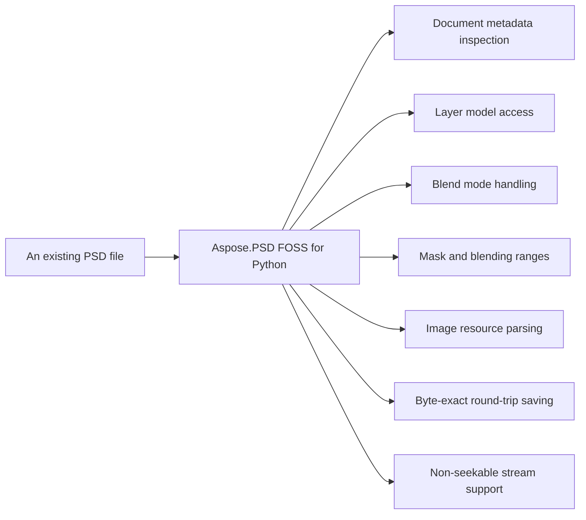

# Aspose.PSD FOSS for Python

Aspose.PSD FOSS for Python reads Adobe Photoshop `.psd` and .psb files, inspects their metadata, layers, channel information, blend modes, masks, image resources, and image-data structures (RLE and ZIP compression), and saves the files back to `.psd` or .psb format. It exposes document properties such as width, height, channels, `bits_per_channel`, `color_mode`, version, `is_psb`, `layer_count`, `resource_count`, compression, and `image_data_kind` through the `PsdImage` class. It provides access to layer objects with properties like name, bounds, blendmode, and channelinformation, and supports reading image resources and imagedata sections. The library runs on Python 3.7+ and depends only on the standard library.

Aspose.PSD FOSS for Python is a free, open-source, pure-Python library for reading, inspecting and saving Adobe Photoshop `.psd`/`.psb` files without rendering. It runs on Python 3.7+ and depends only on the standard library. The library supports reading of document metadata, layers, channel information, blend modes, masks, image resources and image-data structures (RLE and ZIP compression).  

## Navigation

- [At a Glance](#at-a-glance)
- [Key Capabilities](#key-capabilities)
- [Installation](#installation)
- [Quick Start](#quick-start)
- [API Reference](#api-reference)
- [Scope and Limitations](#scope-and-limitations)

## At a Glance



## Key Capabilities

- **Document metadata inspection.** Document metadata inspection exposes width, height, channels, `bits_per_channel`, `color_mode`, version, `is_psb`, `layer_count`, `resource_count`, compression, and `image_data_kind` through the `PsdImage` class.
- **Layer model access.** `Layer` model access provides layer name, bounds, opacity, visibility, clipping, `blend_mode_key`, `channels_count`, and `channel_information` through the layer class.
- **Blend mode handling.** Blend mode handling maps 4-character PSD keys to enum values using the `BlendMode` enum and `LayerBlendModeMapper`.
- **Mask and blending ranges.** Mask and blending ranges expose raw length and basic properties through `LayerMaskDataShort` and `LayerBlendingRangesData`, with mutations not supported.
- **Image resource parsing.** `Image` resource parsing handles unknown resources via `ImageResourcesSection`, preserving raw payloads, with `UnknownResource` exposing `resource_id`, name, and data.
- **Byte-exact round-trip saving.** Byte-exact round-trip saving preserves all unmodified sections, enabling lossless save-load cycles through `PsdImage.save`.
- **Non-seekable stream support.** Non-seekable stream support enables loading from streams that do not support seeking using `BigEndianReader`, `PsdSectionReader`, and `StreamContainer`.

## Installation

To work from a source checkout instead, install the clone with pip:

```bash
git clone https://github.com/aspose-psd-foss/Aspose.PSD-FOSS-for-Python.git
cd Aspose.PSD-FOSS-for-Python
pip install .
```

## Quick Start

This example loads a PSD file and prints each layer's index, name, and bounds to inspect the image structure.

```python
from aspose_psd_foss.psdimage import PsdImage

with PsdImage.load("sample.psd") as img:
    for idx, layer in enumerate(img.layers):
        print(f"{idx}: {layer.name} – {layer.bounds}")
```

## API Reference

The public entry point is the `aspose_psd_foss` package. It provides the `aspose_psd_foss.PsdImage` class to load, inspect, and save Adobe Photoshop files, with methods for accessing layers, resources, color mode, compression, and other core properties.

The verified public surface has 77 types.

<details>
<summary>View the Complete Public API Surface</summary>

### Core API

| Class | Description |
| --- | --- |
| `BigEndianBitConverter` | Provides helper methods for reading big-endian primitive values from byte arrays. |
| `BigEndianReader` | Reads big-endian data from a stream. |
| `BigEndianWriter` | The BigEndianWriter class writes data in big-endian byte order to a stream, providing methods to write bytes, integers, and Pascal strings with optional alignment. |
| `Image` | Abstract base class for image objects. |
| `ImageLoader` | Provides the load functionality for images. |
| `LayerAndMaskSectionReader` | The LayerAndMaskSectionReader class reads the layer and mask section of a PSD file, parsing layer records and associated mask data. |
| `LayerAndMaskSectionWriter` | Writes PSD/PSB Layer and Mask Information sections. |
| `Point` | The Point class represents a point in two-dimensional space with X and Y coordinates. |
| `PsdImage` | Represents a PSD image that can be loaded, inspected, and saved without rendering. |
| `PsdSectionReader` | Provides bounded reads for PSD/PSB sections that are stored in memory by this implementation. |
| `Rectangle` | Stores a set of four integers that represent the location and size of a rectangle. |
| `RectangleF` | Stores a set of four floating-point numbers that represent the location and size of a rectangle. |
| `ResourceBlock` | Represents a PSD image resource block. |
| `Size` | The Size class represents the dimensions of a rectangle with width and height values. |
| `StreamContainer` | Represents a stream container used by resource save APIs. |
| `ArgumentNullException` | Exception that is thrown when argument is null. |
| `NotSupportedException` | Exception that is thrown when operation is not supported. |
| `PsdLoadException` | Exception that is thrown when an error occurs while loading a PSD file. |
| `PsdSaveException` | Initializes a new instance of the PsdSaveException class. |
| `BlendRange` | Represents a PSD layer blend range. |
| `ChannelInformation` | Represents PSD layer channel information. |
| `GlobalLayerMaskInfo` | The GlobalLayerMaskInfo class stores global layer mask information for a PSD file. |
| `Layer` | The Layer class represents a single layer in a PSD file, containing its bounds, blending mode, opacity, and other properties. |
| `LayerBlendingRangesData` | Represents PSD layer blending ranges data. |
| `LayerBlendingRangesInfo` | The LayerBlendingRangesInfo class defines the blending ranges for a layer in a PSD file. |
| `LayerBlendModeMapper` | The LayerBlendModeMapper class maps blend mode keys to their string representations in a PSD file. |
| `LayerChannelInfo` | Stores one channel metadata entry from a layer record. |
| `LayerMaskData` | Defines the base class for PSD layer mask data. |
| `LayerMaskDataShort` | Defines layer mask data for layers that have only a raster or vector mask. |
| `LayerMaskInfo` | The LayerMaskInfo class stores mask data associated with a layer in a PSD file. |
| `LayerRawData` | The LayerRawData class holds the raw binary data of a layer in a PSD file. |
| `LayerRecordReader` | The LayerRecordReader class reads and parses layer records from a PSD file's layer section. |
| `LayerRecordWriter` | Writes PSD/PSB layer records from the in-memory Layer model. |
| `LayerResource` | The LayerResource class is an abstract base class for layer resources in a PSD file. |
| `PsdLayerChannelInfo` | Provides a read-only summary of one parsed layer channel record. |
| `RawLayerBlendingRangesSection` | The RawLayerBlendingRangesSection class represents the raw section containing layer blending ranges data in a PSD file. |
| `RawLayerMaskSection` | The RawLayerMaskSection class represents the raw section containing layer mask data in a PSD file. |
| `PsdImageLoader` | The PsdImageLoader class loads PSD image files from a stream or file path. |
| `ImageResourceIds` | Provides common PSD image resource identifiers used by tests and fixtures. |
| `IndexedColorPalette` | The IndexedColorPalette class represents an indexed color palette used in a PSD file. |
| `IndexedColorPaletteInfo` | Provides a read-only view over an indexed-color PSD palette. |
| `PreservedResourceBlock` | Adapts a raw‑preserved image resource to the official ResourceBlock surface. |
| `PsdResourceInfo` | Provides a read-only summary of one parsed PSD image resource block. |
| `UnknownResource` | Initializes a new instance of the UnknownResource class. |
| `ColorData` | Stores the PSD Color Mode Data section as raw bytes plus mode‑aware parsed |
| `ImageData` | Stores the PSD Image Data section as a compression header plus raw payload bytes. |
| `ImageDataStructure` | Describes the validated structural layout of the PSD Image Data payload. |
| `ImageResourcesSection` | Represents the PSD Image Resources section as raw‑preserved bytes plus unknown‑only parsed summaries. |
| `LayerAndMaskSection` | Represents the PSD/PSB Layer and Mask Information section and its |
| `PsdColorDataInfo` | Provides a read-only summary of the PSD Color Mode Data section. |
| `PsdHeader` | Contains the header information of a Photoshop document. |
| `PsdImageDataInfo` | The PsdImageDataInfo class contains metadata about the image data section of a PSD file. |
| `PsdImageDocumentState` | Stores parsed PSD/PSB document sections used by PsdImage. |
| `PsdImageWriter` | Writes parsed PSD/PSB document state to a stream. |
| `TestAsposeCompatibility` | The TestAsposeCompatibility class verifies compatibility with Aspose.PSD behavior. |
| `TestColorData` | The TestColorData class validates color data handling in PSD files. |
| `TestFixtureDocument` | The TestFixtureDocument class tests document loading using fixture files. |
| `TestImageData` | The TestImageData class validates image data parsing in PSD files. |
| `TestImageResourcesSection` | The TestImageResourcesSection class tests the image resources section of PSD files. |
| `InspectionDtoTests` | The InspectionDtoTests class validates inspection data transfer objects for PSD files. |
| `TestLayerSection` | The TestLayerSection class tests the layer section parsing in PSD files. |
| `NonSeekableReadStream` | Wraps a readable in‑memory stream and intentionally disables seeking. |
| `TestPascalString` | The TestPascalString class validates Pascal string handling in PSD files. |
| `TestPsdHeaderTests` | The TestPsdHeaderTests class validates the PSD file header parsing. |
| `TestPsdImageLoad` | The TestPsdImageLoad class validates loading of PSD images from streams or files. |
| `TestPsdImagesaveTests` | The TestPsdImagesaveTests class validates saving PSD images to streams or files. |
| `PsdTestFixtureBase` | Provides common temporary-file helpers and binary fixture builders for PSD tests. |

#### Enumerations

| Enumeration | Description |
| --- | --- |
| `ColorModes` | Defines the color modes supported by PSD files. |
| `CompressionMethod` | Defines the compression methods used for image data in PSD files. |
| `PsdVersion` | The PsdVersion class specifies the version of the PSD file format, such as Photoshop CS6 or CC. |
| `ResourceBlockState` | Represents resource block state. |
| `SeekOrigin` | Defines seek origin for reader. |
| `BlendMode` | Defines the blend modes used for layers in PSD files. |
| `LayerMaskFlags` | Defines PSD layer mask flags. |
| `PsdResourceKind` | The PsdResourceKind class specifies the type of image resource in a PSD file using an enumeration. |
| `ImageDataKind` | Identifies the structural shape of the PSD Image Data payload. |
| `PsdColorDataKind` | Describes how the Color Mode Data payload was interpreted for the loaded document. |

#### Detailed Member Reference

### PsdImage

The `aspose_psd_foss.PsdImage` class represents a loaded Photoshop document and exposes its `aspose_psd_foss.PsdImage.width`, `aspose_psd_foss.PsdImage.height`, `aspose_psd_foss.PsdImage.color_mode`, `aspose_psd_foss.PsdImage.compression`, `aspose_psd_foss.PsdImage.has_layers`, `aspose_psd_foss.PsdImage.has_image_resources`, `aspose_psd_foss.PsdImage.has_icc_profile`, `aspose_psd_foss.PsdImage.layers`, `aspose_psd_foss.PsdImage.load`, and `aspose_psd_foss.PsdImage.save` members.

- `active_layer`: Gets the active layer.
- `bits_per_channel`: Gets the number of bits stored per channel.
- `channels`: Gets the document channel count from the PSD header.
- `channels_count`: Gets the PSD channels count.
- `color_data_info`: Gets a read-only summary of the parsed Color Mode Data section.
- `color_mode`: Gets the PSD color mode reported by the header.
- `compression`: Gets the compression method used by the merged image data section.
- `dispose`: Releases the image and optionally the underlying stream.
- `global_layer_mask_info`: Gets the global layer mask info.
- `global_layer_resources`: Gets or sets the global layer resources.
- `has_color_mode_data`: Gets whether the document contains Color Mode Data bytes.
- `has_icc_profile`: Gets whether an embedded ICC profile resource is present.
- `has_image_resources`: Gets whether the document contains any parsed image resources.
- `has_layers`: Gets whether the document contains at least one parsed layer.
- `has_merged_image_data`: Gets whether the document contains merged image data payload bytes.
- `has_transparency_data`: Gets or sets whether the first alpha channel contains transparency data.
- `header`: Gets the parsed PSD/PSB header object.
- `height`: Gets the document height in pixels.
- `image_data_info`: Gets a read-only summary of the parsed merged image data structure.
- `image_data_kind`: Gets the structural kind of the merged image data payload.
- `image_resources`: Gets or sets the PSD image resources.
- `indexed_palette`: Gets the parsed indexed palette summary, when present.
- `is_flatten`: Gets whether the PSD image is flattened.
- `is_icc_profile_untagged`: Gets the parsed untagged ICC profile flag, when present.
- `is_large_document`: Gets whether the loaded document uses the PSB large-document container.
- `is_psb`: Equivalent to :attr:is_large_document.
- `layer_count`: Gets the number of parsed layers in the document.
- `layers`: Gets the parsed layer collection.
- `load`: Loads a PSD image from a file path or a readable stream.
- `parsed_color_data`: Gets the parsed color mode data details for internal verification/tests.
- `parsed_resources`: Gets the parsed image resources for internal verification/tests.
- `resource_count`: Gets the number of parsed image resource blocks.
- `resources`: Gets a read-only summary of the parsed image resource blocks.
- `save`: Saves the image to a file path or a writable stream.
- `size`: Gets the image size.
- `uses_prediction`: Gets whether ZIP prediction is used by the merged image data payload.
- `version`: Gets or sets the Aspose.PSD-compatible API version number.
- `width`: Gets the document width in pixels.

### load

Loading a PSD file is performed via the `aspose_psd_foss.Image.load` method, which supports loading from a file path using `aspose_psd_foss.ImageLoader.load_from_path` or from a stream using `aspose_psd_foss.ImageLoader.load_from_stream`, returning an `aspose_psd_foss.PsdImage` instance when the input is a Photoshop document.

### save

Saving a `aspose_psd_foss.PsdImage` instance is done by calling its `aspose_psd_foss.PsdImage.save` method, which accepts a file path or a stream and uses the `aspose_psd_foss.writedescriptors.psdimagewriter` descriptor to write the output.

### layers

The `aspose_psd_foss.PsdImage.layers` property returns a collection of `aspose_psd_foss.layers.layer` objects, and the `aspose_psd_foss.PsdImage.layer_count` property indicates how many layers the document contains.

### resources

The `aspose_psd_foss.PsdImage.resources` property provides access to the document's resource blocks, and the `aspose_psd_foss.PsdImage.image_resources` property returns the image resources section, which contains `aspose_psd_foss.ResourceBlock` instances within the `aspose_psd_foss.sections.imageresourcessection`.

### active_layer

The `aspose_psd_foss.PsdImage.active_layer` property returns the currently active `aspose_psd_foss.layers.layer` in the document.

### color_mode

The `aspose_psd_foss.PsdImage.color_mode` property indicates the color mode of the document, represented by values from the `aspose_psd_foss.ColorModes` enumeration, and the underlying color data kind is defined in `aspose_psd_foss.sections.psdcolordatakind`.

### compression

The `aspose_psd_foss.PsdImage.compression` property specifies the compression method used for the image data, represented by values from the `aspose_psd_foss.CompressionMethod` enumeration, and the structure of the image data is described by `aspose_psd_foss.sections.imagedatastructure`.

### has_layers

The `aspose_psd_foss.PsdImage.has_layers` property returns a boolean indicating whether the document contains layers, as defined in the `aspose_psd_foss.sections.layerandmasksection`.

### has_image_resources

The `aspose_psd_foss.PsdImage.has_image_resources` property returns a boolean indicating whether the document contains image resources, as defined in the `aspose_psd_foss.sections.imageresourcessection`.

### has_icc_profile

The `aspose_psd_foss.PsdImage.has_icc_profile` property returns a boolean indicating whether the document contains an ICC profile, as defined in the `aspose_psd_foss.resources.psdresourceinfo` section.

### dispose

The `aspose_psd_foss.PsdImage.dispose` method releases resources used by the document and accepts an `aspose_psd_foss.StreamContainer` instance for stream cleanup.

The public entry point is the `aspose_psd_foss` package.  

</details>

## Scope and Limitations

Aspose.PSD FOSS for Python reads and writes Photoshop Document files, exposing layer and image data through the `aspose_psd_foss.layers.channelinformation`, `aspose_psd_foss.layers.layerblendingrangesdata`, `aspose_psd_foss.layers.layermaskdatashort`, and `aspose_psd_foss.sections.imagedata` classes.

- The `aspose_psd_foss.layers.channelinformation` class provides access to channel data but does not expose methods to modify channel content directly.
- The `aspose_psd_foss.layers.layerblendingrangesdata` and `aspose_psd_foss.layers.layermaskdatashort` classes expose blending ranges and mask data structures but do not provide APIs to edit their contents.
- The `aspose_psd_foss.sections.imagedata` class exposes image data sections but does not support programmatic modification of section contents.

This project is licensed under the [MIT License](License/LICENSE.txt). The MIT License permits use, copying, modification, distribution, sublicensing and commercial use, provided the original copyright and permission notice are retained. The software is provided without warranty.
