# Aspose.Cells FOSS for .NET

[](https://www.nuget.org/packages/Aspose.Cells.FOSS/) 

It reads and writes Excel .xlsx workbooks, converts them to PDF, and supports editing cells, styles, validation, conditional formatting, list objects, charts, and page setup. It provides `LoadOptions`, `LoadDiagnostics`, and `IWarningCallback` for robust loading behavior.

Aspose.Cells FOSS for .NET is a free, open-source, MIT-licensed .NET library for creating, loading, editing, and saving Excel `.xlsx` workbooks, with no dependency on Microsoft Excel or any other native Office library. It exposes an Aspose.Cells-compatible API surface built around `Workbook`, `Worksheet`, `Cells`, and `Cell`. The library is pure managed code, multi-targeting `netstandard2.0` and `net8.0`, so the same package runs on Windows, Linux, and macOS, including containerized and serverless environments.

## Navigation

- [At a Glance](#at-a-glance)
- [Key Capabilities](#key-capabilities)
- [Installation](#installation)
- [Dependencies](#dependencies)
- [API Reference](#api-reference)
- [Scope and Limitations](#scope-and-limitations)

## At a Glance

```mermaid
flowchart LR
Product["Aspose.Cells FOSS for .NET"]
Product["Aspose.Cells FOSS for .NET"] --> Cap1["Create and edit workbooks"]
Cap2["Format cells and styles"]
Cap3["Add data validation and conditional formatting"]
Cap4["Build structured tables and charts"]
Cap5["Export to PDF"]
Cap6["Protect workbook and worksheet content"]
Product["Aspose.Cells FOSS for .NET"] --> Cap2["Format cells and styles"]
Product["Aspose.Cells FOSS for .NET"] --> Cap3["Add data validation and conditional formatting"]
Product["Aspose.Cells FOSS for .NET"] --> Cap4["Build structured tables and charts"]
Product["Aspose.Cells FOSS for .NET"] --> Cap5["Export to PDF"]
Product["Aspose.Cells FOSS for .NET"] --> Cap6["Protect workbook and worksheet content"]
```



## Key Capabilities

- **Create and edit workbooks.** Create a new workbook or load an existing .xlsx file with `Workbook()` / `Workbook`(fileName) / `Workbook`(stream), then save to .xlsx or .pdf through Save(...); navigate sheets through `Workbook.Worksheets`.
- **Format cells and styles.** Apply fonts, fills, borders, alignment, and number formats through `Cell.GetStyle()` / `SetStyle()` and the `Style`, `Font`, `Borders`, and `FillPattern` types, with `StyleFlag` controlling which formatting properties a style application touches.
- **Add data validation and conditional formatting.** Add whole-number, decimal, list, and date validation rules with `ValidationCollection.Add()`, `ValidationType`, and `OperatorType`; highlight data with conditional formatting via `Worksheet.ConditionalFormattings`; filter columns with `AutoFilter` / `FilterColumn`.
- **Build structured tables and charts.** Build structured Excel tables through `Worksheet.ListObjects`, including built-in table styles (`TableStyleType`) and totals-row aggregation (`TotalsCalculation`); anchor pictures (`PictureCollection`) and drawing shapes (`ShapeCollection`, `AutoShapeType`) to a worksheet.
- **Export to PDF.** Export worksheets to PDF with `SaveFormat`.Pdf or `PdfSaveOptions`, with worksheet page geometry driven by `Worksheet.PageSetup`.
- **Protect workbook and worksheet content.** Protect workbook structure with `WorkbookProtection` or individual sheets with `Worksheet.Protect()`.

- Recover from malformed input instead of failing outright: `LoadOptions.TryRepairPackage`, `TryRepairXml`, and `StrictMode` control repair behavior, and `LoadDiagnostics` reports repair and data-loss-risk diagnostics through `HasRepairs` and `HasDataLossRisk`, plus warning callbacks delivered through `IWarningCallback`.
- Configure worksheet-level display and print settings including zoom, gridlines, right-to-left layout, visibility, and page layout through `Worksheet.PageSetup`, plus workbook and document metadata via `WorkbookProperties` and `CoreDocumentProperties`.
- Read and write cell values of multiple types (`string`, `int`, `bool`, `decimal`, `DateTime`) with `Cell.PutValue(value)`, and read them back with `Cell.StringValue` / `Cell.Value`; store formulas as strings via `Cell.Formula`.

The library multi-targets `netstandard2.0` and `net8.0`. Because it targets `netstandard2.0`, it can also be consumed by other compatible runtimes, including .NET Framework 4.6.1 and later. The public namespace is `Aspose.Cells_FOSS` (with an underscore), which is distinct from the NuGet package id `Aspose.Cells.FOSS` (with dots).

## Installation

Install the published package from NuGet (`Aspose.Cells.FOSS`, version 26.9.0.0):

```bash
dotnet add package Aspose.Cells.FOSS
```

## Dependencies

### Required Package Dependencies

- `SkiaSharp 2.88.8`

### Native and System Requirements

- Requires .NET `netstandard2.0;net8.0` (`TargetFrameworks` in `src/Aspose.Cells_FOSS/Aspose.Cells_FOSS.csproj`).

## API Reference

The public API is exposed under the `Aspose.Cells_FOSS` namespace, with `Workbook` as the root object and `Worksheet`, `Cells`, and `Cell` as the types most developers interact with day to day.

The verified public surface has 98 types.

<details>
<summary>View the Complete Public API Surface</summary>

### Core API

| Class | Description |
| --- | --- |
| `AutoFilter` | Represents auto filter. |
| `AutoFilterColorFilter` | Represents auto filter color filter. |
| `AutoFilterCustomFilter` | Represents auto filter custom filter. |
| `AutoFilterCustomFilterCollection` | Represents a collection of auto filter custom filter objects. |
| `AutoFilterDynamicFilter` | Represents auto filter dynamic filter. |
| `AutoFilterSortCondition` | Represents auto filter sort condition. |
| `AutoFilterSortConditionCollection` | Represents a collection of auto filter sort condition objects. |
| `AutoFilterSortState` | Represents auto filter sort state. |
| `AutoFilterTop10` | Represents auto filter top10. |
| `Border` | Represents border. |
| `Borders` | Represents borders. |
| `CalculationProperties` | Represents calculation properties. |
| `Cell` | Represents a single worksheet cell and exposes value, formula, and style operations. |
| `CellArea` | Represents cell area. |
| `Cells` | Provides access to worksheet cells, rows, columns, and merged ranges. |
| `CellsException` | Represents an error that occurs during cells. |
| `Chart` | Represents a chart embedded in a worksheet. |
| `ChartCollection` | Represents collection of charts on a worksheet. |
| `Color` | Represents color. |
| `Column` | Represents column. |
| `ColumnCollection` | Represents a collection of column objects. |
| `Comment` | Represents a worksheet comment (legacy note) anchored to a single cell. |
| `CommentCollection` | Represents the collection of comments (legacy notes) on a worksheet. |
| `ConditionalFormattingCollection` | Represents a collection of conditional formatting objects. |
| `CoreDocumentProperties` | Represents core document properties. |
| `DefinedName` | Represents defined name. |
| `DefinedNameCollection` | Represents a collection of defined name objects. |
| `DocumentProperties` | Represents document properties. |
| `ExtendedDocumentProperties` | Represents extended document properties. |
| `FilterColumn` | Represents filter column. |
| `FilterColumnCollection` | Represents a collection of filter column objects. |
| `FilterValueCollection` | Represents a collection of filter value objects. |
| `Font` | Represents font. |
| `FontSetting` | Represents a range of characters within a cell's rich text. |
| `FormatCondition` | Represents format condition. |
| `FormatConditionCollection` | Represents a collection of format condition objects. |
| `FormulaException` | Represents an error that occurs during formula. |
| `Hyperlink` | Represents hyperlink. |
| `HyperlinkCollection` | Encapsulates the hyperlinks defined for a worksheet. |
| `IWarningCallback` | Defines a callback that receives load warnings. |
| `InvalidFileFormatException` | Represents an error that occurs during invalid file format. |
| `ListColumn` | Represents a single column in an Excel table. |
| `ListColumnCollection` | Represents the ordered collection of columns in an Excel table. |
| `ListObject` | Represents an Excel table (structured reference / ListObject). |
| `ListObjectCollection` | Represents the collection of Excel tables on a worksheet. |
| `LoadDiagnostics` | Represents load diagnostics. |
| `LoadIssue` | Represents load issue. |
| `LoadOptions` | Specifies how a workbook should be loaded. |
| `NumberFormat` | Provides number format operations. |
| `PageSetup` | Represents worksheet print and page-layout settings. |
| `PdfSaveOptions` | Options controlling XLSX-to-PDF rendering. |
| `Picture` | Represents a picture (image) anchored to a worksheet. |
| `PictureCollection` | Represents collection of pictures anchored to a worksheet. |
| `Row` | Represents row. |
| `RowCollection` | Represents a collection of row objects. |
| `SaveOptions` | Specifies how a workbook should be saved. |
| `Shape` | Represents a drawing object (auto shape) anchored to a worksheet. |
| `ShapeCollection` | Represents collection of drawing objects (shapes) on a worksheet. |
| `Style` | Represents a mutable cell style facade that can be applied to one or more cells. |
| `StyleException` | Represents an error that occurs during style. |
| `StyleFlag` | Represents flags which indicate applied formatting properties. |
| `UnsupportedFeatureException` | Represents an error that occurs during unsupported feature. |
| `Validation` | Represents validation. |
| `ValidationCollection` | Represents a collection of validation objects. |
| `WarningInfo` | Represents warning info. |
| `Workbook` | Represents the root spreadsheet object used to create, load, modify, and save an XLSX workbook. |
| `WorkbookLoadException` | Represents an error that occurs during workbook load. |
| `WorkbookProperties` | Represents workbook properties. |
| `WorkbookProtection` | Represents workbook protection. |
| `WorkbookSaveException` | Represents an error that occurs during workbook save. |
| `WorkbookSettings` | Represents workbook-level settings that affect date handling and display formatting. |
| `WorkbookView` | Represents workbook view. |
| `Worksheet` | Encapsulates a single worksheet and its supported v0.1 worksheet features. |
| `WorksheetCollection` | Encapsulates the workbook's worksheets and active-sheet state. |
| `WorksheetProtection` | Represents worksheet protection. |

#### Enumerations

| Enumeration | Description |
| --- | --- |
| `AutoShapeType` | Specifies the type of an auto shape (preset geometry). |
| `BorderStyleType` | Specifies border style type. |
| `CellValueType` | Specifies cell value type. |
| `ChartType` | Specifies the chart type. |
| `DiagnosticSeverity` | Specifies diagnostic severity. |
| `FillPattern` | Specifies fill pattern. |
| `FilterOperatorType` | Specifies filter operator type. |
| `FontUnderlineType` | Enumerates font underline types. |
| `FormatConditionType` | Specifies format condition type. |
| `HorizontalAlignmentType` | Specifies horizontal alignment type. |
| `ImageType` | Represents the format of an image stored in a worksheet. |
| `LoadFormat` | Specifies load format. |
| `OperatorType` | Specifies operator type. |
| `PageOrientationType` | Specifies page orientation type. |
| `PaperSizeType` | Specifies paper size type. |
| `SaveFormat` | Specifies save format. |
| `TableStyleType` | Represents the built-in Excel table style types. |
| `TargetModeType` | Specifies target mode type. |
| `TotalsCalculation` | Represents the aggregation function shown in a table totals row cell. |
| `ValidationAlertType` | Specifies validation alert type. |
| `ValidationType` | Specifies validation type. |
| `VerticalAlignmentType` | Specifies vertical alignment type. |
| `VisibilityType` | Specifies visibility type. |

#### Detailed Member Reference

### Workbook

The `Workbook` class serves as the primary entry point for working with spreadsheet files, providing access to Worksheets, `DefinedNames`, Properties, Settings, and `DocumentProperties`, and supporting operations such as Save and `LoadDiagnostics`.

- `DefinedNames`: Gets the workbook-defined names collection.
- `Dispose`: Releases resources associated with the workbook instance.
- `DocumentProperties`: Gets the document properties facade for core and extended metadata.
- `LoadDiagnostics`: Gets diagnostics collected while loading the current workbook.
- `Properties`: Gets workbook metadata and view settings exposed by the supported public API.
- `Save`: Saves the workbook to an XLSX file using default save options.
- `Settings`: Gets workbook-level settings such as the date system and display culture.
- `Workbook`: Initializes a new workbook with one default worksheet.
- `Worksheets`: Gets the worksheets in workbook order.

### Style

The `Style` class allows developers to define formatting for cells, including `BackgroundColor`, `ForegroundColor`, `Font`, `Borders`, `FillPattern`, `HorizontalAlignment`, `IndentLevel`, `IsHidden`, and `IsLocked`, and supports operations such as Copy and Equals.

- `BackgroundColor`: Gets or sets the fill background color.
- `Borders`: Gets or sets border settings.
- `Copy`: Copies data from another style object.
- `Custom`: Gets or sets the custom number format code.
- `Equals`: Determines whether two style instances are equal.
- `Font`: Gets or sets the font settings.
- `ForegroundColor`: Gets or sets the fill foreground color.
- `GetHashCode`: Serves as a hash function for a style object.
- `HorizontalAlignment`: Gets or sets the horizontal alignment.
- `IndentLevel`: Gets or sets the indentation level.
- `IsHidden`: Gets or sets whether the cell formula is hidden when worksheet protection is enabled.
- `IsLocked`: Gets or sets whether the cell is locked when worksheet protection is enabled.
- `Number`: Gets or sets the numeric format identifier.
- `NumberFormat`: Gets or sets the resolved number format string.
- `Pattern`: Gets or sets the fill pattern.
- `QuotePrefix`: Gets or sets whether the cell value starts with a single quote mark.
- `ReadingOrder`: Gets or sets the reading order.
- `RelativeIndent`: Gets or sets the relative indent.
- `ShrinkToFit`: Gets or sets whether the cell content shrinks to fit.
- `Style`: Initializes a new style with default font and border objects.
- `TextRotation`: Gets or sets the text rotation.
- `VerticalAlignment`: Gets or sets the vertical alignment.
- `WrapText`: Gets or sets whether text wraps within the cell.

### Validation

The `Validation` class enables data validation rules on cells, managed through the `ValidationCollection`, and works alongside `ConditionalFormattingCollection` for conditional formatting rules.

- `AddArea`: Adds the specified item.
- `AlertStyle`: Gets or sets the alert style.
- `Areas`: Gets the areas.
- `ErrorMessage`: Gets or sets the error message.
- `ErrorTitle`: Gets or sets the error title.
- `Formula1`: Gets or sets the formula1.
- `Formula2`: Gets or sets the formula2.
- `IgnoreBlank`: Gets or sets a value indicating whether ignore blank.
- `InCellDropDown`: Gets or sets a value indicating whether in cell drop down.
- `InputMessage`: Gets or sets the input message.
- `InputTitle`: Gets or sets the input title.
- `Operator`: Gets or sets the operator.
- `RemoveArea`: Removes the specified item.
- `ShowError`: Gets or sets a value indicating whether show error.
- `ShowInput`: Gets or sets a value indicating whether show input.
- `Type`: Gets or sets the type.

### ListObject

The `ListObject` class represents a table in a worksheet, accessible via the `ListObjectCollection`, and supports features such as charts through the `Chart` and `ChartCollection` classes.

- `Comment`: Gets or sets an optional comment for the table.
- `ConvertToRange`: Removes the table structure, leaving the cell data in place.
- `DisplayName`: Gets or sets the user-visible table name.
- `EndColumn`: Gets the zero-based column index of the last column.
- `EndRow`: Gets the zero-based row index of the last row (last data or totals row).
- `ListColumns`: Gets the collection of columns in this table.
- `RemoveAutoFilter`: Hides the autoFilter drop-down buttons from the table header row.
- `Resize`: Resizes the table to the specified range, rebuilding columns from header cells.
- `ShowAutoFilter`: Shows the autoFilter drop-down buttons on the table header row.
- `ShowHeaderRow`: Gets or sets whether the first row of the table range is a header row.
- `ShowTableStyleColumnStripes`: Gets or sets whether alternating column stripes are shown.
- `ShowTableStyleFirstColumn`: Gets or sets whether the first column receives banding or highlight formatting.
- `ShowTableStyleLastColumn`: Gets or sets whether the last column receives banding or highlight formatting.
- `ShowTableStyleRowStripes`: Gets or sets whether alternating row stripes are shown.
- `ShowTotals`: Gets or sets whether the last row of the table range is a totals row.
- `StartColumn`: Gets the zero-based column index of the first column.
- `StartRow`: Gets the zero-based row index of the first row (header or first data row).
- `TableStyleName`: Gets or sets the raw table style name used in the SpreadsheetML tableStyleInfo element.
- `TableStyleType`: Gets or sets the built-in table style type.

### PdfSaveOptions

The `PdfSaveOptions` class controls how a workbook is saved to PDF format, supporting options such as `OnePagePerSheet` and `AllColumnsInOnePagePerSheet`, and works with `SaveFormat` and `PageSetup` settings.

- `AllColumnsInOnePagePerSheet`: Gets or sets whether all columns of each worksheet are rendered on a single page width.
- `CompactStyles`: Gets or sets whether equivalent styles should be compacted during save.
- `DefaultFont`: Gets or sets the fallback font family used when a cell's configured font cannot be resolved on the host system.
- `OnePagePerSheet`: Gets or sets whether all content of each worksheet is rendered onto a single PDF page.
- `PdfSaveOptions`: Initializes a new instance of the PdfSaveOptions class with SaveFormat set to Pdf.
- `PreserveRecoveryMetadata`: Gets or sets whether recovery metadata should be preserved in the saved workbook.
- `SaveFormat`: Gets or sets the output file format.
- `UseSharedStrings`: Gets or sets whether shared strings should be used for string cells.
- `ValidateBeforeSave`: Gets or sets whether the workbook should be validated before save.

### WorkbookProtection

`WorkbookProtection` and `WorksheetProtection` classes provide methods to protect and unprotect workbooks and worksheets, respectively.

- `IsProtected`: Gets a value indicating whether protected.
- `LockRevision`: Gets or sets a value indicating whether lock revision.
- `LockStructure`: Gets or sets a value indicating whether lock structure.
- `LockWindows`: Gets or sets a value indicating whether lock windows.
- `RevisionsPassword`: Gets or sets the revisions password.
- `WorkbookPassword`: Gets or sets the workbook password.

</details>

## Scope and Limitations

Aspose.Cells FOSS for .NET reads and writes XLSX workbooks and saves them as PDF files. It supports basic cell data entry, styling, structured tables, and charts, targeting .NET Standard 2.0 and .NET 8.0 applications.

- Load support is limited to XLSX (`LoadFormat`.Auto and `LoadFormat`.Xlsx); legacy XLS, ODS, CSV, and other spreadsheet formats are not loaded.
- Save support currently covers XLSX and PDF (`SaveFormat`.Xlsx and `SaveFormat`.Pdf).
- `Cell.Formula` stores the formula as a string; the library does not parse, evaluate, or recalculate formulas, and attempts to calculate a formula raise `FormulaException`.
- Structured tables (`ListObject`) and charts (`Chart`) are supported; pivot tables are not part of the public API surface.
- `Worksheet.PageSetup` configures how a spreadsheet application would print the file, but the library itself does not send workbooks to a printer.
- The public API has no VBA-project or macro-related types, so macro-enabled workbooks round-trip only their non-macro content.

- **Load format scope.** Load support is limited to XLSX (`LoadFormat.Auto` and `LoadFormat.Xlsx`). Legacy XLS, ODS, CSV, and other spreadsheet formats are not loaded.
- **Save format scope.** Save support currently covers XLSX and PDF (`SaveFormat.Xlsx` and `SaveFormat.Pdf`).
- **No formula calculation engine.** `Cell.Formula` stores the formula as a string; the library does not parse, evaluate, or recalculate formulas.
- **No image or HTML export.** PDF export is supported, but there is no image or HTML rendering output in this checkout.
- **No print execution.** `Worksheet.PageSetup` configures how a spreadsheet application would print the file, but the library itself does not send workbooks to a printer.
- **No macros or VBA.** The public API has no VBA-project or macro-related types, so macro-enabled workbooks round-trip only their non-macro content.
- **No pivot tables.** Structured tables (`ListObject`) and charts (`Chart`) are supported; pivot tables are not part of the public API surface.

This project is licensed under the [MIT License](License/LICENSE.txt). The MIT License permits use, copying, modification, distribution, sublicensing, and commercial use, provided its copyright and permission notice are retained. The software is provided without warranty.
