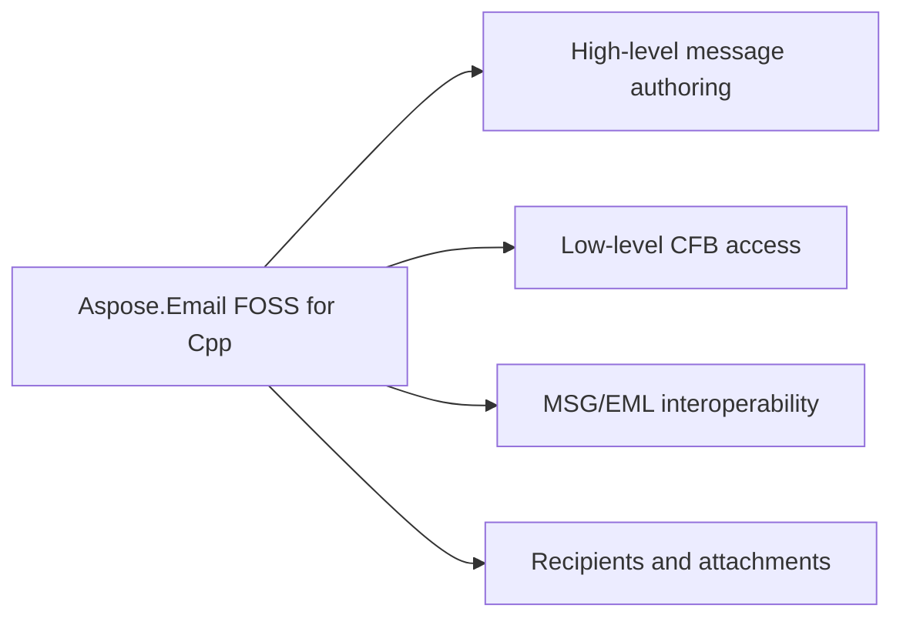

# Aspose.Email FOSS for Cpp


It reads MSG files from streams using `mapi_message`::`from_stream` and writes them back using `mapi_message`::save. It creates new messages with `mapi_message`::create, sets sender information with `set_sender_name` and `set_sender_email_address`, adds recipients with `add_recipient`, and attaches binary content with `add_attachment`. It writes EML files to streams using `mapi_message`::`save_to_eml`.

Aspose.Email FOSS for C++ is a C++17 library for reading and writing binary email containers and
messages — Compound File Binary (CFB) containers, Outlook MSG documents, and RFC 5322 / MIME EML
files — with deterministic, byte-level output and no third-party library dependency of its own. It
exposes both a low-level container API (`cfb_reader`/`cfb_writer`,
`msg_reader`/`msg_document`/`msg_writer`) for direct structural access and a high-level
`mapi_message` API for creating, editing, and reloading messages.

## Navigation

- [At a Glance](#at-a-glance)
- [Key Capabilities](#key-capabilities)
- [Installation](#installation)
- [Dependencies](#dependencies)
- [Quick Start](#quick-start)
- [API Reference](#api-reference)
- [Scope and Limitations](#scope-and-limitations)

## At a Glance



## Key Capabilities

- **High-level message authoring.** Create, edit, save, and reload Outlook-style messages through `mapi_message`, setting the subject, plain-text and HTML bodies, and sender identity, or reaching arbitrary MAPI properties via `set_property`/`get_property_value` with `common_message_property_id` and `property_type_code`.
- **Low-level CFB access.** Read, build, and write generic Compound File Binary containers directly through `cfb_reader`, `cfb_storage`/`cfb_stream`, and `cfb_writer`, working with file paths, in-memory streams, or raw byte buffers.
- **MSG/EML interoperability.** Save an in-memory `mapi_message` to .eml and load .eml back into a `mapi_message`, both through the library's own MIME engine, with no external MIME dependency.
- **Recipients and attachments.** Add To/Cc/Bcc recipients with `add_recipient()`, attach regular files from byte buffers or streams with `add_attachment()`, and nest a full `mapi_message` as an embedded-message attachment with `add_embedded_message_attachment()`.

## Installation

The package `AsposeEmailFoss` could not be confirmed on any package registry (package registry: none could not be read).

To work from a source checkout instead, configure the clone with cmake:

```bash
git clone https://github.com/aspose-email-foss/Aspose.Email-FOSS-for-Cpp.git
cd Aspose.Email-FOSS-for-Cpp
cmake -S . -B build
```

## Dependencies

### Required Package Dependencies

No required third-party package dependencies; in `CMakeLists.txt`, no dependency is on the library target's public link interface, so a consumer links nothing beyond the library itself.

### Native and System Requirements

- Requires C++ `17` (`CMAKE_CXX_STANDARD` in `CMakeLists.txt`).
- Requires CMake 3.26 or later (`cmake_minimum_required` in `CMakeLists.txt`).

## Quick Start

Read a subject from an MSG file opened as a binary stream:

```cpp
#include <fstream>
#include <iostream>

#include "aspose/email/foss/msg/mapi_message.hpp"

int main()
{
    std::ifstream input("sample.msg", std::ios::binary);
    auto message = aspose::email::foss::msg::mapi_message::from_stream(input);
    std::cout << message.subject() << '\n';
}
```

Create a message and save it as both MSG and EML:

```cpp
#include <fstream>

#include "aspose/email/foss/msg/mapi_message.hpp"

int main()
{
    auto message = aspose::email::foss::msg::mapi_message::create("Hello", "Body");
    message.set_sender_name("Alice");
    message.set_sender_email_address("alice@example.com");
    message.add_recipient("bob@example.com", "Bob");
    message.add_attachment("note.txt", std::vector<std::uint8_t>{'a', 'b', 'c'}, "text/plain");

    std::ofstream msg_output("hello.msg", std::ios::binary);
    message.save(msg_output);

    std::ofstream eml_output("hello.eml", std::ios::binary);
    message.save_to_eml(eml_output);
}
```

Build it from source with CMake and either add it as a subdirectory of your own build, or
install it and consume it with `find_package(AsposeEmailFoss)`.

```cmake
add_subdirectory(Aspose.Email-FOSS-for-Cpp)
target_link_libraries(your_app PRIVATE AsposeEmailFoss::AsposeEmailFoss)
```

Create a message and save it as both MSG and EML:

## API Reference

`mapi_message` is the primary high-level entry point for creating, editing, and reloading messages; the lower-level `msg_reader`/`msg_document`/`msg_writer` and `cfb_reader`/`cfb_document`/`cfb_writer` classes expose the underlying MSG and CFB container structure directly for callers that need it.

The verified public surface has 26 types.

<details>
<summary>View the Complete Public API Surface</summary>

### Core API

| Class | Description |
| --- | --- |
| `cfb_document` | The cfb_document class represents a Compound File Binary document and provides methods to load it from various sources and access its root storage, version information, and transaction signature number. |
| `cfb_exception` | The cfb_exception class represents an exception thrown during Compound File Binary processing. |
| `cfb_node` | The cfb_node class represents a node in a Compound File Binary structure, providing access to its name, class identifier, creation and modification times, state bits, and whether it is a storage or stream. |
| `cfb_reader` | The cfb_reader class reads a Compound File Binary document and provides access to its header, directory entries, FAT, mini FAT, DIFAT, and stream data. |
| `cfb_storage` | The cfb_storage class represents a storage node in a Compound File Binary document and allows adding child storages and streams. |
| `cfb_stream` | The cfb_stream class represents a stream node in a Compound File Binary document and provides access to its data. |
| `cfb_writer` | The cfb_writer class writes a Compound File Binary document to a file or stream. |
| `directory_entry` | The directory_entry class represents an entry in the directory of a Compound File Binary document and provides access to its name, class identifier, creation and modification times, color flag, and size. |
| `header` | The header class represents the header of a Compound File Binary document. |
| `mapi_attachment` | The mapi_attachment class represents an attachment in a MAPI message. |
| `mapi_message` | The mapi_message class represents a MAPI message and provides methods to set properties, add recipients and attachments, and save the message. |
| `mapi_property` | The mapi_property class represents a property of a MAPI message. |
| `mapi_property_collection` | The mapi_property_collection class represents a collection of MAPI properties. |
| `mapi_recipient` | The mapi_recipient class represents a recipient in a MAPI message. |
| `msg_document` | The msg_document class represents a MSG document and provides access to its structure and content. |
| `msg_exception` | The msg_exception class represents an exception thrown during MSG processing. |
| `msg_reader` | The msg_reader class reads a MSG document and provides access to its Compound File Binary structure. |
| `msg_storage` | The msg_storage class represents a storage in a MSG document. |
| `msg_stream` | The msg_stream class represents a stream in a MSG document. |
| `msg_writer` | The msg_writer class writes a MSG document to a file or stream. |

#### Enumerations

| Enumeration | Description |
| --- | --- |
| `directory_color_flag` | The directory_color_flag enumeration indicates the color of a directory entry in a Compound File Binary document. |
| `directory_object_type` | The directory_object_type enumeration indicates the type of a directory entry in a Compound File Binary document. |
| `sector_marker` | The sector_marker enumeration indicates the type of a sector in a Compound File Binary document. |
| `common_message_property_id` | The common_message_property_id enumeration defines standard property identifiers for MAPI messages. |
| `msg_storage_role` | The msg_storage_role enumeration indicates the role of a storage in a MSG document. |
| `property_type_code` | The property_type_code enumeration defines type codes for MAPI properties. |

#### Detailed Member Reference

### foss

The `aspose.email.foss` namespace exposes the Aspose.Email FOSS for Cpp library version 0.1.0, requires C++17 and CMake 3.26 or later, and provides high-level message handling via `mapi_message` alongside low-level access to MSG and CFB structures through dedicated reader, document, and writer classes.

| Class | Description |
|---|---|
| `cfb_document` | Mutable Compound File Binary (CFB) document — holds the root `cfb_storage` tree and header fields (major/minor version, transaction signature number); built via `from_reader`/`from_file`/`from_stream`/`from_bytes`/`from_buffer`. |
| `cfb_exception` | Exception type thrown for malformed or unsupported Compound File Binary (CFB) content (a `std::runtime_error` subclass). |
| `cfb_node` | Abstract base class for CFB tree nodes (`cfb_storage` or `cfb_stream`) — carries name, CLSID, state bits, and creation/modified timestamps common to both. |
| `cfb_reader` | Reusable reader for parsed Compound File Binary (CFB) containers — exposes the header, FAT/mini-FAT/DIFAT chains, and directory entries, and resolves storage/stream data by ID or path. |
| `cfb_storage` | Mutable CFB storage node — a directory-like container of child nodes (nested storages and streams), built with `add_storage`/`add_stream`. |
| `cfb_stream` | Mutable CFB stream node holding a raw byte payload (`data()`). |
| `cfb_writer` | Static serializer that writes a `cfb_document` to bytes, a file, or an output stream (`to_bytes`/`write_file`/`write_stream`). |
| `mapi_attachment` | Mutable MAPI attachment — filename, raw `data`, MIME type, content ID, an optional embedded `mapi_message`, and its own MAPI properties; built via `from_bytes`/`from_stream`. |
| `mapi_message` | Mutable high-level MSG object — creates, loads (`from_file`/`from_stream`/`load_from_eml`), edits, and saves Outlook `.msg` messages, with subject/body, recipients, attachments, and MAPI properties. |
| `mapi_property` | A single MAPI property — numeric `property_id`, `property_type`, `value`, and `flags`, combined into a `property_tag`. |
| `mapi_property_collection` | Ordered collection of `mapi_property` entries, keyed by (property ID, property type), with `set`/`add`/`get`/`remove` lookup. |
| `mapi_recipient` | Mutable MAPI recipient — display name, email address, recipient type, address type, and its own `mapi_property_collection`. |
| `msg_document` | Mutable MSG document model — wraps a `msg_storage` root, and converts to a `cfb_document` for CFB serialization via `to_cfb_document`. |
| `msg_exception` | Exception type thrown for malformed or unsupported MSG structures (a `std::runtime_error` subclass). |
| `msg_reader` | Reader for the MSG-specific container layout, built on top of a `cfb_reader` — validates the top-level MSG structure and records `validation_issues`. |
| `msg_storage` | Mutable MSG storage node — name, role (`msg_storage_role`), CLSID/timestamps, and child `msg_stream`/`msg_storage` collections, with `add_stream`/`add_storage`/`find_stream`/`find_storage`. |
| `msg_stream` | Mutable MSG stream node holding a name, raw byte payload, CLSID, and state/timestamp metadata. |
| `msg_writer` | Static serializer that writes a `msg_document` to bytes, a file, or an output stream (`to_bytes`/`write_file`/`write_stream`). |

| Struct | Description |
|---|---|
| `directory_entry` | One CFB directory record — name, object type, sibling/child links, CLSID, timestamps, and stream location/size; `is_storage()`/`is_stream()`/`is_root()` classify it. |
| `header` | The 512-byte CFB file header — signature, CLSID, version, sector-shift fields, and FAT/mini-FAT/DIFAT layout counters. |

| Enumeration | Description |
|---|---|
| `common_message_property_id` | Common MAPI property identifiers used by the MSG reader/writer for core message semantics (`message_class`, `subject`, `body`, `sender_email_address`, `attach_filename`, and more). |
| `directory_color_flag` | Red-black tree color used by a CFB directory entry's sibling links (`red`, `black`). |
| `directory_object_type` | Classifies a CFB directory entry's payload — `unknown_or_unallocated`, `storage_object`, `stream_object`, or `root_storage_object`. |
| `msg_storage_role` | Classifies an MSG storage node's role — `generic`, `message`, `recipient`, `attachment`, `embedded_message`, `named_property_mapping`, or `custom_attachment`. |
| `property_type_code` | MAPI property type codes used in MSG property tags (`ptyp_string`, `ptyp_binary`, `ptyp_integer32`, `ptyp_time`, and more, including their `ptyp_multiple_*` array variants). |
| `sector_marker` | Special FAT marker values reserved for sector allocation metadata (`difsect`, `fatsect`, `endofchain`, `freesect`). |

</details>

## Scope and Limitations

Aspose.Email FOSS for Cpp reads and writes MSG, CFB, and EML containers and messages already on disk, in memory, or in a stream; it supports MSG-format messages and generic CFB containers, and provides a curated subset of MAPI property accessors on `mapi_message`.

- No SMTP, IMAP, POP3, or other network mail-protocol support — this library reads and writes MSG, CFB, and EML containers and messages already on disk, in memory, or in a stream; it is not a mail client or transport library.
- No PST (Outlook Personal Folders) archive support — only single MSG-format messages and generic CFB containers are supported, not multi-message PST stores.
- Only a curated subset of MAPI properties (subject, plain-text and HTML body, message class, sender name/address/address type, and Internet Message-ID) has a dedicated named accessor on `mapi_message`; every other property must be read and written through the generic `get_property_value()`/`set_property()` pair with `common_message_property_id` and `property_type_code`.

This project is licensed under the [MIT License](LICENSE). The MIT License permits use, copying,
modification, distribution, sublicensing, and commercial use, provided its copyright and
permission notice are retained. The software is provided without warranty.
