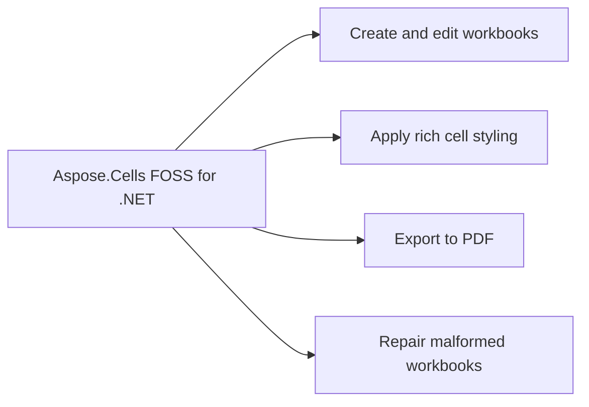

# Aspose.Cells FOSS for .NET

[](https://www.nuget.org/packages/Aspose.Cells.FOSS/)  [](LICENSE.txt) [](https://github.com/aspose-cells-foss/Aspose.Cells-FOSS-for-.NET/graphs/contributors) [](https://github.com/aspose-cells-foss/Aspose.Cells-FOSS-for-.NET/issues)

[](https://products.aspose.org/cells/net/)

Aspose.Cells FOSS for .NET reads Excel files and writes Excel and PDF files. It creates, edits, and saves workbooks and worksheets, supports cell values, formulas, styles, and formatting, and includes features for validation, conditional formatting, hyperlinks, comments, pictures, shapes, auto-filters, list objects, and page setup. It loads workbooks with repair options and diagnostics reporting data loss risk and repair details. It targets net8.0 and runs on Windows, Linux, and macOS without requiring Microsoft Excel or any native Office installation.

The package targets `net8.0` and requires .NET 8 or later. It runs on Windows, Linux, and macOS, and does not require Microsoft Excel or any native Office installation. The NuGet package id is `Aspose.Cells.FOSS`; the public namespace is `Aspose.Cells_FOSS`.

## Navigation

- [At a Glance](#at-a-glance)
- [Key Capabilities](#key-capabilities)
- [Installation](#installation)
- [Dependencies](#dependencies)
- [Quick Start](#quick-start)
- [API Reference](#api-reference)
- [Documentation & Resources](#documentation--resources)
- [Scope and Limitations](#scope-and-limitations)
- [Development and Testing](#development-and-testing)
- [Third-Party Notices](#third-party-notices)
- [License](#license)

## At a Glance



## Key Capabilities

- **Create and edit workbooks.** It creates, loads, modifies, and saves Excel workbooks using the `Aspose.Cells_FOSS.Workbook` class, accesses individual worksheets through the Worksheets collection, and edits cell contents, formulas, and value types via the `Cells` and `Cell` classes.
- **Apply rich cell styling.** It applies rich cell styling by setting font properties, background and foreground colors, fill patterns, and border styles through the `Aspose.Cells_FOSS.Style`, `Font`, `Color`, `FillPattern`, and `Border` classes.
- **Configure data validation and conditional formatting.** It configures data validation and conditional formatting rules using the `Aspose.Cells_FOSS.Validation`, `ValidationCollection`, `FormatCondition`, and `FormatConditionCollection` classes to enforce input constraints and highlight cell values.
- **Support hyperlinks, comments, and shapes.** It embeds hyperlinks, comments, pictures, and shapes in worksheets using the `Aspose.Cells_FOSS.Hyperlink`, `HyperlinkCollection`, `Comment`, `CommentCollection`, `Picture`, and `Shape` classes.
- **Apply filters and tables.** It applies filters and tables to data ranges using the `Aspose.Cells_FOSS.AutoFilter`, `ListObject`, `FilterColumn`, and `AutoFilterSortCondition` classes to organize and sort worksheet content.
- **Export to PDF.** It exports workbooks to PDF by calling the `Workbook.Save` method with `PdfSaveOptions` and configuring page setup options such as orientation through the `Aspose.Cells_FOSS.PageSetup` and `PageOrientationType` classes.
- **Repair malformed workbooks.** It repairs malformed workbooks by loading them with `Aspose.Cells_FOSS.LoadOptions` configured for package and XML repair, then inspects `Aspose.Cells_FOSS.LoadDiagnostics` to detect potential data loss risks.

- Read and write scalar values, formulas, dates, and number formats.
- Export workbooks to PDF with `SaveFormat.Pdf` or `PdfSaveOptions`.

## Installation

Install the published package from NuGet (`Aspose.Cells.FOSS`, version 26.10.0):

```bash
dotnet add package Aspose.Cells.FOSS
```

## Dependencies

### Required Package Dependencies

- `SkiaSharp 2.88.8`

### Native and System Requirements

- Requires .NET `net8.0` (`TargetFramework` in `src/Aspose.Cells_FOSS/Aspose.Cells_FOSS.csproj`).

## Quick Start

Create a new workbook, populate a sheet with product data and formatting, then save it as both an Excel file and a PDF using `Aspose.Cells.FOSS` version 26.10.0.

```csharp
using Aspose.Cells_FOSS;

var workbook = new Workbook();
var sheet = workbook.Worksheets[0];

sheet.Name = "Products";
sheet.Cells["A1"].PutValue("Product");
sheet.Cells["B1"].PutValue("Price");
sheet.Cells["A2"].PutValue("Apple");
sheet.Cells["B2"].PutValue(2.99m);
sheet.Cells["A3"].PutValue("Orange");
sheet.Cells["B3"].PutValue(1.99m);
sheet.Cells["B4"].Formula = "=SUM(B2:B3)";

var headerStyle = sheet.Cells["A1"].GetStyle();
headerStyle.Font.IsBold = true;
headerStyle.Font.Color = Color.FromArgb(255, 255, 255, 255);
headerStyle.Pattern = FillPattern.Solid;
headerStyle.ForegroundColor = Color.FromArgb(255, 34, 120, 212);

sheet.Cells["A1"].SetStyle(headerStyle);
sheet.Cells["B1"].SetStyle(headerStyle);

workbook.Save("products.xlsx");
workbook.Save("products.pdf", new PdfSaveOptions());
```

Load a potentially corrupted Excel file with repair options enabled, check for data loss risk, update a cell, and save the repaired workbook using `Aspose.Cells.FOSS` version 26.10.0.

```csharp
using System;
using Aspose.Cells_FOSS;

var loadOptions = new LoadOptions
{
    TryRepairPackage = true,
    TryRepairXml = true,
    StrictMode = false
};

var workbook = new Workbook("input.xlsx", loadOptions);

if (workbook.LoadDiagnostics.HasDataLossRisk)
{
    Console.WriteLine("Potential data loss risk detected during load.");
}

workbook.Worksheets[0].Cells["A1"].PutValue("Updated");
workbook.Save("updated.xlsx");
```

Runnable samples live under [`samples/`](samples/README.md). Feature areas currently covered include:

- basic workbook and cell operations
- load and repair behavior
- styles
- worksheet settings
- validations
- conditional formatting
- hyperlinks and defined names
- page setup
- comments
- charts
- list objects
- pictures
- document properties
- shapes
- PDF conversion

Run one sample from the repository root:

```bash
dotnet run --project samples\Aspose.Cells_FOSS.Samples.Basic\Aspose.Cells_FOSS.Samples.Basic.csproj
```

## API Reference

Aspose.Cells FOSS for .NET provides the `Workbook` class as the primary entry point for creating and manipulating spreadsheet documents, with `Worksheet`, `Cells`, and `Cell` classes representing the core document structure.

The verified public surface has 98 types.

<details>
<summary>View the Complete Public API Surface</summary>

### Core API

| Class | Description |
| --- | --- |
| `AutoFilter` | Represents auto filter. |
| `AutoFilterColorFilter` | Represents auto filter color filter. |
| `AutoFilterCustomFilter` | Represents auto filter custom filter. |
| `AutoFilterCustomFilterCollection` | Represents a collection of auto filter custom filter objects. |
| `AutoFilterDynamicFilter` | Represents auto filter dynamic filter. |
| `AutoFilterSortCondition` | Represents auto filter sort condition. |
| `AutoFilterSortConditionCollection` | Represents a collection of auto filter sort condition objects. |
| `AutoFilterSortState` | Represents auto filter sort state. |
| `AutoFilterTop10` | Represents auto filter top10. |
| `Border` | Represents border. |
| `Borders` | Represents borders. |
| `CalculationProperties` | Represents calculation properties. |
| `Cell` | Represents a single worksheet cell and exposes value, formula, and style operations. |
| `CellArea` | Represents cell area. |
| `Cells` | Provides access to worksheet cells, rows, columns, and merged ranges. |
| `CellsException` | Represents an error that occurs during cells. |
| `Chart` | Represents a chart embedded in a worksheet. |
| `ChartCollection` | Represents collection of charts on a worksheet. |
| `Color` | Represents color. |
| `Column` | Represents column. |
| `ColumnCollection` | Represents a collection of column objects. |
| `Comment` | Represents a worksheet comment (legacy note) anchored to a single cell. |
| `CommentCollection` | Represents the collection of comments (legacy notes) on a worksheet. |
| `ConditionalFormattingCollection` | Represents a collection of conditional formatting objects. |
| `CoreDocumentProperties` | Represents core document properties. |
| `DefinedName` | Represents defined name. |
| `DefinedNameCollection` | Represents a collection of defined name objects. |
| `DocumentProperties` | Represents document properties. |
| `ExtendedDocumentProperties` | Represents extended document properties. |
| `FilterColumn` | Represents filter column. |
| `FilterColumnCollection` | Represents a collection of filter column objects. |
| `FilterValueCollection` | Represents a collection of filter value objects. |
| `Font` | Represents font. |
| `FontSetting` | Represents a range of characters within a cell's rich text. |
| `FormatCondition` | Represents format condition. |
| `FormatConditionCollection` | Represents a collection of format condition objects. |
| `FormulaException` | Represents an error that occurs during formula. |
| `Hyperlink` | Represents hyperlink. |
| `HyperlinkCollection` | Encapsulates the hyperlinks defined for a worksheet. |
| `IWarningCallback` | Defines a callback that receives load warnings. |
| `InvalidFileFormatException` | Represents an error that occurs during invalid file format. |
| `ListColumn` | Represents a single column in an Excel table. |
| `ListColumnCollection` | Represents the ordered collection of columns in an Excel table. |
| `ListObject` | Represents an Excel table (structured reference / ListObject). |
| `ListObjectCollection` | Represents the collection of Excel tables on a worksheet. |
| `LoadDiagnostics` | Represents load diagnostics. |
| `LoadIssue` | Represents load issue. |
| `LoadOptions` | Specifies how a workbook should be loaded. |
| `NumberFormat` | Provides number format operations. |
| `PageSetup` | Represents worksheet print and page-layout settings. |
| `PdfSaveOptions` | Options controlling XLSX-to-PDF rendering. |
| `Picture` | Represents a picture (image) anchored to a worksheet. |
| `PictureCollection` | Represents collection of pictures anchored to a worksheet. |
| `Row` | Represents row. |
| `RowCollection` | Represents a collection of row objects. |
| `SaveOptions` | Specifies how a workbook should be saved. |
| `Shape` | Represents a drawing object (auto shape) anchored to a worksheet. |
| `ShapeCollection` | Represents collection of drawing objects (shapes) on a worksheet. |
| `Style` | Represents a mutable cell style facade that can be applied to one or more cells. |
| `StyleException` | Represents an error that occurs during style. |
| `StyleFlag` | Represents flags which indicate applied formatting properties. |
| `UnsupportedFeatureException` | Represents an error that occurs during unsupported feature. |
| `Validation` | Represents validation. |
| `ValidationCollection` | Represents a collection of validation objects. |
| `WarningInfo` | Represents warning info. |
| `Workbook` | Represents the root spreadsheet object used to create, load, modify, and save an XLSX workbook. |
| `WorkbookLoadException` | Represents an error that occurs during workbook load. |
| `WorkbookProperties` | Represents workbook properties. |
| `WorkbookProtection` | Represents workbook protection. |
| `WorkbookSaveException` | Represents an error that occurs during workbook save. |
| `WorkbookSettings` | Represents workbook-level settings that affect date handling and display formatting. |
| `WorkbookView` | Represents workbook view. |
| `Worksheet` | Encapsulates a single worksheet and its supported v0.1 worksheet features. |
| `WorksheetCollection` | Encapsulates the workbook's worksheets and active-sheet state. |
| `WorksheetProtection` | Represents worksheet protection. |

#### Enumerations

| Enumeration | Description |
| --- | --- |
| `AutoShapeType` | Specifies the type of an auto shape (preset geometry). |
| `BorderStyleType` | Specifies border style type. |
| `CellValueType` | Specifies cell value type. |
| `ChartType` | Specifies the chart type. |
| `DiagnosticSeverity` | Specifies diagnostic severity. |
| `FillPattern` | Specifies fill pattern. |
| `FilterOperatorType` | Specifies filter operator type. |
| `FontUnderlineType` | Enumerates font underline types. |
| `FormatConditionType` | Specifies format condition type. |
| `HorizontalAlignmentType` | Specifies horizontal alignment type. |
| `ImageType` | Represents the format of an image stored in a worksheet. |
| `LoadFormat` | Specifies load format. |
| `OperatorType` | Specifies operator type. |
| `PageOrientationType` | Specifies page orientation type. |
| `PaperSizeType` | Specifies paper size type. |
| `SaveFormat` | Specifies save format. |
| `TableStyleType` | Represents the built-in Excel table style types. |
| `TargetModeType` | Specifies target mode type. |
| `TotalsCalculation` | Represents the aggregation function shown in a table totals row cell. |
| `ValidationAlertType` | Specifies validation alert type. |
| `ValidationType` | Specifies validation type. |
| `VerticalAlignmentType` | Specifies vertical alignment type. |
| `VisibilityType` | Specifies visibility type. |

#### Detailed Member Reference

### Workbook

The `Workbook` class provides access to worksheets through the Worksheets property, manages workbook settings via the Settings property, exposes document properties through the `DocumentProperties` property, supports saving to various formats using the Save method, and exposes load diagnostics via the `LoadDiagnostics` property.

- `DefinedNames`: Gets the workbook-defined names collection.
- `Dispose`: Releases resources associated with the workbook instance.
- `DocumentProperties`: Gets the document properties facade for core and extended metadata.
- `LoadDiagnostics`: Gets diagnostics collected while loading the current workbook.
- `Properties`: Gets workbook metadata and view settings exposed by the supported public API.
- `Save`: Saves the workbook to an XLSX file using default save options.
- `Settings`: Gets workbook-level settings such as the date system and display culture.
- `Workbook`: Initializes a new workbook with one default worksheet.
- `Worksheets`: Gets the worksheets in workbook order.

### Style

The `Style` class enables formatting of cells through properties such as `Font`, `Color`, `FillPattern`, and `Border`, allowing consistent styling across spreadsheet content.

- `BackgroundColor`: Gets or sets the fill background color.
- `Borders`: Gets or sets border settings.
- `Copy`: Copies data from another style object.
- `Custom`: Gets or sets the custom number format code.
- `Equals`: Determines whether two style instances are equal.
- `Font`: Gets or sets the font settings.
- `ForegroundColor`: Gets or sets the fill foreground color.
- `GetHashCode`: Serves as a hash function for a style object.
- `HorizontalAlignment`: Gets or sets the horizontal alignment.
- `IndentLevel`: Gets or sets the indentation level.
- `IsHidden`: Gets or sets whether the cell formula is hidden when worksheet protection is enabled.
- `IsLocked`: Gets or sets whether the cell is locked when worksheet protection is enabled.
- `Number`: Gets or sets the numeric format identifier.
- `NumberFormat`: Gets or sets the resolved number format string.
- `Pattern`: Gets or sets the fill pattern.
- `QuotePrefix`: Gets or sets whether the cell value starts with a single quote mark.
- `ReadingOrder`: Gets or sets the reading order.
- `RelativeIndent`: Gets or sets the relative indent.
- `ShrinkToFit`: Gets or sets whether the cell content shrinks to fit.
- `Style`: Initializes a new style with default font and border objects.
- `TextRotation`: Gets or sets the text rotation.
- `VerticalAlignment`: Gets or sets the vertical alignment.
- `WrapText`: Gets or sets whether text wraps within the cell.

### Validation

The `Validation` class provides data validation capabilities through `ValidationType` and `ValidationAlertType`, managed via the `ValidationCollection` on a worksheet.

- `AddArea`: Adds the specified item.
- `AlertStyle`: Gets or sets the alert style.
- `Areas`: Gets the areas.
- `ErrorMessage`: Gets or sets the error message.
- `ErrorTitle`: Gets or sets the error title.
- `Formula1`: Gets or sets the formula1.
- `Formula2`: Gets or sets the formula2.
- `IgnoreBlank`: Gets or sets a value indicating whether ignore blank.
- `InCellDropDown`: Gets or sets a value indicating whether in cell drop down.
- `InputMessage`: Gets or sets the input message.
- `InputTitle`: Gets or sets the input title.
- `Operator`: Gets or sets the operator.
- `RemoveArea`: Removes the specified item.
- `ShowError`: Gets or sets a value indicating whether show error.
- `ShowInput`: Gets or sets a value indicating whether show input.
- `Type`: Gets or sets the type.

### FormatCondition

The `FormatCondition` class supports conditional formatting rules through `FormatConditionType`, organized in a `FormatConditionCollection` on a worksheet.

- `Above`: Gets or sets a value indicating whether above.
- `BarColor`: Gets or sets the bar color.
- `BarLength`: Gets or sets the bar length.
- `ColorScaleCount`: Gets or sets the color scale count.
- `Direction`: Gets or sets the direction.
- `Duplicate`: Gets or sets a value indicating whether duplicate.
- `Formula`: Gets or sets the formula.
- `Formula1`: Gets or sets the formula1.
- `Formula2`: Gets or sets the formula2.
- `IconSetType`: Gets or sets the icon set type.
- `MaxColor`: Gets or sets the max color.
- `MidColor`: Gets or sets the mid color.
- `MinColor`: Gets or sets the min color.
- `NegativeBarColor`: Gets or sets the negative bar color.
- `Operator`: Gets or sets the operator.
- `Percent`: Gets or sets a value indicating whether percent.
- `Priority`: Gets or sets the priority.
- `Rank`: Gets or sets the rank.
- `Remove`: Removes the specified item.
- `ReverseIcons`: Gets or sets a value indicating whether reverse icons.
- `ShowBorder`: Gets or sets a value indicating whether show border.
- `ShowIconOnly`: Gets or sets a value indicating whether show icon only.
- `StandardDeviation`: Gets or sets the standard deviation.
- `StopIfTrue`: Gets or sets a value indicating whether stop if true.
- `Style`: Gets or sets the style.
- `TimePeriod`: Gets or sets the time period.
- `Top`: Gets or sets a value indicating whether top.
- `Type`: Gets or sets the type.

### AutoFilter

The `AutoFilter` class enables filtering of data ranges using `FilterColumn` and `AutoFilterSortCondition`, accessible through the `AutoFilter` property of a `Worksheet`.

- `Clear`: Clears the current state.
- `FilterColumns`: Gets the filter columns.
- `Range`: Gets or sets the range.
- `SortState`: Gets the sort state.

### ListObject

The `ListObject` class represents Excel tables with `ListColumnCollection` and `TotalsCalculation` support, accessible via the `ListObjects` property of a `Worksheet`.

- `Comment`: Gets or sets an optional comment for the table.
- `ConvertToRange`: Removes the table structure, leaving the cell data in place.
- `DisplayName`: Gets or sets the user-visible table name.
- `EndColumn`: Gets the zero-based column index of the last column.
- `EndRow`: Gets the zero-based row index of the last row (last data or totals row).
- `ListColumns`: Gets the collection of columns in this table.
- `RemoveAutoFilter`: Hides the autoFilter drop-down buttons from the table header row.
- `Resize`: Resizes the table to the specified range, rebuilding columns from header cells.
- `ShowAutoFilter`: Shows the autoFilter drop-down buttons on the table header row.
- `ShowHeaderRow`: Gets or sets whether the first row of the table range is a header row.
- `ShowTableStyleColumnStripes`: Gets or sets whether alternating column stripes are shown.
- `ShowTableStyleFirstColumn`: Gets or sets whether the first column receives banding or highlight formatting.
- `ShowTableStyleLastColumn`: Gets or sets whether the last column receives banding or highlight formatting.
- `ShowTableStyleRowStripes`: Gets or sets whether alternating row stripes are shown.
- `ShowTotals`: Gets or sets whether the last row of the table range is a totals row.
- `StartColumn`: Gets the zero-based column index of the first column.
- `StartRow`: Gets the zero-based row index of the first row (header or first data row).
- `TableStyleName`: Gets or sets the raw table style name used in the SpreadsheetML tableStyleInfo element.
- `TableStyleType`: Gets or sets the built-in table style type.

### Chart

The `Chart` class supports various `ChartType` options, managed through the `ChartCollection` accessible via the Charts property of a `Worksheet`.

- `ChartType`: Gets the chart type.
- `ExtentCx`: Gets the width extent in EMU.
- `ExtentCy`: Gets the height extent in EMU.
- `LowerRightColumn`: Gets the zero-based lower-right column of the chart anchor.
- `LowerRightRow`: Gets the zero-based lower-right row of the chart anchor.
- `Name`: Gets the chart display name.
- `UpperLeftColumn`: Gets the zero-based upper-left column of the chart anchor.
- `UpperLeftRow`: Gets the zero-based upper-left row of the chart anchor.

### Hyperlink

The `Hyperlink` class provides hyperlink functionality, organized in a `HyperlinkCollection` accessible via the Hyperlinks property of a `Worksheet`.

- `Address`: Gets or sets the address.
- `Area`: Gets the area.
- `Delete`: Performs delete.
- `LinkType`: Gets the link type.
- `ScreenTip`: Gets or sets the screen tip.
- `TextToDisplay`: Gets or sets the text to display.

### Comment

The `Comment` class enables cell comments, managed through the `CommentCollection` accessible via the Comments property of a `Worksheet`.

- `Author`: Gets or sets the comment author name.
- `Column`: Gets the zero-based column index of the annotated cell.
- `Height`: Gets or sets the comment box height in pixels.
- `IsVisible`: Gets or sets whether the comment box is always shown (true) or hidden until hover (false).
- `Note`: Gets or sets the plain-text note content of the comment.
- `Row`: Gets the zero-based row index of the annotated cell.
- `Width`: Gets or sets the comment box width in pixels.

### Picture

The `Picture` class supports embedding images in worksheets, organized in a `PictureCollection` accessible via the Pictures property of a `Worksheet`.

- `Data`: Gets or sets the raw binary bytes of the image.
- `ImageType`: Gets the image format derived from the file extension.
- `LowerRightColumn`: Gets or sets the zero-based column index of the lower-right anchor cell.
- `LowerRightRow`: Gets or sets the zero-based row index of the lower-right anchor cell.
- `Name`: Gets or sets the display name of the picture.
- `UpperLeftColumn`: Gets or sets the zero-based column index of the upper-left anchor cell.
- `UpperLeftRow`: Gets or sets the zero-based row index of the upper-left anchor cell.

### Shape

The `Shape` class provides support for `AutoShapeType` shapes, managed through the `ShapeCollection` accessible via the Shapes property of a `Worksheet`.

- `AutoShapeType`: Gets or sets the shape type.
- `GeometryType`: Gets or sets the preset geometry type as a raw DrawingML prst string.
- `LowerRightColumn`: Gets or sets the zero-based column index of the lower-right anchor cell.
- `LowerRightRow`: Gets or sets the zero-based row index of the lower-right anchor cell.
- `Name`: Gets or sets the display name of the shape.
- `UpperLeftColumn`: Gets or sets the zero-based column index of the upper-left anchor cell.
- `UpperLeftRow`: Gets or sets the zero-based row index of the upper-left anchor cell.

### LoadOptions

The `LoadOptions` class controls how files are loaded, with `LoadDiagnostics` providing detailed `LoadIssue` information about loading problems.

- `LoadFormat`: Gets or sets the expected input format.
- `PreserveUnsupportedParts`: Gets or sets whether unsupported parts should be preserved when possible.
- `StrictMode`: Gets or sets whether loading should reject ambiguous repairs.
- `TryRepairPackage`: Gets or sets whether package-level repairs are allowed during load.
- `TryRepairXml`: Gets or sets whether XML-level repairs are allowed during load.
- `WarningCallback`: Gets or sets a warning callback that receives recoverable-load diagnostics.

</details>

## Documentation & Resources

- **[Local documentation landing page](documentation/_site/index.html)** — The local documentation landing page provides an entry point to the Aspose.Cells FOSS for .NET API reference and usage guidance for .NET developers targeting net8.0.
- **[Contributor and agent instructions](agents.md)** — The contributor and agent instructions document outlines how to contribute code, report issues, and interact with the Aspose.Cells FOSS for .NET project.
- **[samples/](samples/README.md)** — The samples directory contains example projects demonstrating how to use `Aspose.Cells.FOSS` version 26.10.0 to work with spreadsheet files in .NET applications.
- Found a bug or have a feature request? [Open an issue](https://github.com/aspose-cells-foss/Aspose.Cells-FOSS-for-.NET/issues).

## Scope and Limitations

Aspose.Cells FOSS for .NET reads and writes Excel files in the .xlsx format and exports to PDF, using the `Aspose.Cells_FOSS.Workbook` class to create, modify, and save workbooks and their worksheets.

- Only .xlsx is supported as the spreadsheet file format for load and save, and the library stores formulas but does not include a formula calculation engine.
- PDF export is supported, but there is no general HTML export or image export API, and macros, VBA, and pivot tables are outside the supported public API surface.
- Broader format coverage and richer spreadsheet features belong to the commercial Aspose.Cells product line, and `PdfSaveOptions` provides only a limited set of export customization options.
- The netstandard2.0 target has been removed, so applications targeting .NET Framework, .NET Core, or .NET 5-7 must upgrade to .NET 8 or later, or remain on a previous compatible package version.

The `netstandard2.0` target has been removed. Applications targeting .NET Framework, .NET Core, or .NET 5-7 must upgrade to .NET 8 or later, or remain on a previous compatible package version.

These limitations don't apply to [full-featured Aspose.Cells for .NET — Enterprise Edition](https://products.aspose.com/cells/net/). It adds advanced features and support for enterprise-grade workflows not included in this FOSS package.

## Development and Testing

Aspose.Cells FOSS for .NET targets net8.0 and requires the .NET 8 SDK or a newer SDK capable of targeting net8.0. The main library and samples build from the repository's own assets, with the main library and basic sample each built from their respective project files. This checkout does not contain a tests/ directory, so the builds verify compilation but do not provide automated behavioral test coverage.

```xml
<PackageReference Include="Aspose.Cells.FOSS" Version="26.10.0.0" />
```

Building from source requires the .NET 8 SDK or a newer SDK capable of targeting `net8.0`. The library and samples target `net8.0`.

```bash
dotnet build src\Aspose.Cells_FOSS\Aspose.Cells_FOSS.csproj -c Debug
```

```bash
dotnet build samples\Aspose.Cells_FOSS.Samples.Basic\Aspose.Cells_FOSS.Samples.Basic.csproj -c Debug
```

This checkout does not contain a `tests/` directory. These builds check compilation; they do not provide automated behavioral test coverage.

This project is licensed under the [MIT License](License/LICENSE.txt).

## Third-Party Notices

See [Third-party notices](License/ThirdPartyNotices.txt).

## License

This project is licensed under the [MIT License](LICENSE.txt). The MIT License permits use, copying, modification, distribution, sublicensing, and commercial use, provided its copyright and permission notice are retained. The software is provided without warranty.
