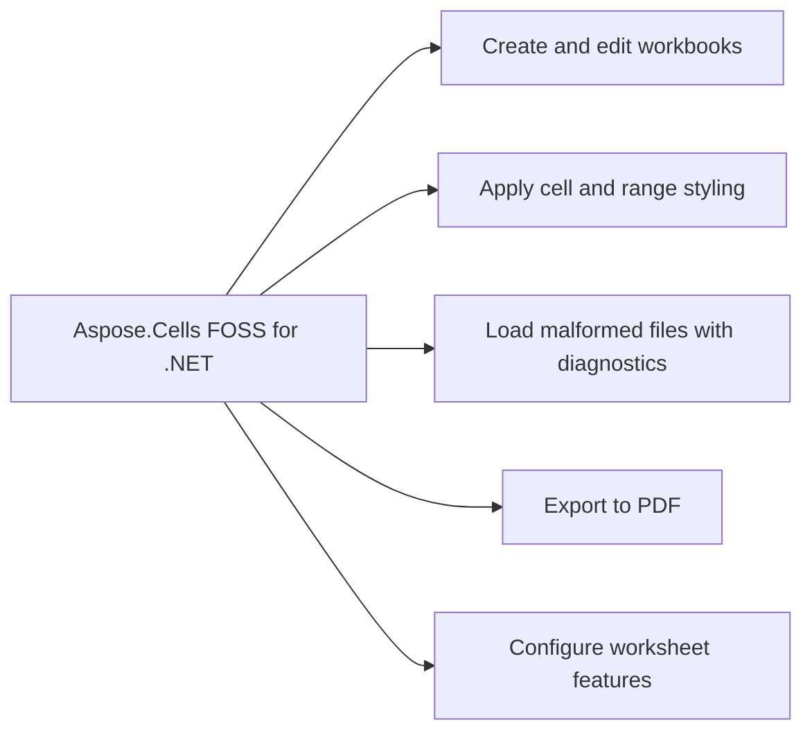

# Aspose.Cells FOSS for .NET

[](https://www.nuget.org/packages/Aspose.Cells.FOSS/)  [](LICENSE.txt) [](https://github.com/aspose-cells-foss/Aspose.Cells-FOSS-for-.NET/graphs/contributors)

[](https://products.aspose.org/cells/net/)

Aspose.Cells FOSS for .NET reads and writes Excel files in XLSX format and converts them to PDF. It supports loading workbooks with repair options for corrupted files and provides diagnostics to detect data loss risks. The product enables programmatic manipulation of worksheets, cells, styles, charts, and other spreadsheet elements through its `Workbook`, `Worksheet`, `Cells`, and `Cell` classes.

## Navigation

- [At a Glance](#at-a-glance)
- [Key Capabilities](#key-capabilities)
- [Installation](#installation)
- [Dependencies](#dependencies)
- [Quick Start](#quick-start)
- [API Reference](#api-reference)
- [Documentation & Resources](#documentation--resources)
- [Scope and Limitations](#scope-and-limitations)
- [Development and Testing](#development-and-testing)
- [Third-Party Notices](#third-party-notices)
- [License](#license)

## At a Glance



## Key Capabilities

- **Create and edit workbooks.** It creates and edits workbooks using the `Aspose.Cells_FOSS.Workbook` class, accesses worksheets through the Worksheets collection, and manipulates cell data via the `Cells` and `Cell` classes to insert values, formulas, and styles.
- **Apply cell and range styling.** It applies cell and range styling using the `Aspose.Cells_FOSS.Style` class with properties for font, background and foreground colors, fill pattern, borders, horizontal alignment, indentation, and lock state.
- **Load malformed files with diagnostics.** It loads malformed Excel files using `Aspose.Cells_FOSS.LoadOptions` with repair and strict mode settings, and inspects `Aspose.Cells_FOSS.LoadDiagnostics` to detect potential data loss risks.
- **Export to PDF.** It exports workbooks to PDF using the `Aspose.Cells_FOSS.PdfSaveOptions` class and the `SaveFormat` enumeration.
- **Configure worksheet features.** It configures worksheet features including `AutoFilter`, `ListObject`, `Validation`, `ConditionalFormattingCollection`, `Hyperlink`, `DefinedName`, `Comment`, `Picture`, `Shape`, `Chart`, and `PageSetup` through their respective `Aspose.Cells_FOSS` classes.

## Installation

Install the published package from NuGet (`Aspose.Cells.FOSS`, version 26.10.0):

```bash
dotnet add package Aspose.Cells.FOSS
```

## Dependencies

### Required Package Dependencies

- `SkiaSharp 2.88.8`

### Native and System Requirements

- Requires .NET `net8.0` (`TargetFramework` in `src/Aspose.Cells_FOSS/Aspose.Cells_FOSS.csproj`).

## Quick Start

Create a new workbook, populate a sheet with product data and a SUM formula, apply bold white text on blue background to headers, and save the file as both XLSX and PDF.

```csharp
using Aspose.Cells_FOSS;

var workbook = new Workbook();
var sheet = workbook.Worksheets[0];

sheet.Name = "Products";
sheet.Cells["A1"].PutValue("Product");
sheet.Cells["B1"].PutValue("Price");
sheet.Cells["A2"].PutValue("Apple");
sheet.Cells["B2"].PutValue(2.99m);
sheet.Cells["A3"].PutValue("Orange");
sheet.Cells["B3"].PutValue(1.99m);
sheet.Cells["B4"].Formula = "=SUM(B2:B3)";

var headerStyle = sheet.Cells["A1"].GetStyle();
headerStyle.Font.IsBold = true;
headerStyle.Font.Color = Color.FromArgb(255, 255, 255, 255);
headerStyle.Pattern = FillPattern.Solid;
headerStyle.ForegroundColor = Color.FromArgb(255, 34, 120, 212);

sheet.Cells["A1"].SetStyle(headerStyle);
sheet.Cells["B1"].SetStyle(headerStyle);

workbook.Save("products.xlsx");
workbook.Save("products.pdf", new PdfSaveOptions());
```

Load a potentially corrupted workbook with repair options enabled, check for data loss risk, update a cell, and save the repaired file.

```csharp
using System;
using Aspose.Cells_FOSS;

var loadOptions = new LoadOptions
{
    TryRepairPackage = true,
    TryRepairXml = true,
    StrictMode = false
};

var workbook = new Workbook("input.xlsx", loadOptions);

if (workbook.LoadDiagnostics.HasDataLossRisk)
{
    Console.WriteLine("Potential data loss risk detected during load.");
}

workbook.Worksheets[0].Cells["A1"].PutValue("Updated");
workbook.Save("updated.xlsx");
```

Run one sample from the repository root:

```bash
dotnet run --project samples\Aspose.Cells_FOSS.Samples.Basic\Aspose.Cells_FOSS.Samples.Basic.csproj
```

## API Reference

Aspose.Cells FOSS for .NET provides core workbook and worksheet functionality through the `Aspose.Cells_FOSS.Workbook` class, which exposes collections for worksheets, defined names, and charts, and supports loading, saving, and protection operations.

The verified public surface has 98 types.

<details>
<summary>View the Complete Public API Surface</summary>

### Core API

| Class | Description |
| --- | --- |
| `AutoFilter` | Represents auto filter. |
| `AutoFilterColorFilter` | Represents auto filter color filter. |
| `AutoFilterCustomFilter` | Represents auto filter custom filter. |
| `AutoFilterCustomFilterCollection` | Represents a collection of auto filter custom filter objects. |
| `AutoFilterDynamicFilter` | Represents auto filter dynamic filter. |
| `AutoFilterSortCondition` | Represents auto filter sort condition. |
| `AutoFilterSortConditionCollection` | Represents a collection of auto filter sort condition objects. |
| `AutoFilterSortState` | Represents auto filter sort state. |
| `AutoFilterTop10` | Represents auto filter top10. |
| `Border` | Represents border. |
| `Borders` | Represents borders. |
| `CalculationProperties` | Represents calculation properties. |
| `Cell` | Represents a single worksheet cell and exposes value, formula, and style operations. |
| `CellArea` | Represents cell area. |
| `Cells` | Provides access to worksheet cells, rows, columns, and merged ranges. |
| `CellsException` | Represents an error that occurs during cells. |
| `Chart` | Represents a chart embedded in a worksheet. |
| `ChartCollection` | Represents collection of charts on a worksheet. |
| `Color` | Represents color. |
| `Column` | Represents column. |
| `ColumnCollection` | Represents a collection of column objects. |
| `Comment` | Represents a worksheet comment (legacy note) anchored to a single cell. |
| `CommentCollection` | Represents the collection of comments (legacy notes) on a worksheet. |
| `ConditionalFormattingCollection` | Represents a collection of conditional formatting objects. |
| `CoreDocumentProperties` | Represents core document properties. |
| `DefinedName` | Represents defined name. |
| `DefinedNameCollection` | Represents a collection of defined name objects. |
| `DocumentProperties` | Represents document properties. |
| `ExtendedDocumentProperties` | Represents extended document properties. |
| `FilterColumn` | Represents filter column. |
| `FilterColumnCollection` | Represents a collection of filter column objects. |
| `FilterValueCollection` | Represents a collection of filter value objects. |
| `Font` | Represents font. |
| `FontSetting` | Represents a range of characters within a cell's rich text. |
| `FormatCondition` | Represents format condition. |
| `FormatConditionCollection` | Represents a collection of format condition objects. |
| `FormulaException` | Represents an error that occurs during formula. |
| `Hyperlink` | Represents hyperlink. |
| `HyperlinkCollection` | Encapsulates the hyperlinks defined for a worksheet. |
| `IWarningCallback` | Defines a callback that receives load warnings. |
| `InvalidFileFormatException` | Represents an error that occurs during invalid file format. |
| `ListColumn` | Represents a single column in an Excel table. |
| `ListColumnCollection` | Represents the ordered collection of columns in an Excel table. |
| `ListObject` | Represents an Excel table (structured reference / ListObject). |
| `ListObjectCollection` | Represents the collection of Excel tables on a worksheet. |
| `LoadDiagnostics` | Represents load diagnostics. |
| `LoadIssue` | Represents load issue. |
| `LoadOptions` | Specifies how a workbook should be loaded. |
| `NumberFormat` | Provides number format operations. |
| `PageSetup` | Represents worksheet print and page-layout settings. |
| `PdfSaveOptions` | Options controlling XLSX-to-PDF rendering. |
| `Picture` | Represents a picture (image) anchored to a worksheet. |
| `PictureCollection` | Represents collection of pictures anchored to a worksheet. |
| `Row` | Represents row. |
| `RowCollection` | Represents a collection of row objects. |
| `SaveOptions` | Specifies how a workbook should be saved. |
| `Shape` | Represents a drawing object (auto shape) anchored to a worksheet. |
| `ShapeCollection` | Represents collection of drawing objects (shapes) on a worksheet. |
| `Style` | Represents a mutable cell style facade that can be applied to one or more cells. |
| `StyleException` | Represents an error that occurs during style. |
| `StyleFlag` | Represents flags which indicate applied formatting properties. |
| `UnsupportedFeatureException` | Represents an error that occurs during unsupported feature. |
| `Validation` | Represents validation. |
| `ValidationCollection` | Represents a collection of validation objects. |
| `WarningInfo` | Represents warning info. |
| `Workbook` | Represents the root spreadsheet object used to create, load, modify, and save an XLSX workbook. |
| `WorkbookLoadException` | Represents an error that occurs during workbook load. |
| `WorkbookProperties` | Represents workbook properties. |
| `WorkbookProtection` | Represents workbook protection. |
| `WorkbookSaveException` | Represents an error that occurs during workbook save. |
| `WorkbookSettings` | Represents workbook-level settings that affect date handling and display formatting. |
| `WorkbookView` | Represents workbook view. |
| `Worksheet` | Encapsulates a single worksheet and its supported v0.1 worksheet features. |
| `WorksheetCollection` | Encapsulates the workbook's worksheets and active-sheet state. |
| `WorksheetProtection` | Represents worksheet protection. |

#### Enumerations

| Enumeration | Description |
| --- | --- |
| `AutoShapeType` | Specifies the type of an auto shape (preset geometry). |
| `BorderStyleType` | Specifies border style type. |
| `CellValueType` | Specifies cell value type. |
| `ChartType` | Specifies the chart type. |
| `DiagnosticSeverity` | Specifies diagnostic severity. |
| `FillPattern` | Specifies fill pattern. |
| `FilterOperatorType` | Specifies filter operator type. |
| `FontUnderlineType` | Enumerates font underline types. |
| `FormatConditionType` | Specifies format condition type. |
| `HorizontalAlignmentType` | Specifies horizontal alignment type. |
| `ImageType` | Represents the format of an image stored in a worksheet. |
| `LoadFormat` | Specifies load format. |
| `OperatorType` | Specifies operator type. |
| `PageOrientationType` | Specifies page orientation type. |
| `PaperSizeType` | Specifies paper size type. |
| `SaveFormat` | Specifies save format. |
| `TableStyleType` | Represents the built-in Excel table style types. |
| `TargetModeType` | Specifies target mode type. |
| `TotalsCalculation` | Represents the aggregation function shown in a table totals row cell. |
| `ValidationAlertType` | Specifies validation alert type. |
| `ValidationType` | Specifies validation type. |
| `VerticalAlignmentType` | Specifies vertical alignment type. |
| `VisibilityType` | Specifies visibility type. |

#### Detailed Member Reference

### Workbook

The `Aspose.Cells_FOSS.Workbook` class represents a spreadsheet file and provides access to its worksheets via the Worksheets property, its defined names via the `DefinedNames` property, and its settings via the Settings, Properties, and `DocumentProperties` members, while also exposing load diagnostics and supporting save and disposal operations.

- `DefinedNames`: Gets the workbook-defined names collection.
- `Dispose`: Releases resources associated with the workbook instance.
- `DocumentProperties`: Gets the document properties facade for core and extended metadata.
- `LoadDiagnostics`: Gets diagnostics collected while loading the current workbook.
- `Properties`: Gets workbook metadata and view settings exposed by the supported public API.
- `Save`: Saves the workbook to an XLSX file using default save options.
- `Settings`: Gets workbook-level settings such as the date system and display culture.
- `Workbook`: Initializes a new workbook with one default worksheet.
- `Worksheets`: Gets the worksheets in workbook order.

### Worksheet

The `Aspose.Cells_FOSS.Worksheet` class represents a single worksheet within a workbook and provides access to its cells, charts, comments, shapes, pictures, hyperlinks, list objects, conditional formatting, protection, and view settings such as gridlines and zero values.

- `AutoFilter`: Gets auto-filter settings for the worksheet.
- `Cells`: Gets the cell grid facade for the worksheet.
- `Charts`: Gets the collection of charts on this worksheet.
- `Comments`: Gets the collection of comments (legacy notes) on this worksheet.
- `ConditionalFormattings`: Gets the worksheet conditional formatting collection.
- `Hyperlinks`: Gets the worksheet hyperlink collection.
- `ListObjects`: Gets the collection of Excel tables on this worksheet.
- `Name`: Gets or sets the worksheet name.
- `PageSetup`: Gets page setup settings for the worksheet.
- `Pictures`: Gets the collection of pictures on this worksheet.
- `Protect`: Marks the worksheet as protected using the current protection settings.
- `Protection`: Gets worksheet protection settings.
- `RightToLeft`: Gets or sets whether the worksheet view is right-to-left.
- `Shapes`: Gets the collection of drawing objects (shapes) on this worksheet.
- `ShowGridlines`: Gets or sets whether gridlines are shown in the worksheet view.
- `ShowRowColumnHeaders`: Gets or sets whether row and column headers are shown in the worksheet view.
- `ShowZeros`: Gets or sets whether zero values are shown in the worksheet view.
- `TabColor`: Gets or sets the worksheet tab color.
- `Unprotect`: Clears worksheet protection and resets supported protection flags.
- `Validations`: Gets the worksheet data validation collection.
- `VisibilityType`: Gets or sets the worksheet visibility state.
- `Zoom`: Gets or sets the worksheet zoom percentage.

### Cells

The `Aspose.Cells_FOSS.Cells` class manages the collection of cells in a worksheet and supports operations on individual cells, cell areas, and cell value types.

- `Columns`: Gets column-level settings for the worksheet.
- `Merge`: Merges a rectangular cell region using zero-based coordinates.
- `MergedCells`: Gets the current merged-cell regions in worksheet order.
- `Rows`: Gets row-level settings for the worksheet.
- `Style`: Gets or sets the default style of the worksheet cells scope.

### Style

The `Aspose.Cells_FOSS.Style` class defines formatting attributes for cells, including font, border, and borders settings, and can be applied using a `StyleFlag` to specify which style elements to update.

- `BackgroundColor`: Gets or sets the fill background color.
- `Borders`: Gets or sets border settings.
- `Copy`: Copies data from another style object.
- `Custom`: Gets or sets the custom number format code.
- `Equals`: Determines whether two style instances are equal.
- `Font`: Gets or sets the font settings.
- `ForegroundColor`: Gets or sets the fill foreground color.
- `GetHashCode`: Serves as a hash function for a style object.
- `HorizontalAlignment`: Gets or sets the horizontal alignment.
- `IndentLevel`: Gets or sets the indentation level.
- `IsHidden`: Gets or sets whether the cell formula is hidden when worksheet protection is enabled.
- `IsLocked`: Gets or sets whether the cell is locked when worksheet protection is enabled.
- `Number`: Gets or sets the numeric format identifier.
- `NumberFormat`: Gets or sets the resolved number format string.
- `Pattern`: Gets or sets the fill pattern.
- `QuotePrefix`: Gets or sets whether the cell value starts with a single quote mark.
- `ReadingOrder`: Gets or sets the reading order.
- `RelativeIndent`: Gets or sets the relative indent.
- `ShrinkToFit`: Gets or sets whether the cell content shrinks to fit.
- `Style`: Initializes a new style with default font and border objects.
- `TextRotation`: Gets or sets the text rotation.
- `VerticalAlignment`: Gets or sets the vertical alignment.
- `WrapText`: Gets or sets whether text wraps within the cell.

### LoadOptions

The `Aspose.Cells_FOSS.LoadOptions` class provides configuration options for loading a workbook, including load format selection, diagnostics reporting, and issue tracking.

- `LoadFormat`: Gets or sets the expected input format.
- `PreserveUnsupportedParts`: Gets or sets whether unsupported parts should be preserved when possible.
- `StrictMode`: Gets or sets whether loading should reject ambiguous repairs.
- `TryRepairPackage`: Gets or sets whether package-level repairs are allowed during load.
- `TryRepairXml`: Gets or sets whether XML-level repairs are allowed during load.
- `WarningCallback`: Gets or sets a warning callback that receives recoverable-load diagnostics.

### SaveFormat

The `Aspose.Cells_FOSS.SaveFormat` class specifies output formats for saving a workbook, including PDF via `PdfSaveOptions` and other save formats through `SaveOptions`.

### Validation

The `Aspose.Cells_FOSS.Validation` class defines data validation rules for cells, including validation type, alert type, and collection management via `ValidationCollection`.

- `AddArea`: Adds the specified item.
- `AlertStyle`: Gets or sets the alert style.
- `Areas`: Gets the areas.
- `ErrorMessage`: Gets or sets the error message.
- `ErrorTitle`: Gets or sets the error title.
- `Formula1`: Gets or sets the formula1.
- `Formula2`: Gets or sets the formula2.
- `IgnoreBlank`: Gets or sets a value indicating whether ignore blank.
- `InCellDropDown`: Gets or sets a value indicating whether in cell drop down.
- `InputMessage`: Gets or sets the input message.
- `InputTitle`: Gets or sets the input title.
- `Operator`: Gets or sets the operator.
- `RemoveArea`: Removes the specified item.
- `ShowError`: Gets or sets a value indicating whether show error.
- `ShowInput`: Gets or sets a value indicating whether show input.
- `Type`: Gets or sets the type.

### ConditionalFormattingCollection

The `Aspose.Cells_FOSS.ConditionalFormattingCollection` class manages conditional formatting rules for a worksheet, including individual format conditions defined by `FormatCondition` and identified by `FormatConditionType`.

- `Add`: Adds the specified item.
- `Count`: Gets the number of items.
- `RemoveArea`: Removes the specified item.
- `RemoveAt`: Removes the specified item.

### Hyperlink

The `Aspose.Cells_FOSS.Hyperlink` class represents a hyperlink in a worksheet and is managed through the `HyperlinkCollection`.

- `Address`: Gets or sets the address.
- `Area`: Gets the area.
- `Delete`: Performs delete.
- `LinkType`: Gets the link type.
- `ScreenTip`: Gets or sets the screen tip.
- `TextToDisplay`: Gets or sets the text to display.

### DefinedName

The `Aspose.Cells_FOSS.DefinedName` class defines a named range or formula in a workbook and is managed through the `DefinedNameCollection`.

- `Comment`: Gets or sets the comment.
- `Formula`: Gets or sets the formula.
- `Hidden`: Gets or sets a value indicating whether hidden.
- `LocalSheetIndex`: Gets or sets the local sheet index.
- `Name`: Gets or sets the name.

### Chart

The `Aspose.Cells_FOSS.Chart` class represents a chart in a worksheet and is managed through the `ChartCollection`, supporting various chart types defined by `ChartType`.

- `ChartType`: Gets the chart type.
- `ExtentCx`: Gets the width extent in EMU.
- `ExtentCy`: Gets the height extent in EMU.
- `LowerRightColumn`: Gets the zero-based lower-right column of the chart anchor.
- `LowerRightRow`: Gets the zero-based lower-right row of the chart anchor.
- `Name`: Gets the chart display name.
- `UpperLeftColumn`: Gets the zero-based upper-left column of the chart anchor.
- `UpperLeftRow`: Gets the zero-based upper-left row of the chart anchor.

### ListObject

The `Aspose.Cells_FOSS.ListObject` class represents a table in a worksheet and is managed through the `ListObjectCollection`, containing list columns managed by `ListColumnCollection`.

- `Comment`: Gets or sets an optional comment for the table.
- `ConvertToRange`: Removes the table structure, leaving the cell data in place.
- `DisplayName`: Gets or sets the user-visible table name.
- `EndColumn`: Gets the zero-based column index of the last column.
- `EndRow`: Gets the zero-based row index of the last row (last data or totals row).
- `ListColumns`: Gets the collection of columns in this table.
- `RemoveAutoFilter`: Hides the autoFilter drop-down buttons from the table header row.
- `Resize`: Resizes the table to the specified range, rebuilding columns from header cells.
- `ShowAutoFilter`: Shows the autoFilter drop-down buttons on the table header row.
- `ShowHeaderRow`: Gets or sets whether the first row of the table range is a header row.
- `ShowTableStyleColumnStripes`: Gets or sets whether alternating column stripes are shown.
- `ShowTableStyleFirstColumn`: Gets or sets whether the first column receives banding or highlight formatting.
- `ShowTableStyleLastColumn`: Gets or sets whether the last column receives banding or highlight formatting.
- `ShowTableStyleRowStripes`: Gets or sets whether alternating row stripes are shown.
- `ShowTotals`: Gets or sets whether the last row of the table range is a totals row.
- `StartColumn`: Gets the zero-based column index of the first column.
- `StartRow`: Gets the zero-based row index of the first row (header or first data row).
- `TableStyleName`: Gets or sets the raw table style name used in the SpreadsheetML tableStyleInfo element.
- `TableStyleType`: Gets or sets the built-in table style type.

</details>

## Documentation & Resources

- **[Local documentation landing page](documentation/_site/index.html)** — The local documentation landing page provides an entry point to the Aspose.Cells FOSS for .NET API reference and usage guidance for the net8.0 target framework.
- **[Contributor and agent instructions](agents.md)** — The contributor and agent instructions document outlines how to contribute code and run automated agents for the Aspose.Cells FOSS for .NET repository.
- **[samples/](samples/README.md)** — The samples directory contains example projects demonstrating how to use `Aspose.Cells.FOSS` version 26.10.0 with the net8.0 target framework.
- Found a bug or have a feature request? [Open an issue](https://github.com/aspose-cells-foss/Aspose.Cells-FOSS-for-.NET/issues).

## Scope and Limitations

Aspose.Cells FOSS for .NET reads and writes the .xlsx spreadsheet file format and exports to PDF, supporting basic cell content, styling, and formula storage without a calculation engine.

- Only .xlsx is supported as the spreadsheet file format for load and save, and the library is installed using dotnet add package `Aspose.Cells.FOSS`.
- The library stores formulas but does not include a formula calculation engine, and PDF export is supported but there is no general HTML export or image export API.
- Macros, VBA, and pivot tables are outside the supported public API surface, and the library is installed using dotnet add package `Aspose.Cells.FOSS`.
- Broader format coverage and richer spreadsheet features belong to the commercial Aspose.Cells product line, and the library is installed using dotnet add package `Aspose.Cells.FOSS`.

These limitations don't apply to [full-featured Aspose.Cells for .NET — Enterprise Edition](https://products.aspose.com/cells/net/). It adds advanced features, enterprise support, and commercial licensing options not included in this open-source package.

## Development and Testing

Aspose.Cells FOSS for .NET targets net8.0 and requires the .NET 8 SDK or a newer SDK capable of targeting net8.0. The main library and samples target net8.0.

Building from source requires the .NET 8 SDK or a newer SDK capable of targeting `net8.0`. The library and samples target `net8.0`.

```bash
dotnet build src\Aspose.Cells_FOSS\Aspose.Cells_FOSS.csproj -c Debug
```

```bash
dotnet build samples\Aspose.Cells_FOSS.Samples.Basic\Aspose.Cells_FOSS.Samples.Basic.csproj -c Debug
```

## Third-Party Notices

See [Third-party notices](License/ThirdPartyNotices.txt).

## License

This project is licensed under the [MIT License](LICENSE.txt). The MIT License permits use, copying, modification, distribution, sublicensing, and commercial use, provided its copyright and permission notice are retained. The software is provided without warranty.
