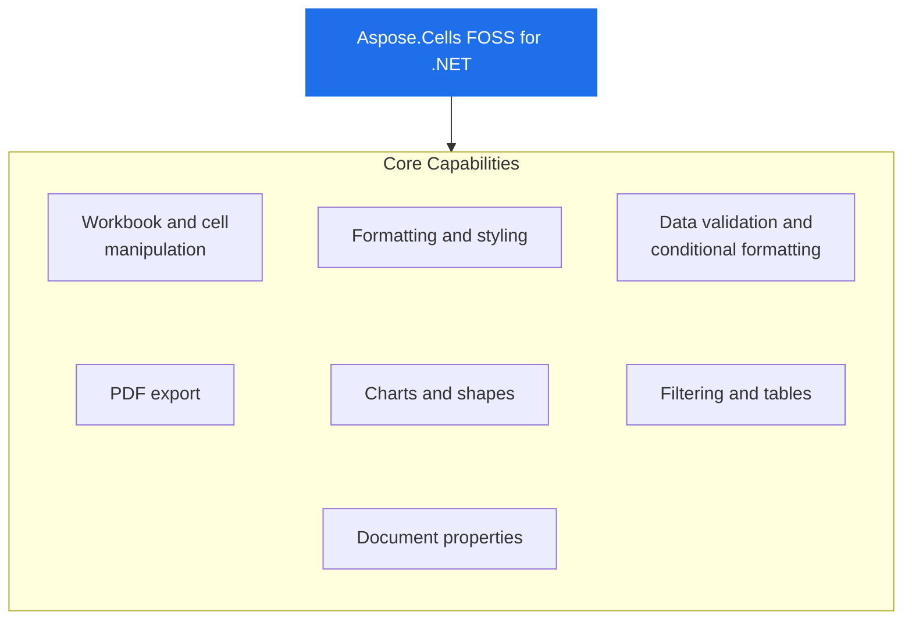

# Aspose.Cells FOSS for .NET

[](https://www.nuget.org/packages/Aspose.Cells.FOSS/)  [](LICENSE.txt) [](https://github.com/aspose-cells-foss/Aspose.Cells-FOSS-for-.NET/graphs/contributors) [](https://github.com/aspose-cells-foss/Aspose.Cells-FOSS-for-.NET/issues)

[](https://products.aspose.org/cells/net/)

Aspose.Cells FOSS for .NET reads Excel files in the .xlsx format and writes Excel and PDF files. It converts workbooks to PDF using `PdfSaveOptions` and supports loading workbooks with `LoadOptions` to handle diagnostics and repair attempts. The product exposes core workbook and worksheet functionality through the `Workbook` class, which provides access to worksheets, cells, styles, and formatting features.

The package targets `net8.0` and requires .NET 8 or later. The NuGet package id is `Aspose.Cells.FOSS`; the public namespace is `Aspose.Cells_FOSS`.

## Navigation

- [At a Glance](#at-a-glance)
- [Key Capabilities](#key-capabilities)
- [Installation](#installation)
- [Dependencies](#dependencies)
- [Quick Start](#quick-start)
- [API Reference](#api-reference)
- [Documentation & Resources](#documentation--resources)
- [Scope and Limitations](#scope-and-limitations)
- [Development and Testing](#development-and-testing)
- [Third-Party Notices](#third-party-notices)
- [License](#license)

## At a Glance



## Key Capabilities

- **Workbook and cell manipulation.** It creates, loads, modifies, and saves Excel workbooks using the `Aspose.Cells_FOSS.Workbook`, `Worksheet`, `Cells`, and `Cell` classes, supporting scalar values, formulas, dates, and number formats.
- **Formatting and styling.** It applies formatting and styling to cells through the `Aspose.Cells_FOSS.Style`, `Font`, `Border`, and `Borders` classes, enabling control over background and foreground colors, font attributes, border styles, horizontal alignment, indentation, and cell locking.
- **Data validation and conditional formatting.** It enforces data validation and conditional formatting on worksheets using the `Aspose.Cells_FOSS.Validation`, `ValidationCollection`, and `ConditionalFormattingCollection` classes.
- **PDF export.** It exports workbooks to PDF using the `Aspose.Cells_FOSS.PdfSaveOptions` class and the `SaveFormat`.Pdf value.
- **Charts and shapes.** It adds and manipulates charts, pictures, and shapes on worksheets through the `Aspose.Cells_FOSS.Chart`, `ChartCollection`, `Picture`, and `ShapeCollection` classes.
- **Filtering and tables.** It applies filters and manages list objects (tables) on worksheets using the `Aspose.Cells_FOSS.AutoFilter`, `FilterColumn`, and `ListObject` classes.
- **Document properties.** It reads and writes built-in and custom document properties using the `Aspose.Cells_FOSS.DocumentProperties` and `ExtendedDocumentProperties` classes.

- Load malformed packages with recovery-oriented `LoadOptions` and inspect `LoadDiagnostics`.
- Apply styles including fonts, fills, borders, alignment, wrapping, and locking.
- Export workbooks to PDF with `SaveFormat.Pdf` or `PdfSaveOptions`.

## Installation

Install the published package from NuGet (`Aspose.Cells.FOSS`, version 26.10.0):

```bash
dotnet add package Aspose.Cells.FOSS
```

## Dependencies

### Required Package Dependencies

- `SkiaSharp 2.88.8`

### Native and System Requirements

- Requires .NET `net8.0` (`TargetFramework` in `src/Aspose.Cells_FOSS/Aspose.Cells_FOSS.csproj`).

## Quick Start

Load an existing workbook with repair-friendly options:

```csharp
using System;
using Aspose.Cells_FOSS;

var loadOptions = new LoadOptions
{
    TryRepairPackage = true,
    TryRepairXml = true,
    StrictMode = false
};

var workbook = new Workbook("input.xlsx", loadOptions);

if (workbook.LoadDiagnostics.HasDataLossRisk)
{
    Console.WriteLine("Potential data loss risk detected during load.");
}

workbook.Worksheets[0].Cells["A1"].PutValue("Updated");
workbook.Save("updated.xlsx");
```

## API Reference

Aspose.Cells FOSS for .NET provides core spreadsheet functionality through the `Aspose.Cells_FOSS.Workbook` class, which manages worksheets, and the `Aspose.Cells_FOSS.Worksheet` class, which organizes cells, styles, and content. It supports reading and writing Excel files and exporting to PDF.

The public API has 98 types.

<details>
<summary>View the Complete Public API Surface</summary>

### Core API

| Class | Description |
| --- | --- |
| `AutoFilter` | Represents auto filter. |
| `AutoFilterColorFilter` | Represents auto filter color filter. |
| `AutoFilterCustomFilter` | Represents auto filter custom filter. |
| `AutoFilterCustomFilterCollection` | Represents a collection of auto filter custom filter objects. |
| `AutoFilterDynamicFilter` | Represents auto filter dynamic filter. |
| `AutoFilterSortCondition` | Represents auto filter sort condition. |
| `AutoFilterSortConditionCollection` | Represents a collection of auto filter sort condition objects. |
| `AutoFilterSortState` | Represents auto filter sort state. |
| `AutoFilterTop10` | Represents auto filter top10. |
| `Border` | Represents border. |
| `Borders` | Represents borders. |
| `CalculationProperties` | Represents calculation properties. |
| `Cell` | Represents a single worksheet cell and exposes value, formula, and style operations. |
| `CellArea` | Represents cell area. |
| `Cells` | Provides access to worksheet cells, rows, columns, and merged ranges. |
| `CellsException` | Represents an error that occurs during cells. |
| `Chart` | Represents a chart embedded in a worksheet. |
| `ChartCollection` | Represents collection of charts on a worksheet. |
| `Color` | Represents color. |
| `Column` | Represents column. |
| `ColumnCollection` | Represents a collection of column objects. |
| `Comment` | Represents a worksheet comment (legacy note) anchored to a single cell. |
| `CommentCollection` | Represents the collection of comments (legacy notes) on a worksheet. |
| `ConditionalFormattingCollection` | Represents a collection of conditional formatting objects. |
| `CoreDocumentProperties` | Represents core document properties. |
| `DefinedName` | Represents defined name. |
| `DefinedNameCollection` | Represents a collection of defined name objects. |
| `DocumentProperties` | Represents document properties. |
| `ExtendedDocumentProperties` | Represents extended document properties. |
| `FilterColumn` | Represents filter column. |
| `FilterColumnCollection` | Represents a collection of filter column objects. |
| `FilterValueCollection` | Represents a collection of filter value objects. |
| `Font` | Represents font. |
| `FontSetting` | Represents a range of characters within a cell's rich text. |
| `FormatCondition` | Represents format condition. |
| `FormatConditionCollection` | Represents a collection of format condition objects. |
| `FormulaException` | Represents an error that occurs during formula. |
| `Hyperlink` | Represents hyperlink. |
| `HyperlinkCollection` | Encapsulates the hyperlinks defined for a worksheet. |
| `IWarningCallback` | Defines a callback that receives load warnings. |
| `InvalidFileFormatException` | Represents an error that occurs during invalid file format. |
| `ListColumn` | Represents a single column in an Excel table. |
| `ListColumnCollection` | Represents the ordered collection of columns in an Excel table. |
| `ListObject` | Represents an Excel table (structured reference / ListObject). |
| `ListObjectCollection` | Represents the collection of Excel tables on a worksheet. |
| `LoadDiagnostics` | Represents load diagnostics. |
| `LoadIssue` | Represents load issue. |
| `LoadOptions` | Specifies how a workbook should be loaded. |
| `NumberFormat` | Provides number format operations. |
| `PageSetup` | Represents worksheet print and page-layout settings. |
| `PdfSaveOptions` | Options controlling XLSX-to-PDF rendering. |
| `Picture` | Represents a picture (image) anchored to a worksheet. |
| `PictureCollection` | Represents collection of pictures anchored to a worksheet. |
| `Row` | Represents row. |
| `RowCollection` | Represents a collection of row objects. |
| `SaveOptions` | Specifies how a workbook should be saved. |
| `Shape` | Represents a drawing object (auto shape) anchored to a worksheet. |
| `ShapeCollection` | Represents collection of drawing objects (shapes) on a worksheet. |
| `Style` | Represents a mutable cell style facade that can be applied to one or more cells. |
| `StyleException` | Represents an error that occurs during style. |
| `StyleFlag` | Represents flags which indicate applied formatting properties. |
| `UnsupportedFeatureException` | Represents an error that occurs during unsupported feature. |
| `Validation` | Represents validation. |
| `ValidationCollection` | Represents a collection of validation objects. |
| `WarningInfo` | Represents warning info. |
| `Workbook` | Represents the root spreadsheet object used to create, load, modify, and save an XLSX workbook. |
| `WorkbookLoadException` | Represents an error that occurs during workbook load. |
| `WorkbookProperties` | Represents workbook properties. |
| `WorkbookProtection` | Represents workbook protection. |
| `WorkbookSaveException` | Represents an error that occurs during workbook save. |
| `WorkbookSettings` | Represents workbook-level settings that affect date handling and display formatting. |
| `WorkbookView` | Represents workbook view. |
| `Worksheet` | Encapsulates a single worksheet and its supported v0.1 worksheet features. |
| `WorksheetCollection` | Encapsulates the workbook's worksheets and active-sheet state. |
| `WorksheetProtection` | Represents worksheet protection. |

#### Enumerations

| Enumeration | Description |
| --- | --- |
| `AutoShapeType` | Specifies the type of an auto shape (preset geometry). |
| `BorderStyleType` | Specifies border style type. |
| `CellValueType` | Specifies cell value type. |
| `ChartType` | Specifies the chart type. |
| `DiagnosticSeverity` | Specifies diagnostic severity. |
| `FillPattern` | Specifies fill pattern. |
| `FilterOperatorType` | Specifies filter operator type. |
| `FontUnderlineType` | Enumerates font underline types. |
| `FormatConditionType` | Specifies format condition type. |
| `HorizontalAlignmentType` | Specifies horizontal alignment type. |
| `ImageType` | Represents the format of an image stored in a worksheet. |
| `LoadFormat` | Specifies load format. |
| `OperatorType` | Specifies operator type. |
| `PageOrientationType` | Specifies page orientation type. |
| `PaperSizeType` | Specifies paper size type. |
| `SaveFormat` | Specifies save format. |
| `TableStyleType` | Represents the built-in Excel table style types. |
| `TargetModeType` | Specifies target mode type. |
| `TotalsCalculation` | Represents the aggregation function shown in a table totals row cell. |
| `ValidationAlertType` | Specifies validation alert type. |
| `ValidationType` | Specifies validation type. |
| `VerticalAlignmentType` | Specifies vertical alignment type. |
| `VisibilityType` | Specifies visibility type. |

#### Detailed Member Reference

### Workbook

The `Aspose.Cells_FOSS.Workbook` class represents a spreadsheet file and provides access to its worksheets via the Worksheets collection, defined names via `DefinedNames`, settings via Settings, document properties via `DocumentProperties`, and load diagnostics via `LoadDiagnostics`; it exposes methods to save the file and dispose resources.

- `DefinedNames`: Gets the workbook-defined names collection.
- `Dispose`: Releases resources associated with the workbook instance.
- `DocumentProperties`: Gets the document properties facade for core and extended metadata.
- `LoadDiagnostics`: Gets diagnostics collected while loading the current workbook.
- `Properties`: Gets workbook metadata and view settings exposed by the supported public API.
- `Settings`: Gets workbook-level settings such as the date system and display culture.
- `Workbook`: Initializes a new workbook with one default worksheet.
- `Worksheets`: Gets the worksheets in workbook order.

### Style

The `Aspose.Cells_FOSS.Style` class defines cell formatting through properties such as `Font`, `Borders`, `BackgroundColor`, `ForegroundColor`, `HorizontalAlignment`, `IndentLevel`, `IsHidden`, and `IsLocked`; it provides methods to copy and compare styles.

- `BackgroundColor`: Gets or sets the fill background color.
- `Borders`: Gets border settings.
- `Copy`: Copies data from another style object.
- `Custom`: Gets or sets the custom number format code.
- `Equals`: Determines whether two style instances are equal.
- `Font`: Gets the font settings.
- `ForegroundColor`: Gets or sets the fill foreground color.
- `GetHashCode`: Serves as a hash function for a style object.
- `HorizontalAlignment`: Gets or sets the horizontal alignment.
- `IndentLevel`: Gets or sets the indentation level.
- `IsHidden`: Gets or sets whether the cell formula is hidden when worksheet protection is enabled.
- `IsLocked`: Gets or sets whether the cell is locked when worksheet protection is enabled.
- `Number`: Gets or sets the numeric format identifier.
- `NumberFormat`: Gets or sets the resolved number format string.
- `Pattern`: Gets or sets the fill pattern.
- `QuotePrefix`: Gets or sets whether the cell value starts with a single quote mark.
- `ReadingOrder`: Gets or sets the reading order.
- `RelativeIndent`: Gets or sets the relative indent.
- `ShrinkToFit`: Gets or sets whether the cell content shrinks to fit.
- `Style`: Initializes a new style with default font and border objects.
- `TextRotation`: Gets or sets the text rotation.
- `VerticalAlignment`: Gets or sets the vertical alignment.
- `WrapText`: Gets or sets whether text wraps within the cell.

### Validation

The `Aspose.Cells_FOSS.Validation` class represents data validation rules applied to cells, and the `Aspose.Cells_FOSS.ValidationCollection` class manages these rules on a worksheet alongside the `Aspose.Cells_FOSS.ConditionalFormattingCollection` class for conditional formatting rules.

- `AddArea`: Adds the specified item.
- `AlertStyle`: Gets or sets the alert style.
- `Areas`: Gets the areas.
- `ErrorMessage`: Gets or sets the error message.
- `ErrorTitle`: Gets or sets the error title.
- `Formula1`: Gets or sets the formula1.
- `Formula2`: Gets or sets the formula2.
- `IgnoreBlank`: Gets or sets a value indicating whether ignore blank.
- `InCellDropDown`: Gets or sets a value indicating whether in cell drop down.
- `InputMessage`: Gets or sets the input message.
- `InputTitle`: Gets or sets the input title.
- `Operator`: Gets or sets the operator.
- `RemoveArea`: Removes the specified item.
- `ShowError`: Gets or sets a value indicating whether show error.
- `ShowInput`: Gets or sets a value indicating whether show input.
- `Type`: Gets or sets the type.

### PdfSaveOptions

The `Aspose.Cells_FOSS.PdfSaveOptions` class configures options for exporting a workbook to PDF, and the `Aspose.Cells_FOSS.SaveFormat` enum specifies Pdf as one of the supported output formats.

- `AllColumnsInOnePagePerSheet`: Gets or sets whether all columns of each worksheet are rendered on a single page width.
- `CompactStyles`: Gets or sets whether equivalent styles should be compacted during save.
- `ConditionalFormattingEvaluationDate`: Gets or sets the date used to evaluate relative-date conditional formatting rules during PDF export.
- `DefaultFont`: Gets or sets the fallback font family used when a cell's configured font cannot be resolved on the host system.
- `OnePagePerSheet`: Gets or sets whether all content of each worksheet is rendered onto a single PDF page.
- `PdfSaveOptions`: Initializes a new instance of the PdfSaveOptions class with SaveFormat set to Pdf.
- `PreserveRecoveryMetadata`: Gets or sets whether recovery metadata should be preserved in the saved workbook.
- `SaveFormat`: Gets or sets the output file format.
- `UseSharedStrings`: Gets or sets whether shared strings should be used for string cells.
- `ValidateBeforeSave`: Gets or sets whether the workbook should be validated before save.

### Chart

The `Aspose.Cells_FOSS.Chart` class represents a chart object on a worksheet, and the `Aspose.Cells_FOSS.ChartCollection` class manages charts via the Charts property of a worksheet; pictures and shapes are managed via the Pictures and Shapes properties of a worksheet.

- `ChartType`: Gets the chart type.
- `ExtentCx`: Gets the width extent in EMU.
- `ExtentCy`: Gets the height extent in EMU.
- `LowerRightColumn`: Gets the zero-based lower-right column of the chart anchor.
- `LowerRightRow`: Gets the zero-based lower-right row of the chart anchor.
- `Name`: Gets the chart display name.
- `UpperLeftColumn`: Gets the zero-based upper-left column of the chart anchor.
- `UpperLeftRow`: Gets the zero-based upper-left row of the chart anchor.

### AutoFilter

The `Aspose.Cells_FOSS.AutoFilter` class manages filtering on a worksheet via the `AutoFilter` property, and the `Aspose.Cells_FOSS.FilterColumn` class defines filter criteria for individual columns; the `Aspose.Cells_FOSS.ListObject` class represents a table-like list object.

- `Clear`: Clears the current state.
- `FilterColumns`: Gets the filter columns.
- `Range`: Gets or sets the range.
- `SortState`: Gets the sort state.

### DocumentProperties

The `Aspose.Cells_FOSS.DocumentProperties` class provides access to built-in document properties, and the `Aspose.Cells_FOSS.ExtendedDocumentProperties` class manages custom document properties.

- `Author`: Gets or sets the author.
- `Category`: Gets or sets the category.
- `Comments`: Gets or sets the comments.
- `Company`: Gets or sets the company.
- `Core`: Gets the core.
- `Extended`: Gets the extended.
- `Keywords`: Gets or sets the keywords.
- `Manager`: Gets or sets the manager.
- `Subject`: Gets or sets the subject.
- `Title`: Gets or sets the title.

</details>

## Documentation & Resources

- **[samples/](samples/README.md)** — In this repository.
- **[Local documentation landing page](documentation/_site/index.html)** — In this repository.
- **[Contributor and agent instructions](agents.md)** — In this repository.
- Found a bug or have a feature request? [Open an issue](https://github.com/aspose-cells-foss/Aspose.Cells-FOSS-for-.NET/issues).

## Scope and Limitations

The `netstandard2.0` target has been removed. Applications targeting .NET Framework, .NET Core, or .NET 5-7 must upgrade to .NET 8 or later, or remain on a previous compatible package version.

Runnable samples live under [`samples/`](samples/README.md). Feature areas currently covered include:

- basic workbook and cell operations
- load and repair behavior
- styles
- worksheet settings
- validations
- conditional formatting
- hyperlinks and defined names
- page setup
- comments
- charts
- list objects
- pictures
- document properties
- shapes
- PDF conversion

- Only `.xlsx` is supported as the spreadsheet file format for load and save.
- The library stores formulas but does not include a formula calculation engine.
- PDF export is supported, but there is no general HTML export or image export API.
- Macros, VBA, and pivot tables are outside the supported public API surface.
- Broader format coverage and richer spreadsheet features belong to the commercial Aspose.Cells product line.

<details>
<summary>View Other Unimplemented Members</summary>

- `FormulaException` is declared but unused by the library's own code.
- `StyleException` is declared but unused by the library's own code.

</details>

See [Aspose.Cells for .NET — Enterprise Edition](https://products.aspose.com/cells/net/). It adds support for additional file formats, advanced rendering features, and enterprise-grade support and licensing options.

## Development and Testing

```xml
<PackageReference Include="Aspose.Cells.FOSS" Version="26.10.0.0" />
```

Run one sample from the repository root:

```bash
dotnet run --project samples\Aspose.Cells_FOSS.Samples.Basic\Aspose.Cells_FOSS.Samples.Basic.csproj
```

- [Local documentation landing page](documentation/_site/index.html)
- [Samples overview](samples/README.md)
- V26.10.0 release notes
- [Contributor and agent instructions](agents.md)

Building from source requires the .NET 8 SDK or a newer SDK capable of targeting `net8.0`. The library and samples target `net8.0`.

```bash
dotnet build src\Aspose.Cells_FOSS\Aspose.Cells_FOSS.csproj -c Debug
```

```bash
dotnet build samples\Aspose.Cells_FOSS.Samples.Basic\Aspose.Cells_FOSS.Samples.Basic.csproj -c Debug
```

This checkout does not contain a `tests/` directory. These builds check compilation; they do not provide automated behavioral test coverage.

This project is licensed under the [MIT License](License/LICENSE.txt).

## Third-Party Notices

See [Third-party notices](License/ThirdPartyNotices.txt).

## License

This project is licensed under the [MIT License](LICENSE.txt). The MIT License permits use, copying, modification, distribution, sublicensing, and commercial use, provided its copyright and permission notice are retained. The software is provided without warranty.
