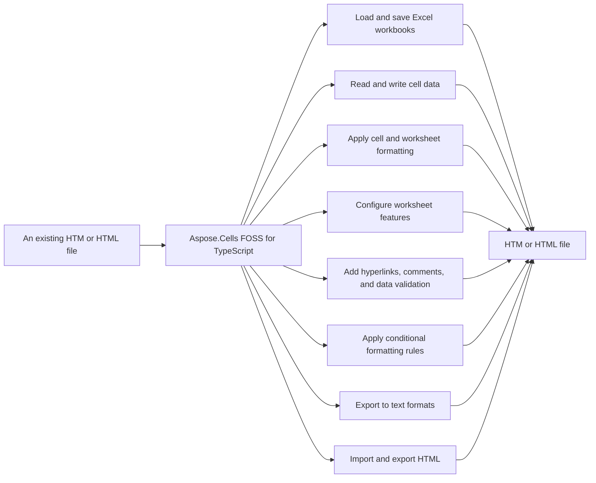

# Aspose.Cells FOSS for TypeScript

[](License/LICENSE.txt) [](https://github.com/aspose-cells-foss/Aspose.Cells-FOSS-for-TypeScript/graphs/contributors)

[](https://products.aspose.org/cells/typescript/)

Aspose.Cells FOSS for TypeScript reads and writes Excel files using the .xlsx format. It converts workbooks to `.html` and `.htm` files for output, and loads `.html` and `.htm` files as input. It provides methods to create, modify, and save workbooks, including setting cell values and formulas, applying styles, and managing worksheet elements such as comments, hyperlinks, data validation, and conditional formatting.

## Navigation

- [At a Glance](#at-a-glance)
- [Key Capabilities](#key-capabilities)
- [Installation](#installation)
- [Dependencies](#dependencies)
- [Quick Start](#quick-start)
- [Additional Examples](#additional-examples)
- [API Reference](#api-reference)
- [Documentation & Resources](#documentation--resources)
- [Scope and Limitations](#scope-and-limitations)
- [Development and Testing](#development-and-testing)
- [License](#license)

## At a Glance



## Key Capabilities

- **Load and save Excel workbooks.** It loads Excel workbooks from a file path using `Workbook.load` and saves them with `Workbook.save`, and it constructs new workbooks with `Workbook.constructor`.
- **Read and write cell data.** It reads and writes cell values and formulas using `Cell.putValue` and `Cell.setFormula`, and retrieves cells by reference or coordinate with `Worksheet.getCell2`, exposing their value and formula properties.
- **Apply cell and worksheet formatting.** It applies formatting to cells using `Style`, `Font`, `Fill`, `Border`, `Alignment`, and `Protection` objects, assigning them via `Cell.setStyle`.
- **Configure worksheet features.** It configures worksheet layout and behavior by setting column widths and row heights, merging cells, hiding rows, and enabling auto filters through `Worksheet` methods.
- **Add hyperlinks, comments, and data validation.** It adds hyperlinks, comments, and data validation to worksheets using `Worksheet.addHyperlink`, `Worksheet.addComment`, and `Worksheet.addDataValidation`, referencing `Hyperlink` and `Comment` objects.
- **Apply conditional formatting rules.** It applies conditional formatting rules to cell ranges using `Worksheet.addConditionalFormat` with `ColorScaleRule`, `DataBarRule`, and `IconSetRule` objects.
- **Export to text formats.** It exports workbook data as text using `Workbook.toCsv`, `Workbook.toJson`, and `Workbook.toMarkdown`, each returning a string representation of the data.
- **Import and export HTML.** It imports HTML files with `Workbook.load` and exports workbooks to HTML using `Workbook.toHtml`, supporting the `.html` format for both input and output.

## Installation

`excel-cells` is not yet published on npm; build it from a source checkout instead:

```bash
git clone https://github.com/aspose-cells-foss/Aspose.Cells-FOSS-for-TypeScript.git
cd Aspose.Cells-FOSS-for-TypeScript
npm install
```

## Dependencies

### Required Package Dependencies

- `adm-zip ^0.5.16`
- `@xmldom/xmldom ^0.8.10`
- `@zip.js/zip.js ^2.8.21`

### Development Dependencies

- `ts-node ^10.9.2`
- `tsx ^4.21.0`
- `@types/node ^25.3.3`
- `typescript ^5.9.3`

## Quick Start

Create a new Excel file with product data and formatted headers, then save it as `products.xlsx`.

```typescript
import { Workbook, Style } from "./aspose_cells";

const workbook = new Workbook();
const sheet = workbook.worksheets.get(0)!;

sheet.name = "Products";
sheet.putValue("A1", "Product");
sheet.putValue("B1", "Price");
sheet.putValue("A2", "Apple");
sheet.putValue("B2", 2.99);
sheet.putValue("A3", "Orange");
sheet.putValue("B3", 1.99);
const cellB4 = sheet.getCell2("B4");
cellB4.setFormula("=SUM(B2:B3)");

const headerStyle = new Style();
headerStyle.setBold(true);
headerStyle.setFontColor("FFFFFFFF");
headerStyle.setForegroundColor("FF2278D4");

sheet.getCell2("A1").setStyle(headerStyle);
sheet.getCell2("B1").setStyle(headerStyle);

await workbook.save("products.xlsx");
```

Load an existing Excel file, update a cell value, and save the changes to `updated.xlsx`.

```typescript
import { Workbook } from "./aspose_cells";

const workbook = await Workbook.load("input.xlsx");
const sheet = workbook.worksheets.get(0)!;

sheet.getCell2("A1").putValue("Updated");

await workbook.save("updated.xlsx");
```

## Additional Examples

Aspose.Cells FOSS for TypeScript supports loading Excel workbooks and saving them as HTML. The following examples demonstrate common workflows.

### Load an Excel File and Save It as HTML

```typescript
import { Workbook } from "./aspose_cells";

const workbook = await Workbook.load("input.xlsx");
await workbook.save("output.html", { saveFormat: undefined });
```

Runnable examples for every major feature area are collected in
[`examples/`](examples/), covering the full surface below.

## API Reference

Aspose.Cells FOSS for TypeScript provides the `Workbook` class as the main entry point for working with Excel files, and the `Worksheet`, `Cell`, and `Style` classes for manipulating individual sheets, cells, and formatting. It supports loading and saving Excel files and converting them to other formats.

The verified public surface has 31 types.

<details>
<summary>View the Complete Public API Surface</summary>

### Core API

| Class | Description |
| --- | --- |
| `Alignment` | Alignment represents the alignment settings for cell content. |
| `AutoFilter` | AutoFilter provides filtering capabilities for a range of cells in a worksheet. |
| `Border` | Border defines the border properties for a cell or range of cells. |
| `BorderLine` | BorderLine specifies the style and color of a border line. |
| `Cell` | Cell represents a single cell in a worksheet. |
| `CellCoordinates` | CellCoordinates holds the row and column indices of a cell. |
| `CellRange` | CellRange defines a rectangular range of cells in a worksheet. |
| `CellValue` | CellValue represents the data stored in a cell. |
| `Cells` | Cells is a collection of Cell objects in a worksheet. |
| `ColorScaleRule` | ColorScaleRule applies a color scale conditional formatting to a range of cells. |
| `Comment` | Comment represents a comment attached to a cell. |
| `CommentCollection` | CommentCollection is a collection of Comment objects in a worksheet. |
| `ConditionalFormat` | ConditionalFormat applies conditional formatting rules to a range of cells. |
| `ConditionalFormatCollection` | ConditionalFormatCollection is a collection of ConditionalFormat objects in a worksheet. |
| `ConditionalFormatRule` | ConditionalFormatRule defines a rule for conditional formatting. |
| `DataBarRule` | DataBarRule applies a data bar conditional formatting to a range of cells. |
| `DataValidation` | DataValidation enforces data entry restrictions on a range of cells. |
| `DataValidationCollection` | DataValidationCollection is a collection of DataValidation objects in a worksheet. |
| `Fill` | Fill defines the fill properties for a cell or range of cells. |
| `FilterColumn` | FilterColumn represents a filtered column in an AutoFilter range. |
| `Font` | Font specifies the font properties for text in a cell. |
| `Hyperlink` | Hyperlink represents a hyperlink attached to a cell. |
| `HyperlinkCollection` | HyperlinkCollection is a collection of Hyperlink objects in a worksheet. |
| `IconSetRule` | IconSetRule applies an icon set conditional formatting to a range of cells. |
| `Protection` | Protection specifies the protection settings for a cell. |
| `Style` | Style defines the formatting style for a cell or range of cells. |
| `Workbook` | Workbook represents an Excel workbook. |
| `Worksheet` | Worksheet represents a worksheet in a workbook. |
| `WorksheetCollection` | WorksheetCollection is a collection of Worksheet objects in a workbook. |

#### Enumerations

| Enumeration | Description |
| --- | --- |
| `EncryptionType` | EncryptionType specifies the encryption algorithm used for a workbook. |
| `SaveFormat` | SaveFormat specifies the format used when saving a workbook. |

#### Detailed Member Reference

### Workbook

The `Workbook` class can be created using its constructor, loaded from a file using `Workbook.load`, and saved using `Workbook.save`. It exposes a worksheets collection for accessing individual worksheets, and provides methods to export the workbook to HTML, CSV, JSON, and Markdown formats.

### Worksheet

The `Worksheet` class provides methods to access and modify cell content and formatting, including `Worksheet.getCell2` to retrieve a cell, `Worksheet.putValue` to set a cell value, and `Worksheet.setCellStyle` to apply a style. It also supports adding hyperlinks, comments, data validation rules, conditional formats, and setting an auto filter.

### Cell

The `Cell` class allows reading and writing cell values, formulas, hyperlinks, and shared string map references. It supports setting cell style using `Cell.setStyle` and retrieving the underlying value, formula, hyperlink, and shared string map via their respective properties.

### Style

The `Style` class provides methods to configure font, fill, border, and alignment properties. It supports setting bold, font color, and foreground color, and exposes getters for alignment, border, fill, and font settings.

</details>

## Documentation & Resources

- **[Getting started guide](https://docs.aspose.org/cells/typescript/)** — The getting started guide covers installation, walkthroughs, and feature guides for this library.
- **[How-to guides & FAQ](https://kb.aspose.org/cells/typescript/)** — The how-to guides and FAQ provide task-focused answers for common spreadsheet-processing questions.
- **[Full API reference](https://reference.aspose.org/cells/typescript/)** — The full API reference offers the complete, browsable reference for every public class. It covers all 31 verified public types; the [API Reference](#api-reference) section above covers the essentials.
- Found a bug or have a feature request? [Open an issue](https://github.com/aspose-cells-foss/Aspose.Cells-FOSS-for-TypeScript/issues).

## Scope and Limitations

Aspose.Cells FOSS for TypeScript reads and writes Excel files using the `Workbook` class, supporting export to CSV, JSON, and Markdown formats via `Workbook.toCsv`, `Workbook.toJson`, and `Workbook.toMarkdown`.

- Text export is available as a returned string, not as a direct file-write helper — pass the result of `Workbook.toCsv`, `Workbook.toJson`, or `Workbook.toMarkdown` to your own file-writing code, and there is no corresponding import path back into a `Workbook`.
- This limitation does not apply to Aspose.Cells for .NET — Enterprise Edition.
- The package excel-cells version 1.0.0 is installed via git clone and npm install from the `aspose-cells-foss/Aspose.Cells-FOSS-for-TypeScript` repository.

These limitations don't apply to [full-featured Aspose.Cells — Enterprise Edition](https://products.aspose.com/cells/). It adds a full commercial spreadsheet engine, broader format coverage, and active support beyond this FOSS TypeScript edition's own scope.

## Development and Testing

The toolchain requires Node.js 18 or later and TypeScript 5 or later, with dependencies handling ZIP containers, XML parsing, and ZIP entry operations. TypeScript compilation and type checking depend on type definitions and the TypeScript compiler, while running examples or tests directly uses runtime environments that support TypeScript execution. The package excel-cells version 1.0.0 is part of the `aspose-cells-foss/Aspose.Cells-FOSS-for-TypeScript` repository, and the examples/ directory contains test assets for validation.

A npm package has not been published yet. Install from source:

- `@zip.js/zip.js` ^2.8.21 — reads and writes the XLSX ZIP container.
- `@xmldom/xmldom` ^0.8.10 — parses and serializes the OOXML part XML.
- `adm-zip` ^0.5.16 — used alongside `@zip.js/zip.js` for ZIP entry handling.

- Requires Node.js 18 or later and TypeScript 5 or later.

- `@types/node` ^25.3.3, `typescript` ^5.9.3 — TypeScript compilation and type checking.
- `ts-node` ^10.9.2, `tsx` ^4.21.0 — running TypeScript examples/tests directly.

Build and type-check from the repository root:

```bash
npm install
npx tsc --noEmit
```

## License

This project is licensed under the [MIT License](License/LICENSE.txt). The MIT License permits use, copying, modification, distribution, sublicensing, and commercial use, provided its copyright and permission notice are retained. The software is provided without warranty.
